# Business Process Model and Notation ja prosessien mallintaminen

*Business Process Model and Notation*[^bpmn_2_spec] (BPMN) on *Object Management Groupin*[^omg]  (OMG) ylläpitämä kansainvälinen standardi liiketoimintaprosessien graafiseen mallintamiseen. Se on tarkoitettu yhteiseksi välineeksi liiketoiminta-analyytikoille, ohjelmistokehittäjille ja muille prosessien parissa työskenteleville sidosryhmille. BPMN:n visuaalinen esitystapa pyrkii mahdollistamaan prosessien kuvaamisen johdonmukaisella ja helposti ymmärrettävällä tavalla ja siten parantamaan kommunikaatiota liiketoiminnan ja IT:n välillä[^bpmn_pituus]. Graafiset BPMN-mallit ovat esitettävissä myös XML:ään (Extensible Markup Language) perustuvalla koneluettavalla kielellä (BPMN XML), jota käyttäen prosessimallit ovat automatisoitavissa eli suoritettavissa prosessimoottoreiksi kutsuttavilla ohjelmistoilla.

[^bpmn_2_spec]: https://www.omg.org/spec/BPMN/2.0/

[^omg]: https://www.omg.org/

[^bpmn_pituus]: Tosin BPMN 2.0 -standardin spesifikaatio itsessään on yli 500 sivua. https://www.omg.org/spec/BPMN/2.0/PDF

BPMN:n tarina käynnistyi 2000-luvun alkuvuosina, kun *Business Process Management Initiative* (BPMI) -niminen organisaatio alkoi kehittää standardia liiketoimintaprosessien kuvaamiseen. Alusta lähtien tavoitteena oli luoda graafinen esitystapa, joka olisi yhteensopiva prosessien suorittamisen ja automatisoinnin kanssa. BPMN:n ensimmäinen versio julkaistiin 2004. Seuraavana vuonna BPMI yhdistyi OMG:n kanssa, joka ryhtyi kehittämään BPMN:stä virallista, laajemmin hyväksyttyä standardia.

Vuosien 2006–2009 aikana julkaistut versiot keskittyivät pääasiassa prosessien kuvaamiseen graafisesti, ja koneellisesti suoritettavien prosessimallien tuki oli vielä melko rajallinen. Vuonna 2011 julkaistu BPMN 2.0 oli merkittävä kehitysharppaus. Samassa yhteydessä julkaistun uuden metamallin tarkkuus mahdollisti prosessimallien koneellisen tulkinnan ja automaattisen suorittamisen. Mallinnuskielen elementtien valikoima kasvoi ja virallinen XML-pohjainen tiedostomuoto julkistettiin. BPMN 2.0 on edelleen kielen nykyinen versio, ja siihen on toistaiseksi julkaistu ainoastaan joitain pieniä korjauksia ja selvennyksiä. Versionumeroinnin desimaaleja tarkemmin tarkasteltaessa BPMN:n viimeisin versio tätä kirjoitettaessa on 2.0.2 ja se julkaistiin tammikuussa 2014. Se tunnetaan myös ISO/IEC -standardina numerolla 19510 ja nimellä Information technology – Object Management Group Business Process Model and Notation[^bpmn_iso].

[^bpmn_iso]: Edition 1 vuodelta 2013 https://www.iso.org/standard/62652.html

BPMN on paitsi virallinen standardi myös de facto -standardi liiketoimintaprosessien mallinnuksessa, organisaatioiden sisäisessä kehitystyössä, prosessien optimoinnissa, digitaalisessa transformaatiossa sekä prosessien automatisoinnissa ja monitoroinnissa. Tätä mallinnuskieltä tukevat lukuisat työvälineet, joista yksi on tämän luvun prosessiesimerkeissäkin käytetty Camunda Modeler[^camunda].

[^camunda]: https://camunda.com/platform/modeler/

Seuraavissa alaluvuissa käydään läpi BPMN 2.0:n ominaisuuksia prosessien graafisessa mallintamisessa. Vaikka niissä käsitellään BPMN-kieli kokonaisuudessaan, todettakoon, että varsin pieni osajoukko kielen elementtejä riittää varsin pitkälle yksikertaisten ja ainoastaan ihmisten luettaviksi tarkoitettujen prosessien suunnittelussa, dokumentoinnissa ja viestinnässä. BPMN sisältää kuitenkin useita hienostuneempia elementtejä ja ominaisuuksia monimutkaisempien ja yksityiskohtaisempien prosessikulkujen esittämiseksi sekä niiden automatisoimiseksi.

Ennen syvään päätyyn sukeltamista, palataan vielä kerran hetkeksi pizzatilausesimerkkin [@fig-pizzatilaus.svg] pariin.

{#fig-pizzatilaus.svg fig-alt="Klassinen esimerkki pizzatilauksen prosessista."}

Esimerkissä on kaksi uima-allasta eli kaksi erillistä toimijaa: asiakas ja pizzeria. Pizzeria-altaan sisällä on kolme uimarataa eli roolia: asiakaspalvelija, kokki ja lähetti. Nämä on esitetty uimaratoina saman altaan sisällä, koska ne edustavat samaa toimijaa eli pizzeriaa. Jos pizzan toimittamiseen käytettäisiin ulkoista lähettipalvelua, tulisi se esittää prosessissa omana uima-altaanaan.

Laatikot esittävät prosessiin liittyvää tekemistä: *Tilaa pizza*, *Valmista pizza*, *Toimita pizza* ja niin edelleen. Kuten edellä todettiin, tehtävien nimeämisessä on suositeltavaa käyttää verbi-objekti-muotoa.

Tehtäviä yhdistävät nuolet esittävät prosessin kulkua eli sitä, missä järjestyksessä prosessin tehtävät etenevät. Katkoviivalla esitetyt nuolet ovat puolestaan tietovirtoja ja esittävät organisaatioiden välillä liikkuvaa tietoa. Prosessin suorittaminen voi siirtyä uima-altaasta toiseen, eli organisaatiolta toiselle, ainoastaan tietovirtojen kautta. Kun prosessi tapahtuu saman organisaation sisällä, eli saman altaan uimaradoilla, liikkuu tieto prosessikulun ja kontekstin mukana. Tällöin käytetään ainoastaan tavallisia prosessin kulkua esittäviä nuolia ja tarvittaessa data-assosiaatiosuhdetta. Saman uima-altaan sisällä ei siis voida käyttää tietovirtoja esittäviä katkonuolia, eikä uima-altaasta toiseen voida siirtyä muuten kuin tietovirtoja käyttäen.

Ympyrän muotoisilla symboleilla esitetään prosessin aikana toteutuvia tapahtumia. Tapahtumat eroavat tehtävistä siinä, että ne eivät ole tekemistä, jonka jokin prosessiin osallistuva toimija suorittaisi, vaan ne pikemminkin – nimensä mukaisesti – ”tapahtuvat”, ja signaalien tai herätteiden tapaan saavat aikaan muutoksen prosessin tilassa. Prosessin aloitus ja lopetus ovat tapahtumia. Aloituksen ja lopetuksen lisäksi tapahtumia voi esiintyä myös prosessikulun aikana. Pizzatilausesimerkissä on viisarikellon näköinen tapahtuma, joka on nimetty *60 minuuttia*. Tämä tapahtuma aktivoituu silloin, kun 60 minuuttia on kulunut. Tällöin prosessikulku etenee tapahtumaan liittyvää haaraa ja asiakas suorittaa tehtävän *Tiedustele pizzaa*. On myös mahdollista, että pizza toimitetaan asiakkaalle alle tunnissa, jolloin tapahtuma *60 minuuttia* ei ehdi toteutua. Tapahtumat ovatkin ehdollisia, ja niiden avulla prosessi voidaan saada reagoimaan myös poikkeustilanteisiin.

Vinoneliösymboleilla esitetään portteja, jotka määrittävät prosessin kulun haarautumista, yhdistymistä ja synkronointia. Näissä kohdissa tehdään päätös siitä, kuinka prosessin kulku etenee. Ne voivat esimerkiksi ohjata tilanteen mukaan prosessin vaihtoehtoisiin suuntiin tai ne voivat jakaa prosessin useampaan rinnakkain suoritettaan haaraan.

## Virrat ja yhteydet

Aloitetaan BPMN:n tarkempi läpikäynti käsittelemällä erilaiset nuolet ja viivat, joita käytetään graafisissa prosessimalleissa. Yhteys- tai liitosviivalla (*Association*) [@fig-association] ei oikeastaan ole muuta käyttöä kuin se, että sillä voidaan liittää huomauksia (*Text Annotation*) prosessimalliin tai johonkin sen osaan. Huomautukset sisältävät ainoastaan ihmisille tarkoitettua informaatiota, kuten prosessia koskevaa dokumentaatiota, eivätkä ne tai Association-suhde vaikuta prosessin kulkuun.

{#fig-association}

Vaikka prosessimalliin lisätyt huomautukset ja kommentit eivät mallia varsinaisesti kaunista, on niiden runsas käyttäminen kuitenkin suositeltavaa. Hankalasti seurattavia tai monimutkaisia prosessikulkuja voidaan dokumentoida ohjelmakoodin kommenttien tavoin. Prosessikehittäjät ja mallintajat voivat käyttää niitä jättääkseen toisilleen -- tai miksei itselleenkin -- kysymyksiä, huomautuksia tai selvennyksiä: ”Toimiiko tämä näin?”, ”Tämä kohta täytyy vielä varmistaa myymäläpäälliköiltä!”, ”Päivämäärämuuttujan arvo tulee Oraclesta jenkkimuodossa, käännetään tällä skriptillä suomalaiseen muotoon ja tallennetaan muuttajaan pvm.”

Dokumentaatio myös helpottaa prosessimallin ymmärtämistä silloin, kun prosessin katselija ei ole BPMN-kielen asiantuntija. Annotaatioiden avulla voidaan myös tehdä näkyväksi toimintoja, jotka eivät välttämättä prosessin graafisessa esityksessä tule esille. Tällaisia tapauksia ovat esimerkiksi myöhemmin käsiteltävät Script- ja Business Rule -tehtävät.

Toinen prosessimalleissa käytettävä assosiaatiosuhte on *Data Association*, jonka avulla voidaan esittää prosessin ja tietovaraston (*Data Store*) välillä toteutuvia tietovirtoja. Yhteyttä, jossa prosessista liikkuu tietoa tietovarastoon, kutsutaan nimellä *Data input Association*. Kun ilmaistaan tiedon siirtymistä tietovarastosta prosessille, yhteyttä kutsutaan nimellä *Data Output Association* (@fig-data_association). Data Storea ja Data Associationia käsitellään hieman tarkemmin luvussa 5.5.

{#fig-data_association}

*Sequence Flow* eli virta tai järjestysvirta ilmaisee, kuinka prosessi etenee ja missä järjestyksessä sen elementit luetaan. Virran avulla yhdistetään samaan prosessiin kuuluvat tapahtumat, tehtävät ja portit. Huomaa, että prosessin jokaisen elementin täytyy liittyä virralla vähintään yhteen toiseen elementtiin. Mikäli prosessin tehtävään ei johda virta, ei tehtävä voi tulla suoritetuksi. Vastaavasti prosessi jumiutuu tehtävään, josta ei lähde virtaa ulos. BPMN ei salli virran ylittävän uima-altaan reunoja. Prosessin kulku ei siis voi virrata organisaatiosta toiseen. Virta esitetään tavallisesti yhtenäisellä viivalla, jossa on nuolenkärki.

BPMN-kielessä virrasta eli Sequence Flow:sta on kaksi erikoisversiota: *Conditional Flow* eli ehdollinen virta sekä *Default Flow* eli oletusvirta. Conditional Flow on ehdollinen järjestysvirta, jota pitkin edetään vain, jos jokin määritelty ehto täyttyy. Sitä voidaan käyttää toteuttamaan *Exclusive*- ja *Inclusive* -päätösportteja vastaavaa toiminnallisuutta. Päätösportteja käsitellään myöhemmin tässä luvussa. Conditional Flow’n käyttö on kuitenkin melko harvinaista, koska sama logiikka voidaan esittää myös päätösportteja käyttäen. Conditional Flow ilmaistaan virtanuolen alussa olevalla valkoisella viistoneliöllä.

Default Flow’n avulla voidaan määritellä oletusvirta, jota seurataan, ellei mikään ehto täyty tai jos useampi ehto täyttyy saman aikaisesti. Default Flow ilmaistaan virtanuolta leikkaavalla vinolla poikkiviivalla. Oletusvirran määrittely on suositeltavaa aina päätösportteja käytettäessä. Sen avulla voidaan estää tilanne, jossa prosessi jäisi jumiin, mikäli mikään määritellyistä ehdoista ei täyty. Toki sama varmistus voidaan toteuttaa huolellisella if-else-rakenteen suunnittelulla, mutta oletusvirran käyttö on helppo tapa pelata varman päälle. (@fig-sec_def_cond)

{#fig-sec_def_cond}

*Message Flow* eli viestivirta tai tietovirta kuvaa viestintää prosessien ja organisaatioiden välillä. Viestivirtaa ei voi käyttää saman prosessin sisällä edes silloin, kun prosessin altaassa on useampia uimaratoja, eli samaan organisaatioon kuuluvia useampia toimijoita. Prosessin kulun siirtyessä saman altaan ratojen välillä, vaikka siirtymän yhteydessä siirtyisikin viestejä tai tietoa, käytetään Sequence Flow -virtaa. Message Flow’ta käytetään silloin, kun prosessi siirtyy altaasta toiseen (@fig-message_flow). Tällöin suorittamisen vastuu siirretään organisaatiolta tai prosessilta toiselle.

{#fig-message_flow}

## Tehtävät

*Task* (tai *Activity*) eli tehtävä esittää erilaisia prosessin aikana suoritettavia töitä tai tehtäviä. Nämä voivat esimerkiksi olla ihmisen suorittamia manuaalisia tai tietokoneen suorittamia automaattisia tehtäviä. Tehtävien avulla esitetään prosessin perusrakenne.

{#fig-perunankuorinta}

Tehtävät esitetään graafisesti tavallisesti suorakaiteen muotoisina nelikulmioina, joiden reunat on pyöristetty. Suorakaide, jossa ei ole mitään graafista tarkenninta (@fig-perunankuorinta), toimii yleiskäyttöisenä tehtävien kuvauselementtinä, eikä siihen liity suorittamista koskevia erityisiä lisätietoja. Laadittaessa prosessimalleja vaikkapa keskustelun tueksi, voidaan tällä elementillä esittää kaikki prosessiin kuuluvat tehtävät ja ilmaista tarvittavat erityispiirteet tehtävän nimessä. Esimerkiksi seuraavan prosessimallin (@fig-gen_activity) tehtävien nimistä on pääteltävissä, että prosessiin liittyy ohjelmistorajapinnan yli suoritettavia tietokoneen tekemiä tehtäviä sekä ihmisen suorittama tehtävä.

{#fig-gen_activity}

### Manual Task

Ihmisen suoritettavaksi tarkoitettuja tehtävätyyppejä on kaksi. *Manual Task* on täysin manuaalinen tehtävä, esimerkiksi paperidokumentin arkistointi tai verkkokaupassa tehtyyn tilaukseen kuuluvien tuotteiden pakkaaminen lähetettäväksi. Manual Task merkitään esimerkiksi kättelyasentoon ojennetun käden kuvalla (@fig-manual_task).

{#fig-manual_task}

### User Task

Myös *User Task* (@fig-user_task) ilmaisee ihmisen suorittamaa tehtävää. Se on kuitenkin tehtävä, joka on suoritetaan IT:n -- tyypillisesti jonkin ohjelmiston tai järjestelmän -- avulla. Erottelu manuaalisten ja IT-avusteisten tehtävien välillä johtuu siitä, että BPMN-kieltä voidaan käyttää automatisoitavien prosessien mallintamiseen, jolloin näillä kahdella ihmisen suorittamalla tehtävällä voi olla hyvinkin erilainen merkitys.

{#fig-user_task}

User Taskissa luetaan, käytetään tai tuotetaan tietoa ohjelmistoa käyttäen, esimerkiksi täyttämällä sähköinen lomake, kun taas Manual Task -tehtävät liittyvät tyypillisesti vuorovaikutukseen "fyysien maailman" kanssa.

### Script Task

*Script Task* -tehtävätyypillä esitetään tehtäviä, jotka suoritetaan prosessin aikana automaattisesti koodiskriptin avulla ilman ihmisen osallistumista. Käytännössä siis prosessikulun saapuessa Script Task -tehtävään, käynnistetään ennalta määritelty ohjelmakoodi, joka tavallisesti käsittelee prosessimuuttujiin tallennettuja arvoja.

Seuraavassa esimerkissä (@fig-tilauksen_hinnoittelu) on Script Task -tehtäviä käyttävä prosessikulku. Asiakkaalta laskutetaan 9,90 € toimitusmaksu ellei tilattujen tuotteiden hinta ole vähintään 100,00 €. Esimerkissä Camunda-ympäristössä suoritettavalle prosessille tilatun tuotteen yksikköhinnaksi annetaan 12,50 € ja niitä on tilattu kaksi kappaletta.

{#fig-tilauksen_hinnoittelu}

*Laske tilauksen hinta* -tehtävässä lasketaan tilauksen kokonaishinta kertomalla tilatun tuotteen `yksikkohinta` tilaukseen kuuluvien tuotteiden määrällä `maara`. Laskutoimitus määritellään Camundassa FEEL-skriptinä (*Friendly Enough Expression Language*), kuten (@fig-kokonaishinta).

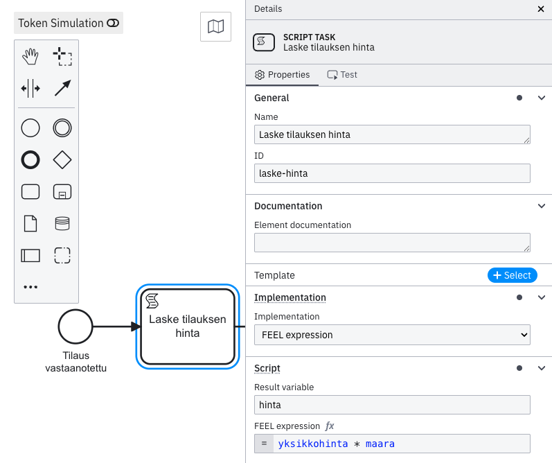{#fig-kokonaishinta}

BPMN-kielen graafisen esityksen taustalle prosessimallinnusvälineet tuottavat BPMN XML -muotosta XML-koodia. Edellinen yksinkertainen Zeebe-skripti näyttää tältä.

 `<zeebe:script expression="=yksikkohinta * maara" resultVariable="hinta" />`

Kokonaishinta tallennetaan tulosmuuttujaan `resultVariable` nimellä `hinta`. *Laske tilauksen hinta* -tehtävää seuraavassa portissa muuttujan arvo tarkastetaan. Koska tilauksen hinta jää alle sadan euron (2 * 12,50 = 25,00), tilaukseen lisätään toimitusmaksu (@fig-lisataan_toimitusmaksu).

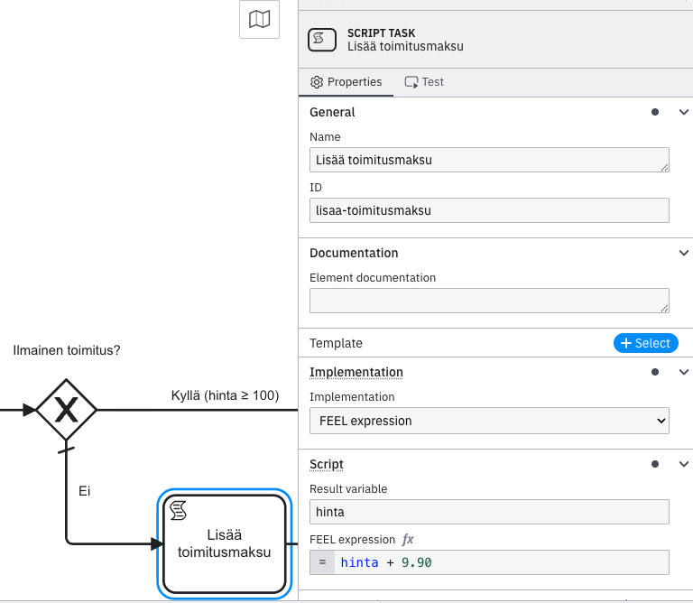{#fig-lisataan_toimitusmaksu}

Kun prosessi suoritetaan Camundan ajoympäristössä edellisillä muuttujien arvoilla, se tuottaa seuraavan lopputuloksen (@fig-tilaus_runtime). Koska tilaukseen lisättiin toimitusmaksu, tuli tilauksen hinnaksi 34,90 €.

{#fig-tilaus_runtime}

### Väliyhteenveto

Seuraavassa tilauksen käsittelyn prosessimallissa käytetään kaikkia kolme tähän mennessä esiteltyä tehtävätyyppiä (@fig-tilauksen-kasittely-valiyhtveto).

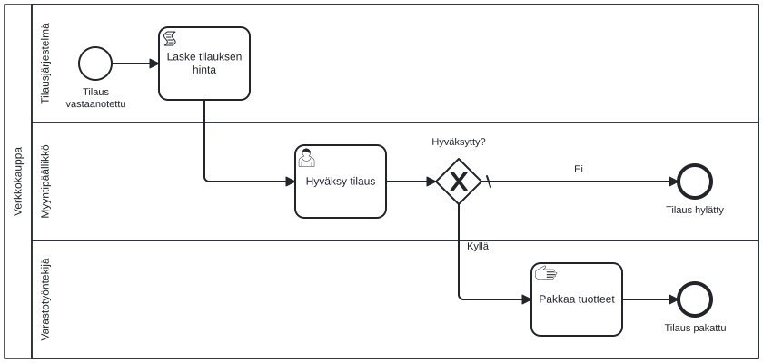{#fig-tilauksen-kasittely-valiyhtveto}

Ensimmäinen tehtävä, Laske tilauksen hinta, on Script Task, jossa tilauksen kokonaishinta muodostetaan suorittamalla skripti, kuten edellä. Seuraava tehtävä on User Task, jossa myymäläpäällikkö tekee päätöksen siitä, hyväksytäänkö saapunut tilaus vai täytyykö se jostain syystä hylätä. Esimerkissä tilausten hyväksynnän voidaan ajatella tapahtuvan tilaustenhallintajärjestelmässä, jota myymäläpäällikkö käyttää. Mikäli tilaus hyväksytään, varastotyöntekijä poimii tilatut tuotteet varastosta ja pakkaa ne lähetettäväksi. Tuotteiden pakkaaminen on tyypiltään Manual Task.

### Service Task

*Service Task* (@fig-service_task) on tehtävätyyppi, jota käytetään, kun prosessissa halutaan suorittaa jokin tehtävä ulkoisen palvelun avulla. Script Task -tehtävään verrattuna ero on siinä, että Service Task kutsuu nimenomaan ulkoista palvelua esimerkiksi API-rajapinnan yli, eikä suorita prosessiin paikallisesti kiinnitettyä ohjelmakoodia. Service Task siis usein toteuttaakin prosessin integraation johonkin järjestelmään.

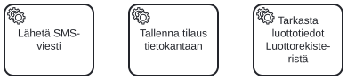{#fig-service_task}

Seuraavassa esimerkissä (@fig-ytunnus) käytetään Patentti- ja rekisterihallituksen Yritys- ja yhteisötietojärjestelmää[^ytj]

[^ytj]: https://www.ytj.fi/

{#fig-ytunnus}

Prosessi kytkeytyy YTJ-palveluun rajapinnan kautta ja välittää yritystunnuksen json-muotoisena kutsuna (@fig-service_task-maarittely). 

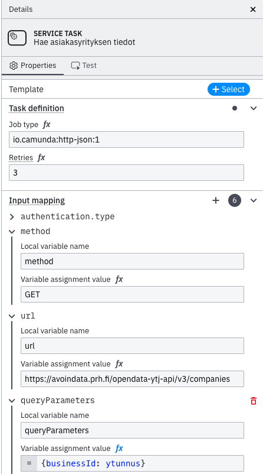{#fig-service_task-maarittely}

Kun prosessi suoritetaan, se kutsuu YTJ-palvelua, joka palauttaa yritystunnusta vastaavan yrityksen nimen (@fig-ytunnus_lopputulos).

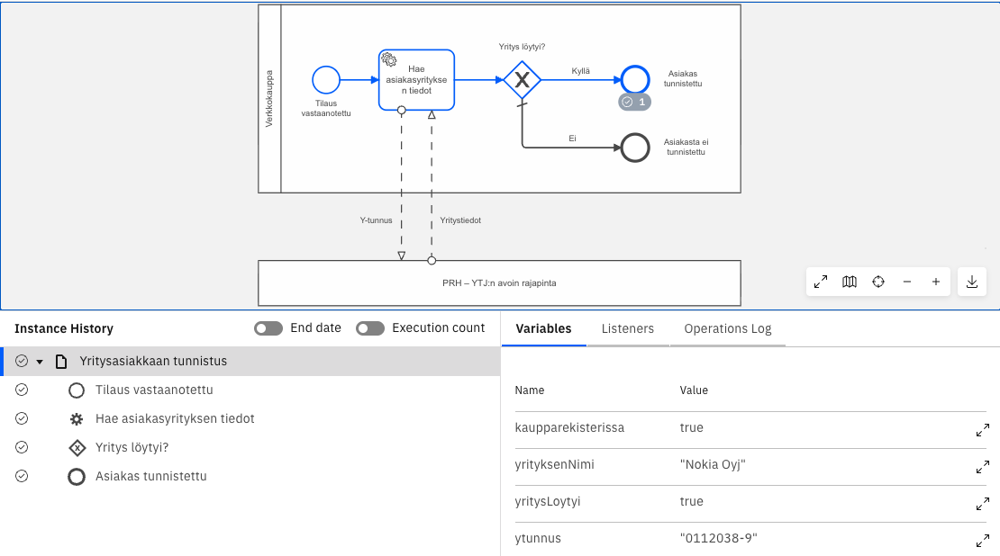{#fig-ytunnus_lopputulos}

### Business Rule Task

*Business Rule Taskin* avulla voidaan suorittaa automaattista sääntöperustaista päätöksentekoa. Päätössäännöt esitetään *Decision Model and Notation* (DMN) -muodossa, joka on standardoitu tapa mallintaa ja esittää päätöksiä[^dmn]. DMN:n avulla voidaan kuvata liiketoimintapäätöksiä yksiselitteisesti ja mallintaa päätöslogiikkaa myös ei-teknisten sidosryhmien ymmärtämässä muodossa. Erityisesti se myös mahdollistaa päätöstilanteiden automatisoimisen osana liiketoimintaprosesseja. Lisäksi DMN:lla voidaan esittää päätöksenteon kokonaisrakennetta (esimerkiksi mitkä päätökset vaikuttavat toisiinsa) ja määritellä taulukkomuotoisia (*Decision Tables*) sääntökokonaisuuksia ja ehtoja päätöksentekotilanteisiin.

[^dmn]: https://www.omg.org/dmn/

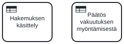{#fig-business_rule_task}

Päätöksen tekeminen tapahtuu niin, että tehtävään menee syötteenä joitain tietoja, joita verrataan ennalta määriteltyihin ehtoihin, joiden perusteella päätös tehdään. Prosessimuuttujille voidaan asettaa päätöksen mukaiset arvot ja prosessikulku etenee Business Rule Taskin jälkeen päätöstä vastaavasti (@fig-dmn-hakemus).

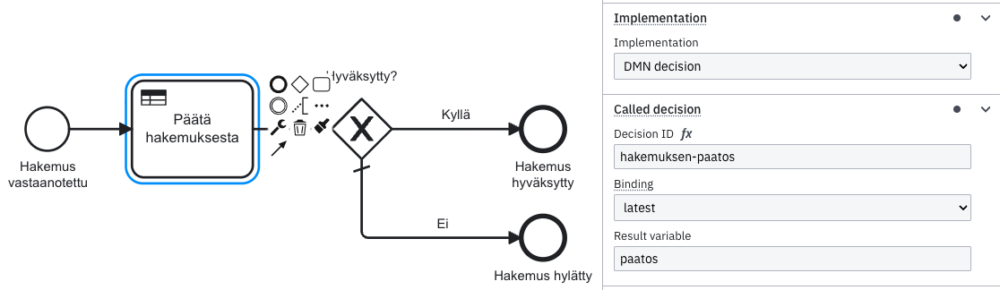{#fig-dmn-hakemus}

*Päätä hakemuksesta* -Business Rule Task on liitetty `hakemuksen-paatos` -päätöstauluun, joka Camundassa voisi näyttää seuraavalta (@fig-dmn-paatostaulu).

{#fig-dmn-paatostaulu}

 Päätöstaulua seuraten hakemus hyväksytään, kun hakemus on kokonaan täytetty ja hakija on täysi-ikäinen. Päätöstyyppi (*Hit policy*) `Unique` tarkoittaa, että päätöksen tekemiseen käytetään vain yhtä sääntöä eivätkä päällekkäiset tai toisensa kumoavat päätökset ole mahdollisia. 

Edellinen päätös voitaisiin tietenkin rakentaa prosessikulkuun myös valintaporttien avulla. Päätöstaulujen hyödyntäminen on kuitenkin prosessin suorittamisen kannalta tehokkaampi tapa ja hyödyllinen erityisesti siksi, että tietyn päätöksen logiikka voidaan tiivistää yhteen tehtävään. Tällöin liiketoimintasääntöjen tai vaikkapa päätökseen vaikuttavan lainsäädännön muutokset voidaan toteuttaa hallitummin yhteen paikkaan. Päätöstaulua voitaisiin käyttää myös esimerkiksi verkkokaupan asiakkaan kotimaan perusteella määräytyvän arvonlisäveron määrittämiseen, jolloin ajantasaiset ALV-tiedot voidaan koota yhteen taulukkoon.

### Send Task ja Receive Task

BPMN:ssa on kaksi tehtävää prosessin aikana tapahtuvan viestinnän tai tiedonsiirron esittämiseksi tilanteissa, joissa tietoa siirtyy prosessin ulkopuolelle tai tulee sisään: *Send Task* ja *Receive Task* (@fig-send_receive_tasks). Niiden avulla voidaan esittää sekä synkronista että asynkronista viestinvaihtoa muiden prosessien, toimijoiden tai järjestelmien kanssa.

Send Task tarkoittaa, että tehtävä lähettää viestin jollekin toiselle toimijalle tai järjestelmälle. Tehtävän suorittamisen jälkeen prosessi jatkuu välittömästi eteenpäin, joten tarvittaessa prosessiin tulee määritellä, mikäli sen halutaan odottavan vastauksen saapumista. Viesti voi olla esimerkiksi sähköposti, lasku, tilauspyyntö tai vaikkapa API-kutsu. Tosin oikeaoppisempaa viimeisen toteuttamiseksi on käyttää Service Task -tehtävää.

Receive Task -tehtävässä prosessi puolestaan pysähtyy odottamaan saapuvaa viestiä ennen eteenpäin jatkamista. Tätä tehtävää käytetään luonnollisesti silloin, kun prosessin eteneminen tarvitsee jonkin signaalin, vastauksen tai muun tiedon.

{#fig-send_receive_tasks}

Send Task merkitään tummalla kirjekuorella ja Receive Task valkoisella.

### Call Activity

*Call Activity* ei oikeastaan ole tehtävä, vaan se on viittaus johonkin toiseen prosessiin tai tehtävään, joka kutsutaan suorittamaan oma osuutensa osana prosessikulkua. Sen avulla prosessin rakennetta voidaan modularisoida ja toisaalta se mahdollistaa prosessien uudelleenkäytön. Sen sijaan, että samoja prosessirakenteita monistettaisiin useaan paikkaan, voidaan niihin viitata kertaalleen määriteltyinä ja hallinnoituina kokonaisuuksina. Tällöin vältytään myös siltä, että jonkin useissa yhteyksissä toistuvan toimintosarjan muuttuessa nämä muutokset tulisi toteuttaa kaikkiin samaa toimintosarjaa toteuttaviin prosesseihin.

Seuraavassa esimerkissä (@fig-call_activity) asiakkaan tulee tunnistautua maksupyynnön vastaanottamisen jälkeen. Tunnistautumista varten kutsutaan Call Activityllä *Tunnista käyttäjä* prosessia `kaksivaiheinen-tunnistautuminen`, jolle propagoidaan -- eli viedään -- kutsuvan prosessin kaikkien muuttujien arvot.

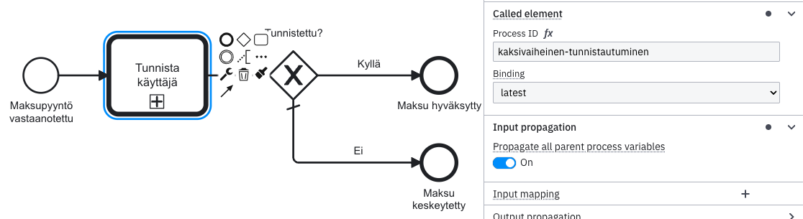{#fig-call_activity}

Propagoinnin sijaan muuttujien välittämisessä voidaan käyttää myös määriteltyjä input- ja output-parametreja. Ne siirtyvät Call Activityllä kutsuttavaan prosessiin ja siitä takaisin. Kutsuva prosessi saa vastauksena ainoastaan paluumuuttujan arvon, eikä sen tarvitse päästä näkemään kutsutun prosessin sisälle, ja toisaalta kutsuttavalle prosessille annetaan vain tiedot, jotka sen tarvitsee nähdä.

Edellinen Call Activityn kutsuma tunnistautumisprosessi voisi näyttää seuraavalta (@fig-kaksivaiheinen-tunnistautuminen).

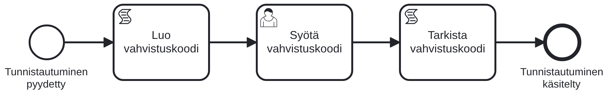{#fig-kaksivaiheinen-tunnistautuminen}

Samaa tunnistautumisprosessia voitaisiin kutsua kirjautumisen, salasanan vaihdon tai vaikkappa tilitietojen muuttamisen yhteydessä. Jos tunnistautumistapa muuttuu, muutos tarvitsee tehdä vain yhteen paikkaan.

Call Activityllä kutsuttava prosessi on myös suoritettavissa useana instanssina, eli se on esimerkiksi mahdollista suorittaa jokaiselle asiakkaalle erikseen saman prosessikulun aikana.

### Sub Process

Call Activityn tavoin myös *Sub Process* ei ole prosessikulun aikana suoritettava yksittäinen tehtävä, vaan nimensä mukaisesti aliprosessi, joka koostuu sarjasta tehtäviä. Sub Process merkitään vastaavalla symbolilla kuin Call Activity, mutta sen reunaviiva on ohut. (@fig-sub_process_kiinni)

{#fig-sub_process_kiinni}

Jokaisen Sub Process -elementin alla on siis tehtävistä koostuva oma prosessikulkunsa, jolle tulee myös määritellä aloitus- ja lopetuspisteet (@fig-sub_process_auki).

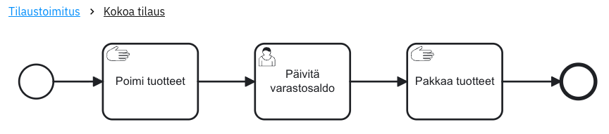{#fig-sub_process_auki}

Aliprosessi on osa pääprosessia ja sitä voidaan käyttää jäsentämään tai yksinkertaistamaan prosessikaaviota. Siten se mahdollistaa prosessin jakamisen osiin, jotka voidaan haluttaessa piilottaa korkeamman tason näkymästä. Call Activityn ja Sub Processin eroja on koottu seuraavaan taulukkoon (@tbl-call-activity-sub-process).

| Call Activity | Sub Process |
|---|---|
| Kohde määritellään aina erillisessä prosessikaaviossa. | Sub Process määritellään samassa prosessikaaviossa pääprosessin kanssa. |
| Kohdetta voidaan käyttää useissa prosesseissa, joista sitä kutsutaan. | Sub Processia voidaan käyttää ainoastaan sen pääprosessissa. |
| Kutsuttaessa Call Activityä, input- ja output-parametrit tulee määritellä eksplisiittisesti[^propa]. | Sub Process perii tietovirrat pääprosessilta, joten sillä on käytettävissä kaikki prosessissa oleva tieto ilman erillistä määrittelyä. |
| Call Activity esitetään aina tiivistettynä eli yhdellä tehtäväelementillä. | Sub Process voidaan esittää tiivistettynä tai se voidaan esittää avattuna aliprosessin kulun tarkastelua varten. |

: Call Activityn ja Sub Processin erot {#tbl-call-activity-sub-process}

[^propa]: Asia on näin BPMN-standardin tasolla. Esimerkeissä käytettävässä Camunda 8:ssa kutsuttu prosessi saa kaikki kutsujan muuttujat (Propagate all parent process variables) ja palauttaa kaikki omansa, ellei siirtoa rajata erikseen.

### Loop, Parallel Multi-instance, Sequential Multi-instance ja Ad-hoc

BPMN tarjoaa keinoja mallintaa tehtäville sekä aliprosesseille toistuvia tai vaihtoehtoisia käyttäytymismalleja: *Loop*, *Parallel Multi-Instance*, *Sequential Multi-Instance* ja *Ad-hoc*.

Loop (@fig-loop) toimii kuten `do-while`-rakenne ohjelmointikielissä. Tehtävän suorittamisen jälkeen, tai haluttaessa jo ennen ensimmäistä suorituskertaa (`testBefore`), tarkastetaan määritelty ehto. Mikäli ehto ei täyty, tehtävä suoritetaan uudelleen, jonka jälkeen ehto tarkastetaan uudelleen. Silmukassa toistuvalle tehtävälle voidaan asettaa myös toistokertojen enimmäismäärä (`loopMaximum`).

{#fig-loop}

Parallel Multi-Instance käynnistää tehtävästä useita rinnakkain suoritettavia toteutuksia eli instansseja. Syötteenä tällaiselle tehtävälle tarvitaan tyypillisesti lista tai joukko, jonka alkiot toimivat syötteinä kullekin instanssille.

Sequential Multi-Instance puolestaan käynnistää tehtävät peräkkäisinä. Seuraava instanssi käynnistyy, kun edellinen on valmis. (@fig-multi_instance) Molemmissa tapauksissa prosessissa siirrytään eteenpäin sitten, kun kaikki instanssit on suoritettu. Koska nämä tehtävätyypit käyvät läpi joukon alkioita `foreach`-rakenteen tyyliin, ne eivät ole Loopin kaltaisia silmukkarakenteita.

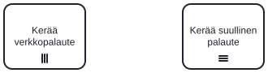{#fig-multi_instance}

Seuraava esimerkki (@fig-multi_esim1) kuvaa tilannetta, jossa asiakas asioi myymälässä. Kukin hänen tilaamansa tuote poimitaan varaston hyllyltä, yksi kerrallaan ja peräkkäisessä järjestyksessä (). Tämän jälkeen asiakkaalta peritään maksu. Maksua penätään asiakkaalta tarvittaessa useampaan kertaan, ennen kuin tuotteet luovutetaan. Jos asiakas ei maksa viidennelläkään pyynnöllä (loopMaximum = 5), ei tuotteita luovuteta.

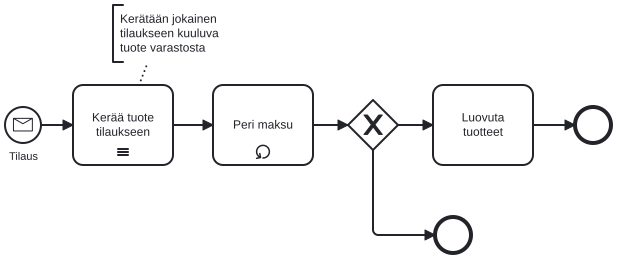{#fig-multi_esim1}

Toisen esimerkin (@fig-multi_esim2) tilaus liittyy digitaalisiin tuotteisiin, joihin käyttäjälle annetaan maksun jälkeen käyttöoikeudet. Kaikki käyttöoikeudet voidaan luovuttaa kerralla, joten tehtävän instanssit voidaan suorittaa rinnakkain. Prosessi päättyy ilman käyttöoikeuksia luovuttamista, mikäli asiakas ei ole maksanut tilaustaan kahden maksumuistutuksen jälkeen.

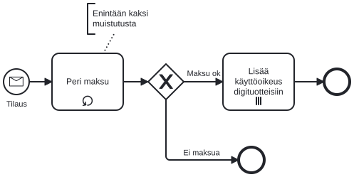{#fig-multi_esim2}

Ad-hoc -prosessi tai -aliprosessi on BPMN-kielen villi kortti (@fig-ad-hoc).

{#fig-ad-hoc}

Sen avulla voidaan esittää tehtäväsarjoja, joiden suoritusjärjestys ei ole ennalta määritelty. Ad-hoc -prosessiin kuuluvat tehtävät voidaan suorittaa kokonaan tai osittain, vapaassa järjestyksessä tai vaikka rinnakkain (@fig-ad-hoc_auki). Näin ollen ad-hoc -prosessille ei myöskään määritellä prosessikulkua. Ad-hoc -tyyppinen prosessi merkitään matematiikassa approksimaatiota ilmaisevalla tilde-merkillä (~).

{#fig-ad-hoc_auki}

## Tapahtumat

Siinä missä edellä käsitellyt tehtävät kuvaavat prosessin aikana suoritettavaa tekemistä, tapahtumat (*Event*) kuvaavat asioita, jotka 'tapahtuvat' prosessin aikana. BPMN:ssa tapahtumia on kolmea päätyyppiä: *Start Event* (aloitustapahtuma), *Intermediate Event* (välitapahtuma) sekä *End Event* (lopetustapahtuma). Tapahtumat voivat siis käynnistää, keskeyttää tai päättää prosessin, tai tapahtua prosessin aikana. Kullakin päätyypillä on alityyppejä, jotka käsitellään seuraavissa alaluvuissa. BPMN:n graafisessa notaatiossa tapahtumat esitetään ympyrällä (@fig-events). Start Event -tyyppisissä tapahtumissa ympyrän kehä piirretään ohuella viivalla, End Event -tapahtumissa paksulla viivalla ja Intermediate Event -tapahtumissa kaksoisviivalla.

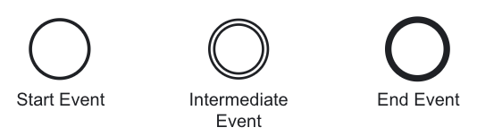{#fig-events}

Jotkin intermediate-tyyppisistä tapahtumista voidaan myös liittää tehtävään, jolloin niitä kutsutaan nimellä *Boundary Event*. Tällainen rajatapahtuma voi olla keskeyttävä (*interrupting*) tai ei-keskeyttävä (*non-interrupting*), jolloin se esitetään kaksoiskatkoviivalla (@fig-boundaryt).

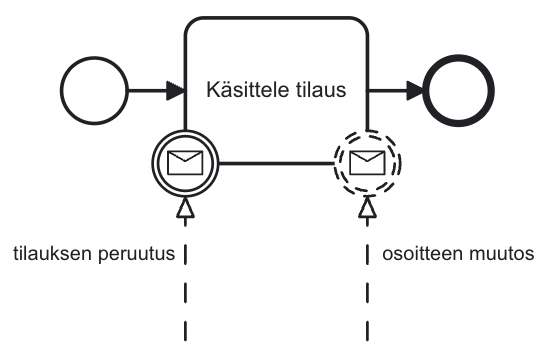{#fig-boundaryt}

Mikäli tilauksen käsittelyn aikana vastaanotettaisiin ilmoitus tilauksen peruutuksesta, tehtävän suorittaminen lopetettaisiin. Vastaavasti asiakkaan ilmoittama tieto osoitteen muutoksesta ei keskeyttäisi tilauksen käsittely, vaan johtaisi tilauksen osoitetiedon päivittämiseen. 

Keskeyttävän ja ei-keskeyttävän tapahtuman toiminnalliset erot on esitetty seuraavassa taulukossa (@tbl-keskeyttava-tapahtuma).

| | Keskeyttävä tapahtuma | Ei-keskeyttävä tapahtuma |
|---|---|---|
| Keskeyttääkö nykyisen tehtävän / prosessin? | Kyllä | Ei |
| Jatkuuko alkuperäinen tehtävä? | Ei, se keskeytetään | Kyllä, se jatkuu normaalisti loppuun saakka |
| Käynnistääkö uuden polun? | Kyllä | Kyllä |
| Käyttötarkoitus | Kriittinen tapahtuma, kuten virhe tai aikakatkaisu | Lisälogiikka, ilmoitukset, monitorointi |

: Keskeyttävän ja ei-keskeyttävän tapahtuman erot {#tbl-keskeyttava-tapahtuma}

Seuraavassa kuviossa (@fig-eventteja) on tilauskäsittelyn prosessimalli, jossa on Start Event -aloitustapahtuma, sitä seuraava tehtävä *Kerää tilauksen tuotteet*. Tähän liittyy Non-interrupting Boundary Event, joka aktivoi tehtävän *Ilmoita viivästyksestä*, mikäli kaksi vuorokautta ehtii kulua ennen kuin tuotteet on kerätty. Kun viivästyksestä on ilmoitettu, ajastin käynnistyy uudelleen, eli tuotteiden keräämiselle on aikaa uudet kaksi vuorokautta. Kun tuotteet on kerätty, siirrytään tehtävään *Toimita tilaus*, jonka jälkeen prosessi päättyy End Eventiin. 

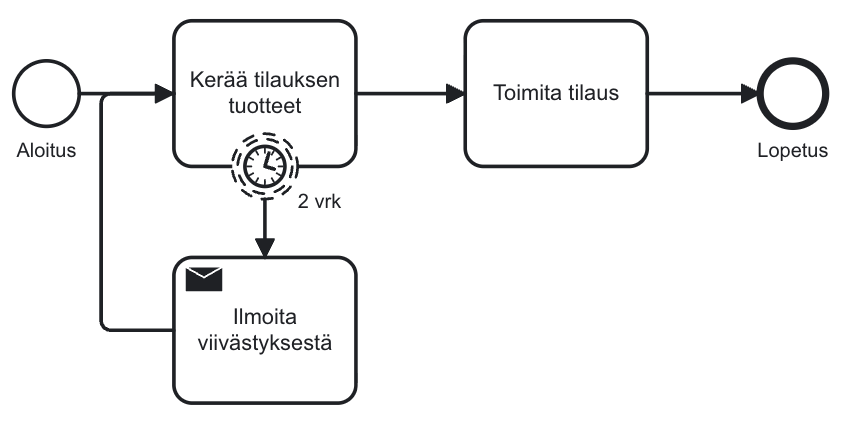{#fig-eventteja}

Seuraavassa esimerkissä ([@fig-eventteja2]) esiintyy myös Terminate Event. Se voidaan mieltää End Eventin voimakkaammaksi versioksi. Prosessin jonkin haaran päätyessä Terminate Eventiin, koko prosessi lopetetaan riippumatta siitä, missä vaiheessa sen muut haarat ovat. Mikäli tilaus peruutetaan, kaikki prosessiin liittyvä toiminta lopetetaan.

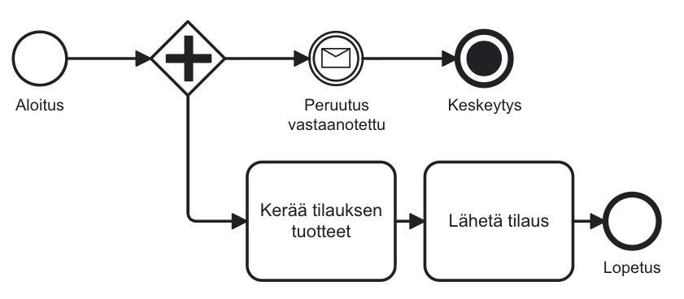{#fig-eventteja2}

### Message Event

Message Event -viestitapahtumia on muutama erilainen. *Message Start Event* on prosessin käynnistävä tapahtuma. Prosessi käynnistyy, kun se vastaanottaa viestin toiselta prosessilta tai vaikkapa ulkoiselta järjestelmältä. Viesti voi olla esimerkiksi puhelinsoitto tai verkkokaupasta tuleva tilaus, joka käynnistäisi tilauskäsittelyprosessin.

Jo edellä nähdyn *Message Intermediate Event* -tapahtuman (@fig-eventteja2) avulla voidaan esittää tilanne, jossa prosessin jokin tehtävä on valmis vastaanottamaan viestin, johon se reagoi, mikäli viesti saapuu.

Seuraavassa esimerkissä (@fig-eventteja3) Message Start Event käynnistää prosessin saadessaan viestin tehdystä tilauksesta. Ensimmäisessä tehtävässä asiakkaalta ruvetaan keräämään maksua. Tähän tehtävään liittyy myös *Message Boundary Event* eli tieto tapahtumasta, jossa asiakas onkin perunut tilauksensa. Jos proessia luetaan tarkkaavaisesti, huomataan, että viesti tilauksen perumisesta voi saapua sinä aikana, kun maksun kerääminen on vielä käynnissä. Mikäli prosessi siirtyy *Lähetä tilaus* -tehtävään, ei tilauksen peruminen enää voi johtaa prosessin päättymiseen. Prosessia suunniteltaessa tulee tietenkin huomioida, että mikäli asiakas voi perua tilauksen vielä maksamisen jälkeenkin (minkä tietysti Suomen lainsäädännön mukaan täytyykin olla mahdollista), ei prosessi voi ainoastaan päättyä perumisviestin vastaanottavan tapahtuman jälkeen, vaan prosessin tulee huolehtia muun muassa maksun palauttamisesta asiakkaalle. Esimerkkiprosessimme päättyy *Lähetä tilaus*- tehtävää seuraavaan *Message End Event* -tapahtumaan, joka voisi prosessin lopuksi lähettää asiakkaalle tiedon siitä, että hänen tilauksensa on jätetty kuljetettavaksi.

{#fig-eventteja3}

Edellä todettiin, että Boundary Eventit voivat olla keskeyttäviä tai ei-keskeyttäviä. Yllä olevan prosessin johonkin tehtävään voisi liittyä esimerkiksi ei-keskeyttävä Message Boundary Event, joka ottaisi vastaan asiakkaan tilaukseensa mahdollisesti tekemän muutoksen, kuten esimerkiksi tilaukseen lisätyt tuotteet. Tällainen tapahtuma aloittaisi prosessissa uuden polun, jonka tehtävät päivittäisivät tilausta vastaavalla tavalla. Tällaista prosessia suunniteltaessa tietenkin olisi harkittava, kuinka paljon asiakkaan halutaan sallia tilaustaan säätää, jotta toiminta on järkevää liiketoimintaprosessien sujuvuuden ja tehokkuuden kannalta, ja toisaalta sujuvan ja myönteisen asiakaskokemuksen kannalta.

### Conditional Event

*Conditional Event* eli ehdollinen tapahtuma voi olla prosessin ehdollisesti käynnistävä Conditional Start Event tai prosessin aikana tapahtuva *Conditiona Boundary Event* tai *Conditional Intermediate Catch Event* (@fig-conditional).

{#fig-conditional}

Ehdollinen aloitustapahtuma siis käynnistää prosessin tietyn ennalta määritellyn ja tarvittaessa monimutkaisenkin ehdon täyttyessä. Conditional Boundary Event, eli ehdollinen rajatapahtuma, voi olla tyypiltään keskeyttävä tai ei-keskeyttävä (@fig-cond_esim). Ehdon täyttyessä tehtävä voi käynnistää prosessiin uuden haaran. Conditional Intermediate Catch Event puolestaan pysäyttää prosessin, kunnes määritelty ehto muuttuu todeksi, jonka jälkeen eteneminen jatkuu.

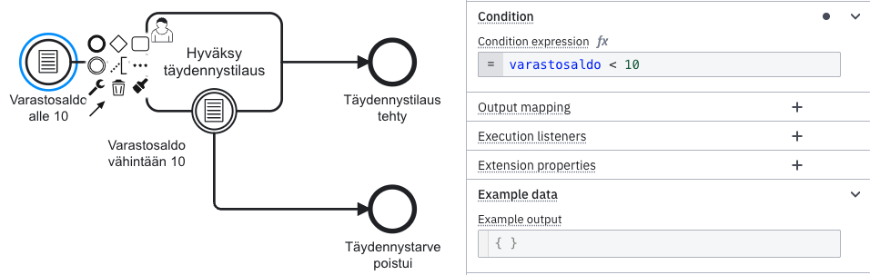{#fig-cond_esim}

Tässä vaiheessa saattaa ajatella, että mihin tällaisia tapahtumatyyppejä tarvitaan. Eikö saman asian voi esittää ja saman toiminnallisuuden toteuttaa joitain muita elementtityyppejä -- kuten viestejä -- käyttäen. Vastaus ainakin useimmissa tapauksissa on, että kyllä voi. Ehdollisten tapahtumien etu viesteihin perustuvaan kommunikointiin verrattuna on löyhäkytkentäisyydessä (Loose Coupling).

Ehdolliset tapahtumat mahdollistavat loogisten ehtojen varassa toimimisen, sen sijaan, etttä prosessiin tarvitsee rakentaa tiukkoja, rajapintojen ja viestimuotojen tuntemista edellyttäviä kytkentöjä. Ehto voi olla loogisesti johdettu tai vaikkapa tietovarastosta saatava tieto siitä, että tilauksen maksu on suoritettu. Tämä sen sijaan, että prosessilla tulisi olla valmiudet kytkeytyä kaikkiin nykyisiin ja mahdollisiin tuleviin vaihtoehtoisiin maksujärjestelmiin sekä kyetä tulkitsemaan ja ymmärtämään niistä saapuvat kuittausviestit. Järjestelmiä ja muita teknisiä ratkaisuja toteutettaessa löyhäkytkentäisyys on yleisesti hyvänä pidetty suunnitteluperiaate. Täytyy kuitenkin muistaa, että jos prosessi halutaan rakentaa pelkästään loogisen tason ehdoille ja päätöksille[^bisnesskieli], ja siten mahdollisimman riippumattomaksi sitä ympäröivistä järjestelmistä ja teknologioista, täytyy vaiva kuitenkin nähdä jossain muualla. Kehittäjä joutuu todennäköisesti tekemään töitä sen eteen, että prosessin ehdolliselle tapahtumalle saadaan tietovarastosta tai eri pankkien maksurajapinnoista loogisen tason tieto siitä, että `maksu == ok`.

[^bisnesskieli]: Tällöin voitaisiin ehkä puhua myös ”liiketoiminnan ymmärtämästä kielestä”.

### Timer Event

*Timer Event*it eli ajastintapahtumat (@fig-timer) liittyvät ajastettuihin ja aikaan sidottuihin tapahtumiin. Niiden avulla voidaan ilmaista esimerkiksi viivettä, ajoituksia tai jollain aikavälillä toistuvia tapahtumia.

*Timer Start Event* määrittelee, että prosessi käynnistyy jonkin aikamääreen perusteella, esimerkiksi joka arkipäivä kello kahdeksan. *Timer Intermediate Catch Event* viivästyttää prosessin etenemistä tietyn ajanjakson kerran -- prosessi voidaan siis määrätä odottamaan. *Timer Boundary Event* puolestaan liitetään johonkin tehtävään ja sen avulla voidaan aloittaa toinen haara, mikäli alkuperäisen aktiviteetin suorittaminen kestää liian kauan. Tämäkin tapahtuma voidaan määritellä joko keskeyttäväksi tai ei-keskeyttäväksi.

{#fig-timer}

Seuraavassa kuviossa (@fig-timer_esim) on muutama esimerkki ajastintapahtumien käytöstä.

{#fig-timer_esim}

Edellä ajastintapahtumiin liittyvät aikamääreet on esitetty yleistajuisesti. Taustalla BPMN kuitenkin käyttää ajanmäärittelyssä ISO 8601 -standardia. Seuraavassa on muutama esimerkki tämän standardin mukaisesta aikamääreiden esittämisestä.

*Fixed Date* -muotoa voidaan käyttää, kun prosessin tai tapahtuman halutaan alkavan tiettynä ajanhetkenä. Fixed Date esitetään muodossa:

`YYYY-MM-DDTHH:MM:SS`

eli esimerkiksi `2027-03-24T08:15:00`, mikä tarkoittaa vuoden 2027 maaliskuun 24. päivää ja kellonaikaa 8:15. Aikavyöhyke ilmaistaan liittämällä litanian perään ajan ero UTC-aikaan. Suomen normaaliaika on kaksi tuntia edellä koordinoitua yleisaikaa, joten edellinen aikamääre Suomen talviajassa olisi siis:

`2027-03-24T08:15:00:00+02:00`

*Cyclen* avulla voidaan esittää toistuva ajankohta seuraavassa muodossa, eli toistokertojen määrä, aloitusaika, toistoväli:

`StartTime/R/Duration`

Mikäli aloitusaikaa ei ilmoiteta, toistuva aika määrittyy tehtävän ensimmäisen kohtaamisen perusteella. Mikäli toistokertoja ei määritellä, toistoja tehdään loputtomasti. Loputtomiin kerran päivässä toistuva tapahtuma ilmaistaan:

`R/P1D`

ja vastaavasti kerran viikossa toistuva tapahtuma olisi:

`R/P1W`

Jos tehtävä yrittäisi vaikkapa hakea tietoa jostain verkkopalvelusta, voitaisiin se ajastaa yrittämään sitä esimerkiksi enintään viisi kertaa ja kymmenen sekunnin välein tapahtuen:

`R5/PT10S`

Seuraava aikamääre asettaisi aloituksen 1.6.2025 kello 9:00 ja tapahtuma tai prosessi toistuisi samalla kellonlyömällä päivittäin seitsemän päivän ajan:

`2027-06-01T09:00:00/R7/PT1D`

jolloin viimeinen toistokerta tapahtuisi siis 7.1.2025 kello 09:00. *Duration* määrittelee odotusajan ennen prosessin jatkamista. Esimerkiksi:

- viiden sekunnin viive: `PT5S`
- 1,5 tunnin viive: `PT1H30M`
- viikon viive: `P7D`
- viikon ja 1,5 tunnin viive: `P1WT1H30M`
- yhden vuoden, kuuden kuukauden, kahden päivän, neljän tunnin, kahdeksan minuutin ja yhdeksän sekunnin viive: `P1Y6M2DT4H8M9S`

Camunda Modelerissa ajan määrittely onnistuu seuraavassa kuviossa näkyvällä tavalla (@fig-timer-juhannus). Timer Definition Type -valikosta valitaan aikamääreen tyyppi ja aika määritellään Timer Definition -kohtaan ISO 8601 -standardin mukaisessa muodossa.

{#fig-timer-juhannus}

Aikailmaisuissa käytetään seuraavia kirjainlyhenteitä. Kirjaimet ovat vastaavien englanninkielisten sanojen alkukirjaimia.

- `P` on kestoa (*period*) osoittava kirjain, joka sijoitetaan kestomerkinnän alkuun.  
- `Y` on vuosia (*year*) osoittava kirjain, joka tulee vuosien määrän jälkeen.  
- `M` on kuukausia (*month*) osoittava kirjain, joka tulee kuukausien määrän jälkeen.  
- `W` on viikkoja (*week*) osoittava kirjain, joka tulee viikkojen määrän jälkeen.  
- `D` on päiviä (*day*) osoittava kirjain, joka tulee päivien määrän jälkeen.  
- `T` on aikaosuutta (*time*) osoittava kirjain, joka edeltää ajan komponentteja.  
- `H` on tunteja (*hour*) osoittava kirjain, joka tulee tuntien määrän jälkeen.  
- `M` on minuutteja (*minute*) osoittava kirjain, joka tulee minuuttien määrän jälkeen.  
- `S` on sekunteja (*second*) osoittava kirjain, joka tulee sekuntien määrän jälkeen.  

Huomaa, että M-kirjain esiintyy sekä kuukausia ilmaistaessa (päivämääräosassa) että minuutteja ilmaistaessa (aikaosassa). Tämän vuoksi P- ja T-kirjaimet erottavat kesto- ja aikaosat.

### Error Event

*Error Event*iä eli virhetapahtumaa käytetään ennalta määriteltyjen virhe- ja poikkeustilanteiden käsittelyyn[^virhe]. Yksittäinen virhe voi liittyä yhteen tai useampaan virhetapahtumaan. Jokaiselle virheelle tulee määritellä virhekoodi, jonka arvo ilmaisee, mikä virheen vastaanottava tapahtuma käsittelee heitetyn virheen.

[^virhe]: Virheillä ei tässä tarkoiteta BPMN-mallissa itsessään olevia syntaksi- tai loogisia virheitä.

*Error Boundary Event* liitetään tehtävään tai aliprosessiin, ja se laukaisee virheen tapahtuessa vaihtoehtoisen haaran. Tällainen virhetapahtuma voi olla keskeyttävä tai ei-keskeyttävä. *Error End Event* puolestaan lopettaa prosessin virhetapahtumaan.

Seuraavassa prosessimallissa (@fig-error-esim) Script task -tehtävä tarkastaa käyttäjän lomakkeen kautta syöttämät tiedot. Mikäli tiedoissa on virhe, prosessi päättyy virhetapahtumaan ja *Error Boundary Event* heittää käyttäjälle kehotuksen korjata syötetyt tiedot.

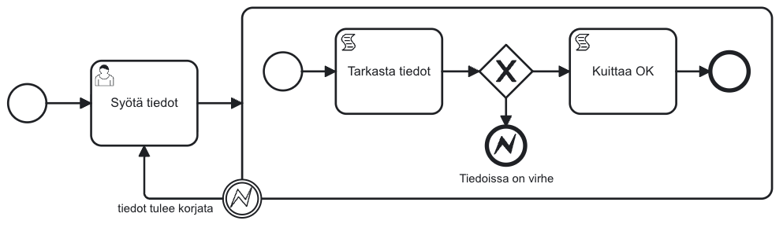{#fig-error-esim}

Error End Eventille on tulee määritellä virhekoodi ja viite (*Global error reference*), jonka avulla virheenkäsittely voidaan toteuttaa (@fig-error_esim2). Edellisessä esimerkissä käyttäjää siis vain pyydettäisiin täyttämään tiedot uudelleen, mutta joissain tapauksissa voisi olla tarpeen määritellä esimerkiksi korjaava prosessikulku, joka käynnistettäisiin virheen havaitsemisen jälkeen.

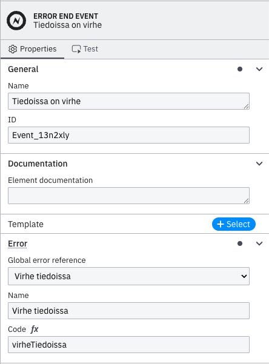{#fig-error_esim2}

### Compensation Event

*Compensation Event*iä käytetään kompensoimaan eli kumoamaan jo suoritettu tehtävä prosessin suorituksen keskeytyessä. Kompensoivan toimenpiteen suunnittelulla voidaan toteuttaa tehtävän hallittu, liiketoimintalogiikan mukainen peruuttaminen. Kompensoinnin ei välttämättä ole tarkoitus palauttaa systeemiä samaan tilaan, jossa se oli kompensoitavan prosessin tai tehtävän käynnistyessä.

Ajatellaan jotain systeemiä, jolla on useita samanaikaisia käyttäjiä. Yksi käyttäjistä käynnistää prosessin, jossa prosessimuuttujan `luku1` numeroarvosta siirretään puolet muuttujan `luku2` arvoon. Jokin tehtävä lukee ensin `luku1`:n lähtöarvon ja vähentää siitä puolet. Mikäli `luku2`:n arvon kasvattaminen `luku1`:n puolikkaalla jostain teknisestä tai vaikka liiketoimintasääntöön perustuvasta syystä kuitenkin epäonnistuu, transaktiomuotoisessa suorituksessa prosessi keskeytetään (*Abort*) ja systeemi palautetaan sen alkuperäiseen tilaan (*Rollback*). On kuitenkin mahdollista, että systeemin toinen käyttäjä on tällä välin päivittänyt `luku1`:n arvoa, jolloin alkuperäisen tilan palauttaminen rollback-operaatiolla hävittää myös toisen käyttäjän tekemän muutoksen. Tarvitaan peräkkäinen palautus (*Cascading Rollback*), joka peruuttaa kaikki väärän tiedon varassa toteutetut toiminnot. Yksinkertaisin ratkaisu tietysti olisi lukita kunkin transaktion tarvitsemat resurssit kyseiselle transaktiolle, kunnes koko prosessi on suoritettu onnistuneesti loppuun tai keskeytetty. Liiketoimintaprosessit voivat kuitenkin olla kestoltaan pitkiä, joten resurssien lukitseminen voisi aiheuttaa huomattavaakin viivettä kaikkiin muihin samoja resursseja tarvitseviin toimintoihin.

Seuraavassa esimerkissä (@fig-compensation-esim) varauspyynnön vastaanottamisen jälkeen asiakkaalle varataan matkakohteeseen lento ja hotellimajoitus. Mikäli maksun veloitus ei kuitenkaan onnistu, prosessi etenee *Compensation End Event* -tapahtumaan ja *Compensation Boundary Event* -tapahtumat käynnistävät kompensoivat tehtävät. Compensoivalle tehtävälle ei ole omaa tehtävätyyppiään, vaan esimerkiksi Camundassa tehtävään lisätään kompensointia ilmaiseva symboli automaattisesti, kun tehtävän käynnistyy Compensation Eventin kautta.

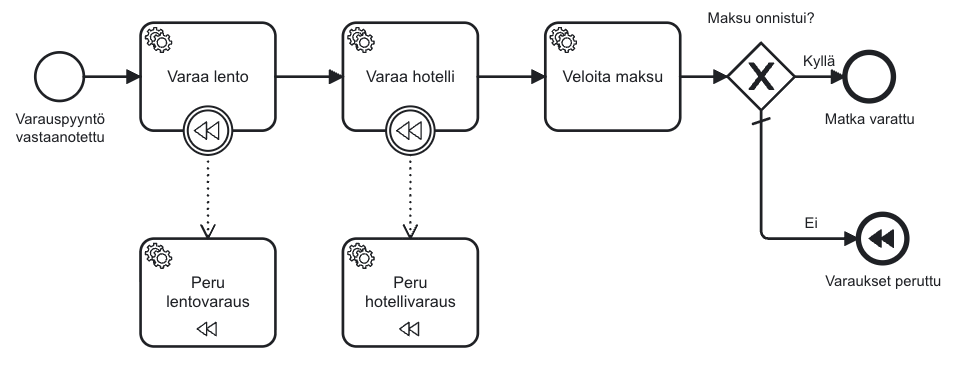{#fig-compensation-esim}

Kompensointi koskee vain tehtäviä, jotka on jo tehty loppuun. Jos prosessi olisi kaatunut jo hotellin varaamiseen, vain lento peruttaisiin. Peruminen -- tai kumoaminen -- ei ole tekninen rollback, vaan sitä varten täytyy määritellä oma toimenpiteensä, eikä kompensoinnin tarvitse siis palauttaa systeemiä täsmälleen alkutilaan. Esimerkiksi luennon peruutuksesta voisi asiakkaalle jäädä maksettavaksi peruutusmaksu.

### Link Event

`Link Eventin` avulla voidaan yhdistää prosessin osia ilman fyysistä virtayhteyttä (). Sitä voidaan verrata joistain ohjelmointikielistä tuttuun goto-käskyyn, joka siirtää ohjelman suorittamisen toiseen kohtaan ohjelmakoodia. Link Eventin toteuttama siirto on yksisuuntainen eli sen jälkeen suorittamista ei palauteta takaisin, toisin kuin vaikka funktiota ohjelmointikielessä kutsuttaessa.

Link Eventiä käytetään lähinnä monimutkaisten prosessimallien selkeyttämiseen sen mahdollistaessa prosessimallin pilkkomisen pienempiin osiin ja hypyt osien välillä.

Seuraavassa prosessissa (@fig-link-esim) puuttuvan tuotteen tilaamisen jälkeen Link Event *Toimitukseen* siirtää prosessikulun *Toimita tilaus* -aliprosessiin.

{#fig-link-esim}

### Signal Event

Siinä missä Message-tehtävät ja -tapahtumat on aina tarkoitettu tarkoin koordinoituun kahden osapuolen väliseen viestinvaihtoon, *Signal Event* mahdollistaa samanaikaisen *broadcast*-tyyppisen viestinnän useille signaalia kuunteleville. Signaalin lähettäjän ei tarvitse tietää, kuinka monta vastaanottajaa sillä on, eikä se odota vastaanottajilta vastausta.

Signal Event -tapahtuman tyypit ovat heittävä (*Throw*) ja vastaanottava (*Catch*). Sitä sitä voidaan käyttää *Boundary*, *Intermediate*-, *Start*- ja *End*-tapahtumissa.

Seuraavassa esimerkissä tehtävää *1* seuraa Intermediate Signal Event *A*. Kaksi muuta prosessia kuuntelevat tätä signaalia ja sen saatuaan suorittavat omat tehtävänsä *2* ja *3*. Signaloiva prosessi siis pyytää kaikkia signaalin *A* kuulevia prosesseja Signal Start Eventin kautta suorittamaan omat tehtävänsä ja siirtyy suorittamaan tehtäväänsä *4*.

Teknisesti ottaen -- ja automaattisia prosessikulkuja simuloitaessa -- tehtävien *2* ja *3* suorittaminen alkaa samaan aikaan kuin tehtävän *4*. Mikäli tehtävillä ei ole määriteltyä suoritusaikaa, ne kaikki myös valmistuvat samaan aikaan. Käytännössä ja todellisissa prosesseissa tätä ei tietenkään voida taata.

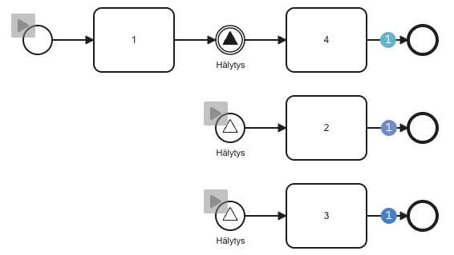
Käytäntöä lähempänä olevassa esimerkissa laadunvarmistus huomaa ongelman jossain myytävässä tuotteessa ja prosessi signaloi siitä (@fig-signal-ongelma).

{#fig-signal-ongelma}

Kaikki tilausten keräilyprosessit, jotka saavat tiedon keräitävään tilaukseen kuuluvan tuotteen takaisinvedosta, keskeytetään.

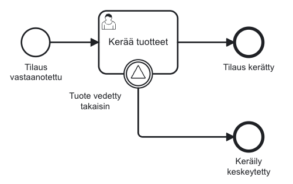{#fig-signal-reaktio}

### None Event

*None Event* on tyhjä tapahtuma, jossa ei varsinaisesti prosessikulun kannalta tapahdu mitään (@fig-none-esim). Niitä voidaan käyttää prosessin luettavuuden parantamiseen ohjelmakoodin kommentoinnin tavoin tai pitkäkestoisen prosessin tilasiirtymien konkreettiseen tarkastamiseen.

None Eventit pystyvät myös asettamaan muuttujia, joten niitä voidaan hyödyntää prosessin monitoroinnissa (esimerkiksi KPI-mittareihin liittyvä informaatio) tai automatisoitujen prosessien toteutuksessa tarvittavien ohjausyksityiskohtien asettamisessa.

{#fig-none-esim}

 Vaikka None Event ei varsinaisesti tee mitään, se voi kertoa prosessista ja sen tilasta paljonkin. Sen avulla (*Reklamaatio ratkaistu*) edellinen prosessi jaettiin kahteen konkreettiseen vaiheeseen: ongelman selvittämiseen ja reklamaation käsittelyn jälkitoimiin. Yrityksen palvelulupaus voi olla, että reklamaatio ratkaistaan viidessä arkipäivässä. Tässä voidaan prosessin kokonaiskeston sijaan mitataan aikaa aloituksesta välitavoitteeseen, koska korvaavan tuotteen toimituksen kesto ei ole reklamaatioiden käsittelijöiden hallinnassa. Lisäksi asiakaspalvelija näkee käynnissä olevasta prosessi-instanssista, onko reklamaatio jo ratkaistu, vaikka prosessi ei olisi vielä päättynyt.

 ## Portit

 Portti eli *Gateway* on prosessimallinnuksessa käytettävä elementti, jonka avulla voidaan ohjata työnkulun haarautumista tai yhdistymistä. Ne siis vaikuttavat prosessivirran kulkuun saavuttaessa tiettyyn kohtaa prosessia. Ne voivat haarauttaa (*Split*) prosessivirran useaan suuntaan tai yhdistää (*Join*) useita virtoja yhdeksi. Portin symbolina käytetään vinoneliötä, jonka sisällä on portin tyyppiä ilmaiseva tunnus.