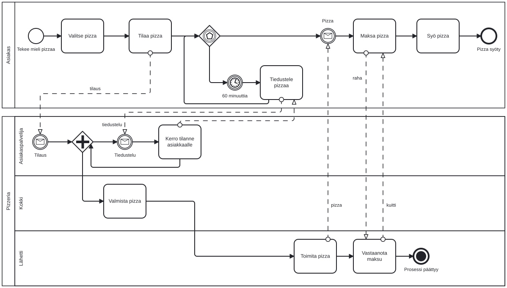
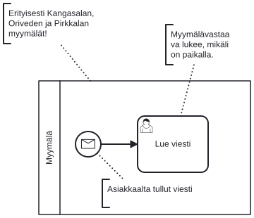
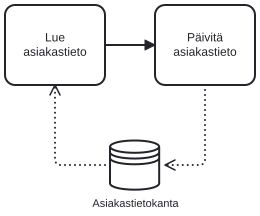
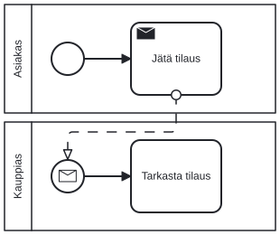
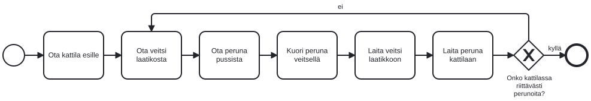
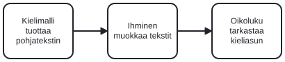
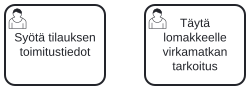
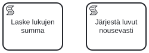
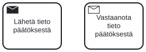

# Business Process Model and Notation ja prosessien mallintaminen

*Business Process Model and Notation*[^bpmn_2_spec] (BPMN) on *Object Management Groupin*[^omg]  (OMG) ylläpitämä kansainvälinen standardi liiketoimintaprosessien graafiseen mallintamiseen. Se on tarkoitettu yhteiseksi välineeksi liiketoiminta-analyytikoille, ohjelmistokehittäjille ja muille prosessien parissa työskenteleville sidosryhmille. BPMN:n visuaalinen esitystapa pyrkii mahdollistamaan prosessien kuvaamisen johdonmukaisella ja helposti ymmärrettävällä tavalla ja siten parantamaan kommunikaatiota liiketoiminnan ja IT:n välillä[^bpmn_pituus]. Graafiset BPMN-mallit ovat esitettävissä myös XML:ään (Extensible Markup Language) perustuvalla koneluettavalla kielellä (BPMN XML), jota käyttäen prosessimallit ovat automatisoitavissa eli suoritettavissa prosessimoottoreiksi kutsuttavilla ohjelmistoilla.

[^bpmn_2_spec]: https://www.omg.org/spec/BPMN/2.0/

[^omg]: https://www.omg.org/

[^bpmn_pituus]: Tosin BPMN 2.0 -standardin spesifikaatio itsessään on yli 500 sivua. https://www.omg.org/spec/BPMN/2.0/PDF

BPMN:n tarina käynnistyi 2000-luvun alkuvuosina, kun *Business Process Management Initiative* (BPMI) -niminen organisaatio alkoi kehittää standardia liiketoimintaprosessien kuvaamiseen. Alusta lähtien tavoitteena oli luoda graafinen esitystapa, joka olisi yhteensopiva prosessien suorittamisen ja automatisoinnin kanssa. BPMN:n ensimmäinen versio julkaistiin 2004. Seuraavana vuonna BPMI yhdistyi OMG:n kanssa, joka ryhtyi kehittämään BPMN:stä virallista, laajemmin hyväksyttyä standardia.

Vuosien 2006–2009 aikana julkaistut versiot keskittyivät pääasiassa prosessien kuvaamiseen graafisesti, ja koneellisesti suoritettavien prosessimallien tuki oli vielä melko rajallinen. Vuonna 2011 julkaistu BPMN 2.0 oli merkittävä kehitysharppaus. Samassa yhteydessä julkaistun uuden metamallin tarkkuus mahdollisti prosessimallien koneellisen tulkinnan ja automaattisen suorittamisen. Mallinnuskielen elementtien valikoima kasvoi ja virallinen XML-pohjainen tiedostomuoto julkistettiin. BPMN 2.0 on edelleen kielen nykyinen versio, ja siihen on toistaiseksi julkaistu ainoastaan joitain pieniä korjauksia ja selvennyksiä. Versionumeroinnin desimaaleja tarkemmin tarkasteltaessa BPMN:n viimeisin versio tätä kirjoitettaessa on 2.0.2 ja se julkaistiin tammikuussa 2014. Se tunnetaan myös ISO/IEC -standardina numerolla 19510 ja nimellä Information technology – Object Management Group Business Process Model and Notation[^bpmn_iso].

[^bpmn_iso]: Edition 1 vuodelta 2013 https://www.iso.org/standard/62652.html

BPMN on paitsi virallinen standardi myös de facto -standardi liiketoimintaprosessien mallinnuksessa, organisaatioiden sisäisessä kehitystyössä, prosessien optimoinnissa, digitaalisessa transformaatiossa sekä prosessien automatisoinnissa ja monitoroinnissa. Tätä mallinnuskieltä tukevat lukuisat työvälineet, joista yksi on tämän luvun prosessiesimerkeissäkin käytetty Camunda Modeler[^camunda].

[^camunda]: https://camunda.com/platform/modeler/

Seuraavissa alaluvuissa käydään läpi BPMN 2.0:n ominaisuuksia prosessien graafisessa mallintamisessa. Vaikka niissä käsitellään BPMN-kieli kokonaisuudessaan, todettakoon, että varsin pieni osajoukko kielen elementtejä riittää varsin pitkälle yksikertaisten ja ainoastaan ihmisten luettaviksi tarkoitettujen prosessien suunnittelussa, dokumentoinnissa ja viestinnässä. BPMN sisältää kuitenkin useita hienostuneempia elementtejä ja ominaisuuksia monimutkaisempien ja yksityiskohtaisempien prosessikulkujen esittämiseksi sekä niiden automatisoimiseksi.

Ennen syvään päätyyn sukeltamista, palataan vielä kerran hetkeksi pizzatilausesimerkkin [@fig-pizzatilaus.svg] pariin.

{#fig-pizzatilaus.svg fig-alt="Klassinen esimerkki pizzatilauksen prosessista."}

Esimerkissä on kaksi uima-allasta eli kaksi erillistä toimijaa: asiakas ja pizzeria. Pizzeria-altaan sisällä on kolme uimarataa eli roolia: asiakaspalvelija, kokki ja lähetti. Nämä on esitetty uimaratoina saman altaan sisällä, koska ne edustavat samaa toimijaa eli pizzeriaa. Jos pizzan toimittamiseen käytettäisiin ulkoista lähettipalvelua, tulisi se esittää prosessissa omana uima-altaanaan.

Laatikot esittävät prosessiin liittyvää tekemistä: *Tilaa pizza*, *Valmista pizza*, *Toimita pizza* ja niin edelleen. Kuten edellä todettiin, tehtävien nimeämisessä on suositeltavaa käyttää verbi-objekti-muotoa.

Tehtäviä yhdistävät nuolet esittävät prosessin kulkua eli sitä, missä järjestyksessä prosessin tehtävät etenevät. Katkoviivalla esitetyt nuolet ovat puolestaan tietovirtoja ja esittävät organisaatioiden välillä liikkuvaa tietoa. Prosessin suorittaminen voi siirtyä uima-altaasta toiseen, eli organisaatiolta toiselle, ainoastaan tietovirtojen kautta. Kun prosessi tapahtuu saman organisaation sisällä, eli saman altaan uimaradoilla, liikkuu tieto prosessikulun ja kontekstin mukana. Tällöin käytetään ainoastaan tavallisia prosessin kulkua esittäviä nuolia ja tarvittaessa data-assosiaatiosuhdetta. Saman uima-altaan sisällä ei siis voida käyttää tietovirtoja esittäviä katkonuolia, eikä uima-altaasta toiseen voida siirtyä muuten kuin tietovirtoja käyttäen.

Ympyrän muotoisilla symboleilla esitetään prosessin aikana toteutuvia tapahtumia. Tapahtumat eroavat tehtävistä siinä, että ne eivät ole tekemistä, jonka jokin prosessiin osallistuva toimija suorittaisi, vaan ne pikemminkin – nimensä mukaisesti – ”tapahtuvat”, ja signaalien tai herätteiden tapaan saavat aikaan muutoksen prosessin tilassa. Prosessin aloitus ja lopetus ovat tapahtumia. Aloituksen ja lopetuksen lisäksi tapahtumia voi esiintyä myös prosessikulun aikana. Pizzatilausesimerkissä on viisarikellon näköinen tapahtuma, joka on nimetty *60 minuuttia*. Tämä tapahtuma aktivoituu silloin, kun 60 minuuttia on kulunut. Tällöin prosessikulku etenee tapahtumaan liittyvää haaraa ja asiakas suorittaa tehtävän *Tiedustele pizzaa*. On myös mahdollista, että pizza toimitetaan asiakkaalle alle tunnissa, jolloin tapahtuma *60 minuuttia* ei ehdi toteutua. Tapahtumat ovatkin ehdollisia, ja niiden avulla prosessi voidaan saada reagoimaan myös poikkeustilanteisiin.

Vinoneliösymboleilla esitetään portteja, jotka määrittävät prosessin kulun haarautumista, yhdistymistä ja synkronointia. Näissä kohdissa tehdään päätös siitä, kuinka prosessin kulku etenee. Ne voivat esimerkiksi ohjata tilanteen mukaan prosessin vaihtoehtoisiin suuntiin tai ne voivat jakaa prosessin useampaan rinnakkain suoritettaan haaraan.

## Virrat ja yhteydet

Aloitetaan BPMN:n tarkempi läpikäynti käsittelemällä erilaiset nuolet ja viivat, joita käytetään graafisissa prosessimalleissa. Yhteys- tai liitosviivalla (*Association*) [@fig-association] ei oikeastaan ole muuta käyttöä kuin se, että sillä voidaan liittää huomauksia (*Text Annotation*) prosessimalliin tai johonkin sen osaan. Huomautukset sisältävät ainoastaan ihmisille tarkoitettua informaatiota, kuten prosessia koskevaa dokumentaatiota, eivätkä ne tai Association-suhde vaikuta prosessin kulkuun.

{#fig-association}

Vaikka prosessimalliin lisätyt huomautukset ja kommentit eivät mallia varsinaisesti kaunista, on niiden runsas käyttäminen kuitenkin suositeltavaa. Hankalasti seurattavia tai monimutkaisia prosessikulkuja voidaan dokumentoida ohjelmakoodin kommenttien tavoin. Prosessikehittäjät ja mallintajat voivat käyttää niitä jättääkseen toisilleen -- tai miksei itselleenkin -- kysymyksiä, huomautuksia tai selvennyksiä: ”Toimiiko tämä näin?”, ”Tämä kohta täytyy vielä varmistaa myymäläpäälliköiltä!”, ”Päivämäärämuuttujan arvo tulee Oraclesta jenkkimuodossa, käännetään tällä skriptillä suomalaiseen muotoon ja tallennetaan muuttajaan pvm.”

Dokumentaatio myös helpottaa prosessimallin ymmärtämistä silloin, kun prosessin katselija ei ole BPMN-kielen asiantuntija. Annotaatioiden avulla voidaan myös tehdä näkyväksi toimintoja, jotka eivät välttämättä prosessin graafisessa esityksessä tule esille. Tällaisia tapauksia ovat esimerkiksi myöhemmin käsiteltävät Script- ja Business Rule -tehtävät.

Toinen prosessimalleissa käytettävä assosiaatiosuhte on *Data Association*, jonka avulla voidaan esittää prosessin ja tietovaraston (*Data Store*) välillä toteutuvia tietovirtoja. Yhteyttä, jossa prosessista liikkuu tietoa tietovarastoon, kutsutaan nimellä *Data input Association*. Kun ilmaistaan tiedon siirtymistä tietovarastosta prosessille, yhteyttä kutsutaan nimellä *Data Output Association* (@fig-data_association). Data Storea ja Data Associationia käsitellään hieman tarkemmin luvussa 5.5.

{#fig-data_association}

*Sequence Flow* eli virta tai järjestysvirta ilmaisee, kuinka prosessi etenee ja missä järjestyksessä sen elementit luetaan. Virran avulla yhdistetään samaan prosessiin kuuluvat tapahtumat, tehtävät ja portit. Huomaa, että prosessin jokaisen elementin täytyy liittyä virralla vähintään yhteen toiseen elementtiin. Mikäli prosessin tehtävään ei johda virta, ei tehtävä voi tulla suoritetuksi. Vastaavasti prosessi jumiutuu tehtävään, josta ei lähde virtaa ulos. BPMN ei salli virran ylittävän uima-altaan reunoja. Prosessin kulku ei siis voi virrata organisaatiosta toiseen. Virta esitetään tavallisesti yhtenäisellä viivalla, jossa on nuolenkärki.

BPMN-kielessä virrasta eli Sequence Flow:sta on kaksi erikoisversiota: *Conditional Flow* eli ehdollinen virta sekä *Default Flow* eli oletusvirta. Conditional Flow on ehdollinen järjestysvirta, jota pitkin edetään vain, jos jokin määritelty ehto täyttyy. Sitä voidaan käyttää toteuttamaan *Exclusive*- ja *Inclusive* -päätösportteja vastaavaa toiminnallisuutta. Päätösportteja käsitellään myöhemmin tässä luvussa. Conditional Flow’n käyttö on kuitenkin melko harvinaista, koska sama logiikka voidaan esittää myös päätösportteja käyttäen. Conditional Flow ilmaistaan virtanuolen alussa olevalla valkoisella viistoneliöllä.

Default Flow’n avulla voidaan määritellä oletusvirta, jota seurataan, ellei mikään ehto täyty tai jos useampi ehto täyttyy saman aikaisesti. Default Flow ilmaistaan virtanuolta leikkaavalla vinolla poikkiviivalla. Oletusvirran määrittely on suositeltavaa aina päätösportteja käytettäessä. Sen avulla voidaan estää tilanne, jossa prosessi jäisi jumiin, mikäli mikään määritellyistä ehdoista ei täyty. Toki sama varmistus voidaan toteuttaa huolellisella if-else-rakenteen suunnittelulla, mutta oletusvirran käyttö on helppo tapa pelata varman päälle. (@fig-sec_def_cond)

{#fig-sec_def_cond}

*Message Flow* eli viestivirta tai tietovirta kuvaa viestintää prosessien ja organisaatioiden välillä. Viestivirtaa ei voi käyttää saman prosessin sisällä edes silloin, kun prosessin altaassa on useampia uimaratoja, eli samaan organisaatioon kuuluvia useampia toimijoita. Prosessin kulun siirtyessä saman altaan ratojen välillä, vaikka siirtymän yhteydessä siirtyisikin viestejä tai tietoa, käytetään Sequence Flow -virtaa. Message Flow’ta käytetään silloin, kun prosessi siirtyy altaasta toiseen (@fig-message_flow). Tällöin suorittamisen vastuu siirretään organisaatiolta tai prosessilta toiselle.

{#fig-message_flow}

## Tehtävät

*Task* (tai *Activity*) eli tehtävä esittää erilaisia prosessin aikana suoritettavia töitä tai tehtäviä. Nämä voivat esimerkiksi olla ihmisen suorittamia manuaalisia tai tietokoneen suorittamia automaattisia tehtäviä. Tehtävien avulla esitetään prosessin perusrakenne.

{#fig-perunankuorinta}

Tehtävät esitetään graafisesti tavallisesti suorakaiteen muotoisina nelikulmioina, joiden reunat on pyöristetty. Suorakaide, jossa ei ole mitään graafista tarkenninta (@fig-perunankuorinta), toimii yleiskäyttöisenä tehtävien kuvauselementtinä, eikä siihen liity suorittamista koskevia erityisiä lisätietoja. Laadittaessa prosessimalleja vaikkapa keskustelun tueksi, voidaan tällä elementillä esittää kaikki prosessiin kuuluvat tehtävät ja ilmaista tarvittavat erityispiirteet tehtävän nimessä. Esimerkiksi seuraavan prosessimallin (@fig-gen_activity) tehtävien nimistä on pääteltävissä, että prosessiin liittyy ohjelmistorajapinnan yli suoritettavia tietokoneen tekemiä tehtäviä sekä ihmisen suorittama tehtävä.

{#fig-gen_activity}

### Manual Task

Ihmisen suoritettavaksi tarkoitettuja tehtävätyyppejä on kaksi. *Manual Task* on täysin manuaalinen tehtävä, esimerkiksi paperidokumentin arkistointi tai jäätelön ojentaminen asiakkaalle. Manual Task merkitään esimerkiksi kättelyasentoon ojennetun käden kuvalla (@fig-manual_task).

{#fig-manual_task}

### User Task

Myös *User Task* (@fig-user_task) ilmaisee ihmisen suorittamaa tehtävää, mutta sellaista, joka on tehdään IT:n avulla. Tehtävän suorittamiseen käytetään siis vaikkapa jotain ohjelmistoa tai tietojärjestelmää. Erottelu manuaalisten ja IT-avusteisten tehtävien välillä johtuu siitä, että BPMN-kieltä voidaan käyttää myös automatisoitavien prosessien mallintamiseen, jolloin näillä kahdella ihmisen suorittamalla tehtävällä voi olla hyvinkin erilainen merkitys.

{#fig-user_task}

User Taskissa luetaan, käytetään tai tuotetaan tietoa ohjelmistoa käyttäen, esimerkiksi täyttämällä sähköinen lomake, kun taas Manual Task merkitsee perinteistä "paperin pyörittelyä".

### Script Task

*Script Task* (@fig-script_task) kuvaa tehtävää, joka suoritetaan prosessin aikana skriptillä automaattisesti ilman, että ihminen osallistuu työhön. Käytännössä siis prosessikulun saavuttua Script Task -tehtävään, käynnistyy ennalta määritellyn ohjelmakoodin suorittaminen.

{#fig-script_task}

Seuraavassa on esimerkki yksinkertaisesta Script Task -tehtävästä, jossa käytetään Camunda Modeler -ohjelmiston hyödyntämää Zeebe -automaatiomoottoria (Automation Engine). Tehtävässä lasketaan kahden muuttujan summa ja tulos tallennetaan prosessimuuttujaan. Prosessimuuttujien avulla voidaan säilyttää tietoja, joita halutaan siirtää prosessin BPMN-elementtien välillä prosessin toteutuksen aikana. Prosessimuuttujat ovat rajoitettu prosessin kyseiseen instanssiin eli prosessin yksittäiseen toteumaan.

```
<bpmn:scriptTask id="laske-summa" name="Laske summa">
  <bpmn:extensionElements>
    <zeebe:script expression="=a + b" resultVariable="summa" />
  </bpmn:extensionElements>
</bpmn:scriptTask>
```

Ensimmäisellä rivillä määritellään Script Task -tehtävä nimellä Laske summa. Seuraavaksi esitellään yksinkertainen skripti FEEL-muodossa (*Friendly Enough Expression Language*). Tässä lasketaan siis prosessimuuttujien `a` ja `b` `summa`. `resultVariable` tallentaa lausekkeen tuloksen summa-nimiseen muuttujaan.

Script Task -tehtävässä suoritettava koodi voidaan upottaa prosessiin (nk. *Inline Script*) tai se voidaan suorittaa prosessin ulkopuolella (*External Resource*).

### Service Task

*Service Task* (@fig-service_task) on tehtävätyyppi, jota käytetään, kun prosessissa halutaan suorittaa jokin tehtävä ulkoisen palvelun avulla. Se ei vaadi manuaalista työtä kuten User Task. Script Task -tehtävään verrattuna ero on siinä, että Service Task kutsuu nimenomaan ulkoista palvelua esimerkiksi API-rajapinnan yli, eikä suorita prosessiin paikallisesti kiinnitettyä ohjelmakoodia. Service Task siis usein toteuttaakin prosessin integraation johonkin järjestelmään.

{#fig-service_task}

### Business Rule Task

*Business Rule Taskin* (@fig-business_rule_task) avulla voidaan suorittaa automaattista sääntöperustaista päätöksentekoa. Päätössäännöt esitetään *Decision Model and Notation* (DMN) -muodossa, joka on standardoitu tapa mallintaa ja esittää päätöksiä . DMN:n avulla voidaan kuvata liiketoimintapäätöksiä yksiselitteisesti ja mallintaa päätöslogiikkaa myös ei-teknisten sidosryhmien ymmärtämässä muodossa. Erityisesti se myös mahdollistaa päätöstilanteiden automatisoimisen osana liiketoimintaprosesseja. Lisäksi DMN:lla voidaan esittää päätöksenteon kokonaisrakennetta (esimerkiksi mitkä päätökset vaikuttavat toisiinsa) ja määritellä taulukkomuotoisia (*Decision Tables*) sääntökokonaisuuksia ja ehtoja päätöksentekotilanteisiin.

{#fig-business_rule_task}

Käytännössä päätös tapahtuu niin, että tehtävään menee syötteenä joitain tietoja, joita verrataan ennalta määriteltyihin ehtoihin, joiden perusteella päätös tehdään. Prosessimuuttujille voidaan asettaa päätöksen mukaiset arvot ja prosessikulku etenee Business Rule Taskin jälkeen päätöstä vastaavasti.

Seuraavassa on yksinkertainen esimerkki jonkin hakemuksen käsittelyä koskevasta päätöstaulusta (@fig-dmn-hakemus). Notaatiossa `U` merkitsee sitä, että päätös on `unique` eli päätöksen tekemiseen käytetään vain yhtä sääntöä eivätkä päällekkäiset tai toisensa kumoavat päätökset ole mahdollisia.

{#fig-dmn-hakemus}

Edellinen päätös voitaisiin tietenkin rakentaa prosessikulkuun myös valintaporttien avulla. Päätöstaulujen hyödyntäminen on kuitenkin prosessin suorittamisen kannalta tehokkaampi tapa ja hyödyllinen erityisesti siksi, että tietyn päätöksen logiikka voidaan tiivistää yhteen tehtävään. Tällöin liiketoimintasääntöjen tai vaikkapa päätökseen vaikuttavan lainsäädännön muuttuessa muutokset voidaan toteuttaa hallitummin. Päätöstaulua voitaisiin käyttää myös esimerkiksi verkkokaupan asiakkaan kotimaan perusteella määräytyvän ALV:n määrittämiseen, jolloin ajantasainen ALV-tieto voidaan koota yhteen taulukkoon.

### Send Task ja Receive Task

BPMN:ssa on kaksi tehtävää prosessin aikana tapahtuvan viestinnän tai tiedonsiirron esittämiseksi tilanteissa, joissa tietoa siirtyy prosessin ulkopuolelle tai tulee sisään: *Send Task* ja *Receive Task* (@fig-send_receive_tasks). Niiden avulla voidaan esittää sekä synkronista että asynkronista viestinvaihtoa muiden prosessien, toimijoiden tai järjestelmien kanssa.

Send Task tarkoittaa, että tehtävä lähettää viestin jollekin toiselle toimijalle tai järjestelmälle. Tehtävän suorittamisen jälkeen prosessi jatkuu välittömästi eteenpäin, joten tarvittaessa prosessiin tulee määritellä, mikäli sen halutaan odottavan vastauksen saapumista. Viesti voi olla esimerkiksi sähköposti, lasku, tilauspyyntö tai vaikkapa API-kutsu. Tosin oikeaoppisempaa viimeisen toteuttamiseksi on käyttää Service Task -tehtävää.

Receive Task -tehtävässä prosessi puolestaan pysähtyy odottamaan saapuvaa viestiä ennen eteenpäin jatkamista. Tätä tehtävää käytetään luonnollisesti silloin, kun prosessin eteneminen tarvitsee jonkin signaalin, vastauksen tai muun tiedon.

{#fig-send_receive_tasks}

Send Task merkitään tavallisesti tummalla kirjekuorella ja Receive Task valkoisella.

### Call Activity

Foobar.