# Mallit, mallintaminen ja Business Process Model and Notation

## Mallit ja mallintaminen

Käsitteet prosessimalli, prosessikaavio ja prosessin visualisointi ovat tulleet jo aiemmin vastaan. Luvun ensimmäisessä osassa tarkastellaan yleisesti, mikä malli on ja miksi malleja tehdään. Lopuksi hahmotellaan, millainen on hyvä BPMN-malli.  Prosessimallinnukseen perehdytään luvun toisessa osassa.

### Mitä mallit ovat?

Malli on abstrakti kuvaus jostakin ilmiöstä tai asiasta, kuten vaikkapa liiketoimintaprosessista. Mallin tarkoitus on auttaa ymmärtämään, hallitsemaan tai ennakoimaan jotain kohdetta tai kokonaisuutta tai sen toimintaa. Mallit ovat siis todellisuutta (mennyttä, nykyistä tai mahdollista tulevaa) kuvaavia abstrahoituja esityksiä, jotka säilyttävät ja välittävät kohdealuetta koskevaa tietoa. Abstrahointi tarkoittaa sitä, että monimutkaisesta ilmiöstä tai ongelmasta pyritään poistamaan epäoleelliset yksityiskohdat ja näin helpottamaan kuvattavan kohteen käsittelyä.

Mallin keskeinen tarkoitus on tehdä kohteensa näkyväksi. Joissain tapauksissa malleilla esitettävien kohteiden suora havainnointi on hankalaa tai mahdotonta. Hankalasti havainnoitava asia on esimerkiksi edellä sivuttu ukonilman syntyminen, kun taas rakennusarkkitehdit voivat laatia malleja kohteista, joita ei ole vielä olemassakaan. Sääilmiöitä koskevat mallit tavallaan vastaavat tai pyrkivät vastaamaan nykytilan prosessikuvauksia, kun taas rakennusarkkitehdin laatima arkkitehtuurisuunnitelma vertautuu tavoitetilan suunniteltuun prosessikulkuun[^box].

[^box]: Tilastotieteilijä George Box on todennut, että ”*All models are wrong, but some are useful*” eli kaikki mallit ovat virheellisiä, mutta jotkin niistä ovat hyödyllisiä. Tämä kannattaa pitää mielessä, puhuttiinpa sitten Boxin alan tilastomatemaattisista malleista tai muista ilmiöitä abstrahoivista ja yleistävistä malleista, kuten prosessimalleista.

Mallit voidaan jakaa kahteen pääkategoriaan: kuvaileviin malleihin (jotka kuvaavat nykyistä tilannetta) ja suunnittelumalleihin (jotka tukevat muutoksen suunnittelua ja toteutusta)[^mallit]. Kuvailevat mallit esittävät jotain olemassa olevaa asiaa tai ilmiötä, kuten vaikkapa rautatieverkostoa, asuinrakennusta, organisaation kokonaisarkkitehtuuria, tietojärjestelmää tai prosessia. Kuvailevia malleja voidaan käyttää esimerkiksi hallittaessa jotain monimutkaista kokonaisuutta, tunnistettaessa tarkasteltavan kohteen nykyisessä toteutuksessa olevia puutteita tai arvioitaessa kohteen yhteensopivuutta sen nykyisen tai tulevan ympäristön kanssa. Suunnittelumallien avulla puolestaan voidaan hahmotella johonkin nykyiseen asiaan aiottavaa muutosta tai jotain, mitä ei vielä ole – kuten vaikkapa se rakennusarkkitehdin suunnittelema rakennus. Suunnittelumalleja tarvitaan ensinnäkin suunnitellun muutoksen toteuttamiskelpoisuuden arviointiin ja sen jälkeen muutoksen toteuttamisen tueksi.

[^mallit]: On olemassa lukuisia muitakin mallityyppejä, kuten ennustavat mallit (*predictive model*), joiden avulla pyritään ennakoimaan tulevaa eli jonkin kohteen tai ilmiön käyttäytymistä ja analyyttiset mallit (*analytical model*), jotka rikastavat mallin kohteen tarkastelua matemaattisten funktioiden, kuten differentiaaliyhtälöiden, ja määrällisen analyysin avulla.

Lisäksi mallit voidaan jakaa epäformaaleihin, puoliformaaleihin ja formaaleihin malleihin. Oikeastaan formaalisuus on mallinnuksessa käytettävän mallinnustavan tai -kielen ominaisuus, jota kielellä luotu malli sitten noudattaa. Mallinnuskielen semantiikan[^semantiikka] ja syntaksin[^syntaksi]  määrittelyn tarkkuus vaikuttaa siihen, kuinka formaaleja malleja kielellä voidaan tuottaa. Mitä yksiselitteisemmät ja tarkemmin määritellyt semantiikka ja syntaksi ovat, sitä suurempi on mallien formaalisuus. Mallinnuskielen semantiikka viittaa kielen elementtien merkityksien määrittelyyn ja syntaksilla tarkoitetaan sääntöjä siitä, miten mallit ovat kielen avulla rakennettavissa. Se, että tummakärkinen nuoli esittää prosessin kulkua tehtävästä toiseen, on BPMN-kielen semantiikkaa. Vastaavasti se, että tällainen nuoli ei voi liikkua uima-altaasta toiseen, on kielen syntaksia koskeva määrittely.

[^semantiikka]: Semantiikka eli merkitysoppi tutkii sanojen ja ajatusten sisältöjä, merkityksiä ja viittauksia. Semantiikka on kielitieteen ja filosofian alalaji, mutta käsitettä käytetään myös puhekielessä jokseenkin samanlaisessa tarkoituksessa. Mallinnuskielissä, kuten BPMN:ssä, kielen semanttisen määrittelyn tarkkuus liittyy siihen, kuinka tarkasti ja yksiselitteisesti kielen elementit on määritelty. Jos prosessimallintajalle on esimerkiksi epäselvää, pitäisikö tietyssä tilanteessa käyttää Manual Task- vai User Task -tyyppistä tehtävää, on kyse kielen semantiikkaan liittyvästä ongelmasta.

[^syntaksi]: Syntaksi eli lauseoppi tarkastelee luonnollisen tai formaalin kielen merkkiyhdistelmiä (sanoja tai käsitteitä), niiden oikeaa muotoa (oikeinkirjoitus) ja oikeaa käyttöä (kielioppi ja lauserakenne). BPMN:n kaltaisissa visuaalisissa mallinnuskielissä käsitteiden oikeinkirjoitus on harvoin ongelma, koska sanoja vastaavat valmiit graafiset symbolit. Haasteet voivat sen sijaan liittyä mallien kielioppiin ja lauserakenteeseen, eli kuinka näitä symboleita tulisi käyttää kieliopillisesti oikean mallin muodostamiseksi. Samoin kuin suomenkielinen virke alkaa isolla alkukirjaimella ja päättyy lopettavaan välimerkkiin, BPMN-kielellä esitetty prosessimalli alkaa Start Event -tyyppisellä tapahtumalla ja päättyy End Event -tyyppiseen tai Terminate Event -tapahtumaan.

Siinä missä epäformaalit mallit mahdollistavat viestinnällisen joustavuuden ja mallien luovan tulkinnan, on formaalien mallien merkitys täsmällinen. Siksi formaaleja malleja voidaan käsitellä ja tulkita koneellisesti ja niiden syntaktinen oikeellisuus voidaan tarkastaa automaattisesti. Epäformaaleja malleja voidaan laatia ja esittää esimerkiksi luonnollisella kielellä tai vapaamuotoisina piirroksina ja kaavioina. Formaalit mallinnuskielet puolestaan noudattavat ehdottoman tarkkaa syntaksia ja semantiikkaa, ja ne usein perustuvat esimerkiksi joukko-oppiin ja matemaattiseen logiikkaan.

Jos vapaamuotoisen kaavion elementtien merkityksiä ryhdytään määrittelemään, lähestytään puoliformaalia esitystapaa: esimerkiksi sovitaan, että soikiolla tarkoitetaan prosessin aikana suoritettavaa tehtävää, kysymysmerkillä valintaa ja että kulku tehtävästä valintaan ja takaisin ilmaistaan nuolella.

Puoliformaaleissa mallinnuskielissä käytetään enimmäkseen vakiintunutta syntaksia (esimerkiksi graafisia symboleja), mutta niiden semantiikka ei ole täysin yksiselitteinen ja aukoton, joten se voi vaihdella esimerkiksi kontekstin mukaan. Puoliformaalit mallit ovat kohtalaisen ristiriidattomasti tulkittavissa, vaikka ne eivät välttämättä olekaan muodollisesti todistettavissa tai verifioitavissa. Käytännön kannalta puoliformaaleissa kielissä oleellista onkin, että mallinnuskieleen perehtymättömätkin pystyvät ainakin jossain määrin niitä tulkitsemaan, mutta kieli on kuitenkin niin tarkasti määritelty, ettei tulkinta salli summittaista arvailua. Vuokaavio, samoin kuin esimerkiksi UML:n luokka-, sekvenssi-, aktiviteetti- ja käyttötapauskaaviot, ovat esimerkkejä puoliformaaleista malleista.

Puoliformaalien kielten käyttötavan formaalisuuden asteesta voidaan sopia tapauskohtaisesti ja tarpeen mukaan. Tähän liittyy sekä hyötyjä että haasteita. Jos puoliformaalia mallinnuskieltä käytetään epäformaalisti, mutta näin laadittua mallia toisessa yhteydessä tulkitaankin kirjaimellisesti, on väärinymmärryksen riski olemassa. Formaalimman mallin epäformalisointi on useimmiten helppoa, mutta epäformaalin esityksen formalisointi mahdotonta tai vähintäänkin hankalaa. Sen vuoksi puoliformaaleja mallinnuskieliä on järkevää pyrkiä käyttämään mahdollisimman tarkasti ja oikein.

### Hyvä BPMN-malli

BPMN on mallinnuskielenä sikäli mielenkiintoinen tapaus, että sen graafinen notaatio (syntaksi) näyttäytyy muodoltaan puoliformaalina – tai sitä ainakin usein käytetään puoliformaaliin ja joskus jopa epäformaaliin tyyliin – kun taas BPMN:n XML-muotoinen esitystapa on sekä syntaksiltaan että semantiikaltaan varsin formaali. BPMN:n XML-muotoinen määritys mahdollistaa prosessimallien koneellisen lukemisen, mikä edelleen tekee mahdolliseksi mallintaa koneellisesti ja täysin automaattisesti suoritettavia työnkulkuja BPMN:n graafisen notaation avulla.

BPMN-malli esittää – tai ainakin sen tulisi esittää – kaikki mahdolliset tapaukset, joiden mukaisesti prosessi voi edetä. Esimerkiksi jokin tilauskäsittelyprosessi toteutuu tietyllä tavalla, mikäli käsillä oleva tilaus on kotimaan tilaus ja toisella tavalla, jos kyseessä on ulkomaan tilaus.

Prosessimalli esittää molemmat tapaukset ja tietysti muutkin prosessin vaihtoehtoiset kulut, valinnat ja erikoistilanteet. Prosessimallin yksittäisiä suoritus-, toteutus- tai ajokertoja kutsutaan prosessi-instansseiksi. Instanssit voivat olla erilaisia, vaikka ne perustuvatkin samaan prosessimalliin. Prosessimalli siis määrittelee prosessin ”ratkaisuavaruuden”.

Automaattisesti suoritettavia prosesseja mallinnettaessa tietysti myös graafista notaatiota tulee pyrkiä käyttämään mahdollisimman oikeellisesti eli kielen spesifikaation[^bpmn_spec] mukaisesti. Luova soveltaminen voi johtaa lopputulokseen, jossa prosessi ei toimi oikealla tavalla -- jos toimii ollenkaan.

[^bpmn_spec]: https://www.omg.org/spec/BPMN

Joskus kuulee, että jotain asiaa pitäisi ”katsoa oksalta”. Usein onkin järkevää pyrkiä tarkastelemaan esimerkiksi käsillä olevaa ongelmaa ensin hieman korkeammalta ja abstrahoiden: kokonaisvaltaisesti ja yksityiskohtiin puuttumatta. Vaikkapa jotain prosessia tarkasteltaessa saattaa kuitenkin olla vaikea tietää, mitkä siihen liittyvät asiat ovat ehdottoman oleellisia ja mitkä tarpeettomia yksityiskohtia.

Jo aiemmin nähdyssä pizzatilauksen prosessissa (@fig-pizzatilaus) oletettiin, että tilattu pizza onnistutaan aina valmistamaan. Entä sitten, jos raaka-ainevarastosta onkin ananas päässyt loppumaan ja kuinka ravintolan silloin tulisi toimia tilanteessa, jossa asiakas tilaa *Tropicana*-pizzan? Asiakaspalvelija ottaa tilauksen vastaan ja välittää tiedon keittiöön. Kokki huomaa ananaksen olevan lopussa, joten tilausta ei pystytä toteuttamaan. Kertooko kokki asiakaspalvelijalle, että ananasta sisältäviä pizzoja ei enää tänään tehdä? Soittaako asiakaspalvelija äskeisen tilauksen tehneelle asiakkaalle ja pahoittelee, että hänen tilaustaan ei voida toimittaa? Onneksi prosessi oli kuitenkin suunniteltu niin, että maksu kerätään asiakkaalta vasta pizzan toimituksen yhteydessä. Muutoin asiakkaan maksusuoritus täytyisi palauttaa, josta edelleen syntyisi tarpeetonta ja arvoa tuottamatonta vaivaa. Vai tulisiko kokin sännätä tukkuun hakemaan lisää ananasta? Tuskin kokin, koska hänellä on toiminnan kannalta kriittinen rooli pizzojen valmistamisessa. Kuka kauppaan sitten ehtisi ja entä jos kaupat ovat jo kiinni? Ja niin edelleen.

{#fig-pizzatilaus fig-alt="Klassinen esimerkki pizzatilauksen prosessista."}

Pizzatilauksen prosessikaavio toisaalta osoittaa, että varsin yksinkertaisestakin toimintoketjusta saadaan helposti rakennettua kohtalaisen monimutkaisen näköinen prosessimalli. Kuitenkin jo yhden samoin yksinkertaisen ja varmasti hyvin yleisen poikkeustilanteen, eli jonkin täytteen loppumisen, tunnistaminen nosti esille useita kysymyksiä, jotka varmasti olisi ollut syytä huomioida prosessimallia laadittaessa.

Esimerkin pizzatilausprosessi on siis käytännön kannalta lähes äärimmilleen yksinkertaistettu. Järkevä abstrahointi tässä tapauksessa voisi esimerkiksi tarkoittaa, ettei prosessikulun näkökulmasta tarvitse tietää, onko varastosta loppunut ananas, kinkkusuikaleet vai tomaattikastike (emme siis mallintaisi prosessiin päätöstaulua tai erillistä ehtoporttia jokaiselle täytevaihtoehdolle), vaan huomioisimme yleisesti sen, että jokin raaka-aine saattaa loppua. Prosessimalleja laadittaessa abstrahointi edellyttää mallintajalta toimialan tuntemusta tai aktiivista vuorovaikutusta toimialan asiantuntijoiden kanssa. Se, kuinka korkealta oksalta prosessia voidaan katsoa, jotta malli kuitenkin sisältää kaiken relevantin tiedon, riippuu tilanteesta, tarpeesta ja mallin käyttötarkoituksesta.

Kaikki mallit ovat siis enemmän tai vähemmän puutteellisia ja virheellisiä, kun niitä verrataan todellisuuteen. Boxin keskeinen kysymys olikin, kuinka virheellinen, puutteellinen tai abstrahoitu malli voi olla, ennen kuin se muuttuu hyödyttömäksi.

Malli pyrkii siis esittämään tarkoituksenmukaisesti abstrahoidun kuvauksen jostakin ilmiöstä, joka usein, mutta ei välttämättä aina, esiintyy myös todellisuudessa. Näin ilmiötä kyetään hahmottamaan, ymmärtämään ja ennakoimaan. Vastaavasti mallia voidaan verrata ympäröivästä todellisuudesta saatavaan palautteeseen. Tämän tulisi tarvittaessa johtaa mallin mukauttamiseen, täydentämiseen tai korjaamiseen (@fig-malli_vs_todellisuus). Edellisessä esimerkissä se, että prosessimalli ei huomioinut täytteen mahdollista loppumista, voisi olla todellisuuden esiin nostama palaute, joka johtaisi prosessimallin tarkentamiseen.

{#fig-malli_vs_todellisuus}

Edellistä ajatusta voidaan hieman mutkistaa yli sata vuotta sitten esitellyn kielitieteeseen ja semiotiikkaan liittyvän semioottisen kolmion [@ogden1923meaning] avulla. Mallissa on kolme pääkomponenttia: *referent* (tarkoite), *symbol* (symboli, merkitsijä) ja *thought* tai *reference* (ajatus, referenssi). Tarkoite on jokin todellisen maailman asia tai ilmiö, esimerkiksi henkilö, tietojärjestelmä tai vaikkapa liiketoimintaprosessi. Symboli on konkreettinen kieliyksikkö, kuten sana, kuva tai ääni, joka toimii viittauksena tarkoitteeseen. Henkilöön voitaisiin tietyssä kontekstissa viitata hänen nimellään tai vaikkapa tehtävänimikkeellä ’tilauskäsittelijä’. Tilauskäsittelyprosessiin viittaavana symbolina voisi – tietysti prosessin nimen lisäksi – toimia prosessimalli. Semioottisen kolmion kolmas komponentti on ajatus (tai referenssi), joka on jonkinlainen mentaalinen representaatio, jonka symboli herättää mielessämme. Symboli tai sana ei viittaa suoraan kohteeseensa, eli sitä vastaavaan todelliseen asiaan, vaan se viittaa ensin mieleemme ajatuksena muodostuvaan käsitteeseen, jonka avulla ymmärrämme, mihin todellisuuden ilmiöön symboli viittaa. Jos emme tunne jotakin näistä kolmesta komponentista, ei merkitysyhteyttä muodostu. Jos emme tunne kuulemaamme sanaa tai ymmärrä näkemäämme graafista mallia, emme pysty yhdistämään symbolia tarkoitteeseen. Vaikka symboli olisi meille sinällään tuttu, mutta se ei muodosta mieleemme järkiperäistä ajatusta, emme pysty yhdistämään sitä oikeaan kohteeseen reaalimaailmassa. Saatamme esimerkiksi muistaa kuulleemme jonkin vierasperäisen sanan aiemminkin, mutta jos sana ei juuri nyt soita päässämme mitään kelloja, emme pysty yhdistämään sitä tarkoitteeseen. Yhteys symbolin (symbol) ja tarkoitteen (referent) välillä on siis epäsuora yhteys, ja niiden väliin tarvitaan ihmisen mielessä oleva viittaava ajatus tai käsitys (reference).

Semiotiikan näkökulmasta edellinen korostaa, että kielen ja todellisuuden suhde ei ole yksiselitteinen. Sama koskee tietenkin myös mallinnuskieliä. Prosessimalli on eräänlainen symboli tai merkitsijä; visuaalinen tai formaali esitys, joka viittaa johonkin todelliseen toimintaan organisaatiossa. Mallin ja todellisuuden välillä on aina käsitteellistä tulkintaa. BPMN-malli ei siis lähtökohtaisesti kuvaa todellista prosessia, vaan lähinnä mallintajan tulkintaa tai ymmärrystä siitä[^tarkoite] (@fig-semiotic_tri).

[^tarkoite]: Tosin prosessimoottorilla suoritettavan täysin automatisoidun prosessin BPMN XML -kuvaus merkitsijänä on käytännössä sama kuin sen tarkoite.

{#fig-semiotic_tri}

Palataan vielä hetkeksi tapaukseen, jossa pizzerian keittiössä ananas oli päässyt loppumaan. IT-orientoitunut ihminen saattaisi ehdottaa ratkaisuksi vaikkapa yksinkertaista inventaariohallintajärjestelmää. Järjestelmä voisi välittää tilauksia vastaanottavalle asiakaspalvelijalle tiedon, kun ananas alkaa käydä vähiin. Tämä olisi varsin helppoa, mikäli järjestelmän tiedot päivittyisivät sisäänostojen ja myyntien perusteella. Edelleen järjestelmä voisi ananaksen loppuessa automaattisesti muuttaa ananasta tarvitsevien pizzojen tilaksi ”loppuunmyyty”.

Malleihin, mallien laatimiseen ja niiden käyttöön liittyy myös riskejä, koska niiden jo määritelmällisestikin oletetaan kuvaavan todellisuutta, mutta toisaalta ne ovat lähes aina myös jollain tavalla puutteellisia. Ajatellaan, että pizzeria päättäisi hankkia joltain ohjelmistotalolta verkkotilausjärjestelmän. Osana järjestelmän vaatimusmäärittelydokumentaatiota pizzeria tarjoaisi edellä nähdyn prosessimallin (@fig-pizzatilaus), ja järjestelmä rakennettaisiin sen mukaisesti. Järjestelmä ja erityisesti pizzerian toiminta alkaisivat yskähdellä heti, kun saapuu tilaus, jota jonkin raaka-aineen loppumisen vuoksi ei kyettäisi toimittamaan. Järjestelmä sinällään toimisi vaatimusten mukaisesti, mutta koska toiminnalliset vaatimukset olivat puutteellisen ja epätarkan prosessimallin vuoksi esitetty yhtä lailla puutteellisesti ja epätarkasti, ei järjestelmä vastaisi liiketoiminnan tarpeita. Tämä korostaa liiketoiminnan ymmärtämisen merkitystä prosessimalleja laadittaessa. Sen puuttuessa taitavakaan mallintaja ei pysty tuottamaan hyvää prosessimallia. Yhteenvetona: hyvä prosessimalli

- vastaa käyttötarkoitustaan,
- perustuu tietoon, joka on kerätty useista eri tietolähteistä,
- edustaa liiketoimintatuntemusta,
- on katselmoitu ja varmennettu laajan asiantuntijajoukon toimesta,
- ei sisällä syntaktisia, semanttisia tai loogisia virheitä,
- on ymmärrettävä, visuaalisesti selkeä ja tekee prosessitiedosta läpinäkyvää.

Mendling ym. [-@mendling2010seven] ovat esittäneet seitsemän konkreettista ohjetta prosessimallintajille. Tutkimusta tehdessään he huomasivat, että nämä ohjeet saattavat olla joissain tapauksissa keskenään ristiriitaisia. Esimerkiksi yksi ohjeista on, että mallin tulisi sisältää mahdollisimman vähän elementtejä, kun taas toinen ohje kuuluu, että reititysten määrä tulisi pyrkiä minimoimaan. Siinä missä pienempi määrä elementtejä tekee mallista helpommin ymmärrettävän, reitityspolkujen karsimisesta usein seuraa tarve lisätä elementtien määrää. Tämän vuoksi Mendling ym. [-@mendling2010seven] priorisoivat ohjeet perustuen keskusteluihinsa prosessimallinnuksen asiantuntijoiden ja ammattilaisten kanssa. Mikäli ohjeet asettavat mallille ristiriitaisia vaatimuksia, tulee niitä soveltaa prioriteettijärjestyksessä. Mendlingin ym. [-@mendling2010seven][^mallinnusohjeet] ohjeet ovat:

[^mallinnusohjeet]: Näihin ohjeisiin kannattaa palata uudelleen, kun on perehtynyt BPMN-kieltä käsittelevään osuuteen.

1.	Käytä mallissa mahdollisimman vähän elementtejä. Mallin suuri koko heikentää sen ymmärrettävyyttä ja lisää virheiden mahdollisuutta.
2.	Minimoi reitityspolkujen määrä per elementti. Mitä suurempi elementin aste prosessimallissa on (eli yhteenlaskettu sisään tulevien ja ulos lähtevien virtojen (*sequence flow*) määrä), sitä vaikeampi mallia on ymmärtää. Mendlingin ym. [-@mendling2010seven] artikkelissa viitattujen tutkimusten mukaan elementtien määrällä ja asteilla on vahva korrelaatio mallinnusvirheiden määrän kanssa.
3.	Käytä yhtä aloitustapahtumaa ja yhtä lopetustapahtumaa. Myös aloitus- ja lopetustapahtumien määrän kasvu on yhteydessä virheiden todennäköisyyden kasvuun ja hankaloittaa mallin ymmärtämistä. Yhtä aloitus- ja lopetustapahtumaa käyttävien mallien oikeellisuuden tarkastaminen on helpompaa. Lisäksi useimmat työnkulkuautomaatiojärjestelmät edellyttävät yhtä aloitus- ja lopetustapahtumaa[^cam_poikkeus].
4.	Mallinna mahdollisimman rakenteisesti. Tällä tarkoitetaan, että jokaiselle prosessivirran jakavalle portille tulee vastinparina mallista löytyä samaa tyyppiä oleva yhdistävä portti. Tämä vertautuu esimerkiksi ohjelmakoodissa tai matemaattisissa lausekkeissa käytettyihin sulkumerkkeihin: jokaisella avaavalla sulkumerkillä tulee olla sulkeva pari. Tutkimusten mukaan rakenteettomissa malleissa virheiden todennäköisyys on suurempi, ja ihmiset myös ymmärtävät niitä huonommin.
5.	Vältä OR-reitityselementtejä. Mendling ym. [-@mendling2010seven] neuvovat välttämään OR- eli *Inclusive Gateway* -päätösportteja, koska tutkimusten mukaan niihin liittyy helposti semanttista epäselvyyttä ja toteutusongelmia. AND- (*Parallel Gateway*) ja XOR-portit (*Exclusive Gateway*) on todettu vähemmän virhealttiiksi.
6.	Käytä aktiviteettien nimissä verbi-objekti -muotoa. Tutkimuksissa, joissa on tarkasteltu todellisissa prosessimalleissa käytettyjä nimeämiskäytänteitä, on kahdeksi vallitsevaksi tyyliksi tunnistettu verbi-objektia (esimerkiksi ”Käsittele reklamaatio”) sekä aktiviteetin teon nimeä (esimerkiksi ”Reklamaation käsittely”) käyttävät muodot. Kolmas yleisesti käytetty tyyli on nimetä aktiviteetit epämääräisemmin toiminnan kontekstilla (esimerkiksi ”Reklamaatio”). Mendling ym. [-@mendling2010seven] ehdottavat verbi-objekti -muotoa parhaaksi käytänteeksi.
7.	Jaa malli osiin, mikäli siinä on yli 50 elementtiä. Mallin koon ja virheiden välillä on todettu olevan voimakas positiivinen korrelaatio. Mendlingin ym. [-@mendling2007understanding] toisen tutkimuksen mukaan malleissa, joissa on yli 50 elementtiä, on virheiden todennäköisyys taipuvainen kasvamaan yli 50 prosentin. Näin ollen he suosittelevatkin, että suuret mallit tulisi jakaa pienemmiksi osamalleiksi. Huomautettakoon kuitenkin, että osiin jaettujen mallien ylläpito sekä niiden koherenssin ja konsistenssin toteuttaminen voi olla yksittäistä, suurtakin, mallia hankalampaa. Useimmat prosessimallinnusvälineet osaavat kuitenkin haluttaessa piilottaa aliprosessien tarkemman työnkulun, jolloin monimutkainen malli on mahdollista näin jakaa osiin ja myös mallintaa osissa, vaikka mallia ei tosiasiassa pilkottaisikaan.

[^cam_poikkeus]: Tämä tosin ei pidä paikkaansa esimerkiksi Camundassa.

Seuraavassa taulukossa (@tbl-7pmg) on esitetty edellisten ohjeiden järjestys kuten prosessiasiantuntijat ne näkivät. Ohjeita tulisi siis noudattaa niiden prioriteetin mukaisessa järjestyksessä, mikäli ne jossain tapauksessa asettuvat keskenään ristiriitaan.

| Prioriteetti | Ohje | Kumulatiivinen sija |
|:---:|---|---:|
| 1 | Mallinna mahdollisimman rakenteisesti. | 58,5 |
| 2 | Jaa malli osiin, mikäli siinä on yli 50 elementtiä. | 73,5 |
| 3 | Käytä mallissa mahdollisimman vähän elementtejä. | 80,5 |
| 4 | Käytä aktiviteettien nimissä verbi-objekti-muotoa. | 84,0 |
| 5 | Minimoi reitityspolkujen määrä per elementti. | 86,5 |
| 6 | Käytä yhtä aloitustapahtumaa ja yhtä lopetustapahtumaa. | 101,0 |
| 7 | Vältä OR-reitityselementtejä. | 104,0 |

: Prosessimallinnuksen seitsemän ohjetta prioriteettijärjestyksessä {#tbl-7pmg}

## Business Process Model and Notation

*Business Process Model and Notation*[^bpmn_2_spec] (BPMN) on *Object Management Groupin*[^omg]  (OMG) ylläpitämä kansainvälinen standardi liiketoimintaprosessien graafiseen mallintamiseen. Se on tarkoitettu yhteiseksi välineeksi liiketoiminta-analyytikoille, ohjelmistokehittäjille ja muille prosessien parissa työskenteleville sidosryhmille. BPMN:n visuaalinen esitystapa pyrkii mahdollistamaan prosessien kuvaamisen johdonmukaisella ja helposti ymmärrettävällä tavalla ja siten parantamaan kommunikaatiota liiketoiminnan ja IT:n välillä[^bpmn_pituus]. Graafiset BPMN-mallit ovat esitettävissä myös XML:ään (Extensible Markup Language) perustuvalla koneluettavalla kielellä (BPMN XML), jota käyttäen prosessimallit ovat automatisoitavissa eli suoritettavissa prosessimoottoreiksi kutsuttavilla ohjelmistoilla.

[^bpmn_2_spec]: https://www.omg.org/spec/BPMN/2.0/

[^omg]: https://www.omg.org/

[^bpmn_pituus]: Tosin BPMN 2.0 -standardin spesifikaatio itsessään on yli 500 sivua. https://www.omg.org/spec/BPMN/2.0/PDF

BPMN:n tarina käynnistyi 2000-luvun alkuvuosina, kun *Business Process Management Initiative* (BPMI) -niminen organisaatio alkoi kehittää standardia liiketoimintaprosessien kuvaamiseen. Alusta lähtien tavoitteena oli luoda graafinen esitystapa, joka olisi yhteensopiva prosessien suorittamisen ja automatisoinnin kanssa. BPMN:n ensimmäinen versio julkaistiin 2004. Seuraavana vuonna BPMI yhdistyi OMG:n kanssa, joka ryhtyi kehittämään BPMN:stä virallista, laajemmin hyväksyttyä standardia.

Vuosien 2006–2009 aikana julkaistut versiot keskittyivät pääasiassa prosessien kuvaamiseen graafisesti, ja koneellisesti suoritettavien prosessimallien tuki oli vielä melko rajallinen. Vuonna 2011 julkaistu BPMN 2.0 oli merkittävä kehitysharppaus. Samassa yhteydessä julkaistun uuden metamallin tarkkuus mahdollisti prosessimallien koneellisen tulkinnan ja automaattisen suorittamisen. Mallinnuskielen elementtien valikoima kasvoi ja virallinen XML-pohjainen tiedostomuoto julkistettiin. BPMN 2.0 on edelleen kielen nykyinen versio, ja siihen on toistaiseksi julkaistu ainoastaan joitain pieniä korjauksia ja selvennyksiä. Versionumeroinnin desimaaleja tarkemmin tarkasteltaessa BPMN:n viimeisin versio tätä kirjoitettaessa on 2.0.2 ja se julkaistiin tammikuussa 2014. Se tunnetaan myös ISO/IEC -standardina numerolla 19510 ja nimellä Information technology – Object Management Group Business Process Model and Notation[^bpmn_iso].

[^bpmn_iso]: Edition 1 vuodelta 2013 https://www.iso.org/standard/62652.html

BPMN on paitsi virallinen standardi myös *de facto* -standardi liiketoimintaprosessien mallinnuksessa, organisaatioiden sisäisessä kehitystyössä, prosessien optimoinnissa sekä prosessien automatisoinnissa ja monitoroinnissa. Sitä tukevat lukuisat työvälineet, joista yksi on kirjan prosessiesimerkeissäkin käytetty *Camunda Modeler*[^camunda].

[^camunda]: https://camunda.com/platform/modeler/

Seuraavissa alaluvuissa käydään läpi BPMN 2.0:n ominaisuuksia prosessien graafisessa mallintamisessa. Vaikka niissä käsitellään BPMN-kieli kokonaisuudessaan, todettakoon, että varsin pieni osajoukko kielen elementtejä riittää varsin pitkälle yksinkertaisten ja ainoastaan ihmisten luettaviksi tarkoitettujen prosessien suunnittelussa, dokumentoinnissa ja viestinnässä. BPMN sisältää kuitenkin useita hienostuneempia elementtejä ja ominaisuuksia monimutkaisempien ja yksityiskohtaisempien prosessikulkujen esittämiseksi sekä niiden automatisoimiseksi.

Palataan vielä kerran hetkeksi pizzatilausesimerkin (@fig-pizzatilaus.svg) pariin.

{#fig-pizzatilaus.svg fig-alt="Klassinen esimerkki pizzatilauksen prosessista."}

Esimerkissä on kaksi uima-allasta eli kaksi erillistä toimijaa: asiakas ja pizzeria. Pizzeria-altaan sisällä on kolme uimarataa eli roolia: asiakaspalvelija, kokki ja lähetti. Nämä on esitetty uimaratoina saman altaan sisällä, koska ne edustavat samaa toimijaa eli pizzeriaa. Jos pizzan toimittamiseen käytettäisiin ulkoista lähettipalvelua, tulisi se esittää prosessissa omana uima-altaanaan.

Laatikot esittävät prosessiin liittyvää tekemistä: *Tilaa pizza*, *Valmista pizza*, *Toimita pizza* ja niin edelleen. Kuten edellä todettiin, tehtävien nimeämisessä on suositeltavaa käyttää verbi-objekti-muotoa.

Tehtäviä yhdistävät nuolet esittävät prosessin kulkua eli sitä, missä järjestyksessä prosessin tehtävät etenevät. Katkoviivalla esitetyt nuolet ovat puolestaan viestivirtoja ja esittävät organisaatioiden välillä liikkuvaa tietoa. Prosessin suorittaminen voi siirtyä uima-altaasta toiseen, eli organisaatiolta toiselle, ainoastaan viestivirtojen kautta. Kun prosessi tapahtuu saman organisaation sisällä, eli saman altaan uimaradoilla, liikkuu tieto prosessikulun ja kontekstin mukana. Tällöin käytetään ainoastaan tavallisia prosessin kulkua esittäviä nuolia ja tarvittaessa data-assosiaatiosuhdetta. Saman uima-altaan sisällä ei siis voida käyttää viestivirtoja esittäviä katkonuolia, eikä uima-altaasta toiseen voida siirtyä muuten kuin viestivirtoja käyttäen.

Ympyrän muotoisilla symboleilla esitetään prosessin aikana toteutuvia tapahtumia. Tapahtumat eroavat tehtävistä siinä, että ne eivät ole tekemistä, jonka jokin prosessiin osallistuva toimija suorittaisi, vaan ne pikemminkin – nimensä mukaisesti – ”tapahtuvat”, ja signaalien tai herätteiden tapaan saavat aikaan muutoksen prosessin tilassa. Prosessin aloitus ja lopetus ovat tapahtumia. Aloituksen ja lopetuksen lisäksi tapahtumia voi esiintyä myös prosessikulun aikana. Pizzatilausesimerkissä on viisarikellon näköinen tapahtuma, joka on nimetty *60 minuuttia*. Tämä tapahtuma aktivoituu silloin, kun 60 minuuttia on kulunut. Tällöin prosessikulku etenee tapahtumaan liittyvää haaraa ja asiakas suorittaa tehtävän *Tiedustele pizzaa*. On myös mahdollista, että pizza toimitetaan asiakkaalle alle tunnissa, jolloin tapahtuma *60 minuuttia* ei ehdi toteutua. Tapahtumat ovatkin ehdollisia, ja niiden avulla prosessi voidaan saada reagoimaan myös poikkeustilanteisiin.

Vinoneliösymboleilla esitetään portteja, jotka määrittävät prosessin kulun haarautumista, yhdistymistä ja synkronointia. Näissä kohdissa tehdään päätös siitä, kuinka prosessin kulku etenee. Ne voivat esimerkiksi ohjata tilanteen mukaan prosessin vaihtoehtoisiin suuntiin tai ne voivat jakaa prosessin useampaan rinnakkain suoritettavaan haaraan.

### Virrat ja yhteydet

Aloitetaan BPMN:n tarkempi läpikäynti käsittelemällä erilaiset nuolet ja viivat, joita käytetään graafisissa prosessimalleissa. Yhteys- tai liitosviivalla (*Association*) (@fig-association) ei oikeastaan ole muuta käyttöä kuin se, että sillä voidaan liittää huomauksia (*Text Annotation*) prosessimalliin tai johonkin sen osaan. Huomautukset sisältävät ainoastaan ihmisille tarkoitettua informaatiota, kuten prosessia koskevaa dokumentaatiota, eivätkä ne tai Association-suhde vaikuta prosessin kulkuun.

{#fig-association}

Vaikka prosessimalliin lisätyt huomautukset ja kommentit eivät mallia varsinaisesti kaunista, on niiden runsas käyttäminen kuitenkin suositeltavaa. Hankalasti seurattavia tai monimutkaisia prosessikulkuja voidaan dokumentoida ohjelmakoodin kommenttien tavoin. Prosessikehittäjät ja mallintajat voivat käyttää niitä jättääkseen toisilleen -- tai miksei itselleenkin -- kysymyksiä, huomautuksia tai selvennyksiä: ”*Toimiiko tämä näin?*”, *”Tämä kohta täytyy vielä varmistaa myymäläpäälliköiltä!*”, ”*Päivämäärämuuttujan arvo tulee Oraclesta amerikkalaisessa muodossa. Se käännetään tällä skriptillä suomalaiseen muotoon ja tallennetaan muuttujaan pvm.*”

Dokumentaatio myös helpottaa prosessimallin ymmärtämistä silloin, kun prosessin katselija ei ole BPMN-kielen asiantuntija. Annotaatioiden avulla voidaan myös tehdä näkyväksi toimintoja, jotka eivät välttämättä prosessin graafisessa esityksessä tule esille. Tällaisia tapauksia ovat esimerkiksi myöhemmin käsiteltävät *Script*- ja *Business Rule* -tehtävät.

Toinen prosessimalleissa käytettävä assosiaatiosuhte on *Data Association*, jonka avulla voidaan esittää prosessin ja tietovaraston (*Data Store*) välillä toteutuvia tietovirtoja. Yhteyttä, jossa prosessista liikkuu tietoa tietovarastoon, kutsutaan nimellä *Data Output Association*. Kun ilmaistaan tiedon siirtymistä tietovarastosta prosessille, yhteyttä kutsutaan nimellä *Data Input Association* (@fig-data_association). Data Storea ja Data Associationia käsitellään hieman tarkemmin myöhemmin tässä luvussa.

{#fig-data_association}

*Sequence Flow* eli järjestysvirta ilmaisee, kuinka prosessi etenee ja missä järjestyksessä sen elementit luetaan. Virran avulla yhdistetään samaan prosessiin kuuluvat tapahtumat, tehtävät ja portit. Huomaa, että prosessin jokaisen elementin täytyy liittyä virralla vähintään yhteen toiseen elementtiin. Mikäli prosessin tehtävään ei johda järjestysvirta, ei tehtävä voi tulla suoritetuksi. Vastaavasti prosessi jumiutuu tehtävään, josta ei lähde järjestysvirtaa ulos. BPMN ei salli virran ylittävän uima-altaan reunoja. Prosessin kulku ei siis voi virrata organisaatiosta toiseen. Järjestysvirta esitetään tavallisesti yhtenäisellä viivalla, jossa on nuolenkärki.

BPMN-kielessä virrasta eli Sequence Flow:sta on kaksi erikoisversiota: *Conditional Flow* sekä *Default Flow*. Conditional Flow on ehdollinen järjestysvirta, jota pitkin edetään vain, jos jokin määritelty ehto täyttyy. Sitä voidaan käyttää toteuttamaan *Exclusive*- ja *Inclusive* -päätösportteja vastaavaa toiminnallisuutta. Päätösportteja käsitellään myöhemmin tässä luvussa. Conditional Flow’n käyttö on kuitenkin melko harvinaista, koska sama logiikka voidaan esittää myös päätösportteja käyttäen. Conditional Flow ilmaistaan virtanuolen alussa olevalla valkoisella viistoneliöllä.

Default Flow’n avulla voidaan määritellä oletusvirta, jota seurataan, ellei mikään ehto täyty tai jos useampi ehto täyttyy samanaikaisesti. Default Flow ilmaistaan virtanuolta leikkaavalla vinolla poikkiviivalla. Oletusvirran määrittely on suositeltavaa aina päätösportteja käytettäessä. Sen avulla voidaan estää tilanne, jossa prosessi jäisi jumiin, mikäli mikään määritellyistä ehdoista ei täyty. Toki sama varmistus voidaan toteuttaa huolellisella if-else-rakenteen suunnittelulla, mutta oletusvirran käyttö on helppo tapa pelata varman päälle. (@fig-sec_def_cond)

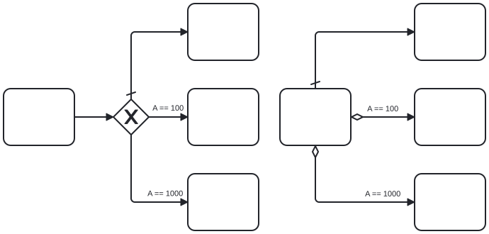{#fig-sec_def_cond}

*Message Flow* eli viestivirta kuvaa viestintää prosessien ja organisaatioiden välillä. Viestivirtaa ei voi käyttää saman prosessin sisällä edes silloin, kun prosessin altaassa on useampia uimaratoja, eli samaan organisaatioon kuuluvia useampia toimijoita. Prosessin kulun siirtyessä saman altaan ratojen välillä, vaikka siirtymän yhteydessä siirtyisikin viestejä tai tietoa, käytetään Sequence Flow -virtaa. Message Flow’ta käytetään silloin, kun prosessi siirtyy altaasta toiseen (@fig-message_flow). Tällöin suorittamisen vastuu siirretään organisaatiolta tai prosessilta toiselle.

{#fig-message_flow}

### Tehtävät

*Task* eli tehtävä esittää erilaisia prosessin aikana suoritettavia töitä tai tehtäviä. Nämä voivat esimerkiksi olla ihmisen suorittamia manuaalisia tai tietokoneen suorittamia automaattisia tehtäviä. Tehtävien avulla esitetään prosessin perusrakenne.

{#fig-perunankuorinta}

Tehtävät esitetään graafisesti tavallisesti suorakaiteen muotoisina nelikulmioina, joiden reunat on pyöristetty. Suorakaide, jossa ei ole mitään graafista tarkenninta (@fig-perunankuorinta), toimii yleiskäyttöisenä tehtävien kuvauselementtinä, eikä siihen liity suorittamista koskevia erityisiä lisätietoja. Laadittaessa prosessimalleja vaikkapa keskustelun tueksi, voidaan tällä elementillä esittää kaikki prosessiin kuuluvat tehtävät ja ilmaista tarvittavat erityispiirteet tehtävän nimessä. Esimerkiksi seuraavan prosessimallin (@fig-gen_activity) tehtävien nimistä on pääteltävissä, että prosessiin liittyy ohjelmistorajapinnan yli suoritettavia tietokoneen tekemiä tehtäviä sekä ihmisen suorittama tehtävä.

{#fig-gen_activity}

#### Manual Task

Ihmisen suoritettavaksi tarkoitettuja tehtävätyyppejä on kaksi. *Manual Task* on täysin manuaalinen tehtävä, esimerkiksi paperidokumentin arkistointi tai verkkokaupassa tehtyyn tilaukseen kuuluvien tuotteiden pakkaaminen lähetettäväksi. Manual Task merkitään esimerkiksi kättelyasentoon ojennetun käden kuvalla (@fig-manual_task).

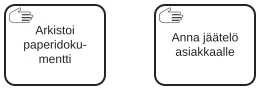{#fig-manual_task}

#### User Task

Myös *User Task* (@fig-user_task) ilmaisee ihmisen suorittamaa tehtävää. Se on kuitenkin tehtävä, joka suoritetaan IT:n -- tyypillisesti jonkin ohjelmiston tai järjestelmän -- avulla. Erottelu manuaalisten ja IT-avusteisten tehtävien välillä johtuu siitä, että BPMN-kieltä voidaan käyttää automatisoitavien prosessien mallintamiseen, jolloin näillä kahdella ihmisen suorittamalla tehtävällä voi olla hyvinkin erilainen merkitys.

{#fig-user_task}

User Taskissa luetaan, käytetään tai tuotetaan tietoa ohjelmistoa käyttäen, esimerkiksi täyttämällä sähköinen lomake, kun taas Manual Task -tehtävät liittyvät tyypillisesti vuorovaikutukseen "fyysisen maailman" kanssa.

#### Script Task

*Script Task* -tehtävätyypillä esitetään tehtäviä, jotka suoritetaan prosessin aikana automaattisesti koodiskriptin avulla ilman ihmisen osallistumista. Käytännössä siis prosessikulun saapuessa Script Task -tehtävään, käynnistetään ennalta määritelty ohjelmakoodi, joka tavallisesti käsittelee prosessimuuttujiin tallennettuja arvoja.

Seuraavassa esimerkissä (@fig-tilauksen_hinnoittelu) on Script Task -tehtäviä käyttävä prosessikulku. Asiakkaalta laskutetaan 9,90 € toimitusmaksu, ellei tilattujen tuotteiden hinta ole vähintään 100,00 €. Esimerkissä Camunda-ympäristössä suoritettavalle prosessille tilatun tuotteen yksikköhinnaksi annetaan 12,50 € ja niitä on tilattu kaksi kappaletta.

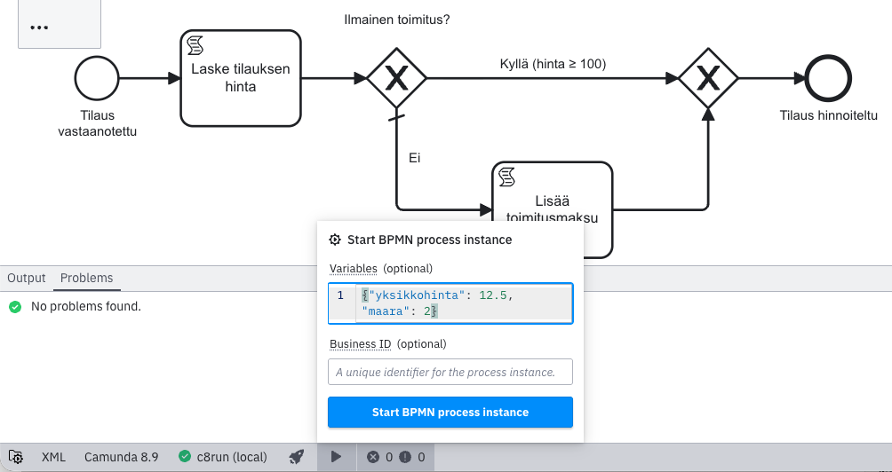{#fig-tilauksen_hinnoittelu}

*Laske tilauksen hinta* -tehtävässä lasketaan tilauksen kokonaishinta kertomalla tilatun tuotteen `yksikkohinta` tilaukseen kuuluvien tuotteiden määrällä `maara`. Laskutoimitus määritellään Camundassa FEEL-skriptinä (*Friendly Enough Expression Language*), kuten (@fig-kokonaishinta).

{#fig-kokonaishinta}

BPMN-kielen graafisen esityksen taustalle prosessimallinnusvälineet tuottavat BPMN XML -muotoista koodia. Edellinen yksinkertainen Zeebe-skripti näyttää tältä.

```xml
<zeebe:script expression="=yksikkohinta * maara" resultVariable="hinta" />
```

Kokonaishinta tallennetaan tulosmuuttujaan `resultVariable` nimellä `hinta`. *Laske tilauksen hinta* -tehtävää seuraavassa portissa muuttujan arvo tarkastetaan. Koska tilauksen hinta jää alle sadan euron (2 * 12,50 = 25,00), tilaukseen lisätään toimitusmaksu (@fig-lisataan_toimitusmaksu).

{#fig-lisataan_toimitusmaksu}

Kun prosessi suoritetaan Camundan ajoympäristössä edellisillä muuttujien arvoilla, se tuottaa seuraavan lopputuloksen (@fig-tilaus_runtime). Koska tilaukseen lisättiin toimitusmaksu, tuli tilauksen hinnaksi 34,90 €.

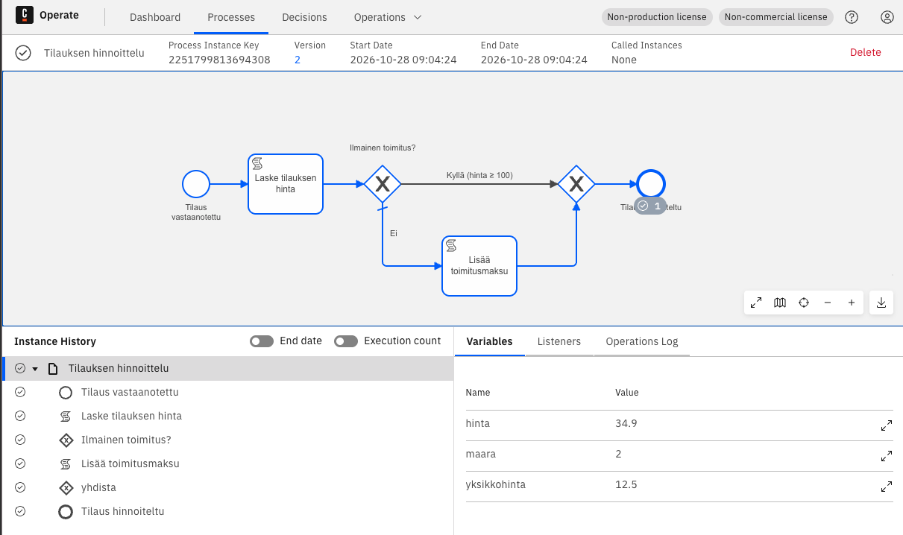{#fig-tilaus_runtime}

Seuraavassa tilauksen käsittelyn prosessimallissa käytetään kaikkia kolmea tähän mennessä esiteltyä tehtävätyyppiä (@fig-tilauksen-kasittely-valiyhtveto).

{#fig-tilauksen-kasittely-valiyhtveto}

Ensimmäinen tehtävä, Laske tilauksen hinta, on Script Task, jossa tilauksen kokonaishinta muodostetaan suorittamalla skripti, kuten edellä. Seuraava tehtävä on User Task, jossa myymäläpäällikkö tekee päätöksen siitä, hyväksytäänkö saapunut tilaus vai täytyykö se jostain syystä hylätä. Esimerkissä tilausten hyväksynnän voidaan ajatella tapahtuvan tilaustenhallintajärjestelmässä, jota myymäläpäällikkö käyttää. Mikäli tilaus hyväksytään, varastotyöntekijä poimii tilatut tuotteet varastosta ja pakkaa ne lähetettäväksi. Tuotteiden pakkaaminen on tyypiltään Manual Task.

#### Service Task

*Service Task* (@fig-service_task) on tehtävätyyppi, jota käytetään, kun prosessissa halutaan suorittaa jokin tehtävä ulkoisen palvelun avulla. Script Task -tehtävään verrattuna ero on siinä, että Service Task kutsuu nimenomaan ulkoista palvelua esimerkiksi API-rajapinnan yli, eikä suorita prosessiin paikallisesti kiinnitettyä ohjelmakoodia. Service Task siis usein toteuttaakin prosessin integraation johonkin järjestelmään.

{#fig-service_task}

Seuraavassa esimerkissä (@fig-ytunnus) käytetään Patentti- ja rekisterihallituksen ja Verohallinnon yhteistä Yritys- ja yhteisötietojärjestelmää (YTJ)[^ytj] asiakasyrityksen tietojen hakemiseen.

[^ytj]: https://www.ytj.fi/

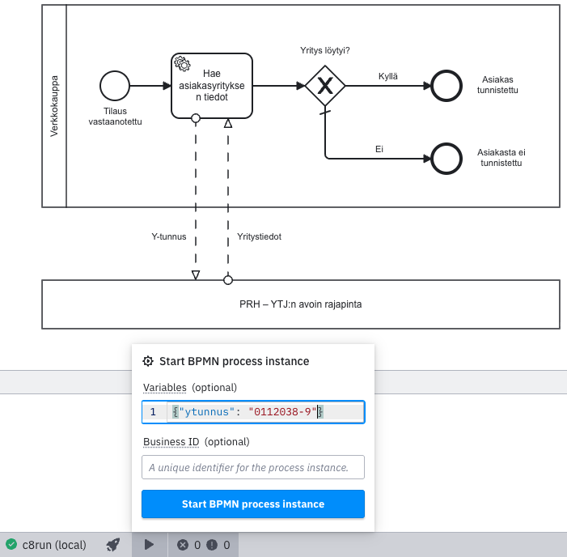{#fig-ytunnus}

Prosessi kytkeytyy YTJ-palveluun rajapinnan kautta ja välittää yritystunnuksen json-muotoisena kutsuna (@fig-service_task-maarittely). 

{#fig-service_task-maarittely}

Kun prosessi suoritetaan, se kutsuu YTJ-palvelua, joka palauttaa yritystunnusta vastaavan yrityksen nimen (@fig-ytunnus_lopputulos).

{#fig-ytunnus_lopputulos}

#### Business Rule Task

*Business Rule Taskin* avulla voidaan suorittaa automaattista sääntöperustaista päätöksentekoa. Päätössäännöt esitetään *Decision Model and Notation* (DMN) -muodossa, joka on standardoitu tapa mallintaa ja esittää päätöksiä[^dmn]. DMN:n avulla voidaan kuvata liiketoimintapäätöksiä yksiselitteisesti ja mallintaa päätöslogiikkaa myös ei-teknisten sidosryhmien ymmärtämässä muodossa. Erityisesti se myös mahdollistaa päätöstilanteiden automatisoimisen osana liiketoimintaprosesseja. Lisäksi DMN:lla voidaan esittää päätöksenteon kokonaisrakennetta (esimerkiksi mitkä päätökset vaikuttavat toisiinsa) ja määritellä taulukkomuotoisia (*Decision Tables*) sääntökokonaisuuksia ja ehtoja päätöksentekotilanteisiin.

[^dmn]: https://www.omg.org/dmn/

{#fig-business_rule_task}

Päätöksen tekeminen tapahtuu niin, että tehtävään menee syötteenä joitain tietoja, joita verrataan ennalta määriteltyihin ehtoihin, joiden perusteella päätös tehdään. Prosessimuuttujille voidaan asettaa päätöksen mukaiset arvot ja prosessikulku etenee Business Rule Taskin jälkeen päätöstä vastaavasti (@fig-dmn-hakemus).

{#fig-dmn-hakemus}

*Päätä hakemuksesta* -Business Rule Task on liitetty `hakemuksen-paatos` -päätöstauluun, joka Camundassa voisi näyttää seuraavalta (@fig-dmn-paatostaulu).

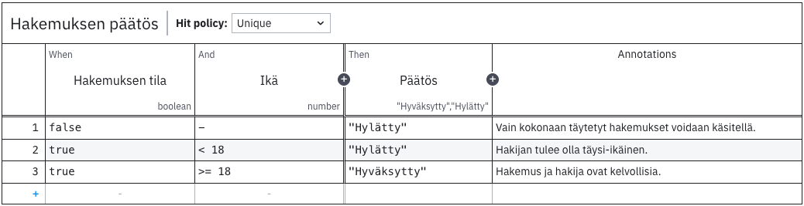{#fig-dmn-paatostaulu}

 Päätöstaulua seuraten hakemus hyväksytään, kun hakemus on kokonaan täytetty ja hakija on täysi-ikäinen. Päätöstyyppi (*Hit policy*) `Unique` tarkoittaa, että päätöksen tekemiseen käytetään vain yhtä sääntöä eivätkä päällekkäiset tai toisensa kumoavat päätökset ole mahdollisia. 

Edellinen päätös voitaisiin tietenkin rakentaa prosessikulkuun myös valintaporttien avulla. Päätöstaulujen hyödyntäminen on kuitenkin prosessin suorittamisen kannalta tehokkaampi tapa ja hyödyllinen erityisesti siksi, että tietyn päätöksen logiikka voidaan tiivistää yhteen tehtävään. Tällöin liiketoimintasääntöjen tai vaikkapa päätökseen vaikuttavan lainsäädännön muutokset voidaan toteuttaa hallitummin yhteen paikkaan. Päätöstaulua voitaisiin käyttää myös esimerkiksi verkkokaupan asiakkaan kotimaan perusteella määräytyvän arvonlisäveron määrittämiseen, jolloin ajantasaiset ALV-tiedot voidaan koota yhteen taulukkoon.

#### Send Task ja Receive Task

BPMN:ssa on kaksi tehtävää prosessin aikana tapahtuvan viestinnän tai tiedonsiirron esittämiseksi tilanteissa, joissa tietoa siirtyy prosessin ulkopuolelle tai tulee sisään: *Send Task* ja *Receive Task* (@fig-send_receive_tasks). Niiden avulla voidaan esittää sekä synkronista että asynkronista viestinvaihtoa muiden prosessien, toimijoiden tai järjestelmien kanssa.

Send Task tarkoittaa, että tehtävä lähettää viestin jollekin toiselle toimijalle tai järjestelmälle. Tehtävän suorittamisen jälkeen prosessi jatkuu välittömästi eteenpäin, joten tarvittaessa prosessiin tulee määritellä, mikäli sen halutaan odottavan vastauksen saapumista. Viesti voi olla esimerkiksi sähköposti, lasku, tilauspyyntö tai vaikkapa API-kutsu. Tosin oikeaoppisempaa viimeisen toteuttamiseksi on käyttää Service Task -tehtävää.

Receive Task -tehtävässä prosessi puolestaan pysähtyy odottamaan saapuvaa viestiä ennen eteenpäin jatkamista. Tätä tehtävää käytetään luonnollisesti silloin, kun prosessin eteneminen tarvitsee jonkin signaalin, vastauksen tai muun tiedon.

{#fig-send_receive_tasks}

Send Task merkitään tummalla kirjekuorella ja Receive Task valkoisella.

#### Call Activity

*Call Activity* ei oikeastaan ole tehtävä, vaan se on viittaus johonkin toiseen prosessiin tai tehtävään, joka kutsutaan suorittamaan oma osuutensa osana prosessikulkua. Sen avulla prosessin rakennetta voidaan modularisoida ja toisaalta se mahdollistaa prosessien uudelleenkäytön. Sen sijaan, että samoja prosessirakenteita monistettaisiin useaan paikkaan, voidaan niihin viitata kertaalleen määriteltyinä ja hallinnoituina kokonaisuuksina. Tällöin vältytään myös siltä, että jonkin useissa yhteyksissä toistuvan toimintosarjan muuttuessa nämä muutokset tulisi toteuttaa kaikkiin samaa toimintosarjaa toteuttaviin prosesseihin.

Seuraavassa esimerkissä (@fig-call_activity) asiakkaan tulee tunnistautua maksupyynnön vastaanottamisen jälkeen. Tunnistautumista varten kutsutaan Call Activityllä *Tunnista käyttäjä* prosessia `kaksivaiheinen-tunnistautuminen`, jolle propagoidaan -- eli viedään -- kutsuvan prosessin kaikkien muuttujien arvot.

{#fig-call_activity}

Propagoinnin sijaan muuttujien välittämisessä voidaan käyttää myös määriteltyjä input- ja output-parametreja. Ne siirtyvät Call Activityllä kutsuttavaan prosessiin ja siitä takaisin. Kutsuva prosessi saa vastauksena ainoastaan paluumuuttujan arvon, eikä sen tarvitse päästä näkemään kutsutun prosessin sisälle, ja toisaalta kutsuttavalle prosessille annetaan vain tiedot, jotka sen tarvitsee nähdä.

Edellinen Call Activityn kutsuma tunnistautumisprosessi voisi näyttää seuraavalta (@fig-kaksivaiheinen-tunnistautuminen).

{#fig-kaksivaiheinen-tunnistautuminen}

Samaa tunnistautumisprosessia voitaisiin kutsua kirjautumisen, salasanan vaihdon tai vaikkapa tilitietojen muuttamisen yhteydessä. Jos tunnistautumistapa muuttuu, muutos tarvitsee tehdä vain yhteen paikkaan.

Call Activityllä kutsuttava prosessi on myös suoritettavissa useana instanssina, eli se on esimerkiksi mahdollista suorittaa jokaiselle asiakkaalle erikseen saman prosessikulun aikana.

#### Sub Process

Call Activityn tavoin myös *Sub Process* ei ole prosessikulun aikana suoritettava yksittäinen tehtävä, vaan nimensä mukaisesti aliprosessi, joka koostuu sarjasta tehtäviä. Sub Process merkitään vastaavalla symbolilla kuin Call Activity, mutta sen reunaviiva on ohut. (@fig-sub_process_kiinni)

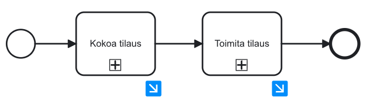{#fig-sub_process_kiinni}

Jokaisen Sub Process -elementin alla on siis tehtävistä koostuva oma prosessikulkunsa, jolle tulee myös määritellä aloitus- ja lopetuspisteet (@fig-sub_process_auki).

{#fig-sub_process_auki}

Aliprosessi on osa pääprosessia ja sitä voidaan käyttää jäsentämään tai yksinkertaistamaan prosessikaaviota. Siten se mahdollistaa prosessin jakamisen osiin, jotka voidaan haluttaessa piilottaa korkeamman tason näkymästä. Call Activityn ja Sub Processin eroja on koottu seuraavaan taulukkoon (@tbl-call-activity-sub-process).

| Call Activity | Sub Process |
|---|---|
| Kohde määritellään aina erillisessä prosessikaaviossa. | Sub Process määritellään samassa prosessikaaviossa pääprosessin kanssa. |
| Kohdetta voidaan käyttää useissa prosesseissa, joista sitä kutsutaan. | Sub Processia voidaan käyttää ainoastaan sen pääprosessissa. |
| Kutsuttaessa Call Activityä, input- ja output-parametrit tulee määritellä eksplisiittisesti[^propa]. | Sub Process perii viestivirrat pääprosessilta, joten sillä on käytettävissä kaikki prosessissa oleva tieto ilman erillistä määrittelyä. |
| Call Activity esitetään aina tiivistettynä eli yhdellä tehtäväelementillä. | Sub Process voidaan esittää tiivistettynä tai se voidaan esittää avattuna aliprosessin kulun tarkastelua varten. |

: Call Activityn ja Sub Processin erot {#tbl-call-activity-sub-process}

[^propa]: Asia on näin BPMN-standardin tasolla. Esimerkeissä käytettävässä Camunda 8:ssa kutsuttu prosessi saa kaikki kutsujan muuttujat (Propagate all parent process variables) ja palauttaa kaikki omansa, ellei siirtoa rajata erikseen.

#### Loop, Parallel Multi-instance, Sequential Multi-instance ja Ad-hoc

BPMN tarjoaa keinoja mallintaa tehtäville sekä aliprosesseille toistuvia tai vaihtoehtoisia käyttäytymismalleja: *Loop*, *Parallel Multi-Instance*, *Sequential Multi-Instance* ja *Ad-hoc*.

Loop (@fig-loop) toimii kuten `do-while`-rakenne ohjelmointikielissä ja tehtävää suoritetaan niin kaun kuin ehto on tosi. Ehto tarkastetaan tehtävän suorittamisen jälkeen tai haluttaessa jo ennen ensimmäistä suorituskertaa (`testBefore`). Silmukassa toistuvalle tehtävälle voidaan asettaa myös toistokertojen enimmäismäärä (`loopMaximum`).

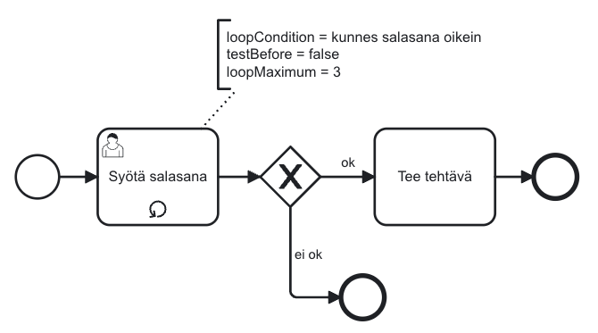{#fig-loop}

Parallel Multi-Instance käynnistää tehtävästä useita rinnakkain suoritettavia toteutuksia eli instansseja. Syötteenä tällaiselle tehtävälle tarvitaan tyypillisesti lista tai joukko, jonka alkiot toimivat syötteinä kullekin instanssille.

Sequential Multi-Instance puolestaan käynnistää tehtävät peräkkäisinä. Seuraava instanssi käynnistyy, kun edellinen on valmis. (@fig-multi_instance) Molemmissa tapauksissa prosessissa siirrytään eteenpäin sitten, kun kaikki instanssit on suoritettu. Koska nämä tehtävätyypit käyvät läpi joukon alkioita `foreach`-rakenteen tyyliin, ne eivät ole Loopin kaltaisia silmukkarakenteita.

{#fig-multi_instance}

Seuraava esimerkki (@fig-multi_esim1) kuvaa tilannetta, jossa asiakas asioi myymälässä. Kukin hänen tilaamansa tuote poimitaan varaston hyllyltä, yksi kerrallaan ja peräkkäisessä järjestyksessä. Tämän jälkeen asiakkaalta peritään maksu. Maksua penätään asiakkaalta tarvittaessa useampaan kertaan, ennen kuin tuotteet luovutetaan. Jos asiakas ei maksa viidennelläkään pyynnöllä (loopMaximum = 5), ei tuotteita luovuteta.

{#fig-multi_esim1}

Toisen esimerkin (@fig-multi_esim2) tilaus liittyy digitaalisiin tuotteisiin, joihin käyttäjälle annetaan maksun jälkeen käyttöoikeudet. Kaikki käyttöoikeudet voidaan luovuttaa kerralla, joten tehtävän instanssit voidaan suorittaa rinnakkain. Prosessi päättyy ilman käyttöoikeuksien luovuttamista, mikäli asiakas ei ole maksanut tilaustaan kahden maksumuistutuksen jälkeen.

{#fig-multi_esim2}

Ad-hoc -prosessi tai -aliprosessi on BPMN-kielen villi kortti (@fig-ad-hoc).

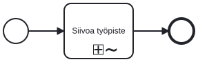{#fig-ad-hoc}

Sen avulla voidaan esittää tehtäväsarjoja, joiden suoritusjärjestys ei ole ennalta määritelty. Ad-hoc -prosessiin kuuluvat tehtävät voidaan suorittaa kokonaan tai osittain, vapaassa järjestyksessä tai vaikka rinnakkain (@fig-ad-hoc_auki). Näin ollen ad-hoc -prosessille ei myöskään määritellä prosessikulkua. Ad-hoc -tyyppinen prosessi merkitään tilde-merkillä (~), jolla matematiikassa ilmaistaan approksimaatiota.

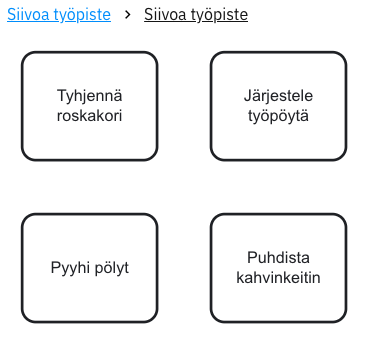{#fig-ad-hoc_auki}

### Tapahtumat

Siinä missä edellä käsitellyt tehtävät kuvaavat prosessin aikana suoritettavaa tekemistä, tapahtumat (*Event*) kuvaavat asioita, jotka 'tapahtuvat' prosessin aikana. BPMN:ssa tapahtumia on kolmea päätyyppiä: *Start Event* (aloitustapahtuma), *Intermediate Event* (välitapahtuma) sekä *End Event* (lopetustapahtuma). Tapahtumat voivat siis käynnistää, keskeyttää tai päättää prosessin, tai tapahtua prosessin aikana. Kullakin päätyypillä on alityyppejä, jotka käsitellään seuraavissa alaluvuissa. BPMN:n graafisessa notaatiossa tapahtumat esitetään ympyrällä (@fig-events). Start Event -tyyppisissä tapahtumissa ympyrän kehä piirretään ohuella viivalla, End Event -tapahtumissa paksulla viivalla ja Intermediate Event -tapahtumissa kaksoisviivalla.

{#fig-events}

Jotkin intermediate-tyyppisistä tapahtumista voidaan myös liittää tehtävään, jolloin niitä kutsutaan nimellä *Boundary Event*. Tällainen rajatapahtuma voi olla keskeyttävä (*interrupting*) tai ei-keskeyttävä (*non-interrupting*), jolloin se esitetään kaksoiskatkoviivalla (@fig-boundaryt).

{#fig-boundaryt}

Mikäli tilauksen käsittelyn aikana vastaanotettaisiin ilmoitus tilauksen peruutuksesta, tehtävän suorittaminen lopetettaisiin. Vastaavasti asiakkaan ilmoittama tieto osoitteen muutoksesta ei keskeyttäisi tilauksen käsittelyä, vaan johtaisi tilauksen osoitetiedon päivittämiseen. 

Keskeyttävän ja ei-keskeyttävän tapahtuman toiminnalliset erot on esitetty seuraavassa taulukossa (@tbl-keskeyttava-tapahtuma).

| | Keskeyttävä tapahtuma | Ei-keskeyttävä tapahtuma |
|---|---|---|
| Keskeyttääkö nykyisen tehtävän / prosessin? | Kyllä | Ei |
| Jatkuuko alkuperäinen tehtävä? | Ei, se keskeytetään | Kyllä, se jatkuu normaalisti loppuun saakka |
| Käynnistääkö uuden polun? | Kyllä | Kyllä |
| Käyttötarkoitus | Kriittinen tapahtuma, kuten virhe tai aikakatkaisu | Lisälogiikka, ilmoitukset, monitorointi |

: Keskeyttävän ja ei-keskeyttävän tapahtuman erot {#tbl-keskeyttava-tapahtuma}

Seuraavassa kuviossa (@fig-eventteja) on tilauskäsittelyn prosessimalli, jossa on Start Event -aloitustapahtuma, sitä seuraava tehtävä *Kerää tilauksen tuotteet*. Tähän liittyy Non-interrupting Boundary Event, joka aktivoi tehtävän *Ilmoita viivästyksestä*, mikäli kaksi vuorokautta ehtii kulua ennen kuin tuotteet on kerätty. Tämän jälkeen siirrytään tehtävään *Toimita tilaus*, jonka jälkeen prosessi päättyy End Eventiin. 

{#fig-eventteja}

Seuraavassa esimerkissä (@fig-eventteja2) esiintyy myös Terminate Event. Se voidaan mieltää End Eventin voimakkaammaksi versioksi. Prosessin jonkin haaran päätyessä Terminate Eventiin, koko prosessi lopetetaan riippumatta siitä, missä vaiheessa sen muut haarat ovat. Mikäli tilaus peruutetaan, kaikki prosessiin liittyvä toiminta lopetetaan.

{#fig-eventteja2}

#### Message Event

Message Event -viestitapahtumia on muutama erilainen. *Message Start Event* on prosessin käynnistävä tapahtuma. Prosessi käynnistyy, kun se vastaanottaa viestin toiselta prosessilta tai vaikkapa ulkoiselta järjestelmältä. Viesti voi olla esimerkiksi puhelinsoitto tai verkkokaupasta tuleva tilaus, joka käynnistäisi tilauskäsittelyprosessin.

Jo edellä nähdyn *Message Intermediate Event* -tapahtuman (@fig-eventteja2) avulla voidaan esittää tilanne, jossa prosessin jokin tehtävä on valmis vastaanottamaan viestin, johon se reagoi, mikäli viesti saapuu.

Seuraavassa esimerkissä (@fig-eventteja3) Message Start Event käynnistää prosessin saadessaan viestin tehdystä tilauksesta. Ensimmäisessä tehtävässä asiakkaalta ruvetaan keräämään maksua. Tähän tehtävään liittyy myös *Message Boundary Event* eli tieto tapahtumasta, jossa asiakas onkin perunut tilauksensa. Jos prosessia luetaan tarkkaavaisesti, huomataan, että viesti tilauksen perumisesta voi saapua sinä aikana, kun maksun kerääminen on vielä käynnissä. Mikäli prosessi siirtyy *Lähetä tilaus* -tehtävään, ei tilauksen peruminen enää voi johtaa prosessin päättymiseen. Prosessia suunniteltaessa tulee tietenkin huomioida, että mikäli asiakas voi perua tilauksen vielä maksamisen jälkeenkin (minkä etämyyntiä koskevan lainsäädännön mukaan täytyykin Suomessa olla mahdollista), ei prosessi voi ainoastaan päättyä perumisviestin vastaanottavan tapahtuman jälkeen, vaan prosessin tulee huolehtia muun muassa maksun palauttamisesta asiakkaalle. Esimerkkiprosessimme päättyy *Lähetä tilaus* -tehtävää seuraavaan *Message End Event* -tapahtumaan, joka voisi prosessin lopuksi lähettää asiakkaalle tiedon siitä, että hänen tilauksensa on jätetty kuljetettavaksi.

{#fig-eventteja3}

Edellä todettiin, että Boundary Eventit voivat olla keskeyttäviä tai ei-keskeyttäviä. Yllä olevan prosessin johonkin tehtävään voisi liittyä esimerkiksi ei-keskeyttävä Message Boundary Event, joka ottaisi vastaan asiakkaan tilaukseensa mahdollisesti tekemän muutoksen, kuten esimerkiksi tilaukseen lisätyt tuotteet. Tällainen tapahtuma aloittaisi prosessissa uuden polun, jonka tehtävät päivittäisivät tilausta vastaavalla tavalla. Tällaista prosessia suunniteltaessa tietenkin olisi harkittava, kuinka paljon asiakkaan halutaan sallia tilaustaan säätää, jotta toiminta on järkevää liiketoimintaprosessien sujuvuuden ja tehokkuuden kannalta, ja toisaalta sujuvan ja myönteisen asiakaskokemuksen kannalta.

#### Conditional Event

*Conditional Event* eli ehdollinen tapahtuma voi olla prosessin ehdollisesti käynnistävä Conditional Start Event tai prosessin aikana tapahtuva *Conditional Boundary Event* tai *Conditional Intermediate Catch Event* (@fig-conditional).

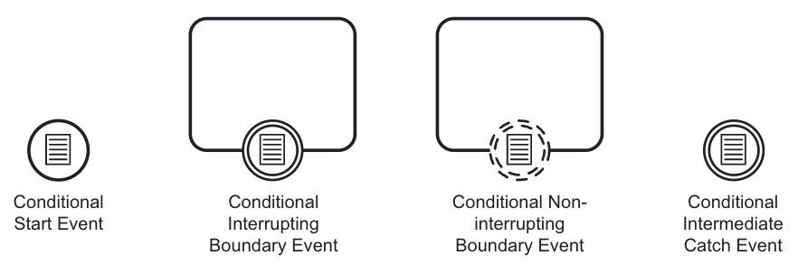{#fig-conditional}

Ehdollinen aloitustapahtuma siis käynnistää prosessin tietyn ennalta määritellyn ja tarvittaessa monimutkaisenkin ehdon täyttyessä (@fig-cond_esim). Conditional Boundary Event, eli ehdollinen rajatapahtuma, voi olla tyypiltään keskeyttävä tai ei-keskeyttävä. Ehdon täyttyessä tehtävä voi käynnistää prosessiin uuden haaran. Conditional Intermediate Catch Event puolestaan pysäyttää prosessin, kunnes määritelty ehto muuttuu todeksi, jonka jälkeen eteneminen jatkuu.

{#fig-cond_esim}

Tässä vaiheessa saattaa ajatella, että mihin tällaisia tapahtumatyyppejä tarvitaan. Eikö saman asian voi esittää ja saman toiminnallisuuden toteuttaa joitain muita elementtityyppejä -- kuten viestejä -- käyttäen? Vastaus ainakin useimmissa tapauksissa on, että kyllä voi. Ehdollisten tapahtumien etu viesteihin perustuvaan kommunikointiin verrattuna on löyhäkytkentäisyydessä (Loose Coupling).

Ehdolliset tapahtumat mahdollistavat loogisten ehtojen varassa toimimisen, sen sijaan, että prosessiin tarvitsee rakentaa tiukkoja, rajapintojen ja viestimuotojen tuntemista edellyttäviä kytkentöjä. Ehto voi olla loogisesti johdettu tai vaikkapa tietovarastosta saatava tieto siitä, että tilauksen maksu on suoritettu. Tämä sen sijaan, että prosessilla tulisi olla valmiudet kytkeytyä kaikkiin nykyisiin ja mahdollisiin tuleviin vaihtoehtoisiin maksujärjestelmiin sekä kyetä tulkitsemaan ja ymmärtämään niistä saapuvat kuittausviestit. Järjestelmiä ja muita teknisiä ratkaisuja toteutettaessa löyhäkytkentäisyys on yleisesti hyvänä pidetty suunnitteluperiaate. Täytyy kuitenkin muistaa, että jos prosessi halutaan rakentaa pelkästään loogisen tason ehdoille ja päätöksille[^bisnesskieli], ja siten mahdollisimman riippumattomaksi sitä ympäröivistä järjestelmistä ja teknologioista, täytyy vaiva kuitenkin nähdä jossain muualla. Kehittäjä joutuu todennäköisesti tekemään töitä sen eteen, että prosessin ehdolliselle tapahtumalle saadaan tietovarastosta tai eri pankkien maksurajapinnoista loogisen tason tieto siitä, että `maksu == ok`.

[^bisnesskieli]: Tällöin voitaisiin ehkä puhua myös ”liiketoiminnan ymmärtämästä kielestä”.

#### Timer Event

*Timer Event*it eli ajastintapahtumat (@fig-timer) liittyvät ajastettuihin ja aikaan sidottuihin tapahtumiin. Niiden avulla voidaan ilmaista esimerkiksi viivettä, ajoituksia tai jollain aikavälillä toistuvia tapahtumia.

*Timer Start Event* määrittelee, että prosessi käynnistyy jonkin aikamääreen perusteella, esimerkiksi joka arkipäivä kello kahdeksan. *Timer Intermediate Catch Event* viivästyttää prosessin etenemistä tietyn ajanjakson kerran -- prosessi voidaan siis määrätä odottamaan. *Timer Boundary Event* puolestaan liitetään johonkin tehtävään ja sen avulla voidaan aloittaa toinen haara, mikäli alkuperäisen aktiviteetin suorittaminen kestää liian kauan. Tämäkin tapahtuma voidaan määritellä joko keskeyttäväksi tai ei-keskeyttäväksi.

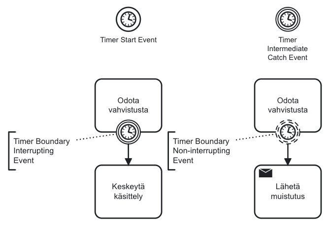{#fig-timer}

Seuraavassa kuviossa (@fig-timer_esim) on muutama esimerkki ajastintapahtumien käytöstä.

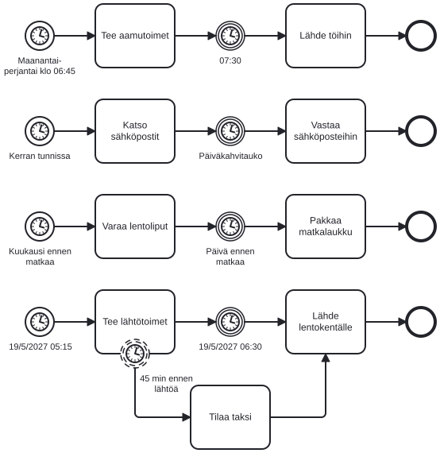{#fig-timer_esim}

Edellä ajastintapahtumiin liittyvät aikamääreet on esitetty yleistajuisesti. Taustalla BPMN kuitenkin käyttää ajanmäärittelyssä ISO 8601 -standardia. Seuraavassa on muutama esimerkki tämän standardin mukaisesta aikamääreiden esittämisestä.

*Fixed Date* -muotoa voidaan käyttää, kun prosessin tai tapahtuman halutaan alkavan tiettynä ajanhetkenä. Fixed Date esitetään muodossa:

```text
YYYY-MM-DDTHH:MM:SS
```

eli esimerkiksi `2027-03-24T08:15:00`, mikä tarkoittaa vuoden 2027 maaliskuun 24. päivää ja kellonaikaa 8:15. Aikavyöhyke ilmaistaan liittämällä litanian perään ajan ero UTC-aikaan. Suomen normaaliaika on kaksi tuntia edellä koordinoitua yleisaikaa, joten edellinen aikamääre Suomen talviajassa olisi siis:

```text
2027-03-24T08:15:00+02:00
```

*Cyclen* avulla voidaan esittää toistuva ajankohta seuraavassa muodossa, eli toistokertojen määrä, aloitusaika, toistoväli:

```text
R/StartTime/Duration
```

Mikäli aloitusaikaa ei ilmoiteta, toistuva aika määrittyy tehtävän ensimmäisen kohtaamisen perusteella. Mikäli toistokertoja ei määritellä, toistoja tehdään loputtomasti. Loputtomiin kerran päivässä toistuva tapahtuma ilmaistaan:

```text
R/P1D
```

ja vastaavasti kerran viikossa toistuva tapahtuma olisi:

```text
R/P1W
```

Jos tehtävä yrittäisi vaikkapa hakea tietoa jostain verkkopalvelusta, voitaisiin se ajastaa yrittämään sitä esimerkiksi enintään viisi kertaa ja kymmenen sekunnin välein tapahtuen:

```text
R5/PT10S
```

Seuraava aikamääre asettaisi aloituksen 1.6.2027 kello 9:00 ja tapahtuma tai prosessi toistuisi samalla kellonlyömällä päivittäin seitsemän päivän ajan:

```text
R7/2027-06-01T09:00:00/PT1D
```

jolloin viimeinen toistokerta tapahtuisi siis 7.6.2027 kello 9:00. *Duration* määrittelee odotusajan ennen prosessin jatkamista. Esimerkiksi:

- viiden sekunnin viive: `PT5S`
- 1,5 tunnin viive: `PT1H30M`
- viikon viive: `P7D`
- viikon ja 1,5 tunnin viive: `P7DT1H30M`
- yhden vuoden, kuuden kuukauden, kahden päivän, neljän tunnin, kahdeksan minuutin ja yhdeksän sekunnin viive: `P1Y6M2DT4H8M9S`

Camunda Modelerissa ajan määrittely onnistuu seuraavassa kuviossa näkyvällä tavalla (@fig-timer-juhannus). Timer Definition Type -valikosta valitaan aikamääreen tyyppi ja aika määritellään Timer Definition -kohtaan ISO 8601 -standardin mukaisessa muodossa.

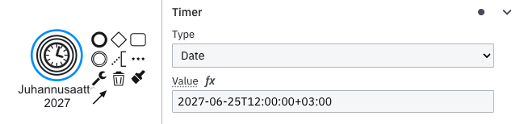{#fig-timer-juhannus}

Aikailmaisuissa käytetään seuraavia kirjainlyhenteitä. Kirjaimet ovat vastaavien englanninkielisten sanojen alkukirjaimia.

- `P` on kestoa (*period*) osoittava kirjain, joka sijoitetaan kestomerkinnän alkuun.  
- `Y` on vuosia (*year*) osoittava kirjain, joka tulee vuosien määrän jälkeen.  
- `M` on kuukausia (*month*) osoittava kirjain, joka tulee kuukausien määrän jälkeen.  
- `W` on viikkoja (*week*) osoittava kirjain, joka tulee viikkojen määrän jälkeen.  
- `D` on päiviä (*day*) osoittava kirjain, joka tulee päivien määrän jälkeen.  
- `T` on aikaosuutta (*time*) osoittava kirjain, joka edeltää ajan komponentteja.  
- `H` on tunteja (*hour*) osoittava kirjain, joka tulee tuntien määrän jälkeen.  
- `M` on minuutteja (*minute*) osoittava kirjain, joka tulee minuuttien määrän jälkeen.  
- `S` on sekunteja (*second*) osoittava kirjain, joka tulee sekuntien määrän jälkeen.  

Huomaa, että M-kirjain esiintyy sekä kuukausia ilmaistaessa (päivämääräosassa) että minuutteja ilmaistaessa (aikaosassa). Tämän vuoksi T-kirjain erottaa päivämäärä- ja aikaosat toisistaan.

#### Error Event

*Error Event*iä eli virhetapahtumaa käytetään ennalta määriteltyjen virhe- ja poikkeustilanteiden käsittelyyn[^virhe]. Yksittäinen virhe voi liittyä yhteen tai useampaan virhetapahtumaan. Jokaiselle virheelle tulee määritellä virhekoodi, jonka arvo ilmaisee, mikä virheen vastaanottava tapahtuma käsittelee heitetyn virheen.

[^virhe]: Virheillä ei tässä tarkoiteta BPMN-mallissa itsessään olevia syntaksi- tai loogisia virheitä.

*Error Boundary Event* liitetään tehtävään tai aliprosessiin, ja se laukaisee virheen tapahtuessa vaihtoehtoisen haaran. Error Boundary Event on aina keskeyttävä. *Error End Event* puolestaan lopettaa prosessin virhetapahtumaan.

Seuraavassa prosessimallissa (@fig-error-esim) Script task -tehtävä tarkastaa käyttäjän lomakkeen kautta syöttämät tiedot. Mikäli tiedoissa on virhe, prosessi päättyy virhetapahtumaan. *Error Boundary Event* nappaa virheen ja ohjaa prosessin korjaavalle polulle.

{#fig-error-esim}

Error End Eventille tulee määritellä virhekoodi ja viite (*Global error reference*), jonka avulla virheenkäsittely voidaan toteuttaa (@fig-error_esim2). Edellisessä esimerkissä käyttäjää siis vain pyydettäisiin täyttämään tiedot uudelleen, mutta joissain tapauksissa voisi olla tarpeen määritellä esimerkiksi korjaava prosessikulku, joka käynnistettäisiin virheen havaitsemisen jälkeen.

{#fig-error_esim2}

#### Compensation Event

*Compensation Event*iä käytetään kompensoimaan eli kumoamaan jo suoritettu tehtävä prosessin suorituksen keskeytyessä. Kompensoivan toimenpiteen suunnittelulla voidaan toteuttaa tehtävän hallittu, liiketoimintalogiikan mukainen peruuttaminen. Kompensoinnin ei välttämättä ole tarkoitus palauttaa systeemiä samaan tilaan, jossa se oli kompensoitavan prosessin tai tehtävän käynnistyessä.

Ajatellaan jotain systeemiä, jolla on useita samanaikaisia käyttäjiä. Yksi käyttäjistä käynnistää prosessin, jossa prosessimuuttujan `luku1` numeroarvosta siirretään puolet muuttujan `luku2` arvoon. Jokin tehtävä lukee ensin `luku1`:n lähtöarvon ja vähentää siitä puolet. Mikäli `luku2`:n arvon kasvattaminen `luku1`:n puolikkaalla jostain teknisestä tai vaikka liiketoimintasääntöön perustuvasta syystä kuitenkin epäonnistuu, transaktiomuotoisessa suorituksessa prosessi keskeytetään (*Abort*) ja systeemi palautetaan sen alkuperäiseen tilaan (*Rollback*). On kuitenkin mahdollista, että systeemin toinen käyttäjä on tällä välin päivittänyt `luku1`:n arvoa, jolloin alkuperäisen tilan palauttaminen rollback-operaatiolla hävittää myös toisen käyttäjän tekemän muutoksen. Tarvitaan peräkkäinen palautus (*Cascading Rollback*), joka peruuttaa kaikki väärän tiedon varassa toteutetut toiminnot. Yksinkertaisin ratkaisu tietysti olisi lukita kunkin transaktion tarvitsemat resurssit kyseiselle transaktiolle, kunnes koko prosessi on suoritettu onnistuneesti loppuun tai keskeytetty. Liiketoimintaprosessit voivat kuitenkin olla kestoltaan pitkiä, joten resurssien lukitseminen voisi aiheuttaa huomattavaakin viivettä kaikkiin muihin samoja resursseja tarvitseviin toimintoihin.

Seuraavassa esimerkissä (@fig-compensation-esim) varauspyynnön vastaanottamisen jälkeen asiakkaalle varataan matkakohteeseen lento ja hotellimajoitus. Mikäli maksun veloitus ei kuitenkaan onnistu, prosessi etenee *Compensation End Event* -tapahtumaan ja *Compensation Boundary Event* -tapahtumat käynnistävät kompensoivat tehtävät. Kompensoivalle tehtävälle ei ole omaa tehtävätyyppiä, vaan esimerkiksi Camundassa tehtävään lisätään kompensointia ilmaiseva symboli automaattisesti, kun tehtävä käynnistyy Compensation Eventin kautta.

{#fig-compensation-esim}

Kompensointi koskee vain tehtäviä, jotka on jo tehty loppuun. Jos prosessi olisi kaatunut jo hotellin varaamiseen, vain lento peruttaisiin. Peruminen -- tai kumoaminen -- ei ole tekninen rollback, vaan sitä varten täytyy määritellä oma toimenpiteensä, eikä kompensoinnin tarvitse siis palauttaa systeemiä täsmälleen alkutilaan. Esimerkiksi lennon peruutuksesta voisi asiakkaalle jäädä maksettavaksi peruutusmaksu.

#### Link Event

*Link Event*in avulla voidaan yhdistää prosessin osia ilman fyysistä virtayhteyttä. Sitä voidaan verrata joistain ohjelmointikielistä tuttuun goto-käskyyn, joka siirtää ohjelman suorittamisen toiseen kohtaan ohjelmakoodia. Link Eventin toteuttama siirto on yksisuuntainen eli sen jälkeen suorittamista ei palauteta takaisin, toisin kuin vaikka funktiota ohjelmointikielessä kutsuttaessa.

Link Eventiä käytetään lähinnä monimutkaisten prosessimallien selkeyttämiseen sen mahdollistaessa prosessimallin pilkkomisen pienempiin osiin ja hypyt osien välillä.

Seuraavassa prosessissa (@fig-link-esim) puuttuvan tuotteen tilaamisen jälkeen Link Event *Toimitukseen* siirtää prosessikulun *Toimita tilaus* -aliprosessin käynnistämiseen.

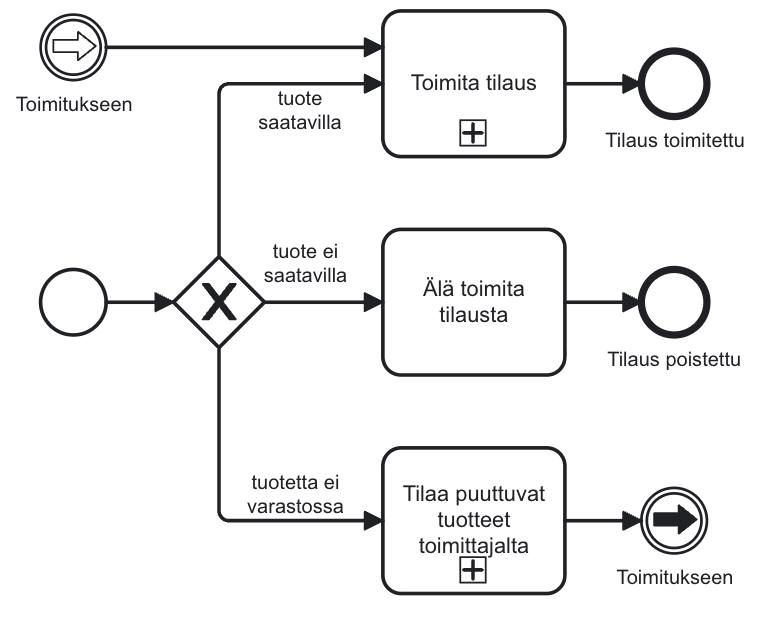{#fig-link-esim}

#### Signal Event

Siinä missä Message-tehtävät ja -tapahtumat on aina tarkoitettu tarkoin koordinoituun kahden osapuolen väliseen viestinvaihtoon, *Signal Event* mahdollistaa samanaikaisen *broadcast*-tyyppisen viestinnän useille signaalia kuunteleville. Signaalin lähettäjän ei tarvitse tietää, kuinka monta vastaanottajaa sillä on, eikä se odota vastaanottajilta vastausta (@fig-signal-token-esim).

Signal Event -tapahtuman tyypit ovat heittävä (*Throw*) ja vastaanottava (*Catch*). Sitä voidaan käyttää *Boundary*-, *Intermediate*-, *Start*- ja *End*-tapahtumissa.

Seuraavassa esimerkissä tehtävää *1* seuraa Intermediate Signal Event *A*. Kaksi muuta prosessia kuuntelevat tätä signaalia ja sen saatuaan suorittavat omat tehtävänsä *2* ja *3*. Signaloiva prosessi siis pyytää kaikkia signaalin *A* kuulevia prosesseja Signal Start Eventin kautta suorittamaan omat tehtävänsä ja siirtyy suorittamaan tehtäväänsä *4*.

Teknisesti ottaen -- ja automaattisia prosessikulkuja simuloitaessa -- tehtävien *2* ja *3* suorittaminen alkaa samaan aikaan kuin tehtävän *4*. Mikäli tehtävillä ei ole määriteltyä suoritusaikaa, ne kaikki myös valmistuvat samaan aikaan. Käytännössä ja todellisissa prosesseissa tätä ei tietenkään voida taata.

![Signal Eventin suorittaminen prosessisimulaatiossa[^signal-token-esim]](kuviot/signal-token-esim.png){#fig-signal-token-esim}

[^signal-token-esim]: Kuviossa näkyvä Token Simulation esitellään Työvälineitä-luvussa. 

Käytäntöä lähempänä olevassa esimerkissä laadunvarmistus huomaa ongelman jossain myytävässä tuotteessa ja prosessi signaloi siitä (@fig-signal-ongelma).

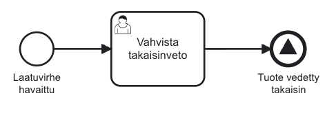{#fig-signal-ongelma}

Kaikki tilausten keräilyprosessit, jotka saavat tiedon kerättävään tilaukseen kuuluvan tuotteen takaisinvedosta, keskeytetään.

{#fig-signal-reaktio}

#### None Event

*None Event* on tyhjä tapahtuma, jossa ei varsinaisesti prosessikulun kannalta tapahdu mitään (@fig-none-esim). Niitä voidaan käyttää prosessin luettavuuden parantamiseen ohjelmakoodin kommentoinnin tavoin tai pitkäkestoisen prosessin tilasiirtymien konkreettiseen tarkastamiseen.

None Eventit pystyvät myös asettamaan muuttujia, joten niitä voidaan hyödyntää prosessin monitoroinnissa (esimerkiksi KPI-mittareihin liittyvä informaatio) tai automatisoitujen prosessien toteutuksessa tarvittavien ohjausyksityiskohtien asettamisessa.

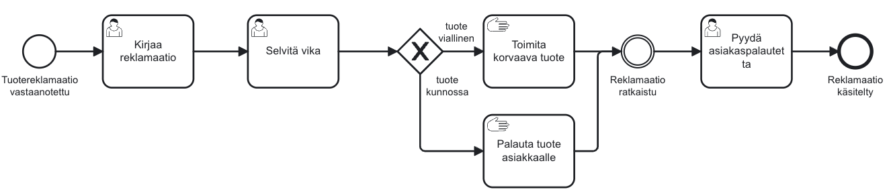{#fig-none-esim}

 Vaikka None Event ei varsinaisesti tee mitään, se voi kertoa prosessista ja sen tilasta paljonkin. Sen avulla (*Reklamaatio ratkaistu*) edellinen prosessi jaettiin kahteen konkreettiseen vaiheeseen: ongelman selvittämiseen ja reklamaation käsittelyn jälkitoimiin. Yrityksen palvelulupaus voi olla, että reklamaatio ratkaistaan viidessä arkipäivässä. Tässä voidaan prosessin kokonaiskeston sijaan mitata aikaa aloituksesta välitavoitteeseen, koska korvaavan tuotteen toimituksen kesto ei ole reklamaatioiden käsittelijöiden hallinnassa. Lisäksi asiakaspalvelija näkee käynnissä olevasta prosessi-instanssista, onko reklamaatio jo ratkaistu, vaikka prosessi ei olisi vielä päättynyt.

### Portit

Porttien (*Gateway*) avulla voidaan ohjata prosessin etenemistä tietyissä päätöspisteissä prosessin aikana. Portit voivat myös haarauttaa (*Split*) prosessivirran useaan suuntaan ja yhdistää (*Join*) useita virtoja taas yhdeksi. Portin symbolina käytetään vinoneliötä, jonka sisällä on portin tyyppiä ilmaiseva tunnus.

#### Parallel Gateway

*Parallel Gateway* eli rinnakkainen portti jakaa prosessivirran useaan rinnakkain suoritettavaan haaraan. Rinnakkaisen portin tunnisteena käytetään +-merkkiä. Rinnakkaiset virrat tulisi taas yhdistää, kun se on mahdollista.

Seuraavassa esimerkissä (@fig-til-toimi) prosessin kulku haarautuu kolmeen rinnakkaiseen järjestysvirtaan, jotka aktivoituvat samanaikaisesti.

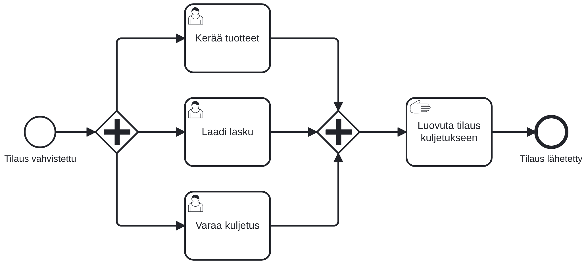{#fig-til-toimi}

#### Exclusive Gateway

*Exclusive Gateway* eli eksklusiivinen portti tai XOR-portti merkitään vinoneliön sisällä olevalla ✕-merkillä. Sen avulla prosessin kulkua voidaan ohjata sääntöperusteisesti: XOR-portti valitsee ehtojen perusteella vain yhden etenemispolun.

Mikäli useampi XOR-porttiin liittyvä ehto on tosi, prosessi seuraa ensimmäistä tosi-haaraa. Tällaisia tilanteita on syytä pyrkiä välttämään. Ehtojen tulisi siis olla toisensa poissulkevia. Tarvittaessa voidaan tukeutua myös oletusvirran merkitsemiseen.

Seuraavassa esimerkissä (@fig-xor-esim) eksklusiivinen portti jatkuu kolmeen vaihtoehtoiseen järjestysvirtaan. Mikäli asiakas on uusi, hänelle lähetetään tervetuliaisviesti. Mikäli asiakkuus on kestänyt vuoden, lähetetään kiitokset pitkästä asiakassuhteesta. Muissa tapauksissa viestejä ei lähetellä. Ilman viestin lähettämistä etenevä järjestysvirta on merkitty oletusvirraksi.

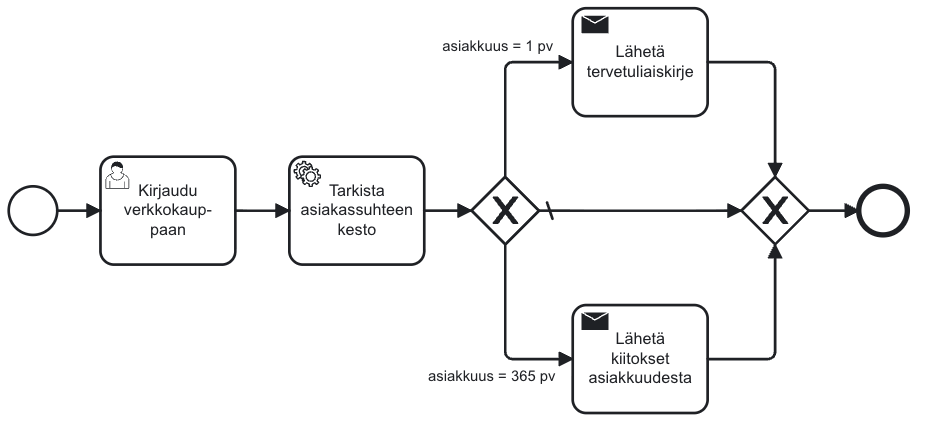{#fig-xor-esim}

Ehdot (*Condition*) määritellään portista lähteviin virtoihin (@fig-xor-esim2) ja prosessia suoritettaessa se etenee prosessimuuttujien arvojen mukaisesti (@fig-xor-esim3).

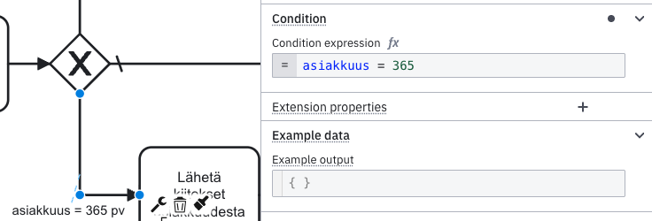{#fig-xor-esim2}

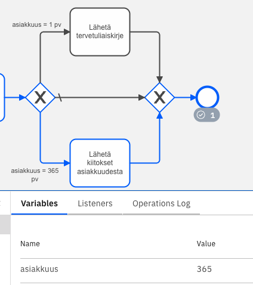{#fig-xor-esim3}

Ehdot kannattaa kirjoittaa myös virtojen yhteyteen, jotta prosessimallin lukeminen graafisen esityksen perusteella on helpompaa.

#### Inclusive Gateway

*Inclusive Gateway* eli inklusiivinen portti tai yleisemmin OR-portti merkitään vinoneliön sisällä olevalla ympyrällä. Porttia seuraavista virroista valitaan ehtojen perusteella yksi tai useampia. OR-portti voi siis aktivoida useita haaroja ja vähintään yhden haaran täytyy aina aktivoitua.

Seuraavassa esimerkissä (@fig-inclu-esim) VIP-asiakkaille annetaan viiden prosentin alennus ja yli kymmenen tilausta tehneille asiakkaille 2,5 prosentin alennus. Molempien ehtojen täyttyessä asiakas voi siis saada molemmat alennukset.

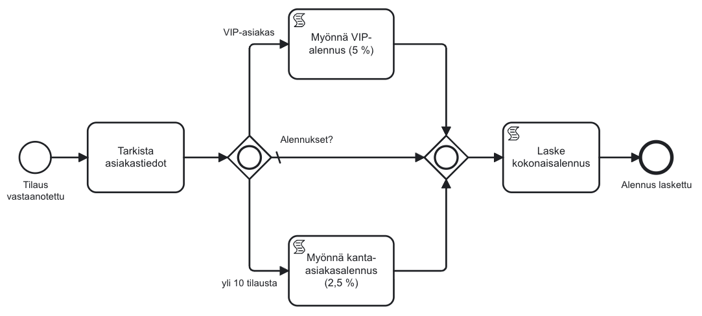{#fig-inclu-esim}

OR-portin haarojen ehdot tarkastetaan ja haarat aktivoituvat tarvittaessa. Ylemmässä haarassa tarkastetaan `vip`-muuttujan arvo ja mikäli se on `true` (@fig-inclu-esim2), asetetaan skriptitehtävällä muuttujan `vipAlennus` arvoksi `5` (@fig-inclu-esim3).

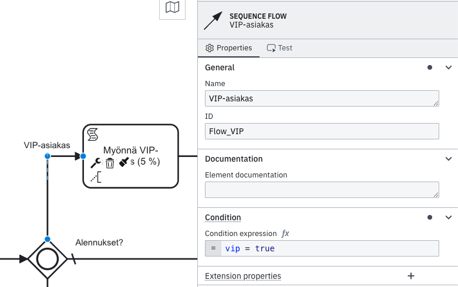{#fig-inclu-esim2}

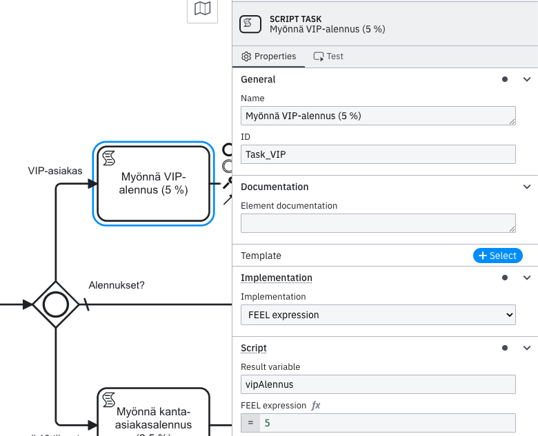{#fig-inclu-esim3}

Myös alempi haara tarkastetaan ja tarvittaessa asetetaan muuttujalle `kantaAlennus` arvo `2.5`. Lopuksi  *Laske kokonaisalennus* -tehtävässä kokonaisalennus muodostetaan FEEL-skriptillä (@fig-inclu-esim4). Mikäli `vipAlennus`- ja `kantaAlennus`-muuttujia ei ole asetettu, saavat ne arvon `0`.

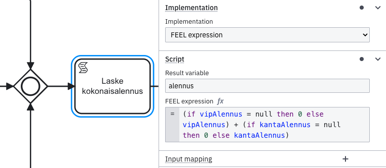{#fig-inclu-esim4}

#### Event-Based Gateway

*Event-Based Gateway* eli tapahtumapohjainen portti suorittaa valinnan sen perusteella, mikä siihen liittyvistä tapahtumista tapahtuu ensimmäisenä[^samaan_aikaan]. Prosessin kulku siis aina odottaa vähintään hetken ensimmäistä tapahtumaa. Sen sijaan esimerkiksi joko-tai-muotoinen XOR-portti päästää virran läpi välittömästi, koska päätökseen tarvittavat tiedot menevät porttiin syötteinä. Event-Based Gateway merkitään vinoneliön sisällä olevalla kaksiviivaisella ympyrällä, jonka sisällä on viisikulmio.

[^samaan_aikaan]: On mahdollista, että useampi Event-Based Gatewayn odottama tapahtuma tapahtuisi täsmälleen samaan aikaan. Automatisoidussa prosessissa näin ei kuitenkaan voi käydä. Reaaliaikaiset ja rinnakkaislaskentaa toteuttavat järjestelmätkin käsittelevät samaan kokonaisuuteen tai prosessiin liittyvät tehtävät aina jonkinlaisessa peräkkäisjärjestyksessä, vaikka niiden käsittely tapahtuisikin nanosekunneissa. Viimeistään prosessia suorittava prosessimoottori voisi ratkaista tilanteen valitsemalla jonkin samanaikaisista tehtävistä suoritettavaksi ensimmäisenä järjestelmän sisäisen aikaleiman tai prioriteettilogiikan mukaan.

Koska Event-Based Gateway odottaa seuraavaa tapahtumaa, voivat prosessin suorituksessa sitä seurata erilaiset tapahtumatyyppiset elementit eli *Conditional Catch Event*, *Message Catch Event*, *Signal Catch Event* ja *Timer Event*. Näiden lisäksi voidaan sallia myös viestin vastaanottava tehtävä *Receive Task*.

Seuraavassa esimerkissä (@fig-event-based-esim) käytetään tapahtumapohjaista porttia prosessissa, jossa Service Task kutsuu jotain ulkoista palvelua API-rajapinnan kautta. Tapahtumapohjaiseen porttiin mentäessä ei vielä tiedetä, saadaanko palvelulta vastaus. Porttia seuraa kaksi vaihtoehtoista tapahtumaa: viestin vastaanottava tapahtuma, joka nappaa ulkoisen palvelun vastauksen sen saapuessa sekä Timer, joka palauttaa prosessin palvelukutsuun kymmenen sekunnin kuluttua. Mikäli kutsuttu palvelu ei siis vastaa kymmenen sekunnin sisällä, Timer aktivoituu ensin ja palvelua kutsutaan uudelleen. Jos taas vastaus saapuu ennen tätä, prosessi jatkaa eteenpäin.

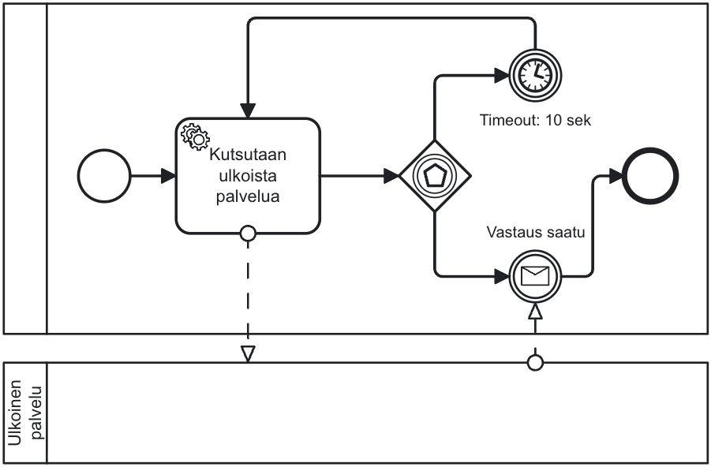{#fig-event-based-esim}

#### Complex Gateway

*Complex Gateway* eli kompleksiportti soveltuu monimutkaisten ja moniosaisten ehtojen määrittelyyn. Sitä käytetään prosessimalleissa kuitenkin harvoin ja usein sama logiikka on esitettävissä myös muiden porttien avulla -- joskin voi olla, että prosessimallista tulee tällöin monimutkaisempi. Mainittakoon anekdoottina, että prosessiarkkitehti ja -analyytikko Allen Murrell on sanonut, että niiden 15 vuoden aikana, kun hän on prosesseja mallintanut, hän on luultavasti käyttänyt kompleksiporttia kahdesti ja silloinkin varmaan olisi onnistunut rakentamaan mallin myös toisella tavalla[^murrell].

[^murrell]: ”I think in the fifteen years that I’ve been modeling processes I’ve possibly used the Complex Gateway twice and even then I’ve probably could have modeled it in a different way using other gateway, even just one or two more gateways.”

Seuraavassa esimerkissä (@fig-complex-esim) esitetään eräänlaisen tarjouspyyntöprosessin kulku. Complex Gateway -portin tehtävänä tässä on päästää prosessi etenemään silloin kun kaksi kolmesta materiaalinmyyjästä on toimittanut tarjouksen.

{#fig-complex-esim}

### Tietolähteet ja ohjelmistot BPMN-prosessimalleissa

Prosesseja mallinnettaessa ollaan ensisijaisesti kiinnostuneita prosessien toimintalogiikasta eikä niinkään prosesseihin liittyvistä ohjelmistoista tai tietolähteistä. Haluttaessa tarkastella prosessia vaikkapa suhteessa niihin liiketoiminta- ja teknologiaympäristöihin, joissa se tapahtuu, ovat esimerkiksi arkkitehtuurimallinnukset sopivampi työväline. Jotkin mallinnusvälineet mahdollistavat myös useiden mallinnuskielten samanaikaisen käyttämisen. Tällöin prosesseja voidaan esimerkiksi kokonaisarkkitehtuurin kontekstissa tarkastella ArchiMate-kaavioina ja tarvittaessa siirtyä jonkin prosessikulun tarkempaan tarkasteluun BPMN-muodossa (@fig-porautuminen).

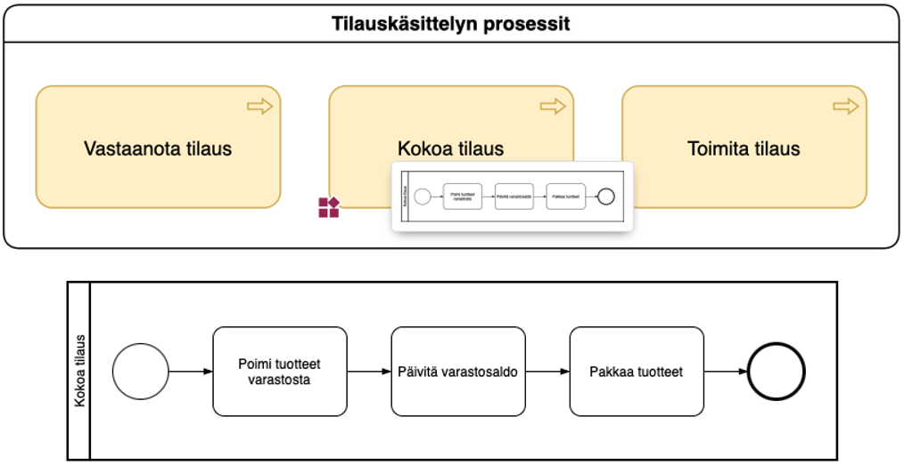{#fig-porautuminen}

Järjestelmillä ja niiden rajapinnoilla, tietokoneiden suorittamilla skripteillä sekä prosesseissa liikkuvalla informaatiolla ja datalla on kuitenkin keskeinen rooli varsinkin silloin, kun prosesseja halutaan automatisoida. Edellä onkin jo käsitelty Service Task -tehtäviä, joita käytetään ulkoisten palvelujen (eli käytännössä ohjelmistojen ja tietojärjestelmien) kutsumiseen, Script Task -tehtäviä, joiden avulla voidaan suorittaa ohjelmakoodia prosessikulun sisällä sekä User Task -tehtäviä, jotka nekin tyypillisesti toteutetaan jotain ohjelmistoa hyödyntäen.

Luvun alussa nähtiin myös Data Store -elementti ja siihen liittyvät Data Input Association ja Data Output Association -suhteet. Data Storea voidaan käyttää tietovarastojen, tietokantojen tai muiden ”tietosäiliöiden” esittämiseen prosessikulkujen yhteydessä. Joskus niitä käytetään myös yleisemminkin kuvaamaan prosessissa käytettäviä tietojärjestelmiä ja ohjelmistoja, ja niille voidaan varata prosessiin oma uimarata tai -allas. Vaikka tämä onkin hieman luovaa BPMN:n soveltamista, on tekniikka melko usein käytetty ja joissain -- pääasiassa viestinnällisissä -- käyttötarkoituksissa myös käyttökelpoinen (@fig-datastoret).

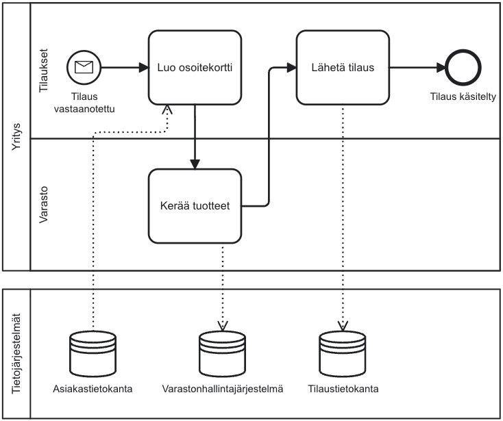{#fig-datastoret}

Ohjelmallista toimintalogiikkaa voidaan joissain tapauksissa myös jäsentää prosessin tehtävien avulla (@fig-riski). Mitä enemmän automatisoidussa prosessissa käytetään skriptitehtäviä, skriptattuja päätössääntöjä ja päätöstauluja, sitä enemmän ero prosessin ja varsinaisen sovelluksen välillä hämärtyy. Prosessikehittäjistä tulee ohjelmistokehittäjiä tai ohjelmistokehittäjistä prosessikehittäjiä.

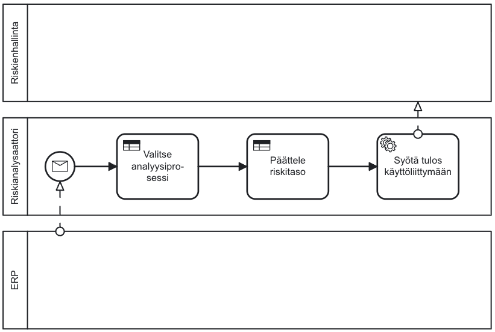{#fig-riski}

### Julkinen ja yksityinen prosessi: kollaboraatio, orkestraatio ja koreografia[^koreo-kasitteet]

[^koreo-kasitteet]: Tässä käsitteet esitetään BPMN 2.0 -standardin mukaisesti (ks. standardin luku 7.2, https://www.omg.org/spec/BPMN/2.0.2/PDF). Esimerkiksi palvelukeskeisen arkkitehtuurin ja mikropalveluarkkitehtuurin yhteydessä orkestraatiolla ja koreografialla tarkoitetaan hieman eri asioita, ja myös mallinnusvälineet voivat käyttää termejä omilla tavoillaan.

Prosessien yhteistyötä mallinnettaessa esiin nousevat käsitteet yksityinen prosessi (*Private Process*) ja julkinen prosessi (*Public Process*). Ne ovat saman osapuolen prosessin kaksi eri näkymää.

Yksityinen prosessi on organisaation sisäinen prosessi, josta näkyvät kaikki sen tehtävät, portit ja tapahtumat. Yksityinen prosessi voi olla myös suoritettava (*executable*) eli tarkoitettu ajettavaksi työnkulkualustalla. Kuvassa (@fig-yksityinen) on verkkokaupan tilausprosessi yksityisenä prosessina. Asiakas on kuvattu suljettuna altaana (niin kutsuttu *black box*), koska verkkokauppa ei tiedä eikä sen tarvitse tietää, millainen asiakkaan oma prosessi on.

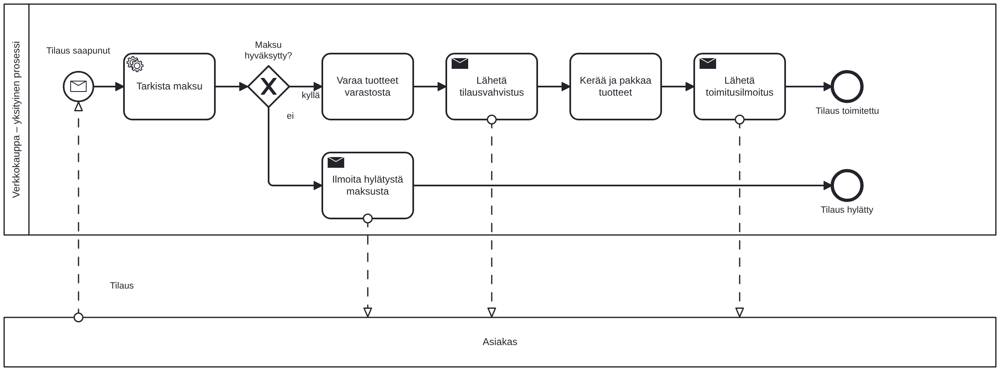{#fig-yksityinen}

Julkinen prosessi näyttää samasta prosessista vain ne osat, joiden kautta osapuoli on vuorovaikutuksessa muiden kanssa: viestejä lähettävät ja vastaanottavat tehtävät ja tapahtumat sekä niiden välisen kulun. Sisäiset tehtävät, kuten maksun tarkistus, tuotteiden varaaminen ja keräily, jäävät pois (@fig-julkinen). Julkinen prosessi on siis kuin yrityksen ulospäin näyttämä rajapinta. Liiketoimintaverkoston osapuolten ei tarvitse tuntea toistensa sisäisiä prosesseja, kunhan ne tietävät, mitä viestejä toisiltaan voivat odottaa ja missä järjestyksessä. Yksityiset prosessit voivat siten olla kirjaimellisestikin yksityisiä.

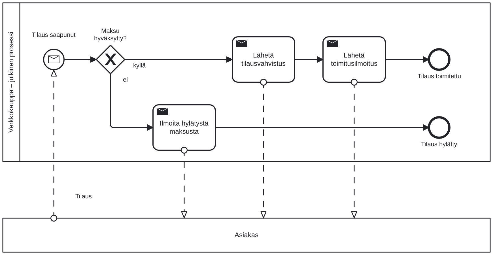{#fig-julkinen}

Yhteistyöprosesseihin liittyvät myös käsitteet kollaboraatio (*Collaboration*), orkestraatio (*Orchestration*) ja koreografia (*Choreography*). Ne kuvaavat eri näkökulmista sitä, miten osallistujat, esimerkiksi organisaatiot, osastot tai sovellukset, toimivat yhdessä prosessin aikana.

#### Kollaboraatio

Kollaboraatiomalli kuvaa kaksi tai useampia prosessiin osallistuvia osapuolia sekä näiden välisen vuorovaikutuksen. BPMN:ssä osapuolet esitetään uima-altaina ja vuorovaikutus viestivirtoina. Altaat voivat olla avattuja, jolloin niissä näkyy osapuolen yksityinen tai julkinen prosessi, tai suljettuja, jolloin osapuolesta näkyvät vain sen lähettämät ja vastaanottamat viestit. Edellisetkin kuvat (@fig-yksityinen ja @fig-julkinen) ovat siis kollaboraatiomalleja. Itse asiassa kaikki aiemmat esimerkit, joissa on useampi allas ja niitä yhdistäviä viestivirtoja, ovat kollaboraatioita.

Kollaboraatiomallissa kaikki altaat voidaan esittää myös suljettuina (@fig-verkkokauppa-kollab). Silloin malli kertoo ainoastaan, mitä viestejä osapuolten välillä kulkee. Esitystapa muistuttaa hieman UML:n sekvenssikaaviota, mutta toisin kuin sekvenssikaaviossa, viestien järjestys ei ole yksiselitteinen, koska se riippuu altaiden sisällä olevista prosesseista.

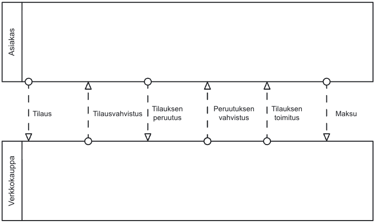{#fig-verkkokauppa-kollab}

#### Orkestraatio

Orkestraatio kuvaa yhden osapuolen ohjaamaa yhteistyötä. Orkesterinjohtajan tavoin tämä toimija koordinoi prosessin etenemistä: se kutsuu muita osapuolia, odottaa niiden vastauksia ja päättää niiden perusteella, mitä seuraavaksi tapahtuu. Muut osapuolet eivät tiedä kokonaisuudesta. Ne vain vastaavat niille osoitettuihin pyyntöihin.

BPMN:ssä orkestraatio on yksityinen prosessi, joka on mallinnettu auki tehtävien ja tapahtumien tarkkuudella. Muut osallistujat kuvataan suljettuina altaina, joihin kulkee viestivirtoja. Tyypillisesti orkestroiva prosessi on suoritettava, ja sitä ajetaan työnkulkualustalla, joka kutsuu muiden osapuolten järjestelmiä niiden rajapintojen kautta. Kuvassa (@fig-orkestraatio) verkkokaupan tilausprosessi ohjaa maksupalvelua, varastoa ja kuljetusliikettä sekä tiedottaa asiakkaalle tilauksen etenemisestä.

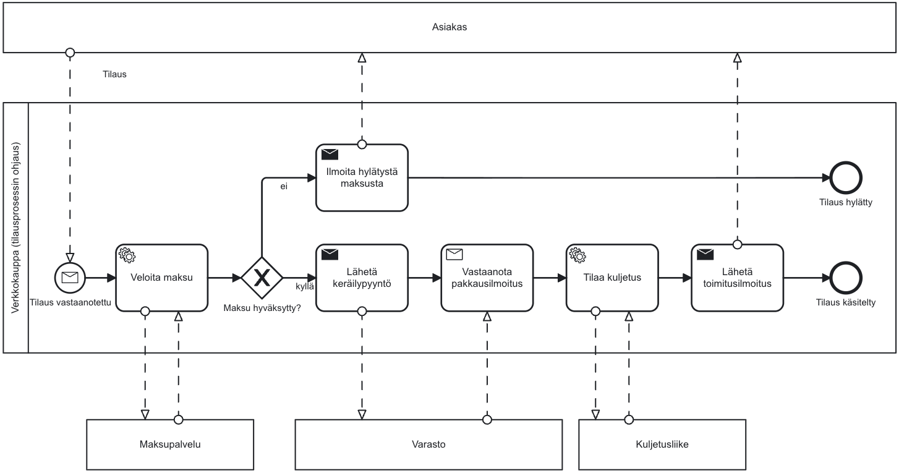{#fig-orkestraatio}

Orkestraatiossa kokonaisuuden hallinta on yhdellä osapuolella. Tämä tekee prosessin seurannasta ja muuttamisesta suoraviivaista, mutta orkestroijasta tulee samalla koko yhteistyön kriittinen piste. Jos sen prosessi pysähtyy, pysähtyvät kaikki.

#### Koreografia

Prosessikoreografiassa millään osapuolella ei ole prosessikulkua ohjaavaa roolia, eikä siten myöskään keskitettyä ohjausta. Koreografia on kaikkien osallistujien yhteistoimintaa, jolle on määritelty ennalta sovitut vuorovaikutussäännöt, joita noudattaen jokainen osallistuja toimii itsenäisesti. Jos prosessiorkestraatio vertautuu orkesteriin ja sitä johtavaan kapellimestariin, voidaan prosessikoreografiaa verrata tanssiteokseen. Kun tanssijat tuntevat koreografian, kukin tietää, mitä hänen tulee tehdä ja milloin, kuinka asemoida itsensä suhteessa muihin tanssijoihin ja niin edelleen. Teoksen läpivienti ei edellytä, että koreografi seisoisi ryhmän edessä ja ohjaisi suoritusta. Sitä toki tarvitaan vielä silloin, kun teosta harjoitellaan. Vastaavasti prosessikoreografia vaatii huolellista suunnittelua ja osapuolten yhteistyötä, jotta yhteistyöprosessi saadaan toteutettua luotettavasti pelkästään ennalta sovittuun viestinvaihtoon tukeutuen.

BPMN:ssä koreografialla on oma kaaviotyyppinsä, joka poikkeaa selvästi prosessi- ja kollaboraatiomalleista. Koreografiakaaviossa ei ole uima-altaita, eikä siinä näy yhdenkään osapuolen sisäinen prosessi. Sen sijaan kaavion perusyksikkö on koreografiatehtävä (*Choreography Task*), joka kuvaa yhtä osapuolten välistä viestinvaihtoa. Koreografiatehtävän ylä- ja alareunassa on osallistujanauhat (*Participant Band*), joihin on merkitty viestinvaihdon osapuolet. Vaalealla pohjalla oleva nauha on viestinvaihdon aloittaja (*initiating participant*) ja harmaa nauha vastaanottaja. Nauhaan liitetty kirjekuori kertoo, mikä viesti vaihdetaan. Valkoinen kirjekuori on aloittajan lähettämä viesti ja harmaa kirjekuori vastaanottajan paluuviesti. Koreografiatehtäviä yhdistetään järjestysvirroilla ja porteilla samaan tapaan kuin tavallisia tehtäviä, ja koreografialla on aloitus- ja lopetustapahtuma.

Kuvassa (@fig-koreografia) on verkkokaupan tilaus koreografiana. Asiakas aloittaa koreografian lähettämällä tilauksen, johon verkkokauppa vastaa kuittauksella. Jos tuotteet ovat saatavilla, verkkokauppa toimittaa tilauksen, ja asiakas maksaa sen. Muussa tapauksessa verkkokauppa peruu tilauksen ja ilmoittaa siitä asiakkaalle.

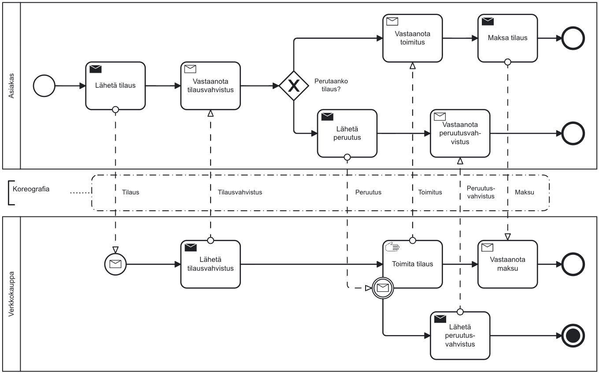{#fig-koreografia}

Koska koreografiassa ei ole ohjaavaa osapuolta, kaavion on oltava sellainen, että jokainen osapuoli pystyy toimimaan oikein pelkästään saamiensa viestien perusteella. BPMN-standardi asettaa tästä syystä koreografioille sääntöjä. Esimerkiksi koreografiatehtävän aloittajan on täytynyt osallistua edelliseen viestinvaihtoon, jotta se tietää, että on sen vuoro toimia. Samoin portin jälkeisten viestinvaihtojen aloittajien on täytynyt nähdä tieto, jonka perusteella portissa valitaan. Esimerkissä verkkokauppa aloittaa sekä toimituksen että peruutuksen, ja valinta perustuu sen omaan tietoon tuotteiden saatavuudesta.

Säännöt paljastavat helposti yhteistyön suunnitteluvirheitä. Jos esimerkiksi asiakkaan sallittaisiin perua tilaus milloin tahansa ennen toimitusta (kuten kollaboraatiomallissa @fig-verkkokauppa-kollab), sekä asiakas että verkkokauppa voisivat aloittaa oman viestinvaihtonsa samanaikaisesti: asiakas lähettää peruutuksen, kun verkkokauppa on jo lähettänyt tilauksen matkaan. Koreografiaa mallintaessa tällaiset tilanteet tulevat näkyviin, ja osapuolten on sovittava, kumman ratkaisu on voimassa, esimerkiksi niin, että peruutus on mahdollinen vain siihen asti, kun verkkokauppa on ilmoittanut lähettävänsä tilauksen.

Koreografiakaavioita tuetaan mallinnusvälineissä selvästi heikommin kuin prosessi- ja kollaboraatiomalleja. Esimerkiksi Camunda Modeler ei tue niitä, mutta niitä voi laatia esimerkiksi avoimen lähdekoodin chor-js-mallintimella[^chor-js]. Käytännössä yritysten välistä yhteistyötä kuvataankin usein kollaboraatiomalleilla, ja koreografioita käytetään erityisesti silloin, kun usean organisaation on sovittava yhteisestä viestinvaihdosta, eikä kenenkään sisäinen prosessi ole kiinnostuksen kohteena.

[^chor-js]: https://github.com/bptlab/chor-js

## Joitain muita tapoja prosessien kuvaamiseen

Prosessien kuvaamiseen voidaan käyttää muitakin tekniikoita kuin BPMN-kieltä. Tässä luvussa käydään niistä läpi muutama.

### Prosessikortti

Prosessikortti on teksti- tai graafinen dokumentti, joka kokoaa prosessiin liittyvät oleelliset tiedot. Kortti voi käyttötarkoituksensa mukaisesti käsitellä prosessia yleisellä tasolla tai vastaavasti kortin sisältö voi olla yksityiskohtaistakin. Korttia voidaan hyödyntää niin prosessitiedon keräämisessä kuin myös prosessitiedon tallentamisessa ja esittämisessä. Kortti voi toimia itsenäisenä prosessidokumentaation välineenä tai se voidaan laatia graafisen prosessimallin liitteeksi. Prosessikorttia voidaan käyttää esimerkiksi prosessihaastattelun dokumentointiin. Se voitaisiin harkinnanvaraisesti myös toimittaa haastateltavalle henkilölle ennakkomateriaaliksi ennen haastattelua.

Seuraavassa (@tbl-prosessikortti-esim) on verkkokaupan kuvitteellisesta tilauskäsittelyprosessista laadittu tiivis prosessikortti.

| Kohta | Kuvaus |
|-------|--------|
| **Prosessin nimi** | Verkkokaupan tilauskäsittely |
| **Tavoite** | Varmistaa tilauksen oikea ja ajantasainen käsittely ja toimitus sekä asiakastyytyväisyys. |
| **Prosessin alku** | Asiakas tekee tilauksen verkkokaupassa. |
| **Prosessin loppu** | Tilaus on toimitettu asiakkaalle ja tilaus suljettu järjestelmässä. |
| **Keskeiset vaiheet** | 1. Tilauksen vastaanotto järjestelmään.<br>2. Maksun varmistus.<br>3. Tuotteiden keräys ja pakkaus.<br>4. Toimituksen organisointi.<br>5. Lähetyksen seuranta ja viestintä asiakkaalle. |
| **Prosessin omistaja** | Verkkokaupan tilausvastaava. |
| **Osallistujat** | Tilausvastaava, varastotyöntekijät, logistiikkakumppanit, asiakaspalvelu. |
| **KPI-mittarit** | 1. Tilausten käsittelyaika.<br>2. Toimitusten oikeellisuus.<br>3. Asiakaspalautteet.<br>4. Palautusprosentti. |
| **Liittyvät prosessit** | Asiakaspalvelu, palautusten käsittely, varastonhallinta, maksuliikenne. |
| **IT-järjestelmät** | Verkkokauppa-alusta, maksupalvelut, varastonhallintajärjestelmä, kuljetusjärjestelmät. |

: Esimerkki prosessikortista: verkkokaupan tilauskäsittely {#tbl-prosessikortti-esim}

Prosessikorttia voidaan käyttää kuvaamaan liiketoimintaprosessi ytimekkäästi siten, että kaikki osapuolet ymmärtävät, mistä prosessissa on kyse. Prosessikortin avulla voidaan myös varmistaa, että prosessi on hallittu, mitattava ja toistettavissa.

Prosessikortin yleisö ja käyttötarkoitus eivät ole samoja kuin yksityiskohtaisten BPMN-mallien. Prosessikortti ei korvaa BPMN-mallinnuksia, eikä se anna kovin paljon konkreettisia välineitä esimerkiksi prosessien tehostamisen tai automaation suunnittelulle. Sen sijaan yleismuotoisena ja helposti ymmärrettävänä esitystekniikkana se voi mahdollistaa kehittämiskohteiden tunnistamisen ja kehittämisideoiden esille pääsyn vaikkapa henkilöstön työpajoissa. Prosessikorttien herättämien ideoiden ja ehdotusten tarkempaan analysointiin ja kehittämistehtävien suunnitteluun tarvitaan kuitenkin prosessimalleja ja mittareiden tuottamaa tietoa.

Prosessikortteja voidaan käyttää myös uusien työntekijöiden perehdyttämiseen. Prosessiin osallistuvat näkevät niistä oman roolinsa ja missä kohtaa prosessia he toimivat. Johto ja esihenkilöt voivat prosessikorttien avulla hahmottaa toiminnan kokonaisuuden ja tunnistaa suorituskyvyn seurannan kannalta keskeisiä kohteita. Prosessien kehittäjät voivat löytää niiden avulla pullonkauloja, virheitä ja kehittämiskohteita. Prosessikortit ovat hyödynnettävissä myös esimerkiksi ISO 9001[^iso-9001] -laatujärjestelmän auditointien ja sertifiointiprosessien yhteydessä.

[^iso-9001]: https://sfs.fi/standardeista/tutustu-standardeihin/suositut-standardit/iso-9001-laadunhallinta/ 

Prosesseja kuvattaessa voidaan myös käyttää visuaalisuutta korostavaa -- infografiikkamaista palvelukorttia muistuttavaa -- esitystapaa. Tiivis ja visuaalinen esitystapa toimii varsinkin silloin, kun tavoitteena on viestiä asiakkaalle tai yhteistyökumppanille, mitä prosessi tekee ja tuottaa.

### Vuokaavio

Visuaalinen vuokaaviotekniikka (*Flow Chart*) vastaa siinä mielessä BPMN:a, että sen avulla voidaan luoda graafisia prosessimalleja, joissa prosessin kulku esitetään vaiheittain. Tekniikka on kuitenkin huomattavasti yksinkertaisempi kuin BPMN. Vuokaavioissa käytetään usein vain muutamaa eri elementtiä: aloitus (ympyrä ohuella viivalla) ja lopetus (ympyrä paksulla viivalla) sekä tehtävä (suorakulmio) ja päätös (vinoneliö). Lisäksi voidaan käyttää myös uimaratoja roolien esittämiseen. Yksinkertaisena tekniikkana vuokaavio soveltuu käytettäväksi yksinkertaisten prosessien jäsentämiseen esimerkiksi koulutuksissa, alkuvaiheen prosessianalyysissa ja -suunnittelussa sekä laatu- tai työohjedokumentaatiossa.

Seuraavassa (@fig-vuokaavio-esim) on esitetty vuokaaviona verkkokauppatilaus asiakasroolin kannalta. Tällaisen prosessin esittämiseen vuokaavio soveltuu vielä hyvin. Kaavio on notaatioltaan yksinkertainen ja intuitiivinen, eikä informaatiota juurikaan menetetä verrattuna BPMN:lla esitettyyn asiakkaan uimarataan. Prosessikulkujen monimutkaistuessa vuokaavion ilmaisuvoima loppuu kuitenkin nopeasti kesken.

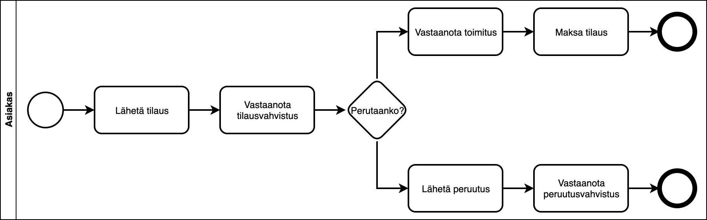{#fig-vuokaavio-esim}

### Aktiviteettikaavio

UML[^uml]-kieleen kuuluvaa aktiviteettikaaviota (*Activity Diagram*) käytetään pääasiassa ohjelmistojen sisäisten prosessikulkujen esittämiseen korkealla abstraktiotasolla. Sen peruselementit ovat aloituspiste ja lopetustila (*End State*), aktiviteetit, päätökset (*Decision Node*), haarautumat (*Fork*), yhdistymiset (*Join*) sekä kontrollivirta (*Control Flow*). Aktiviteeteilla voidaan esittää tehtäviä, forkeilla ja joineilla rinnakkain suoritettavien tehtävien kulkua ja päätöksillä päätösportteja, kuten XOR-portti (@fig-activity_diagram-esim). Ohjelmistoprosesseja esitettäessä säikeet voidaan esittää altaina, mutta altaat toimivat myös roolien esittämisessä, mikäli aktiviteettikaaviota käytetään esimerkiksi organisaatioita tai ihmisen suorittamia tehtäviä sisältävien prosessien kuvaamiseen.

[^uml]: https://www.omg.org/uml/

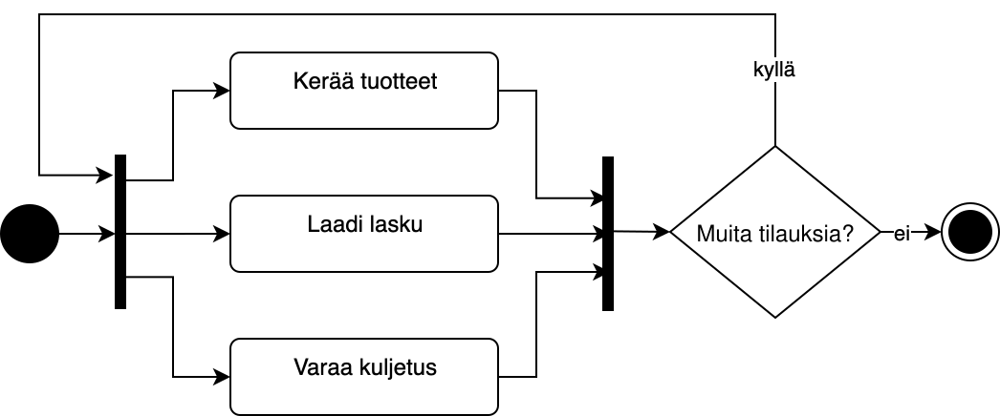{#fig-activity_diagram-esim}

### Kriittisen polun menetelmä

Kriittisen polun menetelmä (*Critical Path Method*, *CPM*) kehitettiin Yhdysvalloissa 1950-luvun lopulla monimutkaisten teollisten projektien aikatauluttamiseen ja hallintaan. CPM:n perusajatuksena on, että projekti koostuu tehtävistä, joilla on arvioidut kestot ja joiden välillä on loogisia riippuvuus- ja erityisesti edeltävyyssuhteita; esimerkiksi ennen resurssien allokointia täytyy olla olemassa tieto käytettävissä olevista resursseista. Tehtävät esitetään verkostomallina, jossa kriittinen polku on se polku kaikkien tehtävien joukossa, jonka kokonaiskesto on pisin. Tämä tehtäväketju siis määrittelee projektin vähimmäiskeston ja projektin valmistuminen viivästyy, mikäli jokin kriittisen polun tehtävistä viivästyy. Jos projektin halutaan valmistuvan suunnitellussa vähimmäisaikataulussa, ei kriittiseen polkuun kuuluvien tehtävien valmistumisajoista voida joustaa. Sen sijaan siihen kuulumattomien tehtävien aikataulussa voi olla pelivaraa, mikä voi mahdollistaa resurssien tilapäisen uudelleenohjailun projektin aikana, esimerkiksi kriittisten tehtävien suorittamiseen.

CPM soveltuu myös prosessien tarkasteluun -- erityisesti prosessien ollessa aikakriittisiä. Sen avulla voidaan selvittää, mitkä prosessin tehtävistä määrittelevät prosessin kokonaiskeston ja mihin puolestaan liittyy ajallista joustovaraa. Kriittiseen polkuun kuuluvat tehtävät voivat aiheuttaa prosessiin pullonkauloja, joten niiden riittävä resursointi ja sujuvan työnkulun varmistaminen on tärkeää. Kehittämistehtävät tulisikin kohdistaa juuri prosessien kriittisiin vaiheisiin ja niiden suorittamisen optimointiin. Prosessilouhinta tarjoaa konkreettista tietoa prosessin tehtävien kestoista ja suhteista, ja sitä voidaankin käyttää yhdessä CPM-analyysin kanssa.

> **Seuraavassa Tuomas Kokko ja Pentti Marttiin Jyväskylän yliopiston IT-tiedekunnasta kertovat tarkemmin projektiverkosta ja kriittisen polun laskemisesta prosessikontekstiin sopivan esimerkin avulla.**
>
> Useissa tapauksissa pelkkä janakaavio ei anna tarpeeksi tietoa projektin tehtävien välisistä suhteista ja aikataulussa olevista joustomahdollisuuksista. Tällöin tehtäviä ja niiden tavoiteaikatauluja on vaikea sijoittaa janakaaviolle oikeisiin ajankohtiin. Tämän ongelman ratkaisemiseksi on kehitetty erilaisia aikataulusuunnittelun tekniikoita, joilla voidaan muodostaa projektiverkko.
>
> Projektiverkko (Project Network) on projektinhallinnan menetelmä, jonka avulla suunnitellaan, aikataulutetaan ja valvotaan projektin eri tehtäviä ja niiden keskinäisiä riippuvuuksia. Projektiverkossa tehtävät voivat olla toisiinsa nähden peräkkäisiä tai rinnakkaisia. Projektiverkko soveltuu hyvin myös liiketoimintaprosessien mallintamiseen, koska niissäkin on usein peräkkäisyyttä ja rinnakkaisuutta osaprosessien suhteen.
>
> Seuraavaksi mallinnetaan uuden työntekijän rekrytointiprosessi projektiverkon ja kriittisen polun menetelmän avulla. Projektiverkon käytön edellytykset ovat seuraavat:
>
> - Liiketoimintaprosessi on jaettu tehtäviin.
> - Jokaiselle tehtävälle on määritelty kesto.
> - Tehtävien keskinäiset riippuvuudet on selvitetty (eli mitä tehtävää ei voi aloittaa ennen kuin toinen on valmis).
>
> @tbl-rekrytointi kuvaa edellä mainittujen edellytysten mukaan rakennetun projektiverkon. Liiketoimintaprosessi ”uuden työntekijän rekrytointi” on jaettu tehtäviin A-L, jotka on myös nimetty. Jokaiselle on määritelty kesto ja kutakin tehtävää edeltävät tehtävät on määritetty. Sama liiketoimintaprosessi voidaan piirtää myös graafisena. Muuttujien (eli tehtävien) lisääntyessä graafinen esitystapa parantaa projektin aikataulun – ja monissa tapauksissa myös kustannusten ja sisällön – hallintaa, kun tehtävien aloitus- ja lopetusajankohdat sekä joustovarat ovat tiedossa ja hallinnassa.

| Tunnus | Uuden työntekijän rekrytointi | Kesto (pv) | Edeltävät tehtävät |
|:------:|-------------------------------|:----------:|:------------------:|
| A | Luo työsopimus | 1 | – |
| B | Tilaa työvälineet | 4 | A |
| C | Luo käyttäjätunnukset | 1 | A |
| D | Tilaa kulkulupa ja avaimet | 2 | A |
| E | Valmistele työpiste | 2 | B, C, D |
| F | Laadi perehdytyssuunnitelma | 2 | B, C, D |
| G | Aikatauluta tapaamiset | 2 | E |
| H | Tiimiperehdytys | 2 | F |
| I | Perehdytä teknisiin työvälineisiin | 4 | F |
| J | Mentoritapaaminen | 2 | G |
| K | Sidosryhmätapaamiset | 5 | G |
| L | Rekrytoinnin palautekeskustelu | 1 | H, I, J, K |

: Uuden työntekijän rekrytoinnin tehtävät, kestot ja riippuvuudet {#tbl-rekrytointi}

> Kriittisen polun menetelmä auttaa löytämään liiketoimintaprosessille pienimmän mahdollisen kokonaiskeston, ja auttaa siten kohdistamaan valvontaa ja resursseja oikein. Kriittinen polku määritellään seuraavasti: ”projektin pisin polku tehtäväverkossa, joka määrittää projektin minimikeston”. Tehtävät kriittisellä polulla eivät saa viivästyä ilman, että koko projekti, tai tässä tapauksessa liiketoimintaprosessi, viivästyy.
>
> Kriittisen polun menetelmässä oletetaan, että ositusrakenteen mukaan tehtävät ja työpaketit ovat tunnettuja, määritettyjä ja kiinteitä. Mikäli tehtävien kestot ovat epävarmoja, voidaan tehtäväkohtaisesti käyttää estimointitekniikoita, esimerkiksi PERT-menetelmää [@fulkerson1962expected]. Toisaalta tehtävien järjestelyyn vaikuttavat tehtävien keston lisäksi monet muut asiat kuten rajoitteet, esim. joissakin tapauksissa projektin kestolle tai aikataululle saatetaan asettaa rajoitteita kuten resurssien saatavuus voi olla aikasidonnaista, tai projektien keskinäiset riippuvuudet ja päällekkäisyydet on otettava huomioon.
>
> Projektiverkko esittää tehtävien suoritusjärjestyksen ja riippuvuudet. Projektiverkossa lasketaan seuraavat arvot kullekin tehtävälle:
>
> - Aikaisin aloitus (ES) ja aikaisin lopetus (EF).
> - Myöhäisin aloitus (LS) ja myöhäisin lopetus (LF) ilman, että projekti viivästyy.
>
> Näin löydetään:
>
> - Pelivara (float/slack) eli kuinka paljon tehtävä voi viivästyä vaikuttamatta projektin kokonaisaikatauluun.
>
> Eteenpäin laskenta selvittää, kuinka aikaisin kukin tehtävä voi alkaa ja päättyä.
>
> - Aikaisin aloitus ES ensimmäiselle tehtävälle on 0. Muille tehtäville ES on edeltävien tehtävien suurin EF. 
> - Aikaisin lopetus EF kullekin tehtävälle lasketaan seuraavasti: EF = ES + tehtävän kesto.
> - Projektin kokonaiskesto saadaan viimeisen tehtävän EF-arvosta.
>
> Taaksepäin laskennan tarkoitus on selvittää, kuinka myöhään tehtävä voi alkaa tai päättyä viivästyttämättä projektia.
>
> - Viimeisen tehtävän LF on sen EF (projektin kokonaiskesto)
> - Muiden tehtävien LF = projektiverkossa tehtävää seuraavien tehtävien pienin LS.
> - Myöhäisin aloitus LS = LF – tehtävän kesto
> - Tuloksena saadaan viimeisimmät ajat, jolloin kukin tehtävä voidaan tehdä ilman, että projekti viivästyy.
>
> Pelivara saadaan laskemalla joko tehtävien aloitusten tai lopetusten erot LS – ES = LF – EF.
>
> - Jos pelivara = 0 (lue: pelivaraa ei ole) tehtävä on kriittinen, eli kuuluu kriittiselle polulle. Kriittinen polku on siis pisin polku tehtäväverkossa, jossa kaikki tehtävät ovat ilman pelivaraa.
> - Jos tehtävän pelivara > 0 voidaan kyseistä tehtävää viivästyttää pelivaran verran ilman vaikutusta projektin kestoon.

Alla (@fig-cpm) on esitetty uuden työntekijän rekrytoinnin prosessi projektiverkon muodossa kriittisen polun selvittämiseksi.

{#fig-cpm}