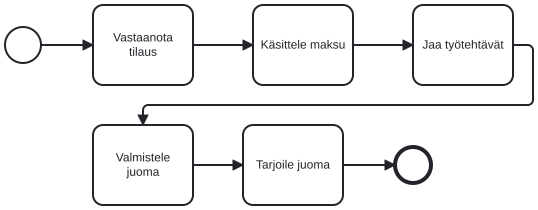
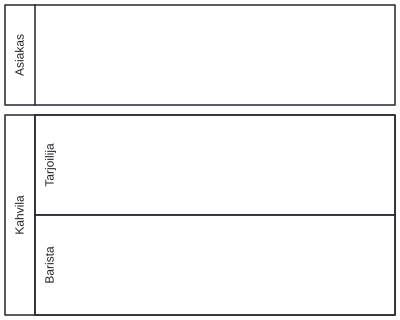
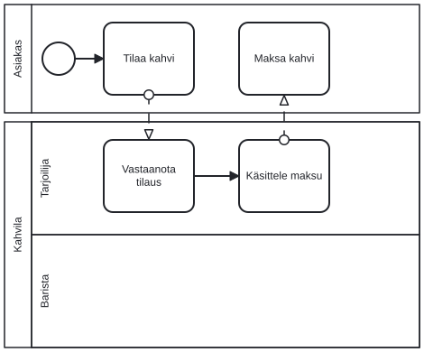
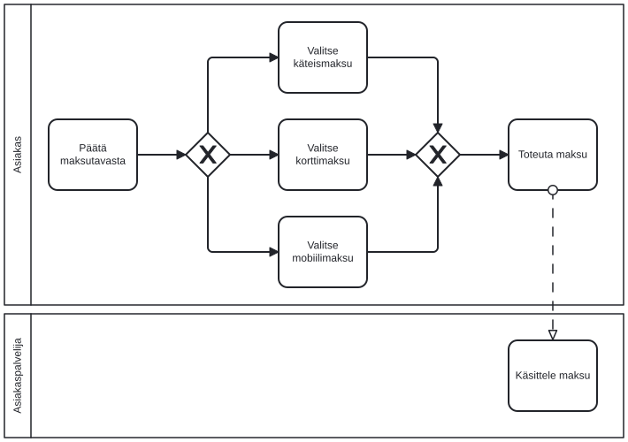

# Johdanto

*Astut kahvilaan aikeenasi hörpätä latte macchiato. Mitä kaikkea täytyy tapahtua, ennen kuin olet saanut kahvisi?*

Kahvin tilataksesi täytyy sinun ensimmäiseksi onnistua viestimään mielihalusi kahvilan henkilökunnalle, esimerkiksi asiakaspalvelijalle. Teet tilauksen ja kahvilan henkilökunta kirjaa sen ylös kassajärjestelmään. Seuraavaksi sinulta ehkä pyydetään maksua tilaamastasi kahvista. Maksun voi tässä kahvilassa suorittaa käteisellä, kortilla tai lähimaksuna älylaitteella. Istut odottamaan kahviasi ja seuraavaksi tapahtuu asioita, jotka eivät välttämättä näy asiakkaille. Henkilökunta jakaa työtehtävät: barista valmistaa juoman ja toinen työntekijä valmistautuu asiakaspalveluun. Barista valmistaa espresson, käsittelee maidon ja sen jälkeen kokoaa latte macchiaton. Tilaamasi kahvi tarjoillaan lasiin, mutta take away -tilaus kaadettaisiin pahvimukiin. Lopuksi juoma viimeistellään ja tuodaan pöytään tai jätetään noutopisteeseen, miten kahvilassa nyt toimitaankaan.

Jos äskeinen tapahtumien ketju piirrettäisiin, voisi se näyttää seuraavalta (@fig-kahvitilauksen_kasittely.svg). Tämä on yksinkertainen prosessimalli alku- ja loppupisteineen ja se on esitetty BPMN-notaatiolla (*Business Process Model and Notation*).

{#fig-kahvitilauksen_kasittely.svg fig-alt="Yksinkertainen prosessimalli kahvitilauksen käsittelystä kahvilassa."}

Lisäksi huomattiin, että prosessin toteuttamiseen osallistui useampi osapuoli: sinä asiakkaana, tarjoilija ja taustalla työskentelevä barista. Olisi myös mahdollista, että tilauksen vastaanottamisen jälkeen tarjoilija rientääkin valmistamaan kahvin itse, jolloin hän toimii prosessin aikana kahdessa roolissa. Sekin olisi mahdollista, että asiakas kävelisi kahvikoneelle, valitsisi haluamansa kahvin laitteen kosketusnäytöltä ja hoitaisi korttimaksun saman laitteen avulla. Myös itsepalvelu toteutuu suunniteltujen prosessien kautta.

BPMN-notaatiossa prosessiin osallistuvat toimijat esitetään tavallisesti uima-altaina (*Pool*) ja -ratoina (*Lane*). Altaat esittävät prosessiin osallistuvia organisaatioita ja uimaradat altaiden, eli organisaatioiden, sisällä eri toimijoita tai rooleja (@fig-kahvilan_uima-altaat.svg). Prosessimallinnuksen kannalta sinä olet siis yksittäisenä yksityisenä asiakkaanakin oma "organisaatiosi". 

{#fig-kahvilan_uima-altaat.svg fig-alt="Kahvilan roolit uima-altaina ja ratoina: asiakas, barista ja tarjoilija."}

Prosessin tehtävät osoitetaan tietyn roolin suoritettavaksi sijoittamalla ne kyseisen roolin uimaradalle, kuten seuraavassa kuviossa on tehty (@fig-tehtavat_radoilla.svg).

{#fig-tehtavat_radoilla.svg fig-alt="Kahvilan prosessin tehtävät sijoitettuina asiakkaan, tarjoilijan ja baristan uimaradoille."}

Maksua varten valitsit, haluatko maksaa käteisellä, kortilla vai mobiilimaksulla. Valintasi vaikuttaa siihen, kuinka prosessi seuraavaksi etenee. Jos käytät muuta maksutapaa kuin käteistä, mukaan liittyy roolina myös maksupalvelun tarjoaja. Valintatilanteet esitetään BPMN-malleissa päätöspisteinä tai -portteina, kuten seuraavan kuvion XOR-portti (@fig-maksutapahtuma.svg).

{#fig-maksutapahtuma.svg fig-alt="Maksutavan valinta XOR-portilla: käteinen, kortti tai mobiilimaksu."}

Mutta se siitä tällä erää. Palataan BPMN-mallintamiseen myöhemmin. Mennään sitä ennen ajassa hieman taaksepäin: mistä, miten ja milloin liiketoimintaprosessien tarkastelu, hallinta ja systemaattinen kehittäminen ovat alkaneet?

## Prosessit eilen

Prosesseihin ryhdyttiin kiinnittämään laajemmin huomiota 1900-luvun alkupuolella Frederick Taylorin julkaistua teoksensa Principles of Scientific Management [@taylor1911principles]. Kirjassa nimensä mukaisesti hahmotellaan ”tieteellistä” lähestymistapaa liikkeenjohtoon; sen systemaattisesti jäsentynyttä ja menetelmällistäkin tarkastelua. Vaikka Taylor ei vielä varsinaisesti kirjoittanut liiketoimintaprosesseista ja niiden johtamisesta nykyisin vakiintunutta käsitteistöä käyttäen, teos kuitenkin esitteli ajatukset työn tekemisen muotojen standardoinnista ja työnkulkujen – eli toisiaan seuraavien tehtävien – analysoinnista tehokkuuden kehittämiseksi.

Toiminnan operatiivisen tason tarkastelussa pajatson räjäytti Henry Ford noin kymmenen vuotta myöhemmin. Ford esitteli liukuhihnatuotantoon ja sen prosessien kehittämiseen liittyvät periaatteet teoksessaan My Life and Work [@ford2021my] vuonna 1922. Prosessien virtausnopeus – eli kuinka nopeasti jonkin asian tekeminen etenee alusta loppuun – ja tämän virtausnopeuden jatkuva parantaminen, ovat vieläkin prosessiajattelun ja prosessien kehittämisen keskeisiä teemoja.

Toisen maailmansodan jälkeen systeemiteoreettinen [esim. @von1968general] ajattelu – eli asioiden hahmottaminen toistensa kanssa vuorovaikuttavista osakokonaisuuksista muodostuvina kokonaisuuksina – alkoi herättää kiinnostusta prosessien kehittäjien keskuudessa. Sijaa alkoi saada myös laatua sekä laadun jatkuvaa parantamista painottava ajattelu – nyt tilastollisiin menetelmiin suorituskykymittaamisessa ja -analyysissa tukeutuen [@juran1951quality]. Samoihin aikoihin Japanissa Toyotan tehtailla muotoutuivat toimintamallit, jotka laadun jatkuvan parantamisen ja virtausnopeuden ohella korostivat hukan välttämistä eli sitä, että kaikenlainen turha tekeminen ja turhan tuottaminen tulisi kitkeä prosesseista pois.

W. Edwards Deming onnistui tiivistämään edelliset ajatukset suurta yleisöä puhuttelevaan muotoon [@deming1982quality]. Hänen esittelemänsä, Shewhartin sykliin [@best2006walter] perustuva, PDCA (Plan, Do, Check, Act) -malli – suomeksi STAK (Suunnittele, Toteuta, Arvioi, Kehitä) – on edelleen laatu- ja prosessijohtamisen vakiokuvastoa. Vaikka PDCA saattaakin kuulostaa liikkeenjohdon konsultin vetämän työpajan iskulauseelta, oli Deming taustaltaan tilastotieteilijä-insinööri. 

Prosessien historiaan palataan vielä myöhemmissä luvuissa, mutta tarkastellaan seuraavaksi, millaista roolia prosessit näyttelevät nykyisessä yhteiskunnassamme.

## Prosessit tänään

Sumean linssin läpi tarkasteltuna prosessi voi näyttäytyä mustana laatikkona: jotain menee sisälle, joitain asioita tapahtuu, ja lopuksi laatikosta tulee jotain ulos -- vaikka sitten se latte macchiato. Joskus tämä vertaus saattaa valitettavasti vastatakin organisaatioiden kyvykkyyttä ymmärtää omia prosessejaan.

Jos tarkastelemme esimerkiksi valmistavan teollisuuden prosesseja, voivat ne varsinkin toimialaa tuntemattomille näyttäytyä mustina laatikkoina. Prosessiin menee raaka-aineita, materiaaleja tai komponentteja, jotka muuttuvat prosessin aikana valmiiksi tuotteeksi. Prosessin päätteeksi tuote kierähtää liukuhihnalta valmiina asiakkaalle myytäväksi.

Harva tuote on niin hyvä, että se tehtaan lattialta myisi itse itsensä. Valmistusprosessia ovat todennäköisesti edeltäneet suunnittelun ja tuotekehityksen prosessit ja sitä seuraavat myynnin prosessit, joita ehkä tukevat markkinoinnin prosessit ja niin edelleen. Näihin liittyy työajan seurantaa, palkanmaksua sekä joukko muita hallinnollisia ja lakisääteisiä prosesseja. Jossain on todennäköisesti vielä johtamisen prosesseja, jotka yrityksen tavoitteista ja strategiasta jalostetuilla perusteilla ovat viime kädessä päättäneet tämän tuotteen markkinoille saattamisesta ja joiden avulla kaikkien muiden prosessien kokonaisuus pyritään pitämään hyvässä järjestyksessä.

Nykyistä yhteiskuntaamme kutsutaan usein palveluyhteiskunnaksi. Vaikka valmistammekin edelleen tuotteita -- ja todennäköisesti enemmän kuin koskaan aiemmin -- yritykset ja julkiset organisaatiot tuottavat myös entistä enemmän palveluja eli aineettomia tuotteita [vrt. @gronroos1982applied].

Aineettomat palvelutuotteet eivät varsinaisesti jää niistä maksaneiden asiakkaiden hypisteltäviksi, vaikka palvelutkin usein manifestoituvat myös fyysiseen todellisuuteen esimerkiksi aurattuina pysäköintialueina tai hieronnan vetreyttäminä hartioina.

Palveluyhteiskunnassa entistä useampi työskentelee tietotyön tehtävissä ja erilaisissa asiantuntijarooleissa. Tietotyöläiset edustavat tietyssä mielessä palveluyhteiskunnallistumisen pitkälle edennyttä muotoa. He eivät tuota palveluja ympäröivän todellisuuden kanssa välittömästi ja konkreettisesti vuorovaikuttaen, lunta auraten tai lihaksia vetreyttäen. Sen sijaan he käsittelevät tietoa: siirtelevät, prosessoivat ja jalostavat sitä, ja tuottavat tietoperustaisia palveluja analyysien, raporttien, ohjeiden tai muiden tietotuotteiden muodossa.

Huolimatta yhteiskunnan rakenteiden, toimintatapojen ja työelämän muutoksista – digitalisaatiota unohtamatta – prosessit ja prosessiajattelu pysyvät edelleen sitkeästi menossa mukana. Kuluttamamme tuotteet, palvelut ja tieto on edelleen saatu aikaiseksi prosesseja toteuttamalla. Tuotantotalouden prosessit ovat valmistaneet tuotteet, jotka verkkokaupoista tilaamme. Tuotteiden tilaamisen verkkokaupasta toiselta puolen maapalloa ovat tehneet mahdolliseksi tiedon käsittelyyn ja siirtelyyn keskittyvät prosessit, joista monet ovat sitä hartioita jumittavaa asiantuntijatyötä. Lopuksi vielä perinteisiä palveluprosesseja toteuttavat yritykset, kuten Posti tai FedEx, toimittavat tuotteet kotiovillemme tai lähimpään noutopisteeseen poimittaviksi. Raaka-aineiden siirtyminen niiden alkulähteiltä piirongin laatikkoon loppusijoitettavaksi tuotteeksi vaatii pitkän ketjun toisiinsa kytkeytyviä prosesseja.

## Prosessit lähitulevaisuudessa

Tekoälyn, kuten suurten kielimallien (*Large Language Model*, *LLM*), nopea kehitys vaikuttaa monin tavoin myös liiketoimintaprosesseihin. Tällä hetkellä tekoäly osaa jo auttaa esimerkiksi prosessikulkujen tunnistamisessa, prosessien analysoinnissa ja uudelleenmäärittelyssä sekä pystyy toteuttamaan prosessien automaatiota. Tietyillä reunaehdoilla myös prosessien aikana tehtävä päätöksenteko on toteutettavissa tekoälyllä jopa täysin ilman ihmistoimijoita. Tähän, kuten useimpiin muihinkin tekoälyn sovellutuksiin, liittyy kuitenkin tiettyjä teknisiä, lainsäädännöllisiä ja eettisiäkin kysymyksiä ratkottavaksi.

Kesäkuun lopulla 2026 valtiovarainministeriön kansliapäällikkö Juha Majanen kertoi julkisen hallinnon tekoälymuutoksesta Helsingin Sanomissa[^majanen]. Majasen esittämät visiot olivat melko rohkeita: koko Suomen julkinen sektori muutetaan toimimaan tekoälypohjaisesti vuoteen 2031 mennessä.

[^majanen]: 26.6.2026 Tämä on painajais­unta, ajatteli Suomen vaikutus­valtaisin virkamies talvella. Veera Paananen, Helsingin Sanomat

Seuraavana päivänä Helsingin Sanomien Lukijan Mielipide -palstalla julkaistiin työelämäasiantuntija, tietokirjailija ja henkilöstöjohtaja Outi Sivosen kirjoitus[^sivonen] ”Automaatio on vasta tekoälyn ensimmäinen askel”, jossa ei kyseenalaistettu tekoälyn mahdollisuuksia – pikemminkin päinvastoin – mutta peräänkuulutettiin huolellista harkintaa ja suunnittelua siitä, kuinka tekoälyn avulla voidaan aidosti tuottaa uutta ja merkityksellistä arvoa.

Kustannustehokkuuden tavoittelu ja asiakirjojen käsittelyn automatisointi ovat siinä korkeintaan ensimmäinen askel. Sivosen kirjoitus tiivistää erinomaisesti teknologioiden kehittymisen ja prosessien suhdetta, olipa kyse höyrykoneesta, automaattisesta tuotantolinjasta tai tekoälystä: ”*Tekoälyn käyttöönotossa eivät muutu vain yksittäiset työtehtävät vaan myös datan laatuun liittyvät prosessit, osaamisen kehittäminen, työprosessien uudelleenmuotoilu sekä agenttien ja ihmisten johtaminen. Jotta tekoälyn hyödyt tulevat todella käyttöön, meidän on jaksettava kysyä, mitä arvoa tuotamme. On liian helppoa tehdä yhä enemmän tai nopeammin sitä, mitä jo teemme. Asiakaslähtöisyys, eettiset kysymykset, arvontuotto ja strateginen ajattelu eivät ole kadonneet minnekään – niitä tarvitaan nyt enemmän kuin koskaan.*”

[^sivonen]: 27.6.2026 Automaatio on vasta tekoälyn ensimmäinen askel. Outi Sivonen, Helsingin Sanomat

Prosessien kehittämistä ja uudelleensuunnittelua -- nykyisellä tekoälyn aikakaudella ja ennen sitä -- käsitellään myöhemmissä luvuissa. Hyvät prosessit palvelevat asiakkaita kustannustehokkaasti, tasapuolisesti ja laadukkaasti. Niiden kautta saavutetaan organisaatioiden toiminnalle asetetut tavoitteet ja ne nostavat yrityksiä markkinoiden johtoasemiin. Vastaavasti huonot prosessit haaskaavat resursseja, voivat aiheuttaa toiminnassa vakaviakin virheitä ja vähintäänkin ne saavat niin asiakkaat kuin työntekijätkin turhautumaan. Prosessit ovat asia, jota jokaisessa organisaatiossa kannattaa miettiä ainakin silloin tällöin.