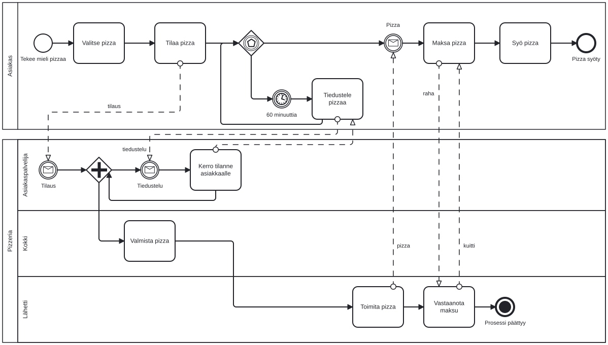
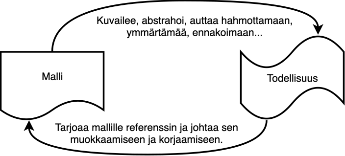
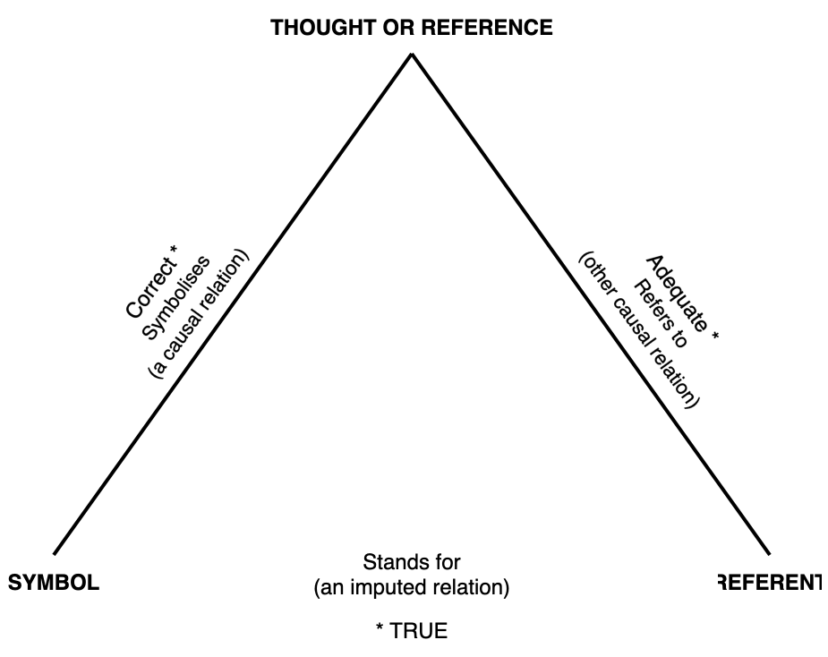

# Mallit ja mallintaminen

Käsitteet prosessimalli, prosessikaavio ja prosessin visualisointi ovat tulleet jo aiemmin vastaan. Luvun aluksi tarkastellaan yleisesti, mikä malli on ja miksi malleja tehdään. Lopuksi hahmotellaan, millainen on hyvä BPMN-malli. Varsinaiseen prosessimallinnukseen perehdytään seuraavassa luvussa.

## Mitä mallit ovat?

Malli on abstrakti kuvaus jostakin ilmiöstä tai asiasta, kuten vaikkapa liiketoimintaprosessista. Mallin tarkoitus on auttaa ymmärtämään, hallitsemaan tai ennakoimaan jotain kohdetta tai kokonaisuutta tai sen toimintaa. Mallit ovat siis todellisuutta (mennyttä, nykyistä tai mahdollista tulevaa) kuvaavia abstrahoituja esityksiä, jotka säilyttävät ja välittävät kohdealuetta koskevaa tietoa. Abstrahointi tarkoittaa sitä, että monimutkaisesta ilmiöstä tai ongelmasta pyritään poistamaan epäoleelliset yksityiskohdat ja näin helpottamaan kuvaaman kohteen käsittelyä.

Mallin keskeinen tarkoitus on tehdä kohteensa näkyväksi. Joissain tapauksissa malleilla esitettävien kohteiden suora havainnointi on hankalaa tai mahdotonta. Hankalasti havainnoitava asia on esimerkiksi edellä sivuttu ukonilman syntyminen, kun taas rakennusarkkitehdit voivat laatia malleja kohteista, joita ei ole vielä olemassakaan. Sääilmiöitä koskevat mallit tavallaan vastaavat tai pyrkivät vastaamaan nykytilan prosessikuvauksia, kun taas rakennusarkkitehdin laatima arkkitehtuurisuunnitelma vertautuu tavoitetilan suunniteltuun prosessikulkuun[^box].

[^box]: Tilastotieteilijä George Box on todennut, että ”*All models are wrong, some are useful*” eli kaikki mallit ovat virheellisiä, mutta jotkin niistä ovat hyödyllisiä. Tämä kannattaa pitää mielessä, puhuttiinpa sitten Boxin alan tilastomatemaattisista malleista tai muista ilmiöitä abstrahoivista ja yleistävistä malleista, kuten prosessimalleista.

Mallit voidaan jakaa kahteen pääkategoriaan: kuvaileviin malleihin (jotka kuvaavat nykyistä tilannetta) ja suunnittelumalleihin (jotka tukevat muutoksen suunnittelua ja toteutusta)[^mallit]. Kuvailevat mallit esittävät jotain olemassa olevaa asiaa tai ilmiötä, kuten vaikkapa rautatieverkostoa, asuinrakennusta, organisaation kokonaisarkkitehtuuria, tietojärjestelmää tai prosessia. Kuvailevia malleja voidaan käyttää esimerkiksi hallittaessa jotain monimutkaista kokonaisuutta, tunnistettaessa tarkasteltavan kohteen nykyisessä toteutuksessa olevia puutteita tai arvioitaessa kohteen yhteensopivuutta sen nykyisen tai tulevan ympäristön kanssa. Suunnittelumallien avulla puolestaan voidaan hahmotella johonkin nykyiseen asiaan aiottavaa muutosta tai jotain, mitä ei vielä ole – kuten vaikkapa se rakennusarkkitehdin suunnittelema rakennus. Suunnittelumalleja tarvitaan ensinnäkin suunnitellun muutoksen toteuttamiskelpoisuuden arviointiin ja sen jälkeen muutoksen toteuttamisen tueksi.

[^mallit]: On olemassa lukuisia muitakin mallityyppejä, kuten ennustavat mallit (*predictive model*), joiden avulla pyritään ennakoimaan tulevaa eli jonkin kohteen tai ilmiön käyttäytymistä ja analyyttiset mallit (*analytical model*), jotka rikastavat mallin kohteen tarkastelua matemaattisten funktioiden, kuten differentiaaliyhtälöiden, ja määrällisen analyysin avulla.

Lisäksi mallit voidaan jakaa epäformaaleihin, puoliformaaleihin ja formaaleihin malleihin. Oikeastaan formaalisuus on mallinnuksessa käytettävän mallinnustavan tai -kielen ominaisuus, jota kielellä luotu malli sitten noudattaa. Mallinnuskielen semantiikan[^semantiikka] ja syntaksin[^syntaksi]  määrittelyn tarkkuus vaikuttaa siihen, kuinka formaaleja malleja kielellä voidaan tuottaa. Mitä yksiselitteisemmät ja tarkemmin määritellyt semantiikka ja syntaksi ovat, sitä suurempi on mallien formaalisuus. Mallinnuskielen semantiikka viittaa kielen elementtien merkityksien määrittelyyn ja syntaksilla tarkoitetaan sääntöjä siitä, miten mallit ovat kielen avulla rakennettavissa. Se, että tummakärkinen nuoli esittää prosessin kulkua tehtävästä toiseen, on BPMN-kielen semantiikkaa. Vastaavasti se, tällainen nuoli ei voi liikkua uima-altaasta toiseen, on kielen syntaksia koskeva määrittely.

[^semantiikka]: Semantiikka eli merkitysoppi tutkii sanojen ja ajatusten sisältöjä, merkityksiä ja viittauksia. Semantiikka on kielitieteen ja filosofian alalaji, mutta käsitettä käytetään myös puhekielessä jokseenkin samanlaisessa tarkoituksessa. Mallinnuskielissä kuten BPMN kielen semanttisen määrittelyn tarkkuus liittyy siihen, kuinka tarkasti ja yksiselitteisesti kielen elementit on määritelty. Jos prosessimallintajalle on esimerkiksi epäselvää, pitäisikö tietyssä tilanteessa käyttää Manual Task- vai User Task -tyyppistä tehtävää, on kyse kielen semantiikkaan liittyvästä ongelmasta.

[^syntaksi]: Syntaksi eli lauseoppi tarkastelee luonnollisen tai formaalin kielen merkkiyhdistelmiä (sanoja tai käsitteitä), niiden oikeaa muotoa (oikeinkirjoitus) ja oikeaa käyttöä (kielioppi ja lauserakenne). BPMN:n kaltaisissa visuaalisissa mallinnuskielissä käsitteiden oikeinkirjoitus on harvoin ongelma, koska sanoja vastaavat valmiit graafiset symbolit. Haasteet voivat sen sijaan liittyä mallien kielioppiin ja lauserakenteeseen, eli kuinka näitä symboleita tulisi käyttää kieliopillisesti oikean mallin muodostamiseksi. Samoin kuin suomenkielinen virke alkaa isolla alkukirjaimella ja päättyy lopettavaan välimerkkiin, BPMN-kielellä esitetty prosessimalli alkaa Start Event -tyyppisellä tapahtumalla ja päättyy End Event -tyyppiseen tai Terminate Event -tapahtumaan.

Siinä missä epäformaalit mallit mahdollistavat viestinnällisen joustavuuden ja mallien luovan tulkinnan, on formaalien mallien merkitys täsmällinen. Siksi formaaleja malleja voidaan käsitellä ja tulkita koneellisesti ja niiden syntaktinen oikeellisuus voidaan tarkastaa automaattisesti. Epäformaaleja malleja voidaan laatia ja esittää esimerkiksi luonnollisella kielellä tai vapaamuotoisina piirroksina ja kaavioina. Formaalit mallinnuskielet puolestaan noudattavat ehdottoman tarkkaa syntaksia ja semantiikkaa, ja ne usein perustuvat esimerkiksi joukko-oppiin ja matemaattiseen logiikkaan.

Jos vapaamuotoisen kaavion elementtien merkityksiä ryhdytään määrittelemään, lähestytään puoliformaalia esitystapaa: esimerkiksi sovitaan, että soikiolla tarkoitetaan prosessin aikana suoritettavaa tehtävää, kysymysmerkillä valintaa ja että kulku tehtävästä valintaan ja takaisin ilmaistaan nuolella.

Puoliformaaleissa mallinnuskielissä käytetään enimmäkseen vakiintunutta syntaksia (esimerkiksi graafisia symboleja), mutta niiden semantiikka ei ole täysin yksiselitteinen ja aukoton, joten se voi vaihdella esimerkiksi kontekstin mukaan. Puoliformaalit mallit ovat kohtalaisen ristiriidattomasti tulkittavissa, vaikka ne eivät välttämättä olekaan muodollisesti todistettavissa tai verifioitavissa. Käytännön kannalta puoliformaaleissa kielissä oleellista onkin, että mallinnuskieleen perehtymättömätkin pystyvät ainakin jossain määrin niitä tulkitsemaan, mutta kieli on kuitenkin niin tarkasti määritelty, ettei tulkinta salli summittaista arvailua. Vuokaavio, samoin kuin esimerkiksi UML:n luokka-, sekvenssi-, aktiviteetti- ja käyttötapauskaaviot, ovat esimerkkejä puoliformaaleista malleista.

Puoliformaalien kielten käyttötavan formaalisuuden asteesta voidaan sopia tapauskohtaisesti ja tarpeen mukaan. Tähän liittyy sekä hyötyjä että haasteita. Jos puoliformaalia mallinnuskieltä käytetään epäformaalisti, mutta näin laadittua mallia toisessa yhteydessä tulkitaankin kirjaimellisesti, on väärinymmärryksen riski olemassa. Formaalimman mallin epäformalisointi on useimmiten helppoa, mutta epäformaalin esityksen formalisointi mahdotonta tai vähintäänkin hankalaa. Sen vuoksi puoliformaaleja mallinnuskieliä on järkevää pyrkiä käyttämään mahdollisimman tarkasti ja oikein.

## Hyvä BPMN-malli

BPMN on mallinnuskielenä sikäli mielenkiintoinen tapaus, että sen graafinen notaatio (syntaksi) näyttäytyy muodoltaan puoliformaalina – tai sitä ainakin usein käytetään puoliformaaliin ja joskus jopa epäformaaliin tyyliin – kun taas BPMN:n XML-muotoinen esitystapa on sekä syntaksiltaan että semantiikaltaan varsin formaali. BPMN:n XML-muotoinen määritys mahdollistaa prosessimallien koneellisen lukemisen, mikä edelleen tekee mahdolliseksi mallintaa koneellisesti ja täysin automaattisesti suoritettavia työnkulkuja BPMN:n graafisen notaation avulla.

BPMN-malli esittää – tai ainakin sen tulisi esittää – kaikki mahdolliset tapaukset, joiden mukaisesti prosessi voi edetä. Esimerkiksi jokin tilauskäsittelyprosessi toteutuu tietyllä tavalla, mikäli käsillä oleva tilaus on kotimaan tilaus ja toisella tavalla, jos kyseessä on ulkomaan tilaus.

Prosessimalli esittää molemmat tapaukset ja tietysti muutkin prosessin vaihtoehtoiset kulut, valinnat ja erikoistilanteet. Prosessimallin yksittäisiä suoritus-, toteutus- tai ajokertoja kutsutaan prosessi-instansseiksi. Instanssit voivat olla erilaisia, vaikka ne perustuvatkin samaan prosessimalliin. Prosessimalli siis määrittelee prosessin ”ratkaisuavaruuden”.

Automaattisesti suoritettavia prosesseja mallinnettaessa tietysti myös graafista notaatiota tulee pyrkiä käyttämään mahdollisimman oikeellisesti eli kielen spesifikaation[^bpmn_spec] mukaisesti. Luova soveltaminen voi johtaa lopputulokseen, jossa prosessi ei toimi oikealla tavalla -- jos toimii ollenkaan.

[^bpmn_spec]: https://www.omg.org/spec/BPMN

Joskus kuulee, että jotain asiaa pitäisi ”katsoa oksalta”. Usein onkin järkevää pyrkiä tarkastelemaan esimerkiksi käsillä olevaa ongelmaa ensin hieman korkeammalta ja abstrahoiden: kokonaisvaltaisesti ja yksityiskohtiin puuttumatta. Vaikkapa jotain prosessia tarkasteltaessa saattaa kuitenkin olla vaikea tietää, mitkä siihen liittyvät asiat ovat ehdottoman oleellisia ja mitkä tarpeettomia yksityiskohtia.

Jo aiemmin nähdyssä pizzatilauksen prosessissa (@fig-pizzatilaus.svg) oletettiin, että tilattu pizza onnistutaan aina valmistamaan. Entä sitten, jos raaka-ainevarastosta onkin ananas päässyt loppumaan ja kuinka ravintolan silloin tulisi toimia tilanteessa, jossa asiakas tilaa *Tropicana*-pizzan? Asiakaspalvelija ottaa tilauksen vastaan ja välittää tiedon keittiöön. Kokki huomaa ananaksen olevan lopussa, joten tilausta ei pystytä toteuttamaan. Kertooko kokki asiakaspalvelijalle, että ananasta sisältäviä pizzoja ei enää tänään tehdä? Soittaako asiakaspalvelija äskeisen tilauksen tehneelle asiakkaalle ja pahoittelee, että hänen tilaustaan ei voida toimittaa? Onneksi prosessi oli kuitenkin suunniteltu niin, että maksu kerätään asiakkaalta vasta pizzan toimituksen yhteydessä. Muutoin asiakkaan maksusuoritus täytyisi palauttaa, josta edelleen syntyisi tarpeetonta ja arvoa tuottamatonta vaivaa. Vai tulisiko kokin sännätä tukkuun hakemaan lisää ananasta? Tuskin kokin, koska hänellä on toiminnan kannalta kriittinen rooli pizzojen valmistamisessa. Kuka kauppaan sitten ehtisi ja entä jos kaupat ovat jo kiinni? Ja niin edelleen.

{#fig-pizzatilaus.svg fig-alt="Klassinen esimerkki pizzatilauksen prosessista."}

Pizzatilauksen prosessikaavio toisaalta osoittaa, että varsin yksinkertaisestakin toimintoketjusta saadaan helposti rakennettua kohtalaisen monimutkaisen näköinen prosessimalli. Kuitenkin jo yhden samoin yksinkertaisen ja varmasti hyvin yleisen poikkeustilanteen, eli jonkin täytteen loppumisen, tunnistaminen nosti esille useita kysymyksiä, jotka varmasti olisi ollut syytä huomioida prosessimallia laadittaessa.

Esimerkin pizzatilausprosessi on siis käytännön kannalta lähes äärimmilleen yksinkertaistettu. Järkevä abstrahointi tässä tapauksessa voisi esimerkiksi tarkoittaa, ettei meidän tarvitse prosessikulun näkökulmasta tietää, onko varastosta loppunut ananas, kinkkusuikaleet vai tomaattikastike (emme siis mallintaisi prosessiin päätöstaulua tai erillistä ehtoporttia jokaiselle täytevaihtoehdolle), vaan huomioisimme yleisesti sen, että jokin raaka-aine saattaa loppua. Prosessimalleja laadittaessa abstrahointi edellyttää mallintajalta toimialan tuntemusta tai aktiivista vuorovaikutusta toimialan asiantuntijoiden kanssa. Se, kuinka korkealta oksalta prosessia voidaan katsoa, jotta malli kuitenkin sisältää kaiken relevantin tiedon, riippuu tilanteesta, tarpeesta ja mallin käyttötarkoituksesta.

Kaikki mallit ovat siis enemmän tai vähemmän puutteellisia ja virheellisiä kun niitä verrataan todellisuuteen. Boxin keskeinen kysymys olikin, kuinka virheellinen, puutteellinen tai abstrahoitu malli voi olla, ennen kuin se muuttuu hyödyttömäksi.

Malli pyrkii siis esittämään tarkoituksenmukaisesti abstrahoidun kuvauksen jostakin ilmiöstä, joka usein, mutta ei välttämättä aina, esiintyy myös todellisuudessa. Näin ilmiötä kyetään hahmottamaan, ymmärtämään ja ennakoimaan. Vastaavasti mallia voidaan verrata ympäröivästä todellisuudesta saatavaan palautteeseen. Tämän tulisi tarvittaessa johtaa mallin mukauttamiseen, täydentämiseen tai korjaamiseen (@fig-malli_vs_todellisuus). Edellisessä esimerkissä se, että prosessimalli ei huomioinut täytteen mahdollista loppumista, voisi olla todellisuuden esiin nostama palaute, joka johtaisi prosessimallin tarkentamiseen.

{#fig-malli_vs_todellisuus}

Edellistä ajatusta voidaan hieman mutkistaa yli sata vuotta sitten esitellyn kielitieteeseen ja semiotiikkaan liittyvän semioottisen kolmion [@malinowski1923meaning] avulla. Mallissa on kolme pääkomponenttia: *referent* (tarkoite), *symbol* (symboli, merkitsijä) ja *thought* tai *reference* (ajatus, referenssi). Tarkoite on jokin todellisen maailman asia tai ilmiö, esimerkiksi henkilö, tietojärjestelmä tai vaikkapa liiketoimintaprosessi. Symboli on konkreettinen kieliyksikkö, kuten sana, kuva tai ääni, joka toimii viittauksena tarkoitteeseen. Henkilöön voitaisiin tietyssä kontekstissa viitata hänen nimellään tai vaikkapa tehtävänimikkeellä ’tilauskäsittelijä’. Tilauskäsittelyprosessiin viittaavana symbolina voisi – tietysti prosessin nimen lisäksi – toimia prosessimalli. Semioottisen kolmion kolmas komponentti on ajatus (tai referenssi), joka on jonkinlainen mentaalinen representaatio, jonka symboli herättää mielessämme. Symboli tai sana ei viittaa suoraan kohteeseensa, eli sitä vastaavaan todelliseen asiaan, vaan se viittaa ensin mieleemme ajatuksena muodostuvaan käsitteeseen, jonka avulla ymmärrämme, mihin todellisuuden ilmiöön symboli viittaa. Jos emme tunne jotakin näistä kolmesta komponentista, ei merkitysyhteyttä muodostu. Jos emme tunne kuulemaamme sanaa tai ymmärrä näkemäämme graafista mallia, emme pysty yhdistämään symbolia tarkoitteeseen. Vaikka symboli olisi meille sinällään tuttu, mutta se ei muodosta mieleemme järkiperäistä ajatusta, emme pysty yhdistämään sitä oikeaan kohteeseen reaalimaailmassa. Saatamme esimerkiksi muistaa kuulleemme jonkin vierasperäisen sanan aiemminkin, mutta jos sana ei juuri nyt soita päässämme mitään kelloja, emme pysty yhdistämään sitä tarkoitteeseen. Yhteys symbolin (symbol) ja tarkoitteen (referent) välillä on siis epäsuora yhteys, ja niiden väliin tarvitaan ihmisen mielessä oleva viittaava ajatus tai käsitys (reference).

Semiotiikan näkökulmasta edellinen korostaa, että kielen ja todellisuuden suhde ei ole yksiselitteinen. Sama koskee tietenkin myös mallinnuskieliä. Prosessimalli on eräänlainen symboli tai merkitsijä; visuaalinen tai formaali esitys, joka viittaa johonkin todelliseen toimintaan organisaatiossa. Mallin ja todellisuuden välillä on aina käsitteellistä tulkintaa. BPMN-malli ei siis kuvaa todellista prosessia, vaan lähinnä mallintajan tulkintaa tai ymmärrystä siitä[^tarkoite] (@fig-semiotic_tri).

[^tarkoite]: Ehkä tietokoneen prosessimoottorilla suoritettavan täysin automatisoidun prosessin BPMN XML -kuvaus merkitsijänä on kuitenkin sama kuin sen tarkoite.

{#fig-semiotic_tri}

Palataan vielä hetkeksi tapaukseen, jossa pizzerian keittiössä ananas oli päässyt loppumaan. IT-orientoitunut ihminen saattaisi ehdottaa ratkaisuksi vaikkapa yksinkertaista inventaariohallintajärjestelmää. Järjestelmä voisi välittää tilauksia vastaanottavalle asiakaspalvelijalle tiedon, kun ananas alkaa käydä vähiin. Tämä olisi varsin helppoa, mikäli tiedot päivittyisivät sisäänostojen ja myyntien perusteella. Edelleen järjestelmä voisi ananaksen loppuessa automaattisesti muuttaa *Tropicanan* ja muiden ananasta tarvitsevien pizzojen tilaksi ”loppuunmyyty”.

Malleihin, mallien laatimiseen ja niiden käyttöön liittyy myös riskejä, koska niiden jo määritelmällisestikin oletetaan kuvaavan todellisuutta, mutta toisaalta ne ovat lähes aina myös jollain tavalla puutteellisia. Ajatellaan, että pizzeria päättäisi hankkia joltain ohjelmistotalolta verkkotilausjärjestelmän. Osana järjestelmän vaatimusmäärittelydokumentaatiota pizzeria tarjoasi edellä nähdyn prosessimallin (@fig-pizzatilaus.svg), ja toimittaja rakentaisi siihen sopivan järjestelmän. Järjestelmä ja erityisesti pizzerian toiminta alkaisivat yskähdellä heti, kun saapuisi tilaus, jota jonkin raaka-aineen loppumisen vuoksi ei kyettäisi toimittamaan. Järjestelmä sinällään toimisi vaatimusten mukaisesti, mutta koska toiminnalliset vaatimukset olivat puutteellisen ja epätarkan prosessimallin vuoksi esitetty yhtä lailla puutteellisesti ja epätarkasti, ei järjestelmä kuitenkaan vastaisi liiketoiminnan tarpeita. Tämä korostaa liiketoiminnan ymmärtämisen merkitystä prosessimalleja laadittaessa. Ilman sitä taitavakaan mallintaja ei pysty tuottamaan hyvää prosessimallia. Edellisiä yhteen vetäen, hyvällä prosessimallilla on siis seuraavat ominaisuudet. Hyvä prosessimalli

- vastaa käyttötarkoitustaan,
- perustuu tietoon, joka on kerätty useista eri tietolähteistä,
- edustaa liiketoimintatuntemusta,
- on katselmoitu ja varmennettu laajan asiantuntijajoukon toimesta,
- ei sisällä syntaktisia, semanttisia tai loogisia virheitä,
- on ymmärrettävä, visuaalisesti selkeä ja tekee prosessitiedosta läpinäkyvää.

Mendling ym. [-@mendling2010seven] ovat esittäneet seitsemän konkreettista ohjetta prosessimallintajille. Tutkimusta tehdessään he huomasivat, että nämä ohjeet saattavat olla joissain tapauksissa keskenään ristiriitaisia. Esimerkiksi yksi ohjeista on, että mallin tulisi sisältää mahdollisimman vähän elementtejä, kun taas toinen ohje kuuluu, että reititysten määrä tulisi pyrkiä minimoimaan. Siinä missä pienempi määrä elementtejä tekee mallista helpommin ymmärrettävän, reitityspolkujen karsimisesta usein seuraa tarve lisätä elementtien määrää. Tämän vuoksi Mendling ym. [-@mendling2010seven] priorisoivat ohjeet perustuen keskusteluihinsa prosessimallinuksen asiantuntijoiden ja ammattilaisten kanssa. Mikäli ohjeet asettavat mallille ristiriitaisia vaatimuksia, tulee niitä soveltaa prioriteettijärjestyksessä. Käydään seuraavaksi Mendlingin ym. ohjeet läpi[^mallinnusohjeet].

[^mallinnusohjeet]: Lukijan kannattaa palata näihin ohjeisiin uudelleen sitten, kun hän on perehtynyt BPMN-kieltä käsitteleviin osuuksiin.

1.	Käytä mallissa mahdollisimman vähän elementtejä. Mallin suuri koko heikentää sen ymmärrettävyyttä ja lisää virheiden mahdollisuutta.
2.	Minimoi reitityspolkujen määrä per elementti. Mitä suurempi elementin aste prosessimallissa on (eli yhteenlaskettu sisään tulevien ja ulos lähtevien virtojen (*sequence flow*) määrä), sitä vaikeampi mallia on ymmärtää. Mendlingin ym. [-@mendling2010seven] artikkelissa viitattujen tutkimusten mukaan elementtien määrällä ja asteilla on vahva korrelaatio mallinnusvirheiden määrän kanssa.
3.	Käytä yhtä aloitustapahtumaa ja yhtä lopetustapahtumaa. Myös aloitus- ja lopetustapahtumien määrän kasvu on yhteydessä virheiden todennäköisyyden kasvuun ja hankaloittaa mallin ymmärtämistä. Yhtä aloitus- ja lopetustapahtumaa käyttävien mallien oikeellisuuden tarkastaminen on helpompaa ja lisäksi Mendlingin ym. [-@mendling2010seven] mukaan useimmat työnkulkuautomaatiojärjestelmät edellyttävät yhtä aloitus- ja lopetustapahtumaa.
4.	Mallinna mahdollisimman rakenteisesti. Tällä Mendling ym. [-@mendling2010seven] tarkoittavat, että jokaiselle prosessivirran eli prosessin kulun jakavalle portille tulee vastinparina mallista löytyä samaa tyyppiä oleva yhdistävä portti. Tämä vertautuu esimerkiksi ohjelmakoodissa tai matemaattisissa lausekkeissa käytettyihin sulkumerkkeihin: jokaisella avaavalla sulkumerkillä tulee olla sulkeva pari. Tutkimusten mukaan rakenteettomissa malleissa virheiden todennäköisyys on suurempi, ja ihmiset myös ymmärtävät niitä huonommin.
5.	Vältä OR-reitityselementtejä. Mendling ym. [-@mendling2010seven] neuvovat välttämään OR- eli *Inclusive gateway* -päätösportteja, koska tutkimusten mukaan niihin liittyy helposti semanttista epäselvyyttä ja toteutusongelmia. AND- (esim. *Parallel port*) ja XOR-portit (esim. *Exclusive port*) on todettu vähemmän virhealttiiksi.
6.	Käytä aktiviteettien nimissä verbi-objekti -muotoa. Tutkimuksissa, joissa on tarkasteltu todellisissa prosessimalleissa käytettyjä nimeämiskäytänteitä, on kahdeksi vallitsevaksi tyyliksi tunnistettu verbi-objektia (esimerkiksi ”Käsittele reklamaatio”) sekä aktiviteetin teon nimeä (esimerkiksi ”Reklamaation käsittely”) käyttävät muodot. Kolmas yleisesti käytetty tyyli on nimetä aktiviteetit epämääräisemmin toiminnan kontekstilla (esimerkiksi ”Reklamaatio”). Mendling ym. [-@mendling2010seven] ehdottavat verbi-objekti -muotoa parhaaksi käytänteeksi. Puoliformaalien kielien kanssa sovellettavista nimeämiskäytänteistä ja niihin tyypillisesti liittyvistä virheistä ovat kirjoittaneet myös Seppänen ja Nurmi [-@seppanen2024archimate].
7.	Jaa malli osiin, mikäli siinä on yli 50 elementtiä. Mallin koon ja virheiden välillä on todettu olevan voimakas positiivinen korrelaatio. Mendlingin ym. [-@mendling2007understanding] toisen tutkimuksen mukaan malleissa, joissa on yli 50 elementtiä, on virheiden todennäköisyys taipuvainen kasvamaan yli 50 prosentin. Näin ollen he suosittelevatkin, että suuret mallit tulisi jakaa pienemmiksi osamalleiksi. Huomautettakoon kuitenkin, että osiin jaettujen mallien ylläpito sekä niiden koherenssin ja konsistenssin toteuttaminen voi olla yksittäistä, suurtakin, mallia hankalampaa. Useimmat prosessimallinnusvälineet osaavat kuitenkin haluttaessa piilottaa aliprosessien tarkemman työnkulun, jolloin monimutkainen malli on mahdollista näin jakaa osiin ja myös mallintaa osissa, vaikka mallia ei tosiasiassa pilkottaisikaan.

Seuraavassa taulukossa (@tbl-7pmg) on esitetty edellisten ohjeiden järjestys kuten prosessiasiantuntijat ne näkivät [@mendling2010seven]. Ohjeita tulisi siis noudattaa niiden prioriteetin mukaisessa järjestyksessä, mikäli ne jossain tapauksessa asettuvat keskenään ristiriitaan.

| Prioriteetti | Ohje | Kumulatiivinen sija |
|:---:|---|---:|
| 1 | Mallinna mahdollisimman rakenteisesti. | 58,5 |
| 2 | Jaa malli osiin, mikäli siinä on yli 50 elementtiä. | 73,5 |
| 3 | Käytä mallissa mahdollisimman vähän elementtejä. | 80,5 |
| 4 | Käytä aktiviteettien nimissä verbi-objekti-muotoa. | 84,0 |
| 5 | Minimoi reitityspolkujen määrä per elementti. | 86,5 |
| 6 | Käytä yhtä aloitustapahtumaa ja yhtä lopetustapahtumaa. | 101,0 |
| 7 | Vältä OR-reitityselementtejä. | 104,0 |

: Prosessimallinnuksen seitsemän ohjetta prioriteettijärjestyksessä {#tbl-7pmg}