# Prosessiarkkitehtuuri

Prosessiarkkitehtuuri määritellään kirjallisuudessa tavallisesti liiketoimintaprosessien ja niiden keskinäisten riippuvuuksien kokonaisuudeksi [@dijkman2011road; @eid2012business], joka tarjoaa organisaatioille välineen suurien prosessikokonaisuuksien hallitsemiseksi [@gonzalez2019business]. Suuremmissa organisaatioissa prosessien määrä voi helposti liikkua useissa kymmenissä tai jopa sadoissa.

Prosessiarkkitehtuurin voidaan katsoa olevan prosessiorganisaatiomuotoisen toiminnan mahdollistaja ja välttämätön perusta prosessijohtamiselle. Prosessiarkkitehtuurin laadinta alkaa prosessien tunnistamisella ja ymmärtämisellä. Ensimmäiseksi organisaation toimintalogiikka tai ansaintamalli jäsennellään prosesseiksi ja niiden muodostamaksi verkostoksi esimerkiksi prosessihierarkian muotoon. Apuvälineenä voidaan käyttää vaikkapa edellä esiteltyä Business Model Canvasia.

## Prosessiarkkitehtuurin muodostaminen

Dijkman ym. [-@dijkman2011road] ovat koonneet lähestymistapoja prosessiarkkitehtuurin jäsentämiseksi. Näistä ensimmäinen (*Goal-based*) perustuu liiketoiminnan tavoitteisiin ja tavoitteiden suhteisiin, ja prosessit tunnistetaan ja johdetaan niiden perusteella. Tavoitelähtöinen tapa mahdollistaa prosessien tarvelähtöisen arvioinnin: miksi jotain prosessia tarvitaan vai tarvitaanko sitä ollenkaan.

Toimintalähtöisessä (*Action-based*) lähestymistavassa tarkastellaan liiketoimintoja, niiden tehtäviä ja toimintojen rakenteita. Lähestymistapa perustuu *Business Action Theory* -malliin [@gonzalez2019business], jossa oletuksena on, että liiketoiminta ei ole ainoastaan teknistä ja mekaanista suorittamista vaan inhimillistä vuorovaikutusta, jossa toimijat pyrkivät saavuttamaan päämääriä yhteistyön, viestinnän ja merkityksien kautta. Malli perustuukin Habermasin kommunikatiiviseen teoriaan, jonka mukaan toimijat ilmaisevat intentioita, vaihtavat tietoa ja neuvottelevat. Toimintalähtöinen lähestymistapa voi auttaa tunnistamaan merkityksiä, sääntöjä ja rooleja liiketoimintaprosessien taustalla. Käytännössä kyse on siitä, että prosessit pyritään tunnistamaan organisaation ja sen aktoreiden toimintaa havainnoimalla. Lähestymistapa on jokseenkin ”akateeminen”, ja sen tuloksellinen soveltaminen vaatinee oikeanlaista mielenlaatua.

Oliolähtöisessä (*Object-based*) tavassa liiketoiminta jäsennetään ensin ohjelmistokehityksestä tutun oliomallin muotoon esimerkiksi UML:n luokkakaaviota käyttäen. Dijkman ym. [-@dijkman2011road] esittävät kolme liiketoimintaolion tyyppiä: pysyvät oliot (*Permanent Objects*), tapausoliot (*Case Objects*) ja muut oliot (*Other Objects*). Pysyvät oliot ovat kohteita, joiden elinkaari on pitkä: tyypillisenä esimerkkinä vaikkapa asiakas. Prosessit tunnistetaan tarkastelemalla mitä asioita tai toimintoja pysyviin olioihin liittyy ja edelleen, millä nämä asiat ja toiminnot toteutetaan. Tapausoliot ohjaavat prosessien suorittamista ja siten prosessit ovat suoraan tunnistettavissa niiden perusteella (@fig-olio-suunnittelu).

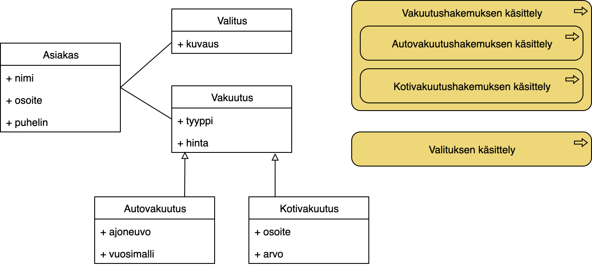{#fig-olio-suunnittelu}

Referenssimallitapa (*Reference Model based*) soveltuu käytettäväksi silloin, kun organisaatiolla on jo olemassa jonkinlainen prosessikartta. Kartta otetaan tarkastelun lähtökohdaksi ja prosessiarkkitehtuuri muokataan sen perusteella. Tässä toimintatavassa voidaan hyödyntää myös toimialakohtaisia yleisiä viite- ja referenssiarkkitehtuurikuvauksia. Seuraavassa kuviossa (@fig-tem-viite) on työn löytymisen prosessit, kuten ne on esitetty Työvoimapalveluiden viitearkkitehtuurissa[^tem]. Referenssimalli tarjoaa raamit sille, mitä prosesseja ja palveluja toimialan viranomaisten tulee toteuttaa. Esimerkkejä yksityisen sektorin referenssimalleista ovat telekommunikaatioalan viitearkkitehtuuri TM Forum Frameworx[^etom], joka sisältää muun muassa eTOM-viitekyksen (Enchaned Telecom Operations Map) sekä pankki- ja finanssialan Banking Industry Architecture Network (BIAN)[^bian].

[^tem]: https://tem.fi/tyovoimapalveluiden-viitearkkitehtuuri

[^etom]: https://www.tmforum.org/frameworx-evolution/

[^bian]: https://bian.org/

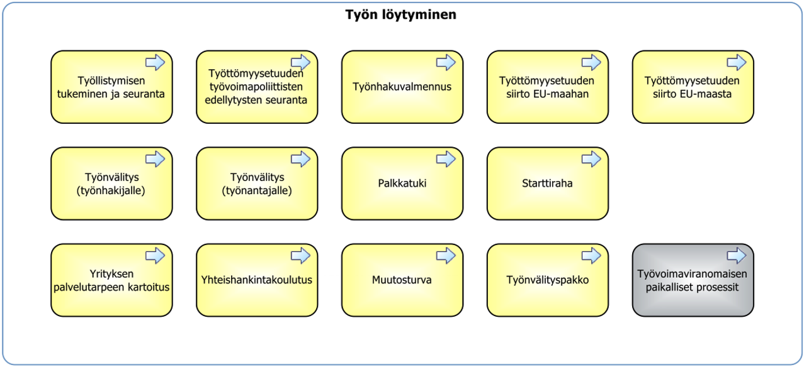{#fig-tem-viite}

Toimintolähtöisessä lähestymistavassa (*Function-based*) hyödynnetään toimintahierarkiaa, jolla liiketoiminnot jaetaan yksityiskohtaisempiin alatoimintoihin. Tämän jälkeen toimintohierarkiasta tunnistetaan prosessikandidaatit (@fig-toim-hier). Toimintolähtöisen tavan hyödyksi voidaan mainita se, että sen avulla ajatukset on helpompi keskittää siihen *mitä*-kysymyksiin, kun taas prosesseista puhumisella on taipumus johdattaa ajattelu suoraan *miten*-kysymyksiin. Prosessikulkujen suunnittelu ei vielä prosesseja tunnistettaessa ole ajankohtaista.

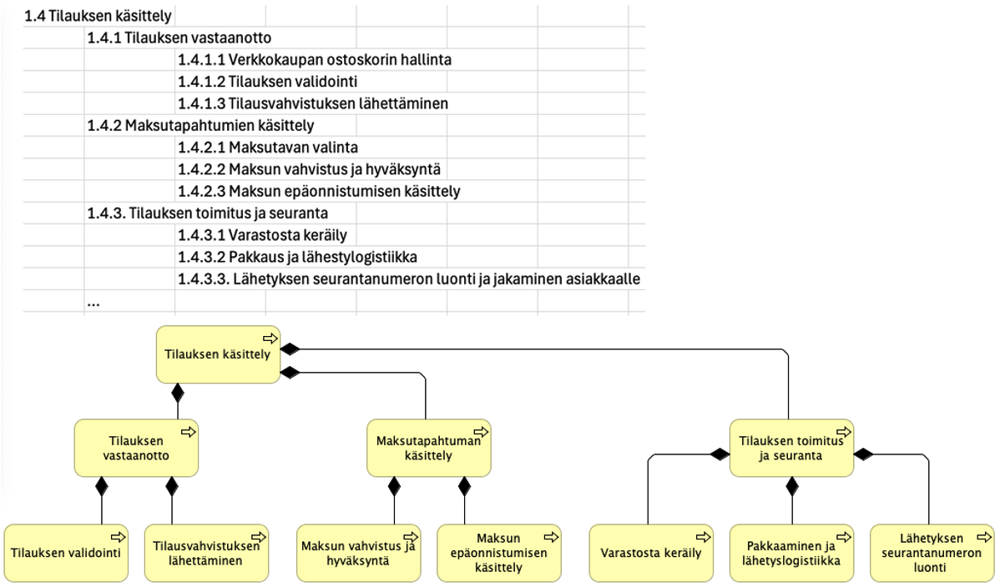{#fig-toim-hier}

Prosessien tunnistamisen ja prosessikartan laadinnan lisäksi prosessiarkkitehtuurin muodostamiseen liittyvä tehtävä on prosessin omistajien tunnistaminen sekä prosessijohtamisen mallista sopiminen. Ennen prosessiarkkitehtuurin kuvaamisen aloittamista tulee myös sopia kuvaustavoista: millä notaatiolla tai notaation osajoukolla ja välineillä prosessit dokumentoidaan, kuka ne dokumentoi, missä kuvauksia säilytetään, kuinka niitä versioidaan ja miten niiden ajantasaisuus varmistetaan.

## Liiketoimintaprosessit osana kokonaisarkkitehtuuria

Kokonaisarkkitehtuurimenetelmät (*Enterprise Architecture*), kuten hallitseva kansainvälinen standardi TOGAF[^togaf]  (*The Open Group Architecture Framework*) tai Suomen julkishallinnon käyttöön kehitetty Suomi.fi -kokonaisarkkitehtuurikehys[^suomifi-ka], ohjaavat tarkastelemaan laajoja ja monimutkaisia organisaatioita helpommin hallittavina osakokonaisuuksina ja kokonaisuuksien välisinä suhteina. Molemmat mainituista menetelmistä esittävät organisaation tarkastelun näkökulmiksi liiketoiminnan, tiedon (datan ja informaation), tietojärjestelmät sekä teknologiat. Oleellista KA-menetelmissä on, että eri näkökulmiin tai arkkitehtuureihin kuuluvien kohteiden väliset suhteet ja riippuvuudet tehdään näkyviksi.

[^togaf]: https://www.opengroup.org/togaf

[^suomifi-ka]: https://kehittajille.suomi.fi/palvelut/kokonaisarkkitehtuuri/kokonaisarkkitehtuurikehys

Kokonaisarkkitehtuurissa voitaisiin olla kiinnostuneita esimerkiksi yrityksen arvolupauksesta ja siihen liittyvinä kohteita niistä liiketoimintaprosesseista, joilla tätä lupausta pyritään toteuttamaan. Näiden prosessien suorittaminen on todennäköisesti riippuvaista joistain tietojärjestelmistä, jotka tuottavat, käsittelevät ja tallentavat prosessissa liikkuvaa tietoa. Tietojärjestelmät tarvitsevat toimiakseen teknologia-alustoja. Näiden kokonaisarkkitehtuurin komponenttien (arvolupaus, prosessit, tiedot, tietojärjestelmät, teknologia-alustat) ja niiden välisten suhteiden kautta voidaan hahmottaa organisaation rakennetta ja toimintaa kokonaisuutena, eli toisin sanoen muodostaa käsitys kokonaisarkkitehtuurista.

Tarkastelemalla organisaation strategisia tavoitteita tai niihin liittyviä arvolupauksia, liiketoimintaprosesseja tai niiden virtausnopeuksia, tietojärjestelmiä, niiden vasteaikoja tai käytettävyyttä toisistaan irrallaan, ei ole mahdollista ymmärtää ja arvioida organisaatiota ja sen toimintaa kokonaisuutena, saati tunnistaa siitä täsmällisiä kehittämiskohteita. Yksittäisen kohteen muuttaminen ilman ymmärrystä muutoksen heijastus- ja kokonaisvaikutuksista johtaa harvoin hyvään lopputulemaan.

Vaikka prosessien hallintaa ja kehittämistä voidaan tietysti tehdä ilman kokonaisarkkitehtuurimenetelmien tukeakin, tarjoavat ne prosessityölle kontekstin, joka puolestaan mahdollistaa valistuneemman päätöksenteon ja kehittämisresurssien kohdentamisen. Kokonaisarkkitehtuurin kannalta edellä käsitelty prosessiarkkitehtuuri on yksi sen osa-alueista tai oikeastaan yksi, joskin varsin oleellinen, liiketoiminta-arkkitehtuurin osa-alue.

BPMN-mallinnuskieltä myöhemmin käsiteltäessä tarkastellaan, kuinka sen avulla voidaan kuvata viestivirtoja, -varastoja ja -järjestelmiä osana prosessimalleja. Prosessimallien pääasiallinen tarkoitus on kuitenkin esittää prosessin kulku. Vaikka automatisoitavissa prosessikuluissa tietovirrat täytyykin mallintaa yksityiskohtaisesti -- muuttujien ja tietotyyppien tasolla -- ja prosessien tulee pystyä teknisesti kytkeytymään tietojärjestelmien rajapintoihin, eivät prosesseja ympäröivät tietovarastot ja järjestelmät ole varsinaisesti prosessiasiantuntijoiden työmaata. Niitä, kuten myös esimerkiksi prosessiin liittyviä tietoturvallisuusvaatimuksia, koskevan informaation tulee kuitenkin olla prosessikehittäjien saatavilla silloin, kun sitä tarvitaan. Tällaista tietoa kokonaisarkkitehdit voivat tarjota prosessityön tueksi.

### Prosessit TOGAF-menetelmässä ja ArchiMate-mallinnuskielellä

TOGAF-menetelmän kattamien tietosisältöjen metamalli (*Enterprise Metamodel*[^ccm]) esittää käsitteet, joista organisaation kokonaisarkkitehtuuri muodostuu. Mallissa liiketoimintaprosessi liittyy välittömillä suhteilla seuraaviin käsitteisiin: organisaatioyksikkö (*Organization Unit*), rooli (*Role*), liiketoimintakyvykkyys (*Business Capability*), arvovirta (*Value Stream*), toiminto (*Function*), tapahtuma (*Event*), kontrolli (*Control*), liiketoimintatieto (*Business Information*) sekä liiketoimintapalvelu (*Business Service*). Data, sovellukset ja teknologiat kytkeytyvät metamallissa prosessiin edellisten kautta.

[^ccm]: https://pubs.opengroup.org/togaf-standard/architecture-content/chap02.html#tag_02_03

Liiketoimintaprosesseilla on siis KA-malleissa kirjaimellisestikin keskeinen asema -- ja miksipä ei olisi. Prosessien avulla toteutetaan asiakkaille tarjottavat tuotteet ja palvelut. Prosessien toteuttamisen tukena käytetään tietojärjestelmiä ja sovelluksia, joten prosessit myös määrittävät IT-ratkaisuja koskevat vaatimukset. Prosesseissa käsitellään tietoa, joka tapauksesta riippuen voi pitää sisällään esimerkiksi henkilötietoja tai liiketoiminnan kannalta kriittistä tai salassa pidettävää tietoa, ja niin edelleen. Voidaan ajatella, että kaikki organisaatioiden kokonaisvaltaisen kehittämisen kysymykset lähteävät liikkeelle prosesseista tai ne ainakin jossain vaiheessa päätyvät prosesseihin.

TOGAF:iin kuuluva arkkitehtuurin kehittämismenetelmä (*Architecture Development Method*[^adm]) ohjaakin arkkitehtuurimuutoksia tehtäessä kiinnittämään ensimmäisenä huomion liiketoimintanäkökulman (*Business Architecture*) sisältöihin, niiden vaatimuksiin ja niille asetettavaan tavoitetilaan. 

[^adm]: https://pubs.opengroup.org/togaf-standard/adm/

Edellä todettiin, että BPMN-mallit on tarkoitettu kuvaamaan prosessin yksityiskohtainen työnkulku, mutta niiden mahdollisuudet esittää prosessin kontekstia ja toimintaympäristöä ovat rajalliset. KA-kuvaukset pystyvät sen sijaan esittämään organisaation loogisen rakenteen ja ympäristön kokonaisuudessaan, mutta tyypillisesti varsin karkealla tarkkuustasolla.

Monet ammattilaisten suosimat mallinnusvälineet tukevat useiden mallinnuskielten käyttöä rinnakkain, kuten ArchiMatea[^archimate] varsinaisten KA-kuvausten tuottamiseen, UML[^uml]-kieltä tarkempien ohjelmistoarkkitehtuurien suunnitteluun ja BPMN-kieltä prosessikulkujen kuvaamiseen. Tällaisten välineiden avulla voidaan tarkastella esimerkiksi ArchiMatella tuotettua prosessi- (@fig-am-esim7) tai kyvykkyyskarttaa (vrt. @fig-kyvykkyyskartta) ensin yleisellä tasolla, jotta nähdään vaikkapa prosessien suhde liiketoiminnan strategisiin tavoitteisiin tai järjestelmärajapintoihin kokonaisuudessaan. Tämän jälkeen voidaan porautua tutkimaan tarkemmin haluttuja prosessikulkuja BPMN-mallien muodossa.

[^archimate]: https://www.opengroup.org/archimate-forum/archimate-overview

[^uml]: https://www.omg.org/uml/

ArchiMate 3.2 -kielen sallimat suhteet liiketoimintaprosessin ja muiden kohteiden välille on koottu seuraavaan kuvioon (@fig-am-bp-suhteet). Kohteet on värikoodattu näkökulmittain: keltainen esittää liiketoiminta-arkkitehtuurin (*Business*) elementtejä, vaaleansininen sovelluksiin (*Application*) liittyviä elementtejä, vihreä teknologiaa (*Technology*) ja niin edelleen.

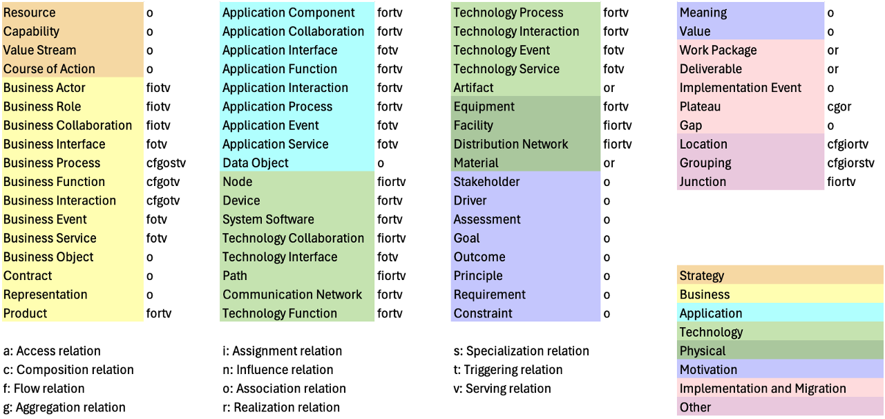{#fig-am-bp-suhteet}

Esimerkiksi *Business Role* (käytännössä siis tehtävänimike ja muu henkilöön tai organisaatioyksikköön liittyvä toiminnallinen rooli) voi liittyä prosessiin seuraavilla suhteilla: *Flow*, *Assignment*, *Association*, *Triggering* tai *Serving*. Flow ilmaisee jonkin hyödykkeen tai resurssin, kuten informaation, materiaalin tai rahan, siirtymistä kohteiden välillä. Assignment esittää vastuun tai suoritusvelvollisuuden allokointia. Esimerkiksi siis niin, että jokin rooli on osoitettu tietyn prosessin toteuttajaksi ja toinen rooli prosessin omistajaksi. Triggering kuvaa kohteiden välistä ajallista tai kausaalista suhdetta; tässä yhteydessä esimerkiksi sitä, että rooli käynnistää prosessin suorittamisen. Serving nimensä mukaisesti ilmaisee, että prosessi palvelee jotain roolia tai rooli palvelee prosessia, riippuen suhteen esityssuunnasta.

Prosessin ja sovelluksen (*Application Component*) välille ArchiMate sallii muuten samat suhteen kuin rooliin, mutta järjestelmää ei voida liittää liiketoimintaprosessiin Assignment-suhteella. Sen sijaan voidaan käyttää *Realization*-suhdetta, jolla ilmaistaan, että sovellus toteuttaa prosessin tai osallistuu sen toteuttamiseen. Sovellus voidaan kuitenkin liittää Assignment-suhteella *Application Process* -tyyppiseen elementtiin, jolla kuvataan sovelluksen sisäisen toimintalogiikan prosesseja tai automatisoituja prosesseja.

Kokonaisarkkitehtuurissa ollaan siis erityisesti kiinnostuneita siitä, kuinka asiat liittyvät toisiinsa ja millaisen kokonaisuuden ne muodostavat. Sen sijaan prosessikulkujen yksityiskohtaiseen esittämiseen ArchiMate ei juuri sovellu, eikä sitä ole siihen tehtävään tarkoitettukaan.

Kokonaisarkkitehtuurimalleissa prosessit esitetään tavallisesti ainoastaan prosessin nimen tarkkuudella -- ei työnkulkuina. Seuraavassa esimerkissä (@fig-am-esim1) on kolme kohdetta ja niiden väliset suhteet. Application Component -elementillä kuvattu *Järjestelmä* tukee Serving-suhteen kautta *Prosessin* suorittamista. Realization-suhde ilmaisee, että tämä prosessi toteuttaa liiketoimintapalvelun *Palvelu*.

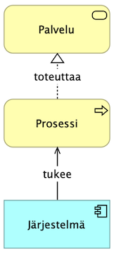{#fig-am-esim1}

Seuraava s@fig-am-esim2 esittää laskunkäsittelyn prosessin vaiheittain. Prosessikulun käynnistää *Lasku saapuu*, joka on Business Event -tyyppinen tapahtuma. Sillä voidaan ilmaista liiketoiminnan kannalta relevanttia tilan muutosta, jollaisena laskun vastaanottamista voidaan toki pitää. Vastaava prosessikulku BPMN:llä esitettynä käynnistyisi *Message Start Event* -tapahtumalla, johon palataan myöhemmin. Toinen merkittävämpi ero, ja ilmeinen puute ArchiMaten mahdollisuuksissa kuvata prosessikulkuja, on se, että siinä ei ole tehtävätyyppistä (*Task* tai *Activity*) elementtiä. Siksi tilauskäsittelyprosessin jokainen vaihe täytyy mallintaa omaksi prosessikseen. Näin tietysti voidaan tehdä ja ehkä vaikkapa *Hyväksy lasku* -tehtävä voi joskus olla hyödyllistäkin hahmottaa ja kuvata omana prosessinaan tai aliprosessinaan.

Käytettäessä ArchiMatea prosessien kuvaamisen tekniikkana ajaudutaan kuitenkin nopeasti tilanteeseen, jossa prosesseina esitettyjä tehtäviä kertyy mallikantaan valtava määrä, ja prosessisalkun hallinta on vaarassa ruuhkautua. Tästäkin syystä prosessikulut on järkevämpää kuvata siihen nimenomaisesti tarkoitetuilla mallinnuskielillä, kuten BPMN:lla.

Yksi esimerkkikuviosta huomattava ArchiMaten etu liittyy mahdollisuuteen liittää tietojärjestelmiä ja järjestelmäpalveluja suorittamisen vaiheisiin tarkemmalla tasolla kuin BPMN-malleissa.

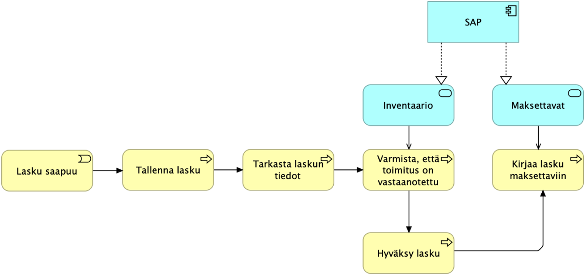{#fig-am-esim2}

ArchiMaten *Business Actor*- ja *Business Role* -elementtejä voidaan käyttää esitettäessä prosessiin liittyviä toimijoita ja sidosryhmiä. Seuraavassa esimerkissä (@fig-am-esim3) prosessiin on liitetty kaksi aktoria (*Omistaja* ja *Asiakas*) ja yksi rooli (*Toteuttaja*). Tällaiseen informaatioon tukeutuen voitaisiin helposti löytää esimerkiksi prosessit, joilla ei ole nimettyä omistajaa tai tarkastella sitä, millä prosesseilla tiettyä kriittistä asiakasryhmää palvellaan.

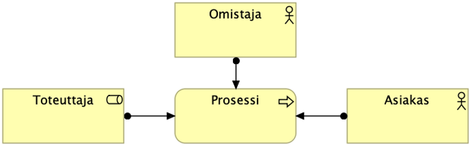{#fig-am-esim3}

ArchiMate-malleissa voidaan aktoreiden ja roolien avulla myös jäljitellä BPMN:n uima-altaita ja -ratoja. Näin toimittaessa malli voi olla helpommin luettava, eikä se menetä mitään informaatiosisällöstään (@fig-am-esim4).

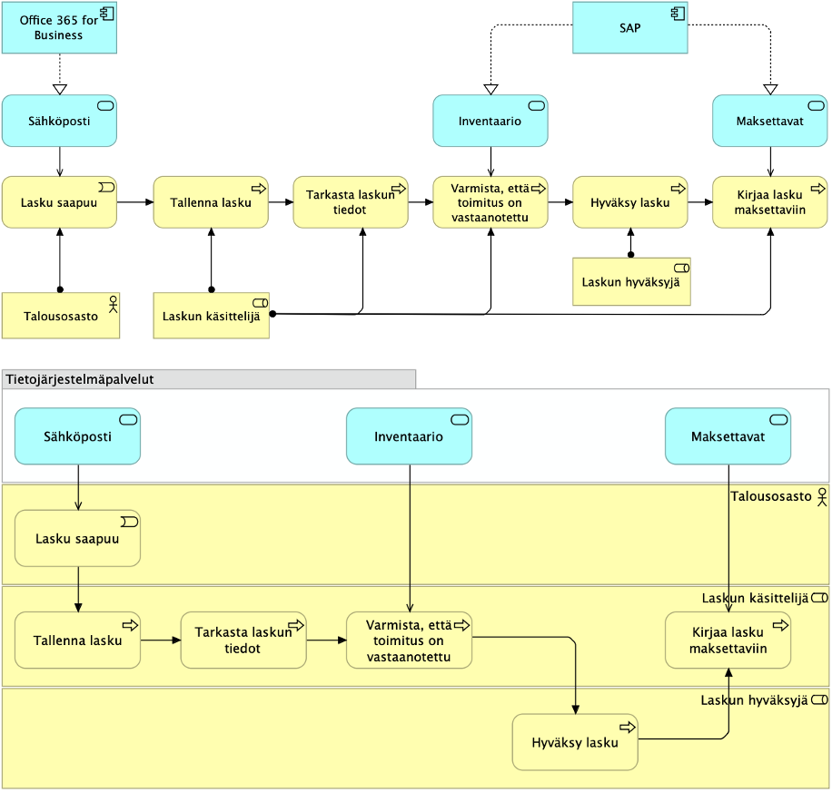{#fig-am-esim4}

ArchiMaten *Junction*-elementillä on mahdollista kuvata hieman tarkemmin prosessikulun logiikkaa. Junction voi olla tyypiltään AND (täytetty musta ympyrä) tai OR (täyttämätön ympyrä). Niitä voidaan käyttää kuten BPMN:n Parallel Gateway- tai Exclusive Gateway -portteja (@fig-am-esim5).

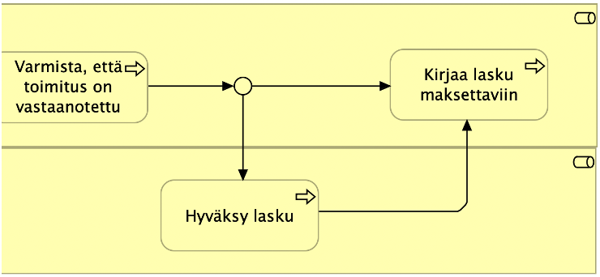{#fig-am-esim5}

Prosessiin kuuluvat aliprosessit voidaan esittää koostumista ilmaisevan suhteen (*Composition* ja *Aggregation*) avulla (@fig-am-esim6).

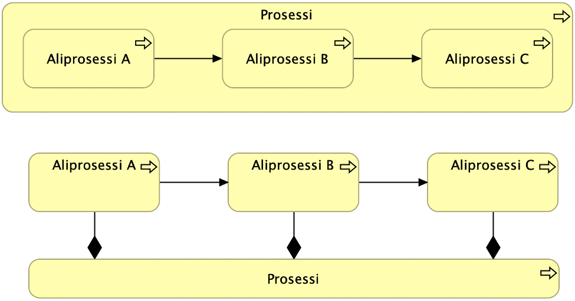{#fig-am-esim6}

Liiketoimintaprosessien hallinnan kannalta kokonaisarkkitehtuuri-informaation merkittävin hyöty perustuu sen kattamien kohteiden ja näkökulmien monipuolisuuteen sekä kykyyn esittää niiden välisiä suhteita ja riippuvuuksia. Esimerkiksi prosessikarttaa voitaisiin rikastaa riippuvuussuhteiden kautta muodostuvalla informaatiolla (@fig-am-esim7): Mihin strategisiin tavoitteisiin prosessit liittyvät? Mitkä ovat kriittisten prosessien käyttämien järjestelmien elinkaarien tilat? Mitkä prosesseista käyttävät pilvipalvelujen resursseja. Sijaitsevatko jotkin palveluista Euroopan talousalueen ulkopuolella?

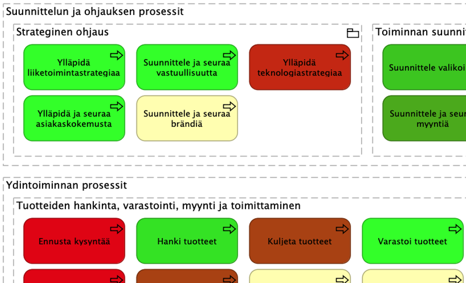{#fig-am-esim7}