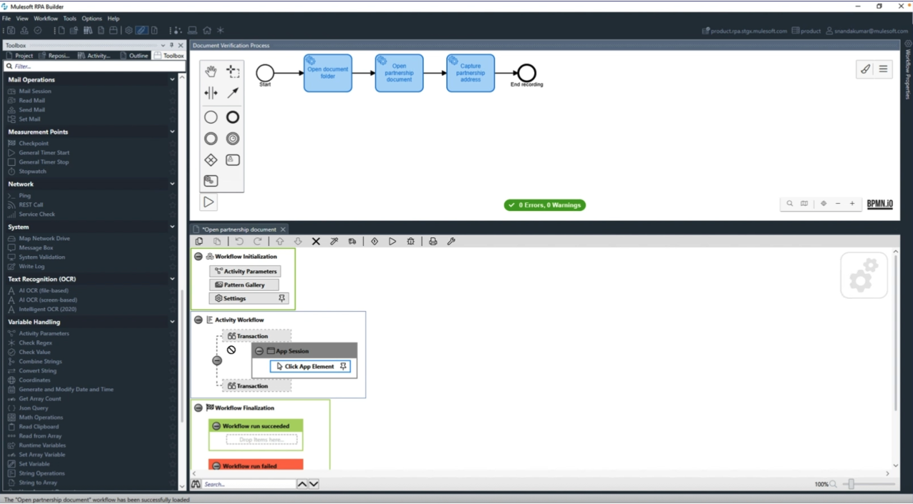
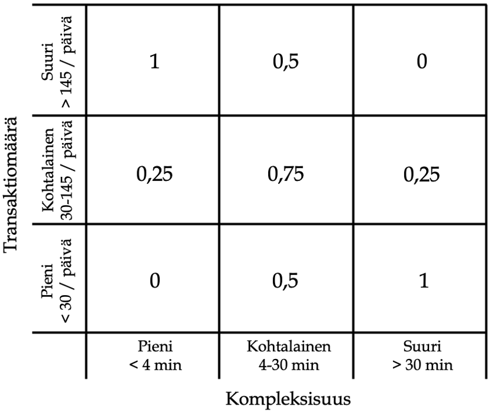
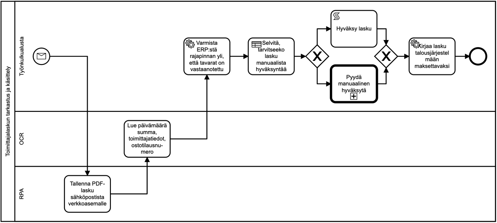

# Prosessiautomaatio ja tekoäly

Tässä luvussa käsitellään liiketoimintaprosessien automaatiota[^hint_bpmn]. Tarkastelu keskittyy asiantuntija- ja tietotyön tehtäviin liittyviin automaatiomahdollisuuksiin, eikä esimerkiksi teollisuus- tai tuotantoautomaatioon, joilla tarkoitetaan valmistus- ja tuotantoprosessien sekä niihin liittyvien koneiden ohjaamista ja valvontaa teknologian avulla (@fig-manufacturing_line).

[^hint_bpmn]: Tässä luvussa tarvitaan jonkin verran BPMN-kielen tuntemista, joten harkitse, luetko tarvittaessa ensin luvun *Mallit, mallintaminen ja Business Process Model and Notation*.

{#fig-manufacturing_line}

Lisäksi tarkastellaan tekoälyn mahdollisuuksia prosessien kehittämisessä ja automaatiossa. Koska tekoälyratkaisujen kehitysvauhti on tällä hetkellä valtavan nopea, tarkastelu pidetään melko yleisellä tasolla.

Kun prosessi on kuvattu ja analysoitu riittävän tarkasti, voidaan arvioida automatisoinnin mahdollisuuksia ja kannattavuutta. Seuraavissa luvuissa käsitellään kolmea liiketoimintaprosessien automaation toteuttamisen muotoa: työnkulkuautomaatiota, ohjelmistorobotiikkaa sekä tekoälypohjaisia ratkaisuja.

Edellisten rinnalla ei kannata myöskään unohtaa ohjelmistojen ja järjestelmien omia mahdollisuuksia, jotka usein voivat olla kevyin ja edullisin tapa prosessien tehostamiseksi. Tällaisia ovat esimerkiksi taulukkolaskennan makrot, valmiit raporttipohjat, tallennetut tietokantakyselyt ja toiminnanohjausjärjestelmän automaattinen täsmäytys tai hälytykset. Ennen kuin uutta automaatioratkaisua lähdetään hankkimaan, kannattaa selvittää, onnistuisiko se jo nykyisillä välineillä.

## Työnkulkuautomaatio

Työnkulkuautomaatio (*Workflow Automation*) tarkoittaa toistuviin, sääntöpohjaisiin prosesseihin kuuluvien tehtävien siirtämistä ohjelmistojen suoritettavaksi. Työnkulkuautomaatio on tässä luvussa käsiteltävistä aiheista vanhin: käsitteenä se eli huippukauttaan 1990-luvun lopulla tai 2000-luvun alussa. Toisaalta nykypäivänäkin esimerkiksi älykäs prosessiautomaatio ja hyperautomaatio edelleen toteuttavat työnkulkuautomaation tavoitteita ja periaatteita; nyt tosin hieman kehittyneempien teknologioiden tuella.

Kun prosessimalli esitetään tarkkuudella, joka mahdollistaa prosessin seuraamisen yksittäisten tehtävien ja tapahtumien tasolla, voidaan sitä kutsua työnkulkumalliksi.

Tarvitaan tarkkaa ja todellisuudelle uskollista mallintamista, jotta prosessi – tai sen työnkulku – voidaan automatisoida. Ajatellaan esimerkiksi johonkin prosessiin kuuluvaa tehtävää ”Laske tuotteiden yhteishinta”. Vaikka tämä tehtävän nimi tai sen sisällön kuvaus on sinällään ymmärrettävä, ei se vielä riitä siihen, että automaatiomoottori osaisi suorittaa tehtävän. Työnkulkumallit vertautuvat työohjeisiin. Jos työohje neuvoo uutta HR-työntekijää ”Käsittele saapunut työhakemus”, ei ohjeella pääse vielä puusta pitkälle. Paitsi, että ohjeen täytyy jakaa tehtävä pienempiin osiin, täytyy sen myös kertoa, miten työntekijä voi tietää, että hakemus on saapunut, mistä hän hakemuksen löytää ja niin edelleen.

Työnkulkumallia (@fig-pros-workflow) voidaan ajatella automaattiseen toimintaan kykenevien järjestelmien työohjeena. Suuriin kielimalleihin perustuvat ja luonnollisen kielen käsittelyyn kykenevät järjestelmät saattavat ehkä sopivassa kontekstissa osata tulkita ja toteuttaa geneerisestikin esitettyjä tehtäviä (kuten ”Käsittele saapunut työhakemus”) yksityiskohtaisina työnkulkuina, mutta ainakin toistaiseksi työnkulun mahdollisimman tarkka määritteleminen on turvallinen valinta.

![Prosessista työnkulkusovellukseksi [mukailtu lähteestä @georgakopoulos1995overview]](kuviot/pros-workflow.svg){#fig-pros-workflow}

Osa automatisoitavista tehtävistä saattaa nousta esille välittömästi, kun taas osa voi muodostua vasta työnkulkuspesifikaation ideoinnin, rakentamisen ja iteroinnin kautta. Oleellista on, ettei työnkulkuja suunniteltaessa takerruta nykyisiin toimintatapoihin ja niiden automatisointiin, vaan mietitään, mitä uusia mahdollisuuksia ja uudenlaisia toimintatapoja teknologiat ja automaatio mahdollistavat. Tulee myös muistaa, ettei työnkulkujen automatisoinnissa ole useinkaan mahdollista -- tai edes järkevää -- pyrkiä täysin automatisoituun toteutukseen. Osa tehtävistä voidaan jättää ihmistoimijoiden suoritettaviksi *Manual Task*- ja *User Task* -tyyppisinä.

Seuraavassa luvussa käsiteltävän BPMN-kielen (*Business Process Model and Notation*) ominaisuudet riittävät erinomaisesti työnkulkumallien laadintaan. BPMN XML -spesifikaatio mahdollistaa myös prosessimallien automaattisen suorittamisen, joten BPMN toimii paitsi määrittelykielenä työnkulkumallia luotaessa, myös runtime-ajoympäristössä suoritettavana työnkulkusovelluksena. Ohjelmistokokonaisuuksia, jotka mahdollistavat prosessien ja päätöslogiikan mallintamisen, testaamisen, käyttöönoton ja lopulta niiden automaattisen suorittamisen, kutsutaan nimellä *Workflow Engine* tai työnkulkumoottori.

## Ohjelmistorobotiikka

Ohjelmistorobotiikassa (*Robotic Process Automation*, *RPA*) on kyse sellaisten tehtävien tai prosessien automatisoinnista, joita suoritetaan tietokoneohjelmistojen käyttöliittymien kautta ja joiden suorittaminen vaatii tavallisesti runsaasti manuaalista työtä. Tällaiset tehtävät voivat sisältää vaikkapa tietojen käsittelyä siten, että lähteenä toimii yksi järjestelmä tai sähköinen dokumentti ja kohteena toinen. Esimerkiksi sähköpostitse vastaanotettu vikailmoitus voitaisiin RPA:n avulla kirjata automaattisesti  tikettijärjestelmään tai tilaus tilausrekisteriin.

Ohjelmistorobotiikka saatetaan joskus sekoittaa tekoälyyn, mutta RPA-ratkaisuilla ei välttämättä tarvitse olla mitään tekemistä tekoälyn kanssa. Ohjelmistorobotit suorittavat tarkoin määriteltyjä työnkulkuja seuraten ennalta määriteltyjä ohjeita. Ne toteuttavat tietokoneen ohjainlaitteiden (kuten näppäimistö ja hiiri) automaatiota, eli ne pystyvät syöttämään tekstiä ohjelmistojen käyttöliittymiin, liikuttamaan hiiren kursoria ja vaikkapa painamaan graafisen käyttöliittymän oikeaa painiketta. Tätä ne eivät tietenkään tee näppäimistöä fyysisesti näpyttelemällä tai hiirtä liikuttamalla, vaan ohjelmallisesti. RPA-toteutuksissa voi olla myös konenäköön liittyviä ominaisuuksia, jolloin ne voivat esimerkiksi etsiä dokumentista tekstiä tai näytöltä oikean näköisen painikkeen sen sijaan, että niille täytyisi kertoa, missä koordinaateissa oikea kohde sijaitsee.

Seuraavassa kuvassa (@fig-mulesoft) näkyy MuleSoftin *RPA Builder*[^mule]  -välineen käyttöliittymä. Prosessikulku esitetään BPMN-kielellä ja RPA:n suorittamat tehtävät ovat mallissa *Service Task* -tyyppiä. Kullekin niistä voidaan määritellä tarkempi tehtävänkulku, jonka aikana edelleen voidaan hyödyntää RPA Builderin toiminnallisuuksia, kuten vaikkapa tekstin tunnistaminen dokumentista OCR:n avulla tai muuttujien käsittely.

[^mule]: https://www.mulesoft.com/platform/rpa

{#fig-mulesoft}

Alla olevassa kuvassa (@fig-powerautomate) on yksityiskohta *Microsoft Power Automate* -välineellä toteutetusta prosessikulusta, jossa ohjelmistorobotti hakee työntekijän työmatkan pituuden lähtöpaikasta työmaalle *Google Maps* -palvelun avulla ja liittää sen työseurannan *Excel*-taulukkoon. Esimerkki [@kemppainen2024prosessien] osoittaa, kuinka tarkasti ohjelmistorobotin toimintaa voidaan -- ja toisaalta täytyy -- ohjeistaa, kun se operoi graafisen käyttöliittymän päällä ilman API-rajapintojen käyttöä. Esimerkissä pyydetään RPA:ta ensin aktivoimaan selaimen Google Maps -ikkuna ja sen jälkeen kaksoisnapauttamaan näyttöä määritellyssä koordinaattipisteessä. Sen jälkeen suoritetaan näppäinkomento *Control+C*, joka kopioi kaksoisnapautuksella valitun tekstin leikepöydälle. Kopioitu teksti liitetään tämän jälkeen Excel-taulukon oikeaan soluun *Control+V* -komennolla.

Useat RPA-ratkaisut osaavat myös kutsua ohjelmistorajapintoja. Tällöin ohjelmistorobotti lukee ja kirjoittaa tietoja sekä käynnistää ohjelmistojen toimintoja esimerkiksi REST-kutsujen avulla sen sijaan, että vuorovaikuttaisi niiden kanssa graafisen käyttöliittymän kautta.

![Esimerkki Microsoft Power Automatella laaditusta työnkulusta [@kemppainen2024prosessien]](kuviot/powerautomate.png){#fig-powerautomate}

RPA-ratkaisut ovat erittäin tiukkakytkentäisiä. Tämä tarkoittaa, että  niiden rakentaminen edellyttää prosessin suorittamisessa käytettävien ohjelmistojen ja niiden käyttöliittymien tarkkaa tuntemista. Pienikin muutos ohjelmiston toimintalogiikassa tai graafisessa käyttöliittymässä, kuten esimerkiksi tekstikentän tai painikkeen sijainnin muuttuminen, voi rikkoa työnkulun nykyisen määrittelyn.

Ennen RPA-projektin käynnistämistä kannattaa tehdä huolellinen arviointi RPA-ratkaisun toteutettavuudesta ja tarpeellisuudesta. Tässä arvioidaan, voidaanko prosessin toiminnot automatisoida RPA:n avulla ja kuinka hyödyllistä ja kannattavaa automatisointi on.

@leshob2018towards ovat esittäneet prosessin automaatiokelpoisuuden arviointiin laskentakaavan (@fig-rpa-arv1), joka muodostaa tulon prosessin tehtävien ohjelmistoavusteisuudesta sekä sääntöperusteisuudesta. Ensimmäistä tekijää varten selvitetään niiden tehtävien määrä, joissa ihminen käyttää sovelluksen käyttöliittymää esimerkiksi valintojen tekemiseen tai tietojen syöttämiseen. Toinen tekijä muodostuu sellaisten tehtävien osuudesta, jotka toteutetaan tunnetun säännön tai vakioidun toimintatavan mukaisesti. Toisin sanoen, mitä useampaan prosessin tehtävistä liittyy sovellusten käyttöä ja mitä harvempi tehtävistä edellyttää inhimillistä harkintaa tai improvisoitua päätöksentekoa (esimerkiksi poikkeustilanteissa, joissa automaattinen päätöksenteko ei ole mahdollista), sitä potentiaalisempi prosessi on RPA:n avulla automatisoitavaksi.

{#fig-rpa-arv1}

Tarpeellisuutta -- tai relevanssia -- puolestaan arvioidaan prosessin transaktiomäärien (kuinka usein tehtävä tapahtuu) ja kompleksisuuden avulla (@fig-rpa-arv2). Jälkimmäisen @leshob2018towards määrittelevät prosessin keston perusteella, mutta joissain tapauksissa voi olla tarpeen käyttää muitakin parametreja.

{#fig-rpa-arv2}

Potentiaalin ja relevanssin perusteella voidaan tehdä kokonaisarvio siitä, kannattaako prosessille ryhtyä rakentamaan RPA-toteutusta (@fig-rpa-arv3).

{#fig-rpa-arv3}

On syytä arvioida myös RPA-toteutuksen sijoitetun pääoman tuottoa (*Return On Investment*, *ROI*), takaisinmaksuaikaa tai kokonaiskustannuksia (*Total Cost of Ownership*, *TCO*) sisältäen toteutuksen välittömät ja välilliset kustannukset sen koko elinkaaren ajalta. Mikäli prosessin manuaalisen suorittamisen kustannukset ovat suurillakin tapahtumamäärillä matalat verrattuna RPA-ratkaisun toteuttamisen hintaan, ei toteutus tietenkään ole taloudellisesti järkevä. Tulee myös huomioida, että jos prosessin kulku tai siinä käytettävät ohjelmistot ovat jatkuvasti alttiita muutoksille, joudutaan myös RPA-toteutusta toistuvasti päivittämään, jolloin sen elinkaarikustannukset kasvavat.

Onnistuneiden RPA-ratkaisujen hyödyt ovat kuitenkin kiistattomia. Tutkimuksissa [@shamsuzzoha2025robotic] hyötyinä on nostettu esille muun muassa prosessien suorittamisen nopeutuminen, inhimillisten virheiden poistuminen ja se, että työntekijät voidaan ohjata tehtäviin, jotka he kokevat mielekkäämmiksi ja joissa tarvitaan inhimillistä päätöksentekoa tai vuorovaikutusta. Tästä huolimatta RPA-teknologioihin liitetään kenties aiheellisiakin pelkoja esimerkiksi joidenkin työtehtävien katoamisesta. Siksi pienissäkin RPA-projekteissa on syytä huomioida muutosjohtamisen ja sidosryhmäviestinnän näkökulmat.

Edellä on keskitytty pääasiassa prosessien RPA-potentiaalin arviointiin. Kuten kaikki muutkin liiketoimintaprosessien kehittämiseen liittyvät tehtävät, myös RPA-ratkaisujen harkinta, arviointi ja rakentaminen edellyttävät nykyisten prosessien hyvää tuntemista. Prosessien tulisi olla dokumentoituja ja mielellään esimerkiksi BPMN-kielellä mallinnettuja. Monet RPA-välineistä toimivat BPMN-mallien perusteella. Prosesseihin liittyvien liiketoimintasääntöjen tunnistaminen edellyttää varsin tarkkaakin prosessituntemusta ja RPA-ratkaisun kustannustehokkuuden arviointi hyötyy suuresti prosesseista kerätystä mittaritiedosta, kuten suoritustiheys, suoritusaika sekä erilaisten virhe- ja poikkeustilanteiden määrä.

| Kriteerit | Kuvaus |
|---|---|
| Sääntöpohjaisuus | Prosessi on pystyttävä kuvaamaan yksiselitteisesti kaikkien mahdollisten prosessikulkujen osalta. |
| Vähäinen monimutkaisuus | Yksinkertainen ja selkeästi hahmotettavissa oleva prosessikulku mahdollistaa RPA-toteutuksen. |
| Runsas toistuvuus | Usein toistuvien prosessien automatisointi parantaa RPA-toteutukseen käytetyn pääoman tuoton todennäköisyyttä. |
| Suuri tapahtumamäärä | Runsaasti tehtäviä sisältävä prosessi usein maksimoi RPA:n hyötyjen toteutumisen. Tällaiset prosessit ovat tavallisesti myös rutiininomaisia ja toistuvia. |
| Digitaaliset syötteet | Kaikkien syöte- ja tulostetietojen on oltava jäsenneltyjä ja digitaalisessa muodossa – tai digitaaliseen muotoon muutettavissa. |
| Normalisoitu, jäsennelty, standardoitu ja kypsä prosessi | Mitä paremmin prosessi tunnetaan ja mitä yksityiskohtaisemmin se on kuvattu, sitä helpompaa ja vähemmän aikaa vievää RPA-robotin konfigurointi on. |
| Vuorovaikutus useiden ohjelmistojen kanssa | Useita ohjelmistoja käyttävä prosessi on hyvä RPA:n kohde. Manuaalinen siirtyminen järjestelmien välillä kasvattaa virheriskiä ja epäjohdonmukaisuutta. |
: RPA-potentiaalin osatekijät [@syed2020robotic] {#tbl-rpa-yhtveto}

## Hyperautomaatio ja Intelligent Process Automation

Hyperautomaatiolla (*Hyperautomation*) tarkoitetaan erilaisten automatisoinnin mahdollisuuksien ja niitä tukevien teknologioiden yhdistelemistä siten, että automaatio voidaan toteuttaa mahdollisimman laaja-alaisesti. Edellä mainittujen työnkulkuautomaation ja ohjelmistorobotiikan rinnalla hyperautomaatiossa voidaan käyttää myös esimerkiksi koneoppimista ja tekoälyä.

Erilaisten teknologioiden soveltamisen lisäksi hyperautomaatiolla voidaan viitata myös eri toiminta-alueita leikkaavaan ja yhdistävään automaatioon. Tämä voi esimerkiksi tarkoittaa, että havainnot markkinoiden muutoksista ohjaavat markkinoinnin prosesseja, joiden toteuma edelleen vaikuttaa tuotannon prosesseihin, ja joista saatava reaaliaikainen palaute säätää tarpeen mukaan toimitusketjun prosesseja.

Viime aikoina on ryhdytty käyttämään myös käsitettä *Intelligent Process Automation* (*IPA*), älykäs prosessiautomaatio, joka useissa määritelmissä kuulostaa hyvin samankaltaiselta hyperautomaation kanssa. IPA rikastaa perinteisempiä ohjelmistorobotiikan ratkaisuja esimerkiksi API-automaation, hahmontunnistuksen, päätösautomaation ja tekoälyn teknologioilla.

Seuraavassa (@fig-ipa-esim1) on esitetty yksinkertaistettu prosessikulku toimittajalaskun tarkastukselle ja käsittelylle. Esimerkistä on jätetty pois mahdollisia poikkeustilanteita ja vaihtoehtoisia kulkuja, joihin tällaisessa prosessissa todellisuudessa olisi tarpeen varautua. Prosessi alkaa, kun yrityksen tiettyyn sähköpostiosoitteeseen saapuu toimittajalta lasku PDF-muodossa. Ostoassistentti tallentaa laskun verkkolevylle ja sen jälkeen tarkastaa laskun oleelliset tiedot. Sitten hän varmistaa ERP-järjestelmästä, että laskutetut tuotteet on vastaanotettu. Tämän jälkeen hän toimittaa laskun hyväksyttäväksi oikealle henkilölle, esimerkiksi yksikön johtajalle tai hankintavastaavalle. Kun lasku on hyväksytty, ostoassistentti kirjaa sen tiedot talousjärjestelmään maksettaviin laskuihin.

{#fig-ipa-esim1}

Seuraavassa (@fig-ipa-esim2) edellinen prosessi on hahmoteltu hyperautomaatiototeutuksen muotoon. Uimaradat on varattu prosessimallissa nyt kolmelle teknologialle, joita prosessin suorittamisessa hyödynnetään. Työnkulkualusta vastaa prosessikulun yleisestä ohjaamisesta ja suorittamisesta. Prosessin aikana se ohjaa osan tehtävistä muiden automaatioteknologioiden suoritettavaksi sekä kutsuu ERP-järjestelmää.

{#fig-ipa-esim2}

Toimittajalaskun saavuttua sähköpostiin, työnkulkualusta kutsuu ohjelmistorobottia, joka etsii laskun ja tallentaa sen verkkoasemalle. Ohjelmistorobotti kutsuu OCR-toimintoa (*Optical Character Recognition*), joka lukee hahmontunnistusta hyödyntäen laskulta relevantit tiedot ja palauttaa ne takaisin työnkulkualustalle prosessimuuttujina. Työnkulkualusta kysyy ERP-järjestelmältä (*Service Task*) API-rajapinnan yli, ovatko tilaukseen liittyvät tuotteet saapuneet ja lasku siltä osin valmis maksettavaksi. Seuraavaksi työnkulkualusta päättelee päätöstaulun (*Business Rule Task*) avulla, voidaanko lasku hyväksyä automaattisesti. Mikäli se on mahdollista, lasku hyväksytään prosessikulkuun liitetyllä ohjelmakoodilla (*Script Task*). Mikäli lasku jostain syystä – esimerkiksi korkean hinnan vuoksi – tarvitsee manuaalisen hyväksynnän, hyväksyntä pyydetään kutsumalla aliprosessia (*Call Activity*). Lopuksi hyväksytyn laskun tiedot viedään automaattisesti (*Service Task*) talousjärjestelmään maksettavien laskujen joukkoon.

Koko prosessi voidaan käsitellä ilman manuaalista työtä, ellei laskun hyväksyntä jostain syystä sitä edellytä. Prosessin läpinäkyvyys ja nopeus paranevat, samoin kuin unohdusten ja inhimillisten virheiden määrä vähenee.

## Tekoäly prosessiautomaatiossa {#sec-tekoaly-automaatiossa}

Hyperautomaation ratkaisuissa tekoälyä käytetään lähinnä yksittäisten tehtävien suorittamisessa, esimerkiksi hahmontunnistus dokumenttia luettaessa tai päätösautomaatiota täydentävä koneoppiminen. Suurten kielimallien yleistyminen on kuitenkin tuomassa tekoälyn prosessiautomaatioon myös laajamittaisemmin. Se voi tietyissä tilanteissa ottaa vastuulleen kokonaisia prosessikulkuja tai jopa päättää, missä järjestyksessä ja millä keinoin prosessiin kuuluvat tehtävät suoritetaan.

Autonomiset tekoälyagentit pystyvät jo nykyisin suorittamaan vaativiakin tehtäviä itsenäisesti ja ilman ohjausta. Useista keskenään vuorovaikuttavista agenteista koostuvat järjestelmät pystyvät suorittamaan monimutkaisia tehtäväsarjoja -- eli prosesseja. Lähitulevaisuudessa saatamme olla tilanteessa, jossa prosessimalliksi riittää BPMN:n *Ad-hoc* -prosessin kaltainen sekalainen joukko irrallisia tehtäviä tai jopa ainoastaan halutun lisättyä arvoa tuottavan lopputuloksen ilmoittaminen.

Vuoden 2026 aikana saatiin lukea useista "välikohtauksista", joissa tekoälyagenttien kerrottiin "karanneen" ja murtautuneen esimerkiksi terveydenhuollon järjestelmiin[^yle_openai]^,^[^yle_ai]. Agentit eivät tietenkään toimi näin ilkeyttään, vaan etsiessään tietoa, jota ne tarvitsevat niille annetun tehtävän ratkaisemiseksi. Joka tapauksessa autonomisen tekoälyn käyttöön prosessiautomaatiossa kannattaa vielä ainakin toistaiseksi suhtautua varauksella ja harkinnalla.

[^yle_openai]: https://yle.fi/a/74-20237506
[^yle_ai]: https://yle.fi/a/74-20247954

Kuten edellä todettiin, tekoälyratkaisujen kehitysvauhti on tällä hetkellä niin suuri, että yksittäisiä tuotteita tai teknologioita koskevat havainnot vanhenevat nopeasti. Tarkastelu pidetään seuraavassa siksi periaatteiden tasolla.

### Tekoäly prosessin yksittäisissä tehtävissä

Tekoälyä, kuten kielimalleja, voidaan ajatella yhtenä prosessin tehtävien suorittajana muiden joukossa. Edellä esitetyssä laskunkäsittelyn prosessissa (@fig-ipa-esim2) OCR-toiminto luki laskulta tiedot ja palautti ne työnkulkualustalle prosessimuuttujina. Perinteinen OCR-ratkaisu toimii, kun laskut ovat rakenteeltaan vakioituja ja tiedot löytyvät aina suurin piirtein samoista kohdista. Toimittajia saattaa kuitenkin olla useita, ja jokaisella voi olla omanlaisensa laskupohja. Joskus viitenumero on oikeassa yläkulmassa, joskus alatunnisteessa, ja joskus lasku on liitetty sähköpostiin valokuvana ruttuisesta paperista.

Tekoälyllä on valmiuksia tulkita vaihtelevaa ja puolirakenteista aineistoa huomattavasti sääntöpohjaista tunnistusta joustavammin. Sille voidaan antaa ohjeeksi esimerkiksi ”Poimi laskulta toimittajan nimi, Y-tunnus, laskun summa, eräpäivä ja tilausnumero”, ja se palauttaa tiedot työnkulkualustalle samaan tapaan kuin OCR-toiminto aiemmin. Prosessimallissa tämä voisi olla *Service Task* -tyyppinen tehtävä, jossa kutsutaan kielimallia rajapinnan yli, tai oma uimarata muiden automaatioteknologioiden rinnalla.

Vastaavia tehtäviä löytyy lähes kaikista asiantuntija- ja tietotyön prosesseista: palvelupyyntöjen luokittelu ja ohjaus eteenpäin, pitkien asiasisältöjen tiivistäminen, rakenteettoman tiedon muuttaminen rakenteiseen muotoon, tarvittavat tyyppimuunnokset siirrettäessä tietoja järjestelmien välillä ja niin edelleen.

Tällaisissa ratkaisuissa prosessin kulku on edelleen tarkasti mallinnettu ja työnkulkualustan ohjaama. Tekoäly ainoastaan muuttaa joidenkin tehtävien toteutustapoja. Tämä on varsin hallittava ja turvallinenkin tapa tuoda tekoälyä osaksi prosessien suorittamista. Työnkulku edelleen määrittelee, mitä tehdään ja missä järjestyksessä, ja tekoäly toteuttaa vain sille osoitetun osan.

On syytä kuitenkin muistaa, etteivät kielimallit toimi kuten perinteinen ohjelmakoodi. Ne eivät ole deterministisiä eli sama syöte ei välttämättä tuota joka kerta täsmälleen samaa lopputulosta. Kielimallit saattavat pahimmillaan myös tuottaa uskottavan näköisiä, mutta virheellisiä vastauksia.

Tekoälyn tuottamat tiedot kannattaa mahdollisuuksien mukaan tarkistaa automaattisesti. Esimerkiksi laskun summaa voidaan verrata ERP-järjestelmän tilaustietoihin tai yritystunnuksen oikeellisuus voidaan varmistaa toimittajarekisteristä. Mikäli tiedot eivät täsmää, voi prosessi ohjata laskun ihmisen käsiteltäväksi.

@prucha2025llm vertasivat UiPath RPA[^uipath] -ohjelmistorobotiikkaratkaisua ja kielimalliagenttia kolmessa tehtävässä: tiedonsyötössä, seurannassa ja dokumenttien tietojen poiminnassa. Tutkimuksen mukaan ohjelmistorobotti oli toiminnassaan nopeampi ja luotettavampi. Sen sijaan agenttiratkaisujen kehitysaika oli lyhyempi ja ne selvisivät käyttöliittymän muutoksia huomattavasti RPA-ratkaisuja paremmin.

[^uipath]: https://www.uipath.com/rpa/robotic-process-automation

### Agenttinen tekoäly

Aiemmin todettiin, että kielimalleihin perustuvat järjestelmät saattavat sopivassa kontekstissa pystyä tulkitsemaan ja toteuttamaan geneerisestikin esitettyjä tehtäviä, kuten ”Käsittele saapunut työhakemus”. Tätä voidaan kutsua agenttiseksi tekoälyksi (*Agentic AI*). Tekoälyagentille ei anneta yksityiskohtaista kuvausta prosessin kulusta, vaan prosessin tavoite sekä joukko työkaluja, joita se saa käyttää tavoitteen saavuttamiseksi. Työhakemuksen käsittelyyn liittyviä työkaluja voivat olla hakemusjärjestelmä, kalenteri ja sähköposti. Agentti päättää itsenäisesti, mitä tehtäviä se suorittaa ja missä järjestyksessä, mitä tietoja se hakee ja milloin tavoite on saavutettu. Useampi agentti voi myös toimia yhdessä siten, että kullakin on prosessissa oma erikoistunut roolinsa ja ne välittävät tehtäviä ja tietoja toisilleen.

@ye2023proagent kutsuvat tätä kehitystä siirtymäksi ohjelmistorobotiikasta agenttiseen prosessiautomaatioon (*Agentic Process Automation*). Kielimalliagentit sekä rakentavat työnkulun ihmisen antamista ohjeista että tekevät sen suorittamisen aikana tarvittavat päätökset. Työnkulku koordinoi erikoistuneita agentteja, jotka suorittavat prosessin tehtäviä.

Ero perinteiseen prosessiautomaatioon on merkittävä. Ohjelmistorobotti suorittaa tarkoin määriteltyjä työnkulkuja ja voi rikkoutua, jos käyttöliittymän painike vaihtaa paikkaa. Työnkulkualusta puolestaan seuraa tarkoin määriteltyä ja mallinnettua prosessikulkua. Agentti voi muodostaa oman työnkulkunsa jokaista tapausta varten. Toisaalta tämä tekee agenteista joustavia ja ne pystyvät käsittelemään poikkeustilanteita, joita ei välttämättä olisi osattu etukäteen ennakoida ja mallintaa työnkulkuun. Toisaalta samasta syystä agentin toimintaa on vaikeampi ennakoida, testata ja valvoa.

BPMN-kielen *Ad-hoc*-aliprosessi sopii agenttien kuvaamiseen varsin luontevasti -- vaikka sitä tuskin alun perin tähän tarkoitukseen on suunniteltu. Se on joukko tehtäviä, jotka voidaan suorittaa tai olla suorittamatta, ja joiden suoritusjärjestystä ei ole ennalta määrätty. Agentin toimintaa voidaan siis kuvata prosessimallissa Ad-hoc-aliprosessina, jonka sisällä agentti valitsee käytettävissä olevista tehtävistä ja välineistä tilanteeseen sopivat. Ympäröivä prosessi on kuitenkin tarkasti mallinnettu ja hallittu. Se määrää, milloin agentille annetaan tehtävä, mitä sen tulee tehtävän suoritettuaan palauttaa, ja mihin pääprosessin kulku sen jälkeen etenee. Osa työnkulkualustojen toimittajista onkin jo ryhtynyt tukemaan tekoälyagenttien orkestrointia BPMN-prosessien osana.

Agenttiseen tekoälyyn liittyy kuitenkin periaatteellisempi haaste. Generatiivisten tekoälyjen ja suurten kielimallien toiminta on siis epädeterminististä ja muistuttaa mustaa laatikkoa. Agentille voidaan antaa tavoite ja seurata sen tekemiä toimenpiteitä. Emme kuitenkaan välttämättä tiedä, millaisen päättelyn tuloksena se päätyi juuri näihin toimenpiteisiin tai edes sitä, tuottivatko ne oikeita lopputuloksia.

Tämä palauttaa meidät takaisin alkuun ja ongelmaan, jota liiketoimintaprosessien hallinnalla on pyritty ratkaisemaan:

> Sumean linssin läpi tarkasteltuna prosessi voi näyttäytyä mustana laatikkona: jotain menee sisälle, joitain asioita tapahtuu, ja lopuksi laatikosta tulee jotain ulos. Joskus tämä vertaus saattaa valitettavasti vastatakin organisaatioiden kyvykkyyttä ymmärtää omia prosessejaan.

Prosessien johtamisen näkökulmasta tämä on vähintään paradoksaalista -- kenties kestämätöntäkin. Prosesseja mallinnetaan, jotta toiminta olisi läpinäkyvää, toistettavaa ja kehitettävissä. Jos prosessin jokin keskeinen osa suoritetaan tavalla, jota kukaan ei täysin tunne, myös prosessin mittaaminen vaikeutuu ja konkreettiset edellytykset jatkuvalle parantamiselle katoavat.

Työnkulun mahdollisimman tarkka määritteleminen on ainakin toistaiseksi turvallinen valinta silloin, kun prosessi on kriittinen, säännelty tai sen virheillä voi olla merkittäviä seurauksia. Agentit sopivat tilanteisiin, joissa tapaukset vaihtelevat paljon, virheiden seuraukset ovat korjattavissa ja joissa lopputuloksen tarkistaminen on helpompaa kuin itse työn tekeminen.

### Ihminen silmukassa ja tekoälyn hallinta

Kun tekoäly osallistuu prosessin suorittamiseen, voi nousta kysymys siitä, kuka on vastuussa sen mahdollisesti tekemistä virheistä. Tosiasiassa vastuu säilyy aina prosessia suorittavalla organisaatiolla ja viime kädessä prosessin omistajalla. Siksi tekoälyä hyödyntäviin prosesseihin tulee suunnitella kohtia, joissa ihminen tarkastaa, hyväksyy tai korjaa tekoälyn tuotoksen. Tätä kutsutaan *Human in the Loop*- tai ihminen silmukassa -periaatteeksi.

Laadittaessa prosessimallit BPMN-kielellä, on ihminen helppo lisätä silmukkaan: tekoälyn suorittaman tehtävän jälkeen prosessiin lisätään esimerkiksi *User Task*, jossa ihminen tarkastaa tuloksen ennen prosessin jatkumista.

Kaikkea ei kuitenkaan ole järkevää tarkastaa. Jos jokainen tekoälyn käsittelemä lasku käydään vielä ihmisen toimesta läpi, on automaation hyöty jokseenkin kyseenalainen. Tarkastus voidaankin ehtoperusteisesti kohdistaa esimerkiksi suuriin summiin, epätavallisiin tapauksiin tai sellaisiin, joissa tekoäly ilmoittaa olevansa epävarma lopputuloksesta. Lisäksi satunnaisotannalla voidaan seurata, pysyykö tekoälyn toiminnan laatu hyväksyttävällä tasolla.

Ihmisen tekemään tarkastukseen liittyy haasteitakin. Tekoälyn tuottama teksti tai muu tulos on usein uskottavan näköistä, ja virheet voivat jäädä huomaamatta. Mitä harvemmin tekoäly erehtyy, sitä helpommin tarkastaja alkaa luottaa siihen, eikä tarkastus enää ole välttämättä todellinen. Lisäksi tarkastaminen on työlästä; useissa tehtävissä työläämpää kuin tehtävän suorittaminen. Ihminen silmukassa -periaate toimii vain, kun tarkastukselle on varattu riittävästi aikaa ja tarkastajalla tehtävää koskevaa asiantuntemusta.

Myös nykyinen lainsäädäntö asettaa reunaehtoja tekoälyn käyttämiselle prosessiautomaatiossa. Suomessa julkisen hallinnon automaattista päätöksentekoa koskeva lainsäädäntö tuli voimaan keväällä 2023[^autom_laki_ai]. Se kieltää automaattisen päätöksenteon tilanteissa, jotka edellyttävät viranomaisen harkintavaltaa, perustuvat yksilölliseen arviointiin tai olosuhteiden kokonaisvaltaiseen punnintaan, tai joihin liittyy merkittäviä vaikutuksia yksilön oikeuksiin tai velvollisuuksiin.

[^autom_laki_ai]: Hallituksen esitys HE 145/2022, https://www.finlex.fi/fi/hallituksen-esitykset/2022/145

Euroopan unionin tekoälysäädös[^ai_act] (*EU AI Act*) puolestaan luokittelee tekoälyjärjestelmiä niiden riskitason perusteella. Esimerkiksi rekrytointiin, koulutukseen tai julkisiin palveluihin liittyvät tekoälysovellukset voivat kuulua korkean riskin luokkaan, jolloin niiden käytölle asetetaan erityisiä vaatimuksia muun muassa ihmisen suorittaman valvonnan, dokumentoinnin ja läpinäkyvyyden osalta. Edellä mainittu ”Käsittele saapunut työhakemus” -agentti ei siis olisi ainoastaan tekninen, vaan myös juridinen kysymys.

[^ai_act]: Euroopan parlamentin ja neuvoston asetus (EU) 2024/1689 tekoälyä koskevista yhdenmukaistetuista säännöistä. https://eur-lex.europa.eu/eli/reg/2024/1689/oj

Tekoälyn tuominen osaksi prosesseja ei siis ole pelkästään teknologioita koskeva kysymys. Kuten Outi Sivonen johdannossa lainatussa kirjoituksessaan totesi, tekoälyn käyttöönotossa eivät muutu vain yksittäiset työtehtävät, vaan myös prosessit ja niiden johtaminen. Automaatio on vasta ensimmäinen askel. On liian helppoa tehdä tekoälyn ja automaation avulla nopeammin sitä, mitä jo nyt tehdään -- myös silloin, kun sitä ei oikeastaan kannattaisi tehdä ollenkaan. Siksi tekoäly ei muuta prosessien kehittämisen perusperiaatteita: ensin tulee miettiä, mitä arvoa prosessi tuottaa ja kenelle, ja vasta sitten sitä, miten prosessi kannattaa toteuttaa.