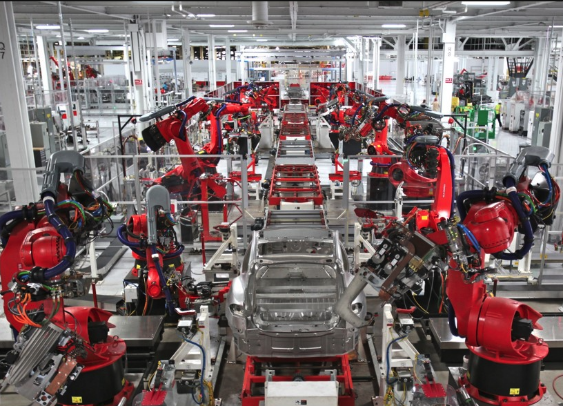
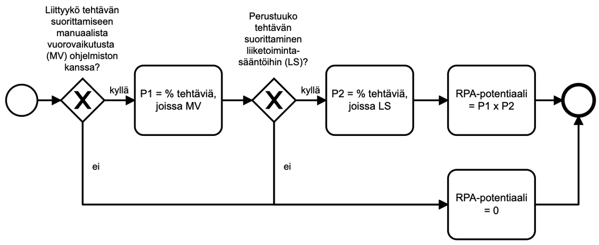
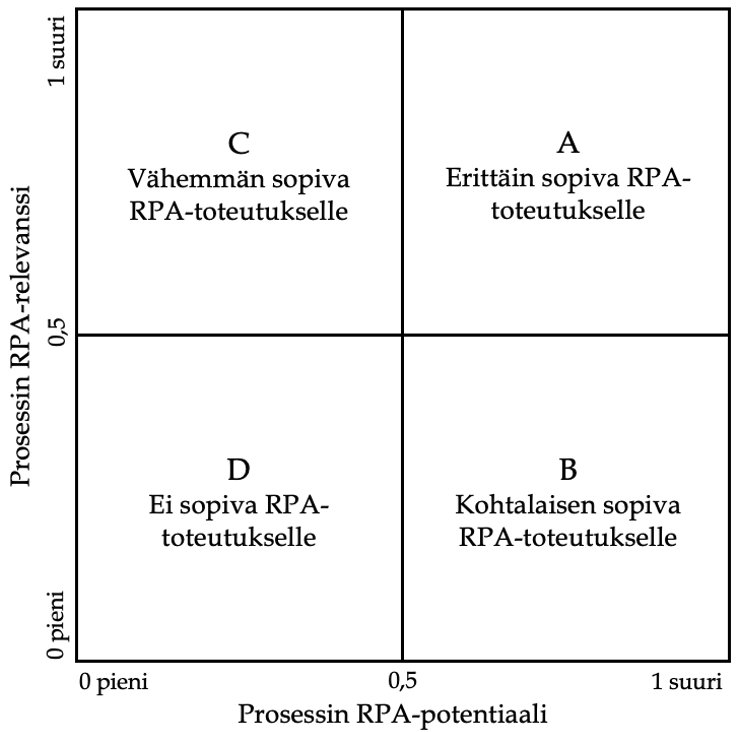
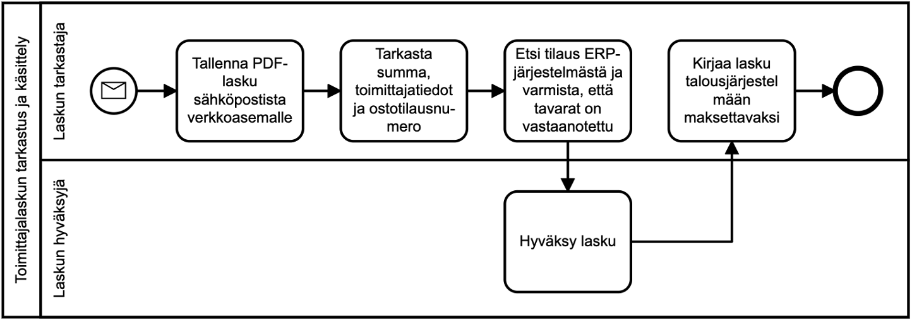

# Prosessiautomaatio ja tekoäly

Tässä luvussa käsitellään liiketoimintaprosessien automaatiota[^hint_bpmn]. Tarkastelu keskittyy asiantuntija- ja tietotyön tehtäviin liittyviin automaatiomahdollisuuksiin, eikä esimerkiksi teollisuus- tai tuotantoautomaatioon, joilla tarkoitetaan valmistus- ja tuotantoprosessien sekä niihin liittyvien koneiden ohjaamista ja valvontaa teknologian avulla (@fig-manufacturing_line).

[^hint_bpmn]: Tässä luvussa tarvitaan hieman BPMN-kielen tuntemista, joten harkitse luetko tarvittaessa ensin osan *Business Process Model and Notation ja prosessien mallintaminen*.

{#fig-manufacturing_line}

Lisäksi tarkastellaan tekoälyn mahdollisuuksia prosessien kehittämisessä ja automaatiossa. Koska tekoälyratkaisujen kehitysvauhti on tällä hetkellä valtavan nopea, tarkastelu pidetään melko yleisellä tasolla.

Kun prosessi on kuvattu ja analysoitu riittävän tarkasti, voidaan arvioida automatisoinnin mahdollisuuksia ja kannavuutta. Seuraavissa luvuissa käsitellään kolmea liiketoimintaprosessien automaation toteuttamisen muotoa: ohjelmistorobotiikkaa, työnkulkuautomaatiota sekä tekoälypohjaisia ratkaisuja.

Edellisten rinnalla ei kannata myöskään unohtaa ohjelmistojen ja järjestelmien omia mahdollisuuksia, jotka usein voivat olla kevyin ja edullisin tapa prosessien tehostamiseksi. Tällaisia ovat esimerkiksi taulukkolaskennan makrot, valmiit raporttipohjat, tallennetut tietokantakyselyt ja toiminnanohjausjärjestelmän automaattinen täsmäytys tai hälytykset. Ennen kuin uutta automaatioratkaisua lähdetään hankkimaan, kannattaa selvittää, onnistuisiko se jo nykyisillä välineillä.

## Työnkulkuautomaatio

Työnkulkuautomaatio (*Workflow Automation*) tarkoittaa toistuviin, sääntöpohjaisiin prosesseihin kuuluvien tehtävien siirtämistä ohjelmistojen suoritettavaksi. Työnkulkuautomaatio on tässä luvussa käsiteltävistä aiheista vanhin: käsitteenä se eli huippukauttaan 1990-luvun lopulla tai 2000-luvun alussa. Toisaalta nykypäivänäkin esimerkiksi älykäs prosessiautomaatio ja hyperautomaatio edelleen toteuttavat työnkulkuautomaation tavoitteita ja periaatteita; nyt tosin hieman kehittyneempien teknologioiden tuella.

Kun prosessimalli esitetään tarkkuudella, joka mahdollistaa prosessin seuraamisen yksittäisten tehtävien ja tapahtumien tasolla, voidaan sitä kutsua työnkulkumalliksi.

Tarvitaan tarkkaa ja todellisuudelle uskollista mallintamista, jotta prosessi – tai sen työnkulku – voidaan automatisoida. Ajatellaan esimerkiksi johonkin prosessiin kuuluvaa tehtävää ”Laske tuotteiden yhteishinta”. Vaikka tämä tehtävän nimi tai sen sisällön kuvaus on sinällään ymmärrettävä, ei se vielä riitä siihen, että automaatiomoottori osaisi suorittaa tehtävän. Työnkulkumallit vertautuvat työohjeisiin. Jos työohje neuvoo uutta HR-työntekijää ”Käsittele saapunut työhakemus”, ei ohjeella pääse vielä puusta pitkälle. Paitsi, että ohjeen täytyy jakaa tehtävä pienempiin osiin, täytyy sen myös kertoa, miten työntekijä voi tietää, että hakemus on saapunut, mistä hän hakemuksen löytää ja niin edelleen.

Työnkulkumallia (@fig-pros-workflow) voidaan ajatella automaattiseen toimintaan kykenevien järjestelmien työohjeena. Suuriin kielimalleihin perustuvat ja luonnollisen kielen käsittelyyn kykenevät järjestelmät saattavat ehkä sopivassa kontekstissa osata tulkita ja toteuttaa geneerisestikin esitettyjä tehtäviä (kuten ”Käsittele saapunut työhakemus”) yksityiskohtaisina työnkulkuina, mutta ainakin toistaiseksi työnkulun mahdollisimman tarkka määritteleminen on turvallinen valinta.

![Prosessista työnkulkusovellukseksi [mukailtu lähteestä @georgakopoulos1995overview]](kuviot/pros-workflow.svg){#fig-pros-workflow}

Osa automatisoitavista tehtävistä saattaa nousta esille välittömästi, kun taas osa voi muodostua vasta työnkulkuspesifikaation ideoinnin, rakentamisen ja iteroinnin kautta. Oleellista on, ettei työnkulkuja suunniteltaessa takerruta nykyisiin toimintatapoihin ja niiden automatisointiin, vaan mietitään, mitä uusia mahdollisuuksia ja uudenlaisia toimintatapoja teknologiat ja automaatio mahdollistavat. Tulee myös muistaa, ettei työnkulkujen automatisoinnissa ole useinkaan mahdollista -- tai edes järkevää -- pyrkiä täysin automatisoituun toteutukseen. Osa tehtävistä voidaan jättää ihmistoimijoiden suoritettaviksi *Manual Task*- ja *User Task* -tyyppisinä.

Seuraavassa luvussa käsiteltävän BPMN-kielen (*Business Process Model and Notation*) ominaisuudet riittävät erinomaisesti työnkulkumallien laadintaan. BPMN XML -spesifikaatio mahdollistaa myös prosessimallien automaattisen suorittamisen, joten BPMN toimii paitsi määrittelykielenä työnkulkumallia luotaessa, myös runtime-ajoympäristössä suoritettavana työnkulkusovelluksena. Ohjelmistokokonaisuuksia, jotka mahdollistavat prosessien ja päätöslogiikan mallintamisen, testaamisen, käyttöönoton (*Deployment*) ja lopulta niiden automaattisen suorittamisen, kutsutaan nimellä *Workflow Engine*.

## Ohjelmistorobotiikka

Ohjelmistorobotiikassa (*Robotic Process Automation*, *RPA*) on kyse sellaisten tehtävien tai prosessien automatisoinnista, joita suoritetaan tietokoneohjelmistojen käyttöliittymien kautta ja joiden suorittaminen vaatii tavallisesti runsaasti manuaalista työtä. Tällaiset tehtävät voivat sisältää vaikkapa tietojen käsittelyä siten, että lähteenä toimii yksi järjestelmä tai sähköinen dokumentti ja kohteena toinen. Esimerkiksi sähköpostitse vastaanotettu vikailmoitus voitaisiin RPA:n avulla kirjata automaattisesti  tikettijärjestelmään tai tilaus tilausrekisteriin.

Ohjelmistorobotiikka saatetaan joskus sekoittaa tekoälyyn, mutta RPA-ratkaisuilla ei välttämättä tarvitse olla mitään tekemistä tekoälyn kanssa. Ohjelmistorobotit suorittavat tarkoin määriteltyjä työnkulkuja seuraten ennalta määriteltyjä ohjeita. Ne toteuttavat tietokoneen ohjainlaitteiden (kuten näppäimistö ja hiiri) automaatiota, eli ne pystyvät syöttämään tekstiä ohjelmistojen käyttöliittymiin, liikuttamaan hiiren kursoria ja vaikkapa painamaan graafisen käyttöliittymän oikeaa painiketta. Tätä ne eivät tietenkään tee näppäimistöä fyysisesti näpyttelemällä tai hiirtä liikuttamalla, vaan ohjelmallisesti. RPA-toteutuksissa voi olla myös konenäköön liittyviä ominaisuuksia, jolloin ne voivat esimerkiksi etsiä dokumentista tekstiä tai näytöltä oikean näköisen painikkeen sen sijaan, että niille täytyisi kertoa, missä koordinaateissa oikea kohde sijaitsee.

Seuraavassa kuvassa (@fig-mulesoft) näkyy MuleSoftin *RPA Builder*[^mule]  -välineen käyttöliittymä. Prosessikulku esitetään BPMN-kielellä ja RPA:n suorittamat tehtävät ovat mallissa *Service Task* -tyyppiä. Niillä kullekin tehtävälle voidaan määritellä tarkempi tehtävänkulku, jonka aikana edelleen voidaan hyödyntää RPA Builderin toiminnallisuuksia, kuten vaikkapa tekstin tunnistaminen dokumentista OCR:n avulla tai muuttujien käsittely.

[^mule]: https://docs.mulesoft.com/rpa-builder/latest/ui-overview

{#fig-mulesoft}

Alla olevassa kuvassa (@fig-powerautomate) on yksityiskohta *Microsoft Power Automate* -välineellä toteutetusta prosessikulusta, jossa ohjelmistorobotti hakee työntekijän työmatkan pituuden lähtöpaikasta työmaalle *Google Maps* -palvelun avulla ja liittää sen työseurannan *Excel*-taulukkoon. Esimerkki osoittaa, kuinka tarkasti ohjelmistorobotin toimintaa voidaan -- ja toisaalta täytyy -- ohjeistaa, kun se operoi graafisen käyttöliittymän päällä ilman API-rajapintojen käyttöä. Esimerkissä pyydetään RPA:ta ensin aktivoimaan selaimen Google Maps -ikkuna ja sen jälkeen kaksoisnapauttamaan näyttöä määritellyssä koordinaattipisteessä. Sen jälkeen suoritetaan näppäinkomento *Control+C*, joka kopio kaksoisnapautuksella valitun tekstin leikepöydälle. Kopioitu teksti liitetään tämän jälkeen Excel-taulukon oikeaan soluun *Control+V* -komennolla.

Useat RPA-ratkaisut osaavat myös kutsua ohjelmistorajapintoja. Tällöin ohjelmistorobotti lukee ja kirjoittaa tietoja sekä käynnistää ohjelmistojen toimintoja esimerkiksi REST-kutsujen avulla sen sijaan, että vuorovaikuttaisi niiden kanssa graafisen käyttöliittymän kautta.

![Esimerkki Microsoft Power Automatella laaditusta työnkulusta [@kemppainen2018]](kuviot/powerautomate.png){#fig-powerautomate}

RPA-ratkaisut ovat erittäin tiukkakytkentäisiä. Tämä tarkoittaa, että  niiden rakentaminen edellyttää prosessin suorittamisessa käytettävien ohjelmistojen ja niiden käyttöliittymien tarkkaa tuntemista. Pienikin muutos ohjelmiston toimintalogiikassa tai graafisessa käyttöliittymässä, kuten esimerkiksi tekstikentän tai painikkeen sijainnin muuttuminen, voi rikkoa työnkulun nykyisen määrittelyn.

Ennen RPA-projektin käynnistämistä kannattaa tehdä huolellinen arviointi RPA-ratkaisun toteutettavuudesta ja tarpeellisuudesta. Tässä arvioidaan, voidaanko prosessin toiminnot automatisoida RPA:n avulla ja kuinka hyödyllistä ja kannattavaa automatisointi on.

@leshob2018towards ovat esittäneet prosessin automaatiokelpoisuuden arviointiin laskentakaavan (@fig-rpa-arv1), joka muodostaa tulon prosessin tehtävien ohjelmistoavusteisuudesta sekä sääntöperusteisuudesta. Ensimmäistä tekijää varten selvitetään niiden tehtävien määrä, joissa ihminen käyttää sovelluksen käyttöliittymää esimerkiksi valintojen tekemiseen tai tietojen syöttämiseen. Toinen tekijä muodostuu sellaista tehtävien osuudesta, jotka toteutetaan tunnetun säännön tai vakioidun toimintatavan mukaisesti. Toisin sanoen, mitä useampaan prosessin tehtävistä liittyy sovellusten käyttöä ja mitä harvempi tehtävistä edellyttää inhimillistä harkintaa tai improvisoitua päätöksentekoa (esimerkiksi poikkeustilanteissa, joissa automaattinen päätöksenteko ei ole mahdollista), sitä potentiaalisempi prosessi on RPA:n avulla automatisoitavaksi.

{#fig-rpa-arv1}

Tarpeellisuus -- tai relevanssi -- puolestaan tehdään prosessin transaktiomäärien (kuinka usein tehtävä tapahtuu) ja kompleksisuuden avulla (@fig-rpa-arv2). Jälkimmäisen @leshob2018towards määrittelevät prosessin keston perusteella, mutta joissain tapauksissa voi olla tarpeen käyttää muitakin parametreja.

{#fig-rpa-arv2}

Potentiaalin ja relevanssin perusteella voidaan tehdä kokonaisarvio siitä, kannattaako prosessille ryhtyä rakentamaan RPA-toteutusta (@fig-rpa-arv3).

{#fig-rpa-arv3}

On syytä arvioida myös RPA-toteutuksen takaisinmaksuaikaa (*Return On Investment*, *ROI*) tai sen kokonaiskustannuksia (*Total Cost of Ownership*, *TCO*) sisältäen toteutuksen välittömät ja välilliset kustannukset sen koko elinkaaren ajalta. Mikäli prosessin manuaalisen suorittamisen kustannukset ovat suurillakin tapahtumamäärillä matalat verrattuna RPA-ratkaisun toteuttamisen hintaan, ei toteutus tietenkään ole taloudellisesti järkevä. Tulee myös huomioida, että jos prosessin kulku tai siinä käytettävät ohjelmistot ovat jatkuvasti alttiita muutoksille, joudutaan myös RPA-toteutusta toistuvasti päivittämään, jolloin sen elinkaarikustannukset kasvavat.

Onnistuneiden RPA-ratkaisujen hyödyt ovat kuitenkin kiistattomia. Tutkimuksissa [@shamsuzzoha2025robotic] hyötyinä on nostettu esille muun muassa prosessien suorittamisen nopeutuminen, inhimillisten virheiden poistuminen ja se, että työntekijät voidaan ohjata tehtäviin, jotka he kokevat mielekkäämmiksi ja joissa tarvitaan inhimillistä päätöksentekoa tai vuorovaikutusta. Tästä huolimatta RPA-teknologioihin liitetään kenties aiheellisiakin pelkoja esimerkiksi joidenkin työtehtävien katoamisesta. Siksi pienissäkin RPA-projekteissa on syytä huomioida muutosjohtamisen ja sidosryhmäviestinnän näkökulmat.

Edellä on keskitytty pääasiassa prosessien RPA-potentiaalin arviointiin. Kuten kaikki muutkin liiketoimintaprosessien kehittämiseen liittyvät tehtävät, myös RPA-ratkaisujen harkinta, arviointi ja rakentaminen edellyttävät nykyisten prosessien hyvää tuntemista. Prosessien tulisi olla dokumentoituja ja mielellään esimerkiksi BPMN-kielellä mallinnettuja. Monet RPA-välineistä toimivat BPMN-mallien perusteella. Prosesseihin liittyvien liiketoimintasääntöjen tunnistaminen edellyttää varsin tarkkaakin prosessituntemusta ja RPA-ratkaisun kustannustehokkuuden arviointi hyötyy suuresti prosesseista kerätystä mittaritiedosta, kuten suoritustiheys, suoritusaika sekä erilaisten virhe- ja poikkeustilanteiden määrä.

| Kriteerit | Kuvaus |
|---|---|
| Sääntöpohjaisuus | Prosessi on pystyttävä kuvaamaan yksiselitteisesti kaikkien mahdollisten prosessikulkujen osalta. |
| Vähäinen monimutkaisuus | Yksinkertainen ja selkeästi hahmotettavissa oleva prosessikulku mahdollistaa RPA-toteutuksen. |
| Runsas toistuvuus | Usein toistuvien prosessien automatisointi parantaa RPA-toteutukseen käytetyn pääoman tuoton todennäköisyyttä. |
| Suuri tapahtumamäärä | Runsaasti tehtäviä sisältävä prosessi usein maksimoi RPA:n hyötyjen toteutumisen. Tällaiset prosessit ovat tavallisesti myös rutiininomaisia ja toistuvia. |
| Digitaaliset syötteet | Kaikkien syöte- ja tulostetietojen on oltava jäsenneltyjä ja digitaalisessa muodossa – tai digitaaliseen muotoon muutettavissa. |
| Normalisoitu, jäsennelty, standardoitu ja kypsä prosessi | Mitä paremmin prosessi tunnetaan ja mitä yksityiskohtaisemmin se on kuvattu, sitä helpompaa ja vähemmän aikaa vievää RPA-robotin konfigurointi on. |
| Vuorovaikutus useiden ohjelmistojen kanssa | Useita ohjelmistoja käyttävä prosessi on hyvä RPA:n kohde. Manuaalinen siirtyminen järjestelmien välillä kasvattaa virheriskiä ja epäjohdonmukaisuutta. |
: RPA-potentiaalin osatekijät [@syed2020robotic] {#tbl-rpa-yhtveto}

## Hyperautomaatio ja Intelligent Process Automation

Hyperautomaatiolla (*Hyper Automation*) tarkoitetaan erilaisten automatisoinnin mahdollisuuksien ja niitä tukevien teknologioiden yhdistelemistä siten, että automaatio voidaan toteuttaa mahdollisimman laaja-alaisesti. Edellä mainittujen työnkulkuautomaation ja ohjelmistorobitiikan rinnalla hyperautomaatiossa voidaan soveltaa myös esimerkiksi koneoppimista ja tekoälyä.

Erilaisten teknologioiden soveltamisen lisäksi hyperautomaatiolla voidaan tarkoittaa myös eri toiminta-alueita leikkaavaa ja yhdistävää automaatiota. Tämä voi esimerkiksi tarkoittaa, että havainnot markkinoiden muutoksista ohjaavat markkinoinnin prosesseja, joiden toteuma edelleen vaikuttaa tuotannon prosesseihin, joista saatava reaaliaikainen palaute säätää tarpeen mukaan toimitusketjun prosesseja.

Viime aikoina on ryhdytty käyttämään myös käsitettä *Intelligent Process Automation* (*IPA*), älykäs prosessiautomaatio, joka useissa määritelmissä kuulostaa hyvinkin samankaltaiselta hyperautomaation kanssa. IPA voi rikastaa perinteisempiä ohjelmistorobotiikan ratkaisuja esimerkiksi API-automaation, hahmontunnistuksen, suurien kielimallien ja päätösautomaation teknologioilla.

Seuraavassa (@fig-ipa-esim1) on esitetty yksinkertaistettu prosessikulku toimittajalaskun tarkastukselle ja käsittelylle. Esimerkistä on jätetty pois mahdollisia poikkeustilanteita ja vaihtoehtoisia kulkuja, joihin tällaisessa prosessissa todellisuudessa olisi varmasti tarpeen varautua. Prosessi alkaa, kun yrityksen tiettyyn sähköpostiosoitteeseen saapuu toimittajalta lasku PDF-muodossa. Ostoassistentti tallentaa laskun verkkolevylle ja sen jälkeen tarkastaa laskun oleelliset tiedot. Sitten hän varmistaa ERP-järjestelmästä, että laskutetut tuotteet on vastaanotettu. Tämän jälkeen hän toimittaa laskun hyväksyttäväksi oikealle henkilölle, esimerkiksi yksikön johtajalle tai hankintavastaavalle. Kun lasku on hyväksytty, ostoassistentti kirjaa sen tiedot talousjärjestelmään maksettaviin laskuihin.

{#fig-ipa-esim1}

Seuraavassa (@fig-ipa-esim2) edellinen prosessi on hahmoteltu hyperautomaatiototeutuksen muotoon. Uimaradat on varattu prosessimallissa nyt kolmelle teknologialle, joita prosessin suorittamisessa hyödynnetään. Työnkulkualusta vastaa prosessikulun yleisestä ohjaamisesta ja suorittamisesta. Prosessin aikana se ohjaa osan tehtävistä muiden automaatioteknologioiden suoritettavaksi sekä kutsuu ERP-järjestelmää.

{#fig-ipa-esim2}

Toimittajalaskun saavuttua sähköpostiin, työnkulkualusta kutsuu ohjelmistorobottia, joka etsii laskun ja tallentaa sen verkkoasemalle. Ohjelmistorobotti kutsuu OCR-toimintoa (*Optical Character Recognition*), joka lukee hahmontunnistusta hyödyntäen laskulta relevantit tiedot ja palauttaa ne takaisin työnkulkualustalle prosessimuuttujina. Työnkulkualusta kysyy ERP-järjestelmältä (*Service Task*) API-rajapinnan yli, ovatko tilaukseen liittyvät tuotteet saapuneet ja lasku siltä osin valmis maksettavaksi. Seuraavaksi työnkulkualusta päättelee päätöstaulun (*Business Rule Task*) avulla, voidaanko lasku hyväksyä automaattisesti. Mikäli voidaan, lasku hyväksytään prosessikulkuun liitetyllä ohjelmakoodilla (*Script Task*). Mikäli lasku jostain syystä – esimerkiksi korkean hinnan vuoksi – tarvitsee manuaalisen hyväksynnän, se hankintaan kutsumalla aliprosessia (*Call Activity*). Lopuksi hyväksytyn laskun tiedot viedään talousjärjestelmään maksettavien laskujen joukkoon.

Koko prosessi voitiin käsitellä ilman manuaalista työtä, ellei laskun hyväksyntä jostain syystä sitä edellytä. Prosessin läpinäkyvyys ja nopeus paranevat, samoin kuin inhimillisten virheiden ja unohdusten määrä vähenee.

<!-- Se, että prosessin kulku pystytään esittämään tietokoneohjelmistojen ymmärtämässä muodossa, mahdollistaa automaation. Mikäli prosessissa käsitellään ainoastaan digitaalista tietoa, prosessi voi olla automatisoitavissa jopa kokonaan. Ihmisen ei tarvitse osallistua prosessin kulkuun, vaan tietokone voi tehdä myös prosessin vaiheisiin liittyviä päätökset. Tässä voidaan soveltaa esimerkiksi BPMN:n Decision Model and Notation -määritystä. Toistaiseksi -- ehkä onneksikin -- näiden päätöstaulujen määrittelyyn tarvitaan kuitenkin inhimilliseen päätöksentekoon kykeneviä toimijoita. Suomen hallitus teki esityksen julkisen hallinnon automaattista päätöksentekoa koskevaksi lainsäädännöksi vuonna 2022[^autom_esitys] ja nykyinen uudistettu yleislaki tuli voimaan keväällä 2023[^autom_laki].

[^autom_esitys]: https://www.finlex.fi/fi/hallituksen-esitykset/2022/145

[^autom_laki]: https://api.hankeikkuna.fi/asiakirjat/ff3444f4-24c9-4ee8-8c9d-7bc581c0021a/3e478d6b-3906-4f3b-a5b0-5619b967e9ac/TIEDOTE_20230307080249.pdf

BPMN-prosesseissa voi olla sekä manuaalisia että automaattisesti suoritettavia tehtäviä. Niitä voidaan yhdistellä prosesseja automatisoitaessa siten, että osa prosessin tehtävistä suoritetaan automatisoidusti, mutta prosessikulku kutsuu mukaan ihmisen silloin, kun tehtävä vaatii inhimillistä harkintaa tai vuorovaikutusta fyysisen maailman kanssa. Julkisen sektorin toimintaa koskeva lainsäädäntö kieltää automaattisen päätöksenteon tilanteissa, jotka edellyttävät viranomaisen harkintavaltaa, perustuvat yksilölliseen arviointiin tai olosuhteiden kokonaisvaltaiseen punnintaan, tai niihin liittyy merkittäviä vaikutuksia yksilön oikeuksiin tai velvollisuuksiin. -->