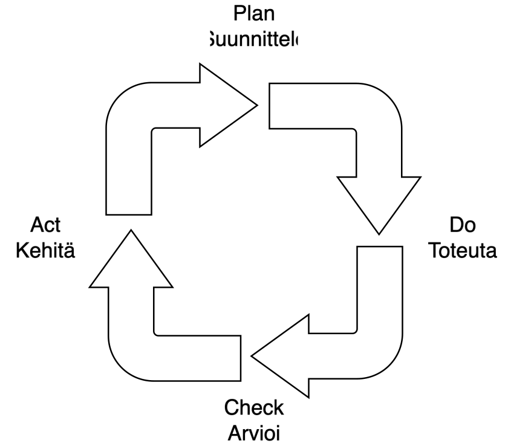

# Prosessiorganisaatio ja prosessien kehittäminen

> Business Process Management = Tarvitseeko oman lukunsa vai saako mahtumaan johonkin? Baiyere tutkimusryhmineen (2020) poimivat aiemmasta tutkimuksesta kolme BPM-ajattelun logiikkaa, jotka olivat prosessilogiikka, infrastruktuurilogiikka, sekä käyttäjälogiikka. Prosessilogiikan vallitsevana näkökulmana toimii prosessien mallintaminen, jossa tarkastellaan toimintoja sarjoina, joita voidaan mallintaa lähes täydellisesti (Baiyere ym., 2020). Infrastruktuurilogiikka puolestaan pyrkii linjaamaan käytössä olevan infrastruktuurin liiketoimintaprosessien tavoitteiden kanssa (Baiyere ym., 2020). Käyttäjälogiikan mukaan liiketoimintaprosesseja suoritetaan käyttäjien toimesta olemassa olevien mallien mukaisesti useina toisiinsa liittyvinä työvaiheina (Baiyere ym., 2020). Karjalaisen gradusta

Käsitteellä prosessiajattelu [@langley2007process] tarkoitetaan kykyä ja tahtoa nähdä ja ymmärtää toimintaa prosessien kautta. Tavallisesti käsite yhdistetään organisaatioiden toimintaan, mutta yhtä hyvin sen voidaan ajatella olevan myös yksilön ominaisuus. Yksittäisten toimintojen tarkastelun sijaan prosessiajattelussa korostetaan kokonaisuuden hahmottamista. Ohjaavia periaatteita ovat asiakaslähtöisyys ja arvon tuottaminen, yksikkörajat ylittävä toiminta ja sen mahdollistama kokonaisoptimointiin tähtäävä kehittäminen. Prosessiajattelu pyrkii haastamaan siiloutuneen toiminnan, jossa kukin yksikkö optimoi ainoastaan omaa tekemistään. Tässä luvussa käsitellään aluksi prosessiorganisaation käsitettä, joka on tavallaan prosessiajattelun suurimittainen ja konkreettinen ilmentymä. Sen jälkeen tarkastellaan prosessien mittaamista sekä sen mahdollistamaa prosessien kehittämistä. Lopuksi perehdytään prosessien ulkoistamiseen, jonka onnistumisen edellytyksenä voidaan pitää organisaation kykyä prosessiajatteluun.

## Prosessiorganisaatio

Organisaatioiden toimintaa voidaan hahmottaa ja johtaa kokonaisvaltaisesti prosesseina. Prosessiorganisaatiolla (*process-based organization* tai *process-oriented organization*) viitataan organisaatioon, jossa sen toiminta, johtaminen, rakenne sekä toiminnan mittaaminen ja kehittäminen on jäsennetty prosesseittain. Prosessiorganisaatiossa prosessit myös määrittävät organisaation muodollisen työnjaon (@fig-prosessiorganisaatio).

![Prosessiorganisaation kaavakuva [mukaeltu @rassfeld2013integrated]](kuviot/prosessiorganisaatio.svg){#fig-prosessiorganisaatio fig-alt="Esimerkki prosessiorganisaation rakenteesta."}

Prosessit on työnjaon mukaisesti jäsennelty prosessialueittain (esimerkiksi HR-prosessit, talouden prosessit tai asiakaspalvelun prosessit) ja jokaiselle prosessille on osoitettu prosessiomistaja. Prosessin omistaja kantaa kokonaisvastuun omistamistaan prosesseista ja niiden kehittämisestä. Lisäksi prosessiomistaja edustaa prosessejaan sitä vaativissa tilanteissa. Esimerkiksi uutta tietojärjestelmää hankittaessa hankkeeseen voisivat osallistua prosessien omistajat niiltä toiminta- tai prosessialueilta, joihin tietojärjestelmä liittyy. Prosessin omistajuus ei useinkaan tarkoita sitä, että omistaja vastaisi prosessin suorittamisesta itse tai välttämättä edes millään muotoa osallistuisi sen toteuttamiseen. Vaikka näinkin voi varsinkin pienemmissä organisaatioissa olla, on omistajuus tavallisesti liiketoiminnan tiettyyn substanssiin liittyvä asiantuntija- ja johtamistehtävä.

Prosessiomistaja on kokonaisvaltaisesti vastuussa prosessin toteutuskyvystä ja tuloksesta. Tähän liittyviä tehtäviä tyypillisesti ovat esimerkiksi:

- Prosessin suorituskyvyn seuranta, jota analysoidaan esimerkiksi KPI-mittareiden avulla.
- Prosessin jatkuvan kehittämisen ohjaaminen.
- Prosessin rajapintojen hallinta, eli prosessin eri vaiheiden koordinointi ja sen varmistaminen, että prosessi toimii sujuvasti yhteen muiden prosessien kanssa sekä yli yksikkörajojen ja tarvittaessa yli organisaatiorajojen.
- Prosessin resurssien varmistaminen, eli huolehtiminen siitä, että tarvittavat resurssit (ihmiset, työvälineet, budjetti) ovat käytettävissä.
- Prosessin tuloksen varmistaminen.
- Prosessitiimin toiminnan johtaminen.
- Toimiminen linkkinä prosessitiimin, johdon ja muiden sidosryhmien välillä.
- Standardien ja sääntöjen noudattaminen, jolla varmistetaan, että prosessi toteutuu lakien, säännösten, toimialakohtaisten ja organisaation omien sopimusten mukaisesti.

Prosessiomistajuuteen liittyvä tehtäväkenttä on siis melko laaja ja vaativa. Tehtävästä saattaa tehdä epäkiitollisen myös se, että prosessiomistajan suuntaan on helppo heitellä syytöksiä silloin, kun prosessiin liittyy ongelmia, mutta kun asiat toimivat, rooli on huomaamaton.

Erilaisiin omistajarooleihin vaikuttaa joskus liittyvän, että omalla vastuulla olevat asiat, olivatpa ne sitten prosesseja tai vaikkapa tietojärjestelmiä, nähdään ehdottoman tärkeiksi, stabiloiduiksi tai jopa lähes koskemattomiksi. Tämä edelleen voi aiheuttaa kitkaa prosessien kehittämisessä sekä muutosten toteuttamisessa ja johtamisessa yleisemminkin. Tästä ei kuitenkaan voida syyttää ainoastaan prosessiomistajia. Pikemminkin se kertoo siitä, että prosessiorganisaatiolta vaadittava koko organisaatiota leikkaava prosessiajattelu ja prosessien kokonaisuuden johtamisen käytänteet eivät ole vielä onnistuneesti jalkautuneet.

Joskus voi myös olla, että prosessin omistaja on ainoastaan nimellisesti vastuussa prosesseistaan ja se, mitä omistajalta todellisuudessa odotetaan, on epäselvää. Jotta prosessiorganisaatio voi toimia, täytyy prosessiomistajuuden vastuiden, tehtäväkuvan ja mandaatin olla selkeästi ja pitävästi määriteltyjä sekä riittävästi resursoituja.

Prosessin operatiivisesta toteuttamisesta prosessiorganisaatiossa vastaa prosessitiimi. Organisaatiosta ja sen toimialasta riippuen prosessitiimin vastuulle voi kuulua useitakin prosesseja tai vastaavasti yksittäinen työntekijä voi kuulua useampaan prosessitiimiin. Oleellista kuitenkin on, että kullekin prosessille on nimetty omistaja ja sen toteuttamisesta vastaava tiimi.

Vaikka kokonaisvastuu prosessista ja sen kehittämisestä kuuluukin prosessiomistajalle, on prosessitiimillä tarkin kuva prosessin operatiivisesta toiminnasta. Siksi tiimillä on parhaat edellytykset arvioida prosessin sujuvuutta ja tunnistaa ongelmakohtia. Mittareiden seuranta (esimerkiksi läpimenoaika, viiveet, virhemäärät ja asiakastyytyväisyys) voidaan antaa tiimin vastuulle, joka edelleen raportoi tulokset prosessiomistajalle. Tiimi voi myös laatia parannusehdotuksia ja sen osallistuminen prosessiin liittyvien muutosprojektien toteuttamiseen on välttämätöntä.

Ylimmän johdon tehtävä prosessiorganisaation toiminnassa on vision ja strategisen suunnan määritteleminen. Johdon tulee ensimmäiseksi määrittää, miksi organisaatio siirtyy prosessilähtöiseen toimintatapaan ja mitä sillä halutaan saavuttaa. Johdon tulee luonnollisesti myös aktiivisesti viestiä ja edistää prosessiajattelua. Konkreettisempia tehtäviä ovat prosessien kehittämisen strateginen ohjaus, prosessitoiminnan riittävä resursointi sekä organisaation rakenteiden muokkaaminen prosessimuotoista toimintaa vastaaviksi. Vähimmillään jälkimmäinen tarkoittaa prosessinomistajien ja prosessitiimien nimittämistä, mutta se voi myös edellyttää aiempien hierarkioiden ja yksikköjakojen muuttamista tai purkua. Lisäksi, kuten edellä todettiin, johdon tulee asettaa omistajuuksiin liittyvät tehtävät ja mandaatit siten, että rooleissa toimivilla henkilöillä todella on edellytykset toimia roolissaan. Lisäksi prosessiomistajien vuorovaikutus tietojärjestelmä- ja tuoteomistajien sekä esimerkiksi asiakkuuspäällikköjen kanssa ja kumppaniverkostojen tasolla [@klerkx2013interaction] täytyy tehdä mahdolliseksi.

Prosessiportfolion (myös prosessisalkun tai prosessikartan) hallinta on oleellinen väline prosessiorganisaation johtamisessa [@harmon2019business; @rosemann2006process]. Prosessiportfolio tarjoaa kokonaiskuvan organisaation kaikista prosesseista ja niihin liittyvistä tarkentavista tiedoista, samaan tapaan kuin projektisalkku kertoo kaikista organisaation projekteista tai järjestelmäsalkku kokoaa yhteen tiedot kaikista tietojärjestelmistä relevantteine attribuutteineen. Prosessikartta on visuaalinen esitys organisaation prosesseista (vrt. @fig-prosessikartta). Yksinkertaisimmillaan kukin kaavion elementti vastaa yhtä prosessia. Prosessit ryhmitellään kokonaisuuksiksi esimerkiksi liiketoiminta-alueen tai tukitoimintojen mukaan. Näin voidaan muodostaa yksi tai useampi tiivis kaavio, joka havainnollistaa, millä prosesseilla organisaation toimintaa toteutetaan. Siinä missä kyvykkyydet kuvaavat (vrt. @fig-kyvykkyyskartta), mitä organisaatio tekee, prosessit kuvaavat miten asiat tehdään [@niemi2024kokonaisarkkitehtuuri]. Prosessiportfolion hallinta on systemaattinen tapa kartoittaa, priorisoida, kehittää ja johtaa organisaation prosesseja kokonaisuutena.

## Prosessien mittaaminen

Prosessiorganisaation toiminnassa oleellista on toiminnan laadun, tehokkuuden ja tuloksellisuuden mittaaminen. Mittaaminen mahdollistaa ongelma- tai kehittämiskohteiden tunnistamisen ja toiminnan jatkuvan parantamisen. Jatkuvan parantamisen tulisikin olla yksi prosessimuotoisen toiminnan kulmakivistä.

Prosessien mittaaminen mahdollistaa suorituskyvyn seuraamisen ilmaisemalla, kuinka hyvin prosessi toimii suhteessa sille asetettuihin tavoitteisiin. Mittaaminen paljastaa myös toiminnan mahdolliset pullonkaulat, virheet tai tehottomuudet. Jälkimmäisessä usein voi auttaa jo se, että prosessi on piirretty auki riittävän tarkasti ja tietenkin todellisuutta vastaavaan muotoon. On kuitenkin mahdollista, ehkä jopa tavanomaista, etteivät kehittämistyön yhteydessä tai laatukäsikirjaa varten laaditut prosessimallit kuitenkaan vastaa sitä, kuinka työ todellisuudessa tapahtuu. Ne saattavat pikemminkin esittää ”virallisia totuuksia” tai ideaaleja siitä, kuinka toiminnot tulisi toteuttaa. Sen vuoksi myös prosessien objektiivinen mittaaminen on tarpeen. Mittarit tarjoavat johdolle ja henkilöstölle faktapohjaista tietoa kehittämistyön tueksi.

Yksi ensimmäisistä kokonaisvaltaisesti ja systemaattisesti toimintaprosessejaan kehittäneistä yrityksistä oli Ford, jossa rakennettiin Ford Production System (FPS) jo 1900-luvun alussa. Toimintamallia käytettiin Fordin tehtailla tuotannon organisointiin ja autonvalmistuksen prosessien tehostamiseen. FPS sisälsi monia tuolloin innovatiivisia ideoita, kuten 

- jatkuvan ja tasaisen tuotantovirran ylläpitäminen, jonka avulla voitiin lyhentää valmistusaikoja ja vähentää materiaalien varastointitarvetta, 
- prosessien jokaisen vaiheen tarkastelu ja optimointi siten, että ne toimivat mahdollisimman tehokkaasti ja välttäen tarpeettomia, arvoa tuottamattomia tehtäviä, 
- prosessien jatkuvan parantamisen, jossa prosessien toimintaa seurattiin, arvioitiin ja kehitettiin jatkuvasti sekä
- työn standardointi, jossa työntekijöille annettiin työtehtävien suorittamiseen selkeät ohjeet, joita seuraamalla voitiin parantaa toiminnan laatua ja vähentää virheitä sekä helpottaa uusien työntekijöiden perehtymistä työhön.

Fordilla käytettiin tuotannossa ja prosessien jatkuvassa parantamisessa PDCA-mallin (*Plan*, *Do*, *Check*, *Act*) tyyppistä toimintatapaa, jota tosin vielä tuolloin ei kutsuttu tällä nimellä. Mallia sovelletaan edelleen yleisesti toiminnan laadun arvioinnissa ja kehittämisessä. Toimintatavassa on kaikessa yksinkertaisuudessaan kyse siitä, että ensin toiminta suunnitellaan ja sitten toimintaa ryhdytään toteuttamaan suunnitelmaa vastaavalla tavalla. Toimintaa seurataan ja arvioidaan jatkuvasti tai ainakin säännöllisesti. Seurannassa ja arvioinnissa kiinnitetään huomiota esimerkiksi toiminnan tehokkuuteen ja tuloksellisuuteen, siinä tapahtuviin virheisiin ja mahdollisiin pullonkauloihin. Toiminnan arviointi perustuu ensisijaisesti prosessien mittaamiseen, mutta välillisesti arvioinnissa voidaan hyödyntää myös esimerkiksi vuosiraportteja, tilinpäätöksiä ja toimintakertomuksia. Arvioinnin perusteella tunnistetaan kehittämistarpeita, joista edelleen johdetaan kehittämistoimenpiteitä. Nämä toimivat syötteinä seuraavalle kierrokselle, joka käynnistyy jälleen toiminnan suunnittelulla.

1930-luvulla japanilainen autovalmistaja Toyota omaksui monia FPS:ssä esitettyjä ideoita omia tuotantoprosesseja kehittäessään. Keskeistä myös Toyotan tuotantomallissa oli järjestelmällinen keskittyminen olennaiseen ja kaiken arvoa tuottamattoman toiminnan karsiminen, eli hukan (*waste*) välttäminen. 1980-luvulla Toyotan tuotantomenetelmistä kiinnostuttiin myös läntisessä maailmassa, jossa malli sai nimen *Lean*. Lean-filosofia on edelleen merkittävä vaikutin lukuisten organisaatioiden toimintastrategioissa. Sen ydinajatus on tehostaa prosesseja poistamalla kaikki sellainen kustannuksia aiheuttava toiminta, joka ei kasvata asiakkaalle tuotettua arvoa.

Prosessimittarit voidaan jakaa suorituskykymittareihin, laatumittareihin ja vaikuttavuusmittareihin. Suorituskykymittarit kuvaavat, kuinka tehokkaasti prosessi käyttään resurssejaan. Resurssit käsittävät kaiken, mitä prosessiin 'menee sisälle' tai mitä ne kuluttavat. Resursseja ovat siis muun muassa raaka-aineet ja materiaalit, työaika, työvälineet ja niin edelleen. Kaikki, tai ainakin lähes kaikki, resurssit ovat palautettavissa rahalliseen arvoon. Tyypillisiä suorituskykymittareita ovat:

- Läpimenoaika (*Cycle Time*) eli kuinka kauan prosessin suorittaminen kestää kokonaisuudessaan.
- Prosessivaiheen suoritusaika (*Task Time*) eli yksittäisen tehtävän suorittamiseen kuluva aika. Suoritusaikaa voidaan tarkastella tehtävän suorittamiseen kuluvana aikana ilman mahdollista odotusaikoja tai viivästyksiä. Sitä voidaan mitata myös mahdolliset viivästykset huomioiden (esimerkiksi keskimääräinen odotusaika), jolloin prosessin pullonkauloista on mahdollista saada kokonaisvaltaisempi ja perusteellisempi ymmärrys.
- Tuottavuus (*Productivity*) eli mikä on prosessin tuotosten suhde kulutettuihin resursseihin; esimerkiksi mikä on prosessiin sidottujen työntekijöiden määrä suhteessa tuotantomäärään.
- Kustannustehokkuus (*Cost Efficiency*) eli kuinka paljon resursseja kuluu prosessin suorittamiseen suhteessa sen tuottamaan arvoon. Voidaan esimerkiksi arvioida, oikeuttaako neljänneksen lisäys prosessin lopputuotteen viimeistelyyn käytettävään aikaan riittävän myyntihinnan korotuksen. 

Tyypillisiä prosessin laatua ja virheiden hallintaa mittaavia tekijöitä ovat esimerkiksi:

- Virheprosentti (*Error Rate* tai *Defect Rate*) eli kuinka monta virheellistä tuotetta tai epäonnistunutta palvelua syntyy suhteessa niiden kokonaismäärään.
- Ensimmäisellä kerralla oikein (*First-Time-Right*, *FTR*) eli kuinka moni prosessitoteutus onnistuu ilman poikkeuksia tai korjaavia toimenpiteitä.
- Palautusten tai reklamaatioiden suhteellinen määrä eli prosessin tuottamien tuotteiden ja palvelujen toimittama tai koettu laatu.

Vaikuttavuusmittarit liittyvät tavallisimmin asiakastyytyväisyyteen (*Customer Satisfaction*, *NPS*) eli siihen, kuinka tyytyväisiä asiakkaat ovat prosessin lopputulokseen -- olipa se tuote tai palvelu -- tai palveluprosessiin itseensä (@fig-happyornot). Viime vuosina erilaisten asiakastyytyväisyysmittareiden käyttö tuntuu lisääntyneen valtavasti. Lähikaupassa asioinnin, hotellista yöpymisen tai asiakaspalvelunumeroon soittamisen jälkeen usein puhelimeen kilahtaa pian tekstiviesti, jossa pyydetään kertomaan, löytyivätkö etsityt tuotteet tai millaisena saadun palvelun laatu koettiin. Vaikka tämä joskus saattaakin tuntua rasittavalta, on asiakastyytyväisyyden mittaaminen ehdottoman tärkeää prosessien jatkuvan kehittämisen kannalta. Myös jotkin muut mittarit, kuten lopputuotteen laatu (*Quality of Output*) ja prosessin onnistumisaste (*Success Rate*) voidaan lukea vaikuttavuusmittareiksi, vaikka ne tavallaan ovatkin samankaltaisia esimerkiksi virheprosentin kanssa. Vaikuttavuuden mittaamisessa näihin verrattuna erilaista ja oleellista on kuitenkin se, että siinä keskitytään prosessin asiakkaan kokemukseen laadusta tai onnistumisesta. Lopputuote voi olla sen valmistajan asettamien sisäisten laatustandardien mukainen tai palveluprosessin toteuma täsmälleen prosessikäsikirjan suunnitelmaa vastaava, mutta asiakas voi silti olla tyytymätön tuotteeseen tai saamaansa palveluun. Mikäli näin on, ongelman ratkaiseminen vaatinee muitakin toimenpiteitä kuin ainoastaan hienosäätöä prosessin yksityiskohtiin. Ajateltaessa esimerkiksi prosessin onnistumisastetta, on mittarin tulos tietysti itsessään kiinnostava, mutta se tarjoaa ainoastaan summittaisen lähtökohdan prosessin kehittämiselle.

{#fig-happyornot fig-alt="Kuvassa HappyOrNot-yrityksen Smiley Terminal."}

Avainsuorituskykymittari (*Key Performance Indicator*, *KPI*) on käsite, joka nousee usein esille puhuttaessa organisaation toiminnan arvioinnista ja kehittämisestä. KPI:t ovat kvantitatiivisia eli määrällisiä mittareita, joiden avulla pyritään seuraamaan, kuinka hyvin tietty prosessi, toiminto tai organisaatio saavuttaa sille asetetut tavoitteet. Esimerkkejä tavallisista KPI-mittareista ovat muun muassa seuraavat:

- Asiakaspalveluprosessille: asiakastyytyväisyysaste, jonka arvioinnissa käytetään usein vaikkapa suositteluhalukkuutta mittaavaa NPS-mittaria (*Net Promoter Scope*), välitöntä tai lyhyen aikavälin asiakastyytyväisyyttä mittaavaa CSAT-mittaria (*Customer Satisfaction Score*) tai palvelukokemuksen tai asiakaspolun vaivattomuutta mittaavaa CES-mittaria (*Customer Effort Score*). Näitä mitataan tavallisesti väittämillä (esimerkiksi ”Asioiminen oli helppoa.”), joihin asiakkaat vastaavat Likert-asteikon vaihtoehdoilla (esim. 1. Täysin eri mieltä, 2. Jonkin verran eri mieltä, 3. En samaa enkä eri mieltä, 4. Jonkin verran samaa mieltä, 5. Täysin samaa mieltä).
- Tilauskäsittelylle: tilausten keskimääräinen käsittelyaika.
- Tuotantoprosessille: läpäisyaika ja virheellisten tuotteiden osuus.
- IT-palveluprosessille: häiriön (*Incident*) ratkaisuaika ja SLA:n toteutuminen.
- Laskutusprosessille: avoimen laskun keskimääräinen maksuaika.

Viisipykäläisen Likert-asteikon hyvinä arvoina pidetään tyypillisesti vastauksia 4 ja 5. Mikäli 68 % asiakkaista vastaisi asioinnin helppoutta koskevaan väittämään joko 4 tai 5, olisi asioinnin helppouden KPI:n arvo vastaavasti 68, kun taas KPI:n tavoitearvoksi olisi voinut asettaa vaikkapa 75. Tavoitetuloksen voi toki kukin organisaatio asettaa halumakseen; vaikkapa niin, että yli puolet asiakkaista ovat täysin samaa mieltä sen kanssa, että asiointi oli helppoa tai että vastausten hajonta pysyy tietyn rajan alapuolella. Samaan teemaan liittyviä erilaisia väittämiä voisi tietysti olla useampiakin ja KPI-tulos muodostettaisiin esimerkiksi niiden keskiarvona, jolloin mittarin voidaan olettaa antavan hieman tarkempia tuloksia.

KPI-mittareissa oleellista on niiden tuottaman kvantitatiivisen tiedon vertaaminen organisaation asettamiin tavoitearvoihin. KPI-mittaristot ja niiden käyttötavat ovat tyypillisesti melko vakioituja, mikä mahdollistaa vaikkapa yksikköjen suoriutumisen vertailun tai yrityksen suoriutumisen vertaamisen kilpailijoita vasten (*benchmarking*). KPI-aineisto mahdollistaa myös suorituskyvyn muutoksen seurannan eri ajanjaksojen välillä.

Edellä mainittujen prosessimittarien lisäksi saatetaan olla kiinnostuneita myös prosessin joustavuudesta ja innovaatiokyvykkyydestä. Tässä halutaan tietää, kuinka nopeasti tai helposti prosessi pystyy reagoimaan muutoksiin. On esimerkiksi mahdollista, että asiakasodotukset muuttuvat kirjaimellisesti yhdessä yössä vaikkapa uuden toimijan ilmaannuttua markkinoille. Vastaavasti muutokset lainsäädännössä tai toimialakohtaisessa sääntelyssä voivat lyhyellä varoitusajalla aiheuttaa massiivisia muutosvaatimuksia prosesseihin. EU:n yleinen tietosuoja-asetus GDPR vuodelta 2018 on edelleen useissa yrityksissä ja organisaatioissa hyvässä muistissa. Tällaiset muutokset vaativat nopeaa kykyä muuttaa prosesseja ja tehtävä haastava, mikäli prosessit eivät alun alkujaankaan ole hallussa.

Innovaatioihin reagointi puolestaan voi liittyä esimerkiksi teknologisiin muutoksiin. Vuoden 2023 alussa yrityksissä ryhdyttiin kuumeisesti miettimään, mitä liiketoiminnan lisäarvoa suurien kielimallien avulla voitaisiin saada. Jotkut ovat onnistuneet tekoälyn valjastamisessa nopeammin ja paremmin, jotkut hitaammin ja huonommin; kenties juuri prosessien innovaatiokyvyn sekä joustavuuden ja mukautuvuuden perusteella.

Mittarointi on inspiroinut lentäviä lauseita johtamiskirjallisuuteen. Johtamisguru Peter Drucker on todennut, että ”sitä mitä et mittaa, et voi johtaa” tai ”sitä ei voi parantaa, mitä ei mitata”. Mittaamiseen liittyy toisaalta myös haasteita. Turing-palkittu matemaatikko Richard Hamming on puolestaan kuulemma sanonut, että ”sitä saat, mitä mittaat”. Jälkimmäiseen liittyykin kaksi prosessien mittaamisen keskeistä haastetta tai jopa riskiä. Ensinnäkin oikeiden mittareiden valinta on äärettömän tärkeää. Mikäli mittarit eivät mittaa oikeita asioita, tai jos sinällään oikeita asioita mitataan vääränlaisilla mittareilla, ne voivat johtaa harhaan. Kuten mitä tahansa mittareita käytettäessä, myös KPI-mittareiden validiteettia ja reliabiliteettia tulee miettiä huolellisesti. Validiteetti tarkoittaa mittarin kykyä mitata juuri sitä, mitä sen halutaan mittaavan. Lämpömittarin tulee mitata lämpötilaa, eikä esimerkiksi ilmankosteutta. Reliabiliteetti puolestaan viittaa mittarin johdonmukaisuuteen eli siihen, että olosuhteet tai satunnaisvirheet eivät vaikuta tulosten oikeellisuuteen. Prosessin läpimenoaikaa on helppo mitata sopivaa aikayksikköä käyttäen, mutta esimerkiksi asiakastyytyväisyyttä määrittävien mittaristojen laadinta on huomattavasti hankalampaa.

Mittaamiseen liittyy myös riski keskittyä liiaksi numeroihin. Hyvin usein, vaikkapa prosessin asiakastyytyväisyyttä mitattaessa, kvantitatiivisten mittareiden lisäksi tarvitaan myös laadullista mitta-aineistoa ja sen analysointia.

Prosessien mittaamiseen voi liittyä myös datankeruun haasteita. Kaikki prosessit eivät ole helposti mitattavissa tai tietoa voi olla mahdotonta saada ainakaan reaaliaikaisesti. Tuotantoprosessit ovat usein helposti mitattavissa: kauanko kestää, että tuote liukuu koontilinjaston läpi, kuinka moni tuotteista läpäisee lopputarkastuksen ja paljonko jää viivan alle, kun ulosmyyntihinnasta on vähennetty raaka-aineiden ja valmistuksen kustannukset. Sen sijaan esimerkiksi asiantuntijatehtäviin tai tietotyöhön liittyvien prosessien mittaaminen ei välttämättä ole näin yksioikoista tai se ainakin vaatii erilaisia mittareita.

Jotkut voivat vierastaa ajatusta prosessien mittaamista siksi, että mieltävät valvonnaksi tai kyttäämiseksi. On tietenkin totta, että varsinkin määrälliset mittarit voivat mahdollistaa valvonnan, vaikka mittareiden käytön tavoitteet olisivatkin vilpittömästi toiminnan kokonaisvaltaisessa kehittämisessä yksittäisten työntekijöiden kyttäämisen sijaan. Prosessimittareita ja -metriikoita suunniteltaessa ja lanseerattaessa on viisasta varautua kohtaamaan muutosvastaisuutta.

## Prosessien jatkuva parantaminen ja radikaali uudelleenjärjestely

Liiketoimintaprosessien parantaminen (*Business Process Improvement*, *BPI*) on olemassa olevien prosessien asteittaista alhaalta ylöspäin suuntautuvaa kehittämistä. Kehittämistoiminta on jatkuvaa, mutta yksittäiset muutokset ovat pienimuotoisia ja nopeasti toteuttavissa. Muutostyyppi on kulttuurillinen, mutta sen laajuus on yleensä rajallinen ja tapahtuu tavallisesti yksittäisten toimintojen sisällä. Tuloksia voidaan mitata esimerkiksi läpimenoajan, palveluajan, odotusajan ja resurssien hyödyntämisen perusteella.

Toinen, jokseenkin täysin erilainen, lähestymistapa prosessien kehittämiseen on niiden radikaali uudistaminen (*Business Process Reengineering*, *BPR*), jonka yhteydessä jonkin toiminnon tai toiminta-alueen prosessit pyritään rakentamaan uudelleen.

Prosessien kehittäminen, tehtiinpä sitä jatkuvan parantamisen tai radikaalin uudistamisen keinoin, on prosessien johtamisen ja kehittämisprojektien hallinnan yhteistyötä. Seuraava kuvio (@fig-prosessiportfoliojohtaminen) havainnollistaa prosessiportfolion strategisen johtamisen ja prosessien kehittämistyön suhdetta. Strategisen johtamisen tasolla suunnittelua ohjaava toiminto on mahdollisuuksien tunnistaminen ja arviointi. Nämä voivat olla liiketoimintaympäristöstä tulevia kehittämisherätteitä tai vaikkapa uusien teknologioiden tarjoamia mahdollisuuksia. Ne voivat myös olla toimintaympäristössä tapahtuvia tai prosessien suorittamiseen kohdistuvia muutoksia, jotka eivät varsinaisesti näyttäydy kehittämismahdollisuuksina, mutta joihin organisaation on kuitenkin toiminnassaan välttämätöntä reagoida. Kun jokin mahdollisuus tai uhka tunnistetaan, arvioidaan sen mahdollistamat tai edellyttämät kehittämistarpeet. Prosessien kehittämistyö voidaan sen jälkeen toteuttaa kehittämisen elinkaarimallin mukaan, jossa vaiheina ovat tilanteen analysointi, prosessin suunnittelu, prosessin valmistelu, prosessin implementointi ja jalkauttaminen sekä prosessin mukainen toiminta ja ylläpito. Toiminnasta saatavaa seuranta- ja mittaritietoa hyödynnetään tämän jälkeen jatkokehittämistarpeiden tunnistamisessa.

![Prosessiportfolion johtamisen ja kehittämistyön vuorovaikutus[^leading]](kuviot/prosessiportfoliojohtaminen.svg){#fig-prosessiportfoliojohtaminen}

[^leading]: https://www.leadingpractice.com 

Kuten todettiin, tämä malli soveltuu käytettäväksi sekä jatkuvan pienimuotoisen kehittämisen että radikaalin uudistamisen tapauksissa. Ero on lähinnä siinä, kuinka suuri tai merkittävä mahdollisuuden tulee olla, jotta se kelpuutetaan kehittämistyön käynnistäväksi herätteeksi. Seuraavissa alaluvuissa käsitellään ensin prosessien jatkuvan parantamisen malleja ja sen jälkeen prosessien radiaalia uudistamista.

### Prosessien jatkuva parantaminen

Prosessien arvioinnin ja mittarien tulosten perusteella organisaatiot voivat tehdä päätöksiä prosessien kehittämiseksi. Prosessien kehittämisessä voidaan hyödyntää erilaisia prosessijohtamisen ja jatkuvan parantamisen menetelmiä. Tunnetuimpia näistä ovat jatkuvaan parantamisen keskittyvä *Kaizen*, siihen läheisesti liittyvä Lean-ajattelu sekä *Six Sigma*.

Kaizen, jota usein kutsutaan tuttavallisemmin nimellä jatkuva kehittäminen tai jatkuva parantaminen (*Continuous Improvement*), perustuu siihen, että prosesseja optimoidaan jatkuvasti pienin muutoksin. Tästä toimintamallista on ammennettu ideoita myös ohjelmistokehityksen alueella nykyisin suosittuihin jatkuviin toimintamalleihin, kuten jatkuva julkaiseminen (*Continuous Release*) ja DevOps-toimintamalli yleisemminkin.

Prosessimittarit auttavat tunnistamaan potentiaaliset kehityskohteet ja vastaavasti seuraamaan toteutettujen muutosten vaikutuksia. Esimerkiksi prosessin läpimenoaikaa voidaan lyhentää poistamalla siitä turhia työvaiheita. Jokaisen toimitettavan tilauksen yhteyteen käsin kirjoitettu henkilökohtainen kiitoskortti asiakkaalle hidastaa tilauskäsittelyä ja aiheuttaa kustannuksiakin. Mittareiden valossa se on hukkaa, josta Lean-toimintamallin hengessä tulisi hankkiutua eroon. Muutoksen jälkeen mittarit kuitenkin saattavat osoittaa asiakastyytyväisyyspisteiden laskeneen ja palaavien asiakkaiden määrän vähentyneen, joten ehkä kiitoskortit kuitenkin tuottavat arvoa. Täytyykin muistaa, että Lean-mallissa hukkaa on nimenomaan sellainen toiminta, joka ei tuota arvoa asiakkaille. Sitä ei voida arvioida pelkästään virtausnopeuteen ja kustannustehokkuuteen keskittyvillä mittareilla.

Prosessi- ja KPI-mittareihin perustuva jatkuva parantaminen toteutetaan tavallisesti Demingin laatuympyrän ajatusta seuraavalla toimintamallilla. Laatuympyrän (*PDCA Cycle*) toisiaan kehämäisesti seuraavat vaiheet ovat: suunnittele (*Plan*), toteuta (*Do*), arvioi (*Check*) ja kehitä (*Act*). Deming kehitti mallin perehdyttyään aiemmin mainittuun Ford Production Systemiin. Suomeksi voidaan puhua myös STAK-kehästä, joka on useiden kotimaistenkin laadunhallinta- ja kehittämismenetelmien vakiokuvastoa (@fig-pdca). Mallin mukaisesti toimittaessa toimintaa seurataan jatkuvasti ja toteumasta kerätään tietoa erilaisten mittareiden avulla.

{#fig-pdca}

Laatuympyrän mukaisesti toimittaessa kulku voi olla esimerkiksi seuraava. Ensin tunnistetaan kehittämiselle jokin kohde. Se voi olla havaittu mahdollisuus tai tunnistettu ongelma; esimerkiksi jokin pullonkaula prosessissa tai miksei perustua johonkin ylimalkaisempaankin kehittämisideaan. Ensin kannattaa määritellä kehittämistyölle konkreettiset tavoitteet sekä niihin liittyvät mittarit. Tavoite voisi esimerkiksi olla asiakaspalveluprosessin nopeuttaminen ja tavoitteeseen liitettävä mittari käsittelyajan lyhentäminen 25 prosentilla. Tämä auttaa hahmottamaan tarvittavaa muutosta sekä keinoja sen saavuttamiseksi.

Seuraavaksi suunnitellaan toimenpiteet muutoksen tai parannuksen toteuttamiseksi. Prosessien tapauksessa tämä tarkoittaa tietenkin nykyisten toimintamallien muuttamista. Muutos kannattaa toteuttaa ensin pienessä mittakaavassa ja arvioida sitä pilotoinnin avulla. Toimintatapojen muuttaminen ja uusien toimintatapojen omaksuminen vaativat aina jonkin verran aikaa ja harjoittelua, joten uuden toimintamallin systemaattinen mittaaminen on järkevää aloittaa vasta siirtymäjakson jälkeen. Uudet toimintatavat on syytä dokumentoida toimintaohjeisiin ja piirtää prosessimalleiksi, joita voidaan käyttää myös perehdyttämiseen.

Edellinen asiakaspalveluprosessin nopeuttamiseen tähtäävä muutos voisi sisältää esimerkiksi uuden automaattisen vastausjärjestelmän tai tikettien sääntöperustaisen ohjausratkaisun käyttöönoton. Tällöin prosessimuutos olisikin oikeastaan ohjelmiston pilotointi- ja käyttöönottoprojekti, jonka tuloksellisuutta seurattaisiin prosessin tavoitearvomittareita soveltaen. Pilotointijakson jälkeen arvioidaan tavoitteiden toteuma. Kerätyt tiedot analysoidaan ja niitä verrataan asetettuihin tavoitearvoihin. Keskimääräisen vastausajan voitaisiin todeta lyhentyneen vaikkapa 18 % ja asiakastyytyväisyyden parantuneen vastaavasti.

PDCA-kehän viimeisessä vaiheessa tehdään tulkinta muutoksen onnistumisesta ja harkitaan sen mahdollista laajempaa käyttöönottoa. Mikäli tulokset eivät olleet tavoitellun kaltaiset, syyt pyritään tunnistamaan, ne analysoidaan ja suunnitellaan uusi kehittämiskierros. Lopuksi kertyneet opit dokumentoidaan.

Oma haasteensa liittyy siihen, että jos pienimuotoista parantamista tapahtuu jatkuvasti, saattaa mittareiden lukemista olla vaikea tunnistaa todelliset syy ja seuraus -suhteet. Onko KPI-arvon kehittyminen seurausta tästä kehittämisponnistuksesta tai prosessiuudistuksesta, tuosta uudesta teknologiaratkaisusta, niiden yhteisvaikutuksesta, markkinatilanteesta yleisesti vai mahdollisesti jostain aivan muusta?

Jatkuvan parantamisen mallilla toimittaessa myös muutos on enemmän tai vähemmän jatkuvaa. Vaikka kehittämistoiminta olisikin tuloksellista ja muutokset pääsääntöisesti onnistuneita, ovat muutokset aina tavalla tai toisella kuormittavia. Paitsi että ne aiheuttavat välttämättä jonkinlaisia kustannuksia, ne myös kuormittavat henkilökuntaa.

Jos muutokset näkyvät asiakkaillekin joka kerta hieman erilaisena palvelukokemuksena, saatetaan tämä kokea kielteisenä, vaikka tosiasiallisesti palvelun laatu olisikin parantanut. Voidaankin todeta, että prosessien jatkuva parantaminen ei tarkoita sitä, että niitä välttämättä täytyisi olla jatkuvasti muuttamassa. Oleellisempaa on toiminnan systemaattinen seuranta ja mittaaminen sekä valmius ryhtyä toteuttamaan muutoksia silloin, kun ne nähdään aiheellisiksi.

### Prosessien radikaali uudistaminen

Toinen lähestymistapa prosessien kehittämiseen on radikaali uudistaminen (*Business Process Re-engineering*). Siinä missä PDCA tähtää jatkuvaan ja pienimuotoiseen parantamiseen, BPR-hankkeissa tavoitteena on tehdä organisaation toimintaan suurimittaisia ja radikaaleja muutoksia. Hammer ja Champy [@hammer2009reengineering] ovat määritelleet BPR:n olevan liiketoimintaprosessien perusteellinen uudelleenarviointi ja radikaali uudelleenmuotoilu, jonka tavoitteena on merkittävä parannus suorituskyvyn kannalta keskeisissä ja ajankohtaisissa mittareissa[^rethinking].

[^rethinking]: "The fundamental rethinking and radical redesign of business processes to achieve dramatic improvements in critical, contemporary measures of performance.” [@hammer2009reengineering]

Prosessiorganisaatiomallin tavoin BPR:ssa oleellista on hahmottaa organisaatiota prosesseina, ei yksikköinä tai osastoina. Tarkoitus on siirtää tarkastelu kokonaisvaltaisiin asiakasarvoa tuottaviin työnkulkuihin, jotka ylittävät osastorajat ja leikkaavat koko organisaatiota. Prosessien suunnittelussa tulisi lähteä liikkeelle puhtaalta pöydältä eikä ainoastaan nykyisiä prosesseja muokaten, iteratiivisesti ja inkrementaalisesti kehittäen, kuten jatkuvassa parantamisessa. Nykyistä toimintaa tulisi tarkastella kriittisesti: Miksi teemme asioita niin kuin teemme? Miksi teemme juuri näitä asioita? Prosessien radikaalia uudelleenmuotoilua voidaan lähestyä kysymällä, miten toiminta järjestettäisiin, mikäli kyseessä olisi nyt toimintaansa vasta aloitteleva organisaatio.

Kolmas BPR:ia ohjaava ajatus on teknologian hyödyntäminen mahdollistajana. Automaation, tietojärjestelmien ja integraatioiden käyttö toimintamallien muutoksen ajureina oli Hammerin ja Champyn kirjan ensimmäisen julkaisun aikaan 1990-luvun alussa vielä uutta ja ehkä radikaaliakin ajattelua. Vaikka tämä nykyisin onkin arkipäivää lähes kaikilla toimialoilla, ei teknologioiden rooli uuden mahdollistajana ja prosessien suurimittaisen uudistamisen pontimena ole vähentynyt -- pikemminkin päinvastoin. Viime vuosien aikana esimerkiksi lohkoketjuteknologiat, (Industrial) Internet of Things, ohjelmistorobotiikka (*Robotic Process Automation*, *RPA*), kehittynyt data-analytiikka, suuret kielimallit ja edistyneet työnkulkuautomaatioratkaisut tuettuina esimerkiksi tekoälyyn perustuvalla päätöksenteolla ovat mahdollistaneet merkittäviä prosessiuudistuksia useilla aloilla. Tämä kehitys jatkuu edelleen ja uusia disruptiivisia teknologiainnovaatioita vaikuttaa nykyisin syntyvän lähes jatkuvasti.

Ilman BPR:n kannustamaa ”radikaalia” ajattelua, teknologia usein vain automatisoi vanhoja toimintamalleja. Huono tapa tehdä työtä muuttuu ainoastaan nopeammaksi tavaksi tehdä sama työ edelleen huonosti.

> Muutama vuosi sitten eräs RPA-ratkaisuja toimittava IT-konsultti kertoi asiakkaastaan, joka halusi ostaa ohjelmistorobotin, jonka avulla voitaisiin automaattisesti tulostaa organisaatioon saapuvat sähköiset asiakirjat paperimuotoon. Lyhyen tarvekartoituksen jälkeen asiakaskin kuitenkin totesi, ettei dokumentteja oikeastaan ole mitään syytä saada paperille, ja RPA-ratkaisu jätettiin toteuttamatta.

Vastaavaa ilmiötä on käsitelty tutkimuksissa myös nimellä IT:n tuottavuusparadoksi (*Productivity Paradox of Information Technology*). Brynjolfsson [-@brynjolfsson1993productivity] lanseerasi käsitteen saman nimisessä artikkelissaan vuonna 1993. Oli huomattu, että toiminnan tuottavuus ei parantunut likimainkaan samassa suhteessa informaatioteknologiaan tehtyjen investointien ja käytön lisääntymisen kanssa.

Toiminnanohjaus- eli ERP-järjestelmät ovat jo vuosikymmenten ajan tavallaan toimineet BPR:n airuina. EPR-järjestelmät kytkeytyvät lukuisiin ydin- ja tukiprosesseihin ja ne on oletusarvoisesti kehitetty tukemaan niin kutsuttuja parhaita käytänteitä (*Best Practices*), joko yleisesti tai toimialakohtaisesti (*Industry Best Practices*). ERP-järjestelmää käyttöönottava organisaatio joutuu usein tekemään valinnan, haluaako se mukauttaa järjestelmän tukemaan organisaation nykymuotoisia prosesseja tai vaihtoehtoisesti muuttaa prosessit yhteentoimiviksi järjestelmään sisäänrakennettujen oletusten kanssa. Liiketoimintaprosessien yhteensopivuus järjestelmän kanssa on todettu useissa tutkimuksissa yhdeksi ERP-järjestelmän käyttöönoton kriittisistä menestystekijöistä. Vastaavasti epäyhteensopivat prosessit tai organisaation haluttomuus tai kyvyttömyys mukauttaa prosessejaan on yksi tyypillisimmistä käyttöönoton epäonnistumiseen johtavista tekijöistä [@cocskun2022erp] (KUVIO 80). Tämän vuoksi ERP:n tai muun vastaavan laajan yritystietojärjestelmän käyttöönottoprojekti on lähes aina myös BPR-projekti (@fig-lidl-erp).

![ERP-järjestelmän käyttöönotto on lähes poikkeuksetta myös BPR-projekti[^lidl-panorama]](kuviot/lidl-erp.png){#fig-lidl-erp fig-alt="Lessons learned from the Lidl ERP failure -luettelon kohta 1. Be open to business process reengineering."}

[^lidl-panorama]: https://www.panorama-consulting.com/lidl-erp-failure/

Davenport ja Short [-@davenport1990new] esittelivät vuonna 1990 viiden vaiheen mallin (@fig-davenport-bpr) prosessien uudelleensuunnitteluun. Malli ei nykypäivänä välttämättä näytä erityisen kekseliäältä, saati radikaalilta. Keskeistä mallissa sen julkaisuaikaan oli, ja on tietysti edelleen, että IT:lle annetaan merkittävä rooli uusia toimintatapoja suunniteltaessa.  Artikkelissa korostetaan, että IT:n todellinen potentiaali löytyy sen kyvystä mahdollistaa kokonaisvaltaiset prosessiuudistukset, jotka ylittävät perinteiset osastorajat ja keskittyvät asiakaslähtöisyyteen.

{#fig-davenport-bpr}

Aluksi luodaan selkeä visio muutoksen tavoitteille. Priorisoitavien tavoitteiden tulee olla kunnianhimoisia ("*stretch targets*"). BPR-projektia määrittelee, ettei sillä tavoitella pieniä ja inkrementaalisia uudistuksia. Seuraavaksi selvitetään, mitä prosesseja uudistuksen tavoitteet kattavat ja näistä tunnistetaan kriittiset ja nykyisin pullonkauloja muodostavat tekijät. Koska uudet prosessit lähtökohtaisesti joka tapauksessa rakennetaan uudelleen, tulee kriittiset tekijät tuntea lähinnä sen vuoksi, että ne voidaan huomioida uusia prosessikulkuja suunniteltaessa -- ei niinkään siksi, että kehittämiskohteet löydettäisiin ja määriteltäisiin niiden kautta.

Mikäli projektin laajuutta on tarpeen rajata, työssä on syytä keskittyä suuren vaikuttavuuden prosesseihin. Esimerkiksi ERP-järjestelmävetoisessa projektissa täytyy kuitenkin huomata prosessien kytkeytyminen toisiinsa. Mikäli vaikka tilauskäsittelyn prosessi rakennetaan uudelleen, tulee varmistua, että  muut siihen kytkeytyvät prosessit saavat vastaavan päivityskäsittelyn prosessien jatkuvuuden sekä loogisen yhteentoimivuuden varmistamiseksi. Tilanne vertautuukin tietyiltä osin prosessien ulkoistamiseen, jota käsitellään myöhemmin.

Edellisessä on avuksi, jos nykyiset prosessit tunnetaan ja on dokumentoitu. Yksinkertaisimmillaan tämä voi tarkoittaa esimerkiksi prosessikarttaa tai hieman edistyneemmässä tapauksessa prosessisalkkua. Usein kuitenkin tarvitaan myös tarkempaa prosessidokumentaatiota, kuten BPMN-malleja tai vastaavia työnkulkukuvauksia. Sen jälkeen tulee analysoida prosessien nykytilanne. Tässä voidaan tunnistaa heikkoudet, virhealttiit vaiheet ja pullonkaulat. Samalla on syytä huomioida, mikäli prosesseissa on joitain ominaisuuksia, jotka ovat välttämättömiä säilyttää myös niiden uudessa toteutusmuodossa. Nämä voivat olla lakisäänteisiä tai muuhun sääntelyyn liittyviä vaatimuksia ja joissain -- todennäköisesti harvoissa -- tapauksissa joitain kilpailukyvyn kannalta erityisiä innovaatioita tai kyvykkyyksiä, joista ei haluta luopua.

Uusien prosessien suunnittelussa hyödynnetään asiakastuntemusta, teknologian tarjoamia mahdollisuuksia ja nojaudutaan mahdollisesti innovatiivisiinkin ratkaisuihin. BPR-muutosten laajuuden vuoksi innovointiin ei kuitenkaan tule suhtautua leikkikenttänä, vaan muutosten tulee olla hyvin suunniteltuja ja mielellään proof-of-concept -tasolla tai pilotoinnilla testattavissa.

{#fig-teknologia-liiketoiminta}

Perustavaa laatua oleva kysymys onkin, millainen rooli teknologialle muutoshankkeessa annetaan (@fig-teknologia-liiketoiminta). Muutos voidaan toteuttaa teknologiavetoisesti. Tällöin keskitytään teknologioiden mahdollisuuksiin ja prosessit rakennetaan näiden mahdollisuuksien muodostaman kivijalan varaan. Toinen vaihtoehto on suunnitella muutosta liiketoimintalähtöisesti. Tällöin ensin muotoillaan prosessit ja tämän jälkeen etsitään teknologiaratkaisut, jotka tukevat niiden toteuttamista mahdollisimman hyvin. Ideaalitilanteessa molempia lähestymistapoja sovelletaan rinnakkain ja jatkuvassa vuoropuhelussa, eikä organisaation kaikilla toiminta-alueilla ole välttämätöntä soveltaa samoja periaatetason linjauksia. Joissain toiminnoissa teknologialle voidaan antaa prosessimuotoja määrittävä rooli ja jossain muualla prosesseja tukeva rooli. Päätöksenteossa voidaan käyttää tukena esimerkiksi McFarlanin matriisia (@fig-mcfarlanin_matriisi), jonka avulla voidaan määrittää IT:n rooli erilaisissa toiminnoissa tällä hetkellä ja tulevaisuudessa.

![McFarlanin matriisi [mukaeltu @tiirikainen2008johtaja]](kuviot/mcfarlanin_matriisi.svg){#fig-mcfarlanin_matriisi}

Muutosten ollessa suuria, ne todennäköisesti vaikuttavat myös rooleihin ja tehtävävastuisiin, tietojärjestelmiin ja jopa organisaatiokulttuuriin. BPR-projekteihin tuleekin aina suhtautua organisaatiomuutoksina ja huomioida tämä muutoksen läpiviennin ajankohdassa ja aikataulussa, sidosryhmien osallistamisessa, muutosviestinnässä, koulutuksissa ja muutosjohtamisessa koko skaalallaan[^ajoitus]. BPR-muutosten toteuttamisen jälkeen toimintaa seurataan ja arvioidaan KPI- ja muiden prosessimittareiden avulla.

[^ajoitus]: Laajamittaisia BPR-projekteja saatetaan toteuttaa esimerkiksi kesälomakauden aikana, jolloin niiden ajatellaan häiritsevän mahdollisimman vähän organisaation operatiivista toimintaa. Tällöin uusien toimintatapojen opettelu ja uusien järjestelmien häiriöt ovat kuitenkin odottamassa lomalta palaavia työntekijöitä.

Proctorin [-@Proctor2018WhyDoBPR] mukaan BPR-projektien epäonnistumiselle tyypillisiä syitä ovat: 

- **BPR-hanke ei kytkeydy strategisiin tavoitteisiin.** Ilman selkeää yhteyttä organisaation strategisiin tavoitteisiin BPR-hankkeet voivat menettää suuntansa ja keskittyä epäolennaisiin parannuksiin. BPR on liian suuri, kallis ja riskialtis ponnistus toteutettavaksi, jos sillä ei lähtökohtaisestikaan ole edellytyksiä saavuttaa liiketoiminnan kannalta keskeisiä ja merkittäviä muutoksia.
- **BPR-hankkeessa korostuu taktisen tason tarkastelu.** Keskittyminen ainoastaan päivittäisiin työprosesseihin ilman operatiivisen ja strategisen tason huomioimista voi johtaa pinnallisiin muutoksiin, jotka eivät tuota pitkäaikaista arvoa.
- **BPR-hankkeen rajallinen laajuus ja nykytilanteen suppea analyysi.** Pintapuolinen prosessianalyysi ja kapea-alainen lähestymistapa voivat estää todellisten ongelmakohtien tunnistamisen ja estää merkittävien parannusten toteuttamisen.
- **Toistuvia malleja ei onnistuta tunnistamaan.** Ilman kykyä tunnistaa ja ymmärtää organisaation sisäisiä toistuvia malleja ja rakenteita voi olla vaikeaa toteuttaa tehokkaita uudistuksia.
- **Epäoptimaalinen mahdollisuuksien priorisointi.** Mahdollisuuksien priorisointi subjektiivisten tekijöiden perusteella voi johtaa resurssien tehottomaan käyttöön ja tärkeiden parannusten ohittamiseen.
- **Passiivinen kehitys ja toteutus.** Uudistusten passiivinen lähestymistapa ilman aktiivista suunnittelua ja toteutusta voi estää muutosten onnistumisen ja kestävyyden. BPR on radikaali uudistushanke, joka edellyttää paitsi nykyisten toimintamallien ja rakenteiden purkamista, myös tehokkaan suunnitelman uusien toimintamallien rakentamiseksi ja jalkauttamiseksi. Kaikenlaisissa uudistushankkeissa surkein tulema on se, että nykyinen ratkaisu revitään auki, mutta tekemisen tahti ja into alkaa hidastua, kun uudet kaakelit pitäisi saada paikalleen.
- **Muutoksenhallinnan puutteet.** BPR on aina huomattava organisaatiomuutoshanke ja muutoshankkeiden valitettavan tavallinen epäonnistumistekijä on mikäpä muukaan kuin heikko tai epäonnistunut muutosjohtaminen. Henkilöstön, prosessien ja teknologian muutosten hallinnan laiminlyönti voi johtaa BPR-hankkeen vastustukseen ja estää uudistusten onnistumisen.
- **Teknologian ja prosessien erillinen käsittely.** Teknologian ja prosessien erillinen tarkastelu voi estää niiden tehokkaan integroinnin ja heikentää uudistusten vaikutusta. BPR-hankkeet lähtökohtaisesti pyrkivät uudistamaan toimintatapoja IT-ratkaisujen avulla. Sen vuoksi teknologioiden mahdollisuuksien tarkastelua ei missään tapauksessa saa erottaa prosessien tarkastelusta.
- **Liiallinen luottamus standardimalleihin.** Yleisten mallien ja parhaiden käytäntöjen sokea soveltaminen ilman organisaation erityispiirteiden huomioimista voi johtaa epäonnistumiseen.
- **Väärinkäsitykset BPR:n luonteesta.** BPR:n ymmärtäminen pelkästään prosessien parantamisena ilman strategista näkökulmaa ja IT:n mahdollisuuksien ymmärtämistä voi rajoittaa sen potentiaalia ja johtaa epäonnistumiseen.

## Muutoksenhallinta

Liiketoimintaprosessien muutokset ovat lähtökohtaisesti haastavia muutoshankkeita. Paitsi, että ne muuttavat työnteon tapoja, suurempimittaiset prosessimuutokset voivat tuoda rooleille uusia tehtäviä ja vastuualueita, tehdä joistakin tehtävistä tarpeettomia, ja aiheuttaa muutoksia aina organisaation rakenteissa saakka. Tämä vaatii koko organisaatiota leikkaavaa uuden opettelua ja vanhoista toimintatavoista poisoppimista. Prosessimuutosten menestyksekäs läpivienti edellyttääkin muutosjohtamista.

Tuoreessa systemaattisessa kirjallisuuskatsauksessa Idogawa ym. [-@idogawa2023critical] selvittivät prosessien kehittämiseen liittyvän muutoksenhallinnan kriittisiä menestystekijöitä (*Critical Success Factor*, *CSF*). Jos tuntee CSF-tutkimuksia, löydökset eivät sinällään ole erityisen yllättäviä -- samat tekijät vaikuttavat usein toistuvan aiheesta riippumatta. Menestystekijöiksi aiempien tutkimusten perusteella nousivat projektinhallinta (*project management*), ylimmän johdon tuki (*top management support*) sekä teknologiaosaaminen (*technological competencies*).

Idogawa ym. [@idogawa2023critical] muotoilivat hypoteeseja menestystekijöiden välisistä vahvistavista vaikutuksista sekä niiden vaikutuksesta muutoksenhallintaan liiketoimintaprosessien kehittämisprojekteissa. Hypoteeseja testattiin varsin suurella määrällisellä aineistolla. Tärkeimmäksi tekijäksi tunnistettiin projektinhallinta, ja seuraavaksi johdon tuki, joka toimii ratkaisevana välittäjänä muutoksenhallinnan mahdollistamisessa. Vaikka teknologiset kompetenssit todettiin myös relevanteiksi, oli niiden merkitys tutkimuksen mukaan toissijaista.

Olipa kyse pienimuotoisesta kehittämisestä tai radikaalimmasta uudistamisesta, prosessimuutosten läpivienti on syytä toteuttaa suunnitelmallisesti ja jotain toimivaksi todettua muutosjohtamisen mallia soveltaen. Tällaisia ovat esimerkiksi Lewinin klassikko *Unfreeze*-*Change*-*Refreeze* [kts. @keen1981information], Kotterin kahdeksan vaiheen muutosjohtamismalli [@kotter2007leading] ja Hiattin ADKAR-malli [@hiatt2006adkar]. Erilaisille muutosjohtamisen malleille yhteistä on, että ensin muutoksen tarpeellisuus ja hyödyllisyys perustellaan, ja muutokselle pyritään luomaan edellytykset. Sitten muutos toteutetaan ja lopuksi uusi tila vakiinnutetaan.

Prosessimuutosten tapauksessa nykytilan diagnosointi ja analyysi ovat ehdottoman tärkeitä. Näissä selvitetään, mitä tietoa prosessissa liikkuu, mitä järjestelmiä sen toteuttamisessa käytetään, mitä rooleja prosessiin osallistuu ja mitä taitoja näiltä henkilöiltä vaaditaan, mitkä säännökset prosessia koskevat ja niin edelleen. Kuten edellä todettiin, mikäli nykytilan prosessit on dokumentoitu, on muutoksen vaikutusten arviointi huomattavasti helpompaa. Myös kokonaisarkkitehtuurin informaatiota voidaan käyttää tässä apuna. Mikäli taas prosessien tuntemus on heikkoa, on muutoksen hallittu toteuttaminen vaikeaa.

Samalla kun tavoitetilan prosesseja suunnitellaan, tulee huomioida myös niiden mahdollisesti vaatimat organisaatiomuutokset, laatia viestintä- ja koulutussuunnitelmat sekä siirtymäskenaariot. Halutaanko uusia toimintamalleja esimerkiksi pilotoida jossain yksikössä tai jollain kohdealueella ennen päätöstä laajemmasta käyttöönotosta. Muutoksen toteumaa ja vaikutuksia tulee myös jatkuvasti seurata, jotta mahdolliset virheet ja ongelmat, tai tarpeet hienosäädölle, voidaan tunnistaa ja niihin reagoida.

Liiketoimintaprosessien muuttaminen ja siihen liittyvä muutoksenhallinta ovat vaiheineen, haasteineen ja menestystekijöineen hyvin samankaltaisia projekteja kuin uusien tietojärjestelmien käyttöönotot. Lisäksi nämä projektit toteutuvatkin usein rinnakkain: tietojärjestelmämuutoksista voi seurata tarve uudistaa prosesseja tai prosessimuutoksista tarve uudistaa järjestelmiä.

## Prosessien ulkoistaminen

Ulkoistaminen (*outsourcing*) vaikuttaa olevan trendi, joka nousee toistuvasti pinnalle ja sitten taas hetkeksi katoaa. Tämä on koskenut erityisesti tukitoimintoja ja niiden prosesseja. Yhdellä hetkellä näyttää siltä, että lähes kaikki yritykset ulkoistavat esimerkiksi IT-tukensa prosessit, ja seuraavaksi näitä toimintoja ollaankin jo siirtämässä takaisin (*insourcing*) yrityksen omaan haltuun. 2000-luvun alussa alkoi yleistyä myös IT-toimintojen ulkoistamisen ulkomaille (*offshoring*). Monet suuryritykset, kuten IBM ja General Electric edelläkävijöinä, siirsivät IT-tukea, palvelinkeskuksia ja jopa ohjelmistokehitystä halvemman työvoiman maihin kuten Intiaan ja Kiinaan. Samoin tuotantoa ja logistiikkaa ulkoistettiin ulkomaille halvemman työvoiman ja mittakaavaetujen perässä. 2010-luvulta alkaen pilvipalvelujen yleistyessä yhä useammat, jopa liiketoiminnan kannalta keskeiset IT-järjestelmät, on saatettu siirtää ulkoisten toimijoiden tarjoamille pilvialustoille.

Ajatuksena tässä on strategia tai johtamismalli, jonka mukaan ainoastaan ydin- ja kriittiset toiminnot toteutetaan itse ja kaikki muu voidaan ulkoistaa. Ajattelutapa perustuu Hamelin ja Prahaladin [-@hamel1990core] esittelemään ydinkyvykkyyden (*Core Competence*) käsitteeseen sekä Williamsonin [-@williamson1975markets] transaktiokustannusteoriaan (*Transaction Cost Theory*). Yrityksen tulisi keskittyä sellaiseen toimintaan, jossa sillä on vahvaa osaamista ja jolla se voi saavuttaa kilpailuetua. Jos joku lupaa toteuttaa jonkin toiminnon laadukkaammin ja halvemmalla kuin mihin yritys itse pystyy, miksipä sitä kannattaisi tehdä itse.

McIvor [@mcivor2000practical] on esitellyt liiketoimintaprosessien ulkoistamispäätöksiä ohjaavan viitekehyksen (@fig-ulkoistuspaatos). Ensimmäisessä vaiheessa yritys määrittelee, mitä ydintoiminnolla tarkoitetaan: esimerkiksi toiminnot, jotka tuottavat asiakkaalle arvoa tai jotka ovat merkityksellisiä kilpailukyvyn kehittämisen kannalta. Seuraavaksi tässä vaiheessa tunnistetaan ydintoiminnot ja vastaavasti ei-ydintoiminnot. Tämä tulisi toteuttaa organisaation ylimmän johdon ohjaamana, mutta osallistaen ja kuullen henkilöstöä myös organisaation alemmilta tasoilta. Selvitykseen tulisi osallistua organisaation henkilöstöä laajasti, niin hierarkkisesti kuin myös yksiköittäin ja toiminnoittain.

![Viitekehys ulkoistuspäätösten arviointiin [mukaeltu @mcivor2000practical]](kuviot/ulkoistuspaatos.svg){#fig-ulkoistuspaatos}

Kun ydin ja ei-ydintoiminnot on tunnistettu, seuraavaksi analysoidaan ja arvioidaan ydintoimintoihin liittyviä organisaation kyvykkyyksiä suhteessa ulkoisiin toimijoihin ja niiden kyvykkyyteen suorittaa vastaavia toimintoja. Tavoitteena on selvittää valittuja mittareita käyttäen organisaation oma suorituskyky suhteessa muihin toimijoihin. Seuraavaksi pyritään arvioimaan ydintoimintojen toteuttamisen kokonaiskustannukset, kun ne toteutetaan itse ja toisaalta jos ne ulkoistettaisiin. Huomattakoon, että viitekehyksessä oletetaan, että ei-ydintoiminnot lähtökohtaisesti ulkoistetaan. Poikkeuksena tähän mainitaan ”poliittiset” syyt, jotka voivat liittyä toimialan sisäisiin tai ulkoisiin suhteisiin. Esimerkiksi ammattiliitot ovat joskus saattaneet heittää kapuloita laajamittaisten ulkoistussuunnitelmien rattaisiin.

Viimeiseksi arvioidaan, millainen yhteistyö kunkin edellisissä vaiheissa tunnistetun potentiaalisen ulkoistuskumppanin kanssa on mahdollista. Onko esimerkiksi mahdollista solmia strategisia kumppanuuksia, voidaanko toiminnon ohjaus ja johtaminen säilyttää ulkoistusjärjestelyssä itsellä (vrt. prosessikoreografia ja prosessiorkestraatio) ja niin edelleen. Mikäli ulkoistusvaihtoehtoon ei jostain syystä päädytä, vaihtoehtona on edellisten analyysien ohjaamana investoida toimintojen sisäisen toteutuksen kehittämiseen.

Asiat eivät tietenkään aina ole näin yksinkertaisia. Ensinnäkin toimintojen onnistunut ulkoistaminen edellyttää, että ydinprosessit, joita ulkoistettavien toimintojen on tarkoitus tukea, ovat hyvin hallussa. Ydinprosessien vaatimukset tulee tuntea ja ne tulee pystyä kommunikoimaan ulkoistuskumppanille niin, että prosessien yhteentoimivuus ja laatuvaatimukset toteutuvat. Mikäli laatuvaatimusten toteutumisen varmistaminen vaatii jatkuvaa valvontaa, voi jo se aiheuttaa niin paljon välillisiä kustannuksia, ja vaatimuksissa epäonnistuminen niin suurta asiakastyytymättömyyttä tai mainehaittaa, etteivät esimerkiksi matalampien työvoimakustannusten mahdollistamat säästöt maksakaan itseään takaisin. Samoin riskienhallinta muuttuu monimutkaisemmaksi ja aiheuttaa epäsuoria kustannuksia.

> **Seuraava, erityisesti IT-toimintojen ja niihin liittyvien prosessien ulkoistamiseen keskittyvä, osuus perustuu keskusteluun Ari Kuusion kanssa. Kuusio on toiminut muun muassa johtaja- ja päällikkötehtävissä suurissa julkisissa organisaatioissa. **
>
> Kuusio toteaa aluksi, että on tärkeää, että organisaation omat prosessit tunnetaan ja ne on kuvattu selkeästi. Tämä lähtötilanne mahdollistaa prosessiulkoistusten tietoperustaisen arvioinnin. Jotta jokin toiminto, kuten vaikkapa IT-tukipalvelut, voidaan onnistuneesti ulkoistaa, täytyy organisaation tuntea, mitä prosesseja toimintoon kuuluu ja mitkä niistä toimivat tai eivät toimi. Samoin täytyy tuntea toiminnan toteuttamisen nykyiset kustannukset.
>
> Näiden tietojen avulla voidaan mahdollisimman objektiivisesti määritellä, mitä ulkoistuksella halutaan saavuttaa. Tämä on ensimmäinen kysymys, joka organisaatiossa tulee esittää, kun ulkoistamista ryhdytään suunnittelemaan. Mitä sillä ollaan tavoittelemassa? Olettamiin, että ulkoistaminen aina ja automaattisesti johtaa matalampiin kustannuksiin ja toiminnan tai palvelujen parempaan laatuun, kannattaa suhtautua varauksella. Ulkoistusta koskeva päätöksenteko vaatii aina perusteellisen selvityksen.
>
> Ulkoistuksen kohteet ovat monenlaisia. Tavallisesti ulkoistamisen mielletään liittyvän johonkin laajaan operatiivisen toiminnan kokonaisuuteen. Kuusio kuitenkin korostaa, että nykymaailmassa on paljon toimintoja, jotka jo ovat käytännössä ulkoistettuja, vaikka asiaa ei välttämättä niin ajateltaisikaan. Monet organisaatiot esimerkiksi ostavat valmisohjelmistoja, ja itse tehtävä ohjelmistokehitys on entistä harvinaisempaa. Toisaalta taas esimerkiksi taloushallinnon tehtävien siirto ulkoisen toimijan vastuulle on tyypillinen esimerkki perinteisestä hieman suuremman toimintokokonaisuuden ulkoistamisesta.
>
> Useiden organisaatioiden toimintaan liittyykin tiiviisti joukko kumppaneita, jotka toteuttavat ulkoistettuja toimintoja. Kumppanuuksien, eli tässä tapauksessa ulkoistusten, suunnittelussa voidaan soveltaa esimerkiksi edellä esitettyä (@fig-ulkoistuspaatos) mallia. Asiaa on syytä tarkastella kokonaisvaltaisesti toiminnan tehokkuuden, tuloksellisuuden ja toiminnan laadun sekä organisaation kyvykkyyksien kannalta. Jälkimmäisessä voidaan käyttää apuna esimerkiksi kyvykkyyskarttaa (kts. @fig-kyvykkyyskartta). Pohdintojen tulisi tukea työtä, jossa muodostetaan strategian mukainen linjaus siitä, ostetaanko jokin toiminto kumppanilta vai toteutetaanko se itse.
>
> Eräänä osakokonaisuutena ulkoistusten pohdintaan liittyy tietovirtojen tarkastelu, koska prosessien ulkoistamiseen liittyy myös tietosuojakysymyksiä. On ehdottoman tärkeää tietää, mitä tietoja prosesseissa käsitellään: mitä tietoja niihin menee syötteinä ja mistä tiedot tulevat, mitä tietoja tai päätöksiä prosessit tuottavat, ja minne ne prosesseista menevät.
>
> Prosesseja, niihin liittyviä toimintoja tai niiden toteuttamia palveluja ulkoistettaessa on tavallisesti välttämätöntä siirtää myös niissä käsiteltävät tiedot oman organisaation ulkopuolelle tai vähintään mahdollistaa ulkoistuskumppanille pääsy näihin tietoihin. Tulee muistaa myös EU:n yleisen tietosuoja-asetuksen GDPR:n vaatimukset. Tiedon käsittelyyn liittyvä vastuita ei voida ulkoistaa, vaikka operatiivisessa mielessä tiedon käsittelyä olisikin ulkoistettu.
>
> Ajatellaan seuraavassa palvelupistettä[^servicedesk]  (*Service Desk*), joka on ohjelmistokehityksen ohella yleinen IT-ulkoistuksen kohde. Kuusion mukaan tarkastelu tulee aloittaa selvittämällä, mitä nykyisen palvelupisteen tarjoamat palvelut ovat. Palvelukuvaukset toimivat tässä keskeisessä roolissa. Mikäli palvelut sekä niitä toteuttavat prosessit on kuvattu hyvin, on ulkoistuksen suunnittelu helpompaa ja sen lopputulos todennäköisesti laadukkaampi. Jos ulkoistettavaksi suunniteltuja toimintoja ei tunneta, on hyvin vaikeaa arvioida, voidaanko ulkoistuksen avulla saavuttaa parempi lopputulos tai voidaanko nykyinen taso säilyttää pienemmillä kustannuksilla. Mikäli palvelut tuotetaan vakioidulla tavalla, esimerkiksi ITIL-käytänteiden tai ISO/IEC 20000[^iso20000]  -standardin mukaisesti, on ulkoistusta suunnittelevalla asiakkaalla oletettavasti varsin hyvä käsitys siitä, mitä hän on ostamassa, ja vastaavasti palveluntarjoalla ymmärrys siitä, mitä asiakas haluaa saada.
> Vaikkei organisaatio lopulta lähtisikään laajaan ulkoistukseen, standardoitujen prosessien ja palvelumuotojen toteuttajiksi on helpompi löytää osaajia niin talon sisä- kuin ulkopuolelta verrattuna tilanteeseen, jossa palvelumalli on hyvin omintakeinen.
>
> Prosessien ja palvelujen mittaaminen on oleellista hyvin perusteltujen ja onnistuneiden ulkoistuspäätösten kannalta. On tärkeää tietää, missä toiminta on nykyisellään laadukasta, missä olisi kehittämisen varaa ja mitä kustannuksia palvelut aiheuttavat. Ulkoistaminen ei kuitenkaan saa olla ongelmien siirtämistä; toimivien prosessien ulkoistaminen on huomattavasti yksinkertaisempaa ja tuloksellisempaa.
>
> Mittarit palvelevat myös ulkoistusten arvioinnissa. Ulkoistettujen palvelujen mittaaminen kertoo, saadaanko sellaista palvelua, mistä on sovittu ja toimitetaanko se sovituin ehdoin ja kustannuksin. Palveluiden laatua ja kustannuksia tulisi mitata riippumatta siitä, tuotetaanko palvelu itse vai osittain tai kokonaan kumppanin toimesta. Mikäli ulkoistusratkaisuun päätyneellä organisaatiolla ei ole verrokkitietoa, eivät nykytilannetta kuvaavat mittarit pysty ilmaisemaan ulkoistuksen vaikutuksia palvelun laatuun tai kustannuksiin.
>
> Kuusio mainitsee myös, että kun prosesseja ja palveluja toteutetaan itse, on niiden mukautuvuus ja joustavuus usein parempi kuin ulkoistuskumppaneiden tuottamissa vaihtoehdoissa. Kuten edellä todettiin, palveluntuottajien toimintamallit ovat tyypillisesti vakioituja. Vakioidut toimintamallit mahdollistavat, että asiakkaalle voidaan tarjota palveluista sovittu kiinteä hinta ja että palvelutason toteumaa voidaan verrata palvelutasosopimukseen (*Service Level Agreement*, *SLA*). Tämä kuitenkin tarkoittaa myös sitä, että asiakas voi odottaa saavansa ainoastaan sen, mitä sopimuksessa on määritelty. Kaikki tästä poikkeava aiheuttaa ylimääräisiä kustannuksia, mikäli palveluntuottaja ylipäätään suostuu toimittamaan tarvittavia lisäpalveluja, esimerkiksi kaikkia IT-lähitukipalveluja. Tilanne on toisaalta verrattavissa suuriin yritystietojärjestelmiin, kuten ERP-järjestelmät. Niiden käyttäjien tulee mukauttaa omia prosessejansa järjestelmiin koodattuihin oletuksiin tai vaihtoehtoisesti päätyä usein kalliisiin ja vaikeasti ylläpidettäviin räätälöityihin ratkaisuihin ja niiden edellyttämiin monimutkaisiin järjestelyihin. Ulkoistusta mietittäessä onkin tarkasteltava toiminnan vaatimuksia eri skenaarioissa: mitä kuuluu vakiopalveluun ja mikä on lisämaksullista palvelua. Tämä tulee ottaa huomioon myös kokonaiskustannuksia vertailtaessa.
>
> Lopuksi Kuusio korostaa laadukkaiden ulkoistussopimusten merkitystä. Sopimuksen neuvotteluun ja tekoon tuleekin panostaa riittävästi resursseja. Toinen keskeinen seikka on se, että jos ulkoistukseen päädytään, on varmistettava, että ulkoistavaan organisaatioon jää yhteyshenkilö, joka huolehtii, että sopimus toteutuu määriteltyjen ehtojen mukaisesti ja että sitä kehitetään tarvittaessa. Tämä henkilö siis toimii ulkoistetun toiminnon rajapintana omaan organisaatioonsa ja pitää silmällä, saadaanko sitä, mitä on tilattu ja mistä maksetaan. Rooli voidaan mieltää ulkoistettujen prosessien paikalliseksi prosessinomistajaksi.
>
>Ulkoistusta mietittäessä on myös syytä muistaa, että palvelujen kehittäminen ei missään nimessä lopu ulkoistamiseen, vaikka palvelujen tuottamistapa muuttuisi. Palveluja tulee edelleen mitata ja kehittää yhdessä kumppanin kanssa.
>
> Lisäksi on muistettava, että ulkoistuspäätöksiä suunniteltaessa on varauduttava myös siihen, että ulkoistuskumppania voi olla joskus tarpeen vaihtaa tai ulkoistussopimus purkaa. Sopimus tulee tehdä niin, että ratkaisusta päästään tarvittaessa eroon mahdollisimman sujuvasti. Ulkoistuksen lisäksi puhutaankin palvelujen takaisinotosta omaan organisaatioon (*insourcing*). Insourcing-tarkasteluun pätevät monet samat kysymykset kuin ulkoistuksia pohdittaessa. Molemmissa tapauksissa esimerkiksi prosessien ja palvelujen kuvaaminen, vakiointi ja mittaaminen sekä laadukkaat sopimukset ovat keskeisessä roolissa.

[^servicedesk]: Keskitetty yhteydenottopiste palvelutuottajan ja käyttäjien välillä. Tyypillinen service desk hallinnoi häiriöitä ja palvelupyyntöjä, ja hoitaa myös viestinnän käyttäjien kanssa. (ITIL Palvelutuotanto) https://www.itsmf.fi/site/assets/files/1931/itil_2011_finnish_glossary_v1_01.pdf

[^iso20000]: https://sales.sfs.fi/fi/index/tuotteet/SFS/ISO/ID2/2/727723.html.stx

Organisaation ulkoistaessa joitain liiketoimintaprosessejaan tai osia prosesseista, on prosessien suunnittelussa silloin kyse oikeastaan prosessiorkestraatiosta tai -koreografiasta, jossa keskeistä on prosessien yhteentoimivuus ja rajapinnat. Tätä teemaa käsitellään myöhemmin.