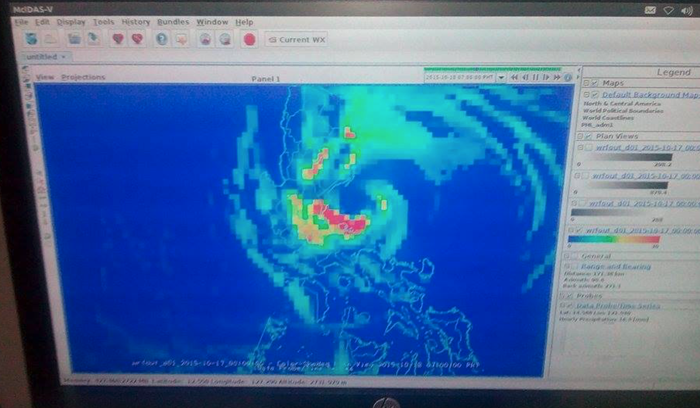

# Prosessit ja liiketoimintaprosessit

Prosessi on järjestelmällinen tapa suorittaa jokin tehtävä ja saavuttaa jokin tavoite. Jos niin halutaan ajatella, on kaikessa, missä jotain tehdään tai jotain tapahtuu, kyse prosesseista. Yritysten ja organisaatioiden toimintaa tarkasteltaessa puhutaan tavallisesti liiketoimintaprosesseista riippumatta siitä, onko toiminta varsinaista liiketoimintaa tai vaikka välitöntä taloudellista arvoa tuottamatonta yleishyödyllistä tai julkista toimintaa.

Medina-Mora ym. [-@medina1992action] jakoivat 1990-luvun alussa julkaistussa artikkelissaan organisaatioiden prosessit kolmeen luokkaan. Materiaaliprosessit (*Material Process*) liittyvät fyysisten tuotteiden valmistamiseen, raaka-aineiden hallintaan ja valmiiden tuotteiden toimittamiseen. Ne vaativat fyysistä työtä, joka tapahtuu fyysisessä maailmassa ja vaikuttaa siihen. Tässä mielessä monet perinteisten palveluammattien prosesseistakin voidaan mieltää materiaaliprosesseiksi, vaikka Medina-Mora ym. eivät artikkelissaan näihin suoraan viittaakaan.

Informaatioprosessi (*Information Process*) muodostui käsitteeksi nykyaikaisen tietotyön yleistymisen myötä. Ihmiset keskustelevat ja naputtelevat näppäimistöä: ”*With computer workstations, all of the physical work becomes indistinguishable – talking to people and tapping keys in front of display screens*.” [@medina1992action] Informaatioprosesseihin liittyvät siis tietokoneet – tai informaatioteknologia – ja niiden avulla suoritettava tietojenkäsittely, tietokannat, transaktioiden hallinta, data-analytiikka ja niin edelleen. Tietokoneet voivat toteuttaa prosesseja ilman, että niillä on välitöntä vaikutusta ympäröivään fyysiseen todellisuuteen. Informaatioprosessit ovat tehneet mahdolliseksi myös nykyisen ymmärryksemme prosessiautomaatiosta. Informaatioprosessien suhteen Medina-Moran ym. ajatukset ovat hieman dikotomisia. Kaikki tietotyön, tiedon tuottamisen, käsittelyn, tulkinnan ja jalostamisen prosessit eivät tietenkään vaadi tietoteknisiä laitteita tai automaattista tietojenkäsittelyä.

Organisaatioiden prosessien kolmas luokka Medina-Moran ym. mukaan on liiketoimintaprosessit (*Business Process*). Niissä voivat yhdistyä sekä materiaali- että informaatioprosessit, ja ne lähtökohtaisesti ovat markkinakeskeisiä tai markkinaorientoituneita. Ne on suunniteltu täyttämään jokin sopimus tai tietty asiakastarve. Liiketoimintaprosessit ovat käsiteellisellä tasolla tarkasteluna materiaali- ja informaatioprosessien yläpuolella, ja ne määrittyvät markkinoiden[^markkina] asettaman lopputuleman ja tarkoituksen kautta.

[^markkina]: Markkina tulee tässä ymmärtää laajassa merkityksessä: esimerkiksi prosessia toteuttavan organisaation toimintaympäristönä ja sen oletettuina tarpeina.

Tyypillisesti liiketoimintaprosessit sisältävät useita eri vaiheita eli sarjan tehtäviä, jotka voivat olla edellisen luokittelun mukaan materiaali- tai informaatioprosesseja, ja jotka suoritetaan tietyssä järjestyksessä jonkin lopputuloksen saavuttamiseksi. Seuraavassa (@fig-pizzatilaus) on monista BPMN-oppimateriaaleista tuttu esimerkki: pizzatilauksen liiketoimintaprosessi.

{#fig-pizzatilaus}

<!-- {#fig-pizzatilaus.svg fig-alt="Klassinen esimerkki pizzatilauksen prosessista."} -->

Joskus kuulee sanottavan, että jokin asia ei ole projekti, vaan se on jatkuva prosessi. Vaikka tämä ajatus esimerkiksi laadun kehittämisestä tai toiminnan jatkuvuudesta puhuttaessa on sinällään ylevä, on se oksymoron: prosessilla on aina oltava alku ja loppu.

Sen sijaan prosessi voi olla toistuva, ja prosessiajattelu ohjaakin ensisijaisesti kiinnittämään huomion usein toistuviin tapahtumasarjoihin. Jatkuvuus ja toistuvuus ovat kuitenkin eri asioita. Toiminnan jatkuva parantaminen liittyy silti oleellisesti prosessiajatteluun. Prosessiajattelua ja jatkuvaa parantamista käsitellään myöhemmin.

Projektilla ja prosessilla on kuitenkin paljon yhteistä. Yksi projektinhallinnan kulmakivistä on niin kutsuttu projektin rautakolmio, jonka muodostavat projektin laajuus, hinta tai resurssit sekä aika. Kolmion keskellä on laatu. Rautakolmio[^rautakolmio] pyrkii havainnollistamaan, että esimerkiksi projektin laajuuden kasvaessa, mutta aikataulun ja resurssien pysyessä entisellään, joudutaan tinkimään laadusta. Samat lainalaisuudet pätevät tyypillisesti myös prosesseja tarkasteltaessa.

[^rautakolmio]: Rautakolmion käsite (Project Management Iron Triangle, Project Triangle tai Triple Constraint) yleistyi 1950-1970 -luvuilla projektinhallinnan ammattikunnan kehittyessä ja erityisesti suurissa insinööriprojekteissa.

Projekteja ja prosesseja erottaa pääasiassa se, että projekti on ainutkertainen tapahtuma, kun taas prosessi on toistuvaa ja mahdollisimman vakioitua tekemistä (@tbl-prosessi-projekti). Silti projektinhallinnan menetelmät ja mallit (kuten Vesiputousmalli, Kriittisen polun menetelmä tai Scrum) ovat kaikki prosesseja. Tämä kertoo, että sinällään ainutkertaisiin yhdistelmiin tapahtumia ja kontingenssitekijöitä on mahdollista ja hyödyllistäkin kehittää vakioituja toimintatapoja eli prosesseja[^sfs].

[^sfs]: Suomalainen standardoinnin keskusjärjestö SFS kirjoittaa verkkosivuillaan projektinhallinnasta (SFS/SR 206): ”Sanotaan, että jokainen projekti on ainutlaatuinen. Tästä huolimatta niissä kaikissa on myös yhteisiä tekijöitä. Projektinhallinnan standardeilla pyritään tunnistamaan ja määrittelemään projektien yhteiset tekijät ja viitekehykset. Lisäksi standardit tarjoavat arvokasta ohjeistusta projektinhallinnasta vastuussa oleville henkilöille ja tahoille vaikuttavaan ja tehokkaaseen projektinhallintaan.”

Organisaation ryhtyessä systemaattisesti tarkastelemaan ja kehittämään toimintaansa prosessienhallinnan keinoin, ensimmäiseksi katse kohdistetaan usein toistuviin toimintoihin. Harvinaislaatuisten tai harvoin toteutuvien asioiden hahmottaminen prosesseina ei useinkaan ole erityisen hyödyllistä. Toisaalta myös toiminnon kriittisyys on hyvä peruste prosessitarkastelulle, vaikka tapahtumatiheys ei olisikaan suuri. Aiheeseen palataan myöhemmin.

|               | Prosessi | Projekti |
|---------------|----------|----------|
| **Luonne**    | Toistuvaa tekemistä. | Kertaluonteinen ja ajallisesti rajattu. |
| **Tavoite**   | Tuottaa arvoa systemaattisesti ja säännöllisesti. | Tuottaa ainutlaatuisen ja spesifisen lopputuloksen. |
| **Kesto**     | Tyypillisesti melko lyhyt ja säännöllisesti toistuva. | Määräaikainen, päättyy tavoitteen saavuttamisen jälkeen. |
| **Resurssit** | Vakiintuneet resurssit, osa organisaation arkea. | Resurssit määritellään projektikohtaisesti. |
| **Hallinta**  | Prosessit noudattavat pysyviä toimintamalleja. | Projektit käyttävät projektinhallintamenetelmiä. |

: Prosessin ja projektin erot[^arter] {#tbl-prosessi-projekti}

[^arter]: Hieman muokattu lähteestä https://www.arter.fi/mika-on-prosessi/

Yhteenvetäen voidaan todeta, että prosessi on organisaation suorittama toistuva toiminto, joka koostuu sarjasta toisiaan seuraavia tehtäviä, joiden toteuttamiseen käytetään resursseja (kuten tarvittavat työvälineet, materiaalit, informaatio ja työvoima), ja jonka tavoitteena on muuttaa syötteet arvoa lisääviksi lopputuotteiksi.

Joskus prosessin lopputulos saattaa olla arvoltaan vähäisempi kuin sen tuottamiseen käytetyt resurssit. Jos tuotteen tai palvelun toteuttaminen kuluttaa enemmän resursseja kuin mikä tuotettu arvo on, ei toiminta ole ainakaan pitkällä aikavälillä kannattavaa. Siksi tulisi pyrkiä siihen, että prosessin toteuttaminen tuottaa enemmän arvoa kuin mitä se sitä kuluttaa.

Prosessin tuottaman objektiivisen arvon määrittäminen on usein kuitenkin hankalaa, eivätkä monet prosessit tuota minkäänlaista suoraa tai välitöntä arvoa, vaikka ne saattavat kuluttaa paljonkin resursseja. Esimerkiksi jotkin lain määrittelemät velvollisuudet eivät itsessään tuota yrityksille tai organisaatioille välitöntä mitattavaa arvoa. Itse asiassa hyvin harvat tukiprosessit tuottavat suoraan tulosluvuissa näkyvää arvoa, mutta ne ovat välttämättömiä arvon tuottamiseksi ylipäätään. Sen sijaan organisaation ydinprosessien tulisi tähdätä välittömään ja toistuvaan arvontuottoon, joskaan niissäkään näin ei aina tapahdu.

## Ydinprosessit ja muut prosessit

Organisaatioiden prosessit voidaan jakaa erilaisiin luokkiin niiden roolin ja merkityksen perusteella. Tavallisia prosessityyppejä ovat ydinprosessit (*Core Process*), tukiprosessit (*Support Process*) ja johtamisprosessit (*Management Process*).

Ydinprosessit liittyvät suoraan yrityksen arvolupaukseen ja asiakkaan saamaan arvoon. Ne voidaan mieltää organisaation toiminnan perustaksi, ja ne liittyvät tavallisesti tuotteiden tai palveluiden tuottamiseen. Esimerkkejä ydinprosesseista ovat:

- tuotannon ja palvelun toteutus (esimerkiksi valmistavan teollisuuden tuotantoprosessi tai asiantuntijapalvelun tuottaminen asiakkaan toimeksiannosta),
- tuotekehitys (esimerkiksi ohjelmistoyrityksen ohjelmistokehitysprosessi tai palvelualan toimijan palvelumuotoiluprosessi),
- toimitusketjun hallinta (esimerkiksi logistiikka ja varastointi),
- asiakashallinta ja asiakaspalvelu (esimerkiksi asiakassuhteiden hoitaminen) ja
- tilauksen käsittely (esimerkiksi verkkokaupan tilauskäsittelyprosessi).

Tilausten käsittely ei välttämättä kuulosta monenkaan yrityksen ydintoiminnalta. Jos kuitenkin ajatellaan verkkokaupan asiakkaalle tuotettavaa arvoa, on sujuva tilaustoimitus sen kannalta yksi keskeinen tekijä. Kuten edellä todettiin, ydinprosessien tulisi olla liitettävissä asiakkaille annettuun arvolupaukseen, joka on johdettavissa yrityksen liiketoimintamallista ja strategisista tavoitteista. Ydinprosessit oikeuttavat organisaation olemassaolon; toiminnan edellytykset ja kilpailukyky rakentuvat niiden kautta. Näin ollen tilaustoimitus useissa tapauksissa onkin syytä mieltää ydinprosessiksi. Huomattakoon kuitenkin, että esimerkiksi tilaustoimituksiin liittyvä logistiikka on usein ulkoistettu jollekin tähän erikoistuneelle toimijalle. Prosessien ulkoistamiseen palataan myöhemmin.

Tukiprosessit tukevat ydinprosessien toimintaa, mutta ne eivät tuota lisäarvoa ulkoisille asiakkaille. Ne ovat kuitenkin välttämämättömiä organisaation toiminnan kannalta. Esimerkkejä tukiprosessien kokonaisuuksista ovat:

- HR-prosessit eli henkilöstöhallinnon prosessit (esimerkiksi rekrytointi, palkkahallinto ja henkilöstön kehittäminen),
- taloushallinto (kuten kirjanpito, budjetinhallinta ja maksuliikenne),
- sisäinen viestintä ja
- IT-järjestelmien hallinta.

Tukiprosessit tuottavat kuitenkin arvoa organisaation sisäisille asiakkaille. Esimerkiksi palkanmaksuprosessista arvoa saavat asiakkaat ovat organisaation omia työntekijöitä.

Edelliset esimerkit ydin- ja tukiprosesseista saattavat kuulostaa toiminnanohjausjärjestelmien (*Enterprise Resource Planning*, *ERP*) toimintokokonaisuuksia tunteville tutuilta, eikä tämä tietenkään ole sattuma. Kun ensimmäisiä ERP-järjestelmiä lanseerattiin 1980- ja 1990-lukujen vaihteessa, niiden tavoitteeksi asetettiin organisaation kaikkien keskeisten prosessien palveleminen yhden järjestelmäratkaisun avulla.

Kolmantena prosessikokonaisuutena mainitaan tavallisesti johtamisen prosessit. Huolimatta siitä, että johtajat usein puheita pitäessään nöyrällä äänenpainolla toteavat johtamisen olevan ainoastaan tukitoiminto, on johtamisen prosessien rooli erilainen. Niiden toteutuksessa täytyy huomioida ja painottaa muita asioita kuin varsinaisissa tukiprosesseissa. Johtamisprosesseja saatataan kutsua myös ohjausprosesseiksi. Joitain esimerkkejä johtamis- tai ohjausprosesseista ovat:

- strateginen suunnittelu,
- laadunhallinta,
- riskienhallinta,
- budjetointi ja taloussuunnittelu sekä
- sidosryhmähallinta.

Siinä mistä strategisesta suunnittelusta saattaa vastata suoraan ylimmän johdon alla toimiva strategiaryhmä, ovat esimerkiksi laadunhallinta ja budjetointi tyypillisesti lähempänä operatiivista toimintaa, vaikka toiminnot itsessään ovatkin suoraan strategian ohjaamia. Ydin- ja tukiprosessit ovat yksityiskohtaisesti suunniteltuja sekä määrämuotoisella ja systemaattisella tavalla toteutuvia. Johtamisen prosesseja luonnehtii laaja-alaisuus. Ne kattavat koko organisaation ja huomioivat yhtä lailla ylimmät strategiset tavoitteet ja linjaukset, kuin myös operatiivisen toiminnan. Johtamisen prosessien tulee reagoida toimintaympäristön muutoksiin, olipa kyse sitten strategiatyöstä tai budjetoinnista. Kyvykkäät johtamisen prosessit ovat mieluummin proaktiivisia kuin reaktiivisia. Niiden välityksellä kommunikoidaan muutosmahdollisuudet, -paineet ja -tarpeet organisaation ydinprosesseille ja edelleen ydintoimintaa tukeville prosesseille.

Julkisen hallinnon tietohallinnon neuvottelukunnan JHS-sarjan suosituksessa *JHS 152 Prosessien kuvaaminen* esitetään seuraavanlainen prosessikarttamalli[^jhs] (@fig-prosessikartta). Prosessikartta esittää kokonaiskuvan organisaation toiminnasta ja on käyttökelpoinen väline korkean tason päätöksenteon tueksi ja vaikka ulkoiseen viesintään.

{#fig-prosessikartta fig-alt="Esimerkki prosessikartasta."}

[^jhs]: https://dvv.fi/jhs-suositukset

Prosessien luokittelu auttaa hahmottamaan organisaation toimintaa kokonaisuutena ja tunnistamaan siitä kriittisiä alueita sekä mahdollisia aukkoja tai kehittämiskohteita. Lisäksi se tukee prosessien optimointia ja resurssien kohdentamista. Ennen kaikkea se kuitenkin mahdollistaa tehokkaan prosessijohtamisen ja laadunhallinnan. Perusedellytys prosessimuotoiselle toiminnalle -- tai prosessiorganisaatiolle -- on, että toimintaa hahmotetaan prosesseina ja että prosessit tunnetaan. Näennäisen yksinkertainenkin harjoitus, jossa mietitään ja jäsennetään organisaation toimintaa sen ydin-, tuki- ja ohjausprosessien kannalta, voi olla silmät avaava kokemus ja antaa edellytyksiä prosessijohtamisen tai esimerkiksi kyvykkyysajattelun aloittamiselle.

## Miksi ja milloin prosesseihin kannattaa kiinnittää huomiota?

### Ennakointi ja ennustaminen

Mitä tahansa tekojen tai tapahtumien sarjaa voidaan tarkastella prosessina. Esimerkiksi ukonilman muodostuminen on hahmotettavissa prosessina: ensimmäisessä vaiheessa aurinko lämmittää maanpintaa. Koska lämmennyt ilma on kylmää ilmaa kevyempää, alkaa se nousta ylöspäin. Jossain vaiheessa lämmin ilma törmää ylempänä ilmakehässä sijaitseviin kylmempiin ilmamassoihin. Lämpimän ilman kosteus tiivistyy nopeasti ja muodostuu pilviä. Ja niin edelleen.

Edellinen oli maallikon ymmärryksellä esitetty yritelmä hahmottaa ukkosen syntyä prosessina eli sarjana toisiaan seuraavia tapahtumia. Kaikkia tapahtumasarjoja ei kuitenkaan välttämättä ole mielekästä ajatella prosesseina. Ukkosen prosessista saattavat olla kiinnostuneita ilmakehän ja sääilmiöiden tutkijat. Useimmille meistä kuitenkin riittää, että meteorologi vinkkaa hyvissä ajoin huomisen mahdollisesta ukkosmyrskystä.

Säätiedotteita seuranneet ovat huomanneet, että niissä usein esitetään myös todennäköisyyksiä erilaisten sääilmiöiden toteutumiselle: kuinka todennäköistä on, että huomenna on poutaa ja joko rantakori kannattaa pakata valmiiksi. Siksi puhutaankin myös sääennusteista. Se, että meteorologi pystyy näitä ennusteita esittämään, edellyttää tietenkin maallikkotasoa huomattavasti syvällisempää ymmärrystä sääilmiöiden prosesseista. Meteorologien voidaankin sanoa olevan sääilmiöiden prosessiasiantuntijoita.

Kun prosessi tunnetaan riittävän hyvin, sen kulkua voidaan simuloida. Simulointi tarkoittaa, että jonkin systeemin, kuten vaikkapa ilmakehän, toimintaa mallinnetaan ja jäljitellään ainakin jossain määrin todellisuutta vastaavalla tarkkuudella. Tämä mallinnus auttaa ennustamaan systeemin käyttäytymistä erilaisissa olosuhteissa. Simulaatio siis esittää, kuinka jokin prosessi etenee tiettyjen reunaehtojen ja parametrien ollessa voimassa tai kuinka niiden muuttuminen vaikuttaa prosessin lopputulemaan. Television sääennusteiden animaatiot pilvimassojen liikkeistä ovat prosessituntemuksen mahdollistamia simulaatioita (@fig-saaennusteanimaatio.png). Sääsimulaatioissa käytettävän tiedon ja laskentakapasiteetin rajoitteiden vuoksi niiden lopputulos on kuitenkin aina enemmän tai vähemmän arvaus -- siis ennuste.

{#fig-saaennusteanimaatio.png}

Kuten sääilmiöitä, myös liiketoimintaprosesseja voidaan tuntea syvällisellä tasolla. Kun vaikkapa jokin valmistavan teollisuuden tai sairaalan päivystyksen prosessi tunnetaan riittävän hyvin, voidaan myös sen etenemistä simuloida. Emme juurikaan voi vaikuttaa sääilmiöihin, mutta liiketoimintaprosesseihin on mahdollista vaikuttaa.

Liiketoimintaprosessien simulointi onnistuu useilla prosessimallinnusvälineillä ja simulointiin erikoistuneilla ohjelmistoilla. Simulointi mahdollistaa prosessimallien ”koeajamisen”. Prosessin tehtäville, tapahtumille ja vaikkapa niiden aikana tehtäville päätöksille voidaan määritellä todennäköisyys, kesto tai kestoväli, kustannus tai kustannusväli ja niin edelleen. Jos prosessin aikana kutsutaan jotain ulkoista järjestelmäpalvelua, mikä on palvelun vasteaika arkisin ja viikonloppuisin, keskipäivällä ja yöllä? Paljonko virheistä johtuvaa raaka-ainehukkaa voitaisiin vähentää pidentämällä prosessin jonkin tehtävän kestoa ja maksaisiko se itsensä takaisin suhteessa tuotannon hidastumiseen? Paljonko vuodessa voitaisiin säästää, jos prosessin kutsuman palvelun vasteajasta saataisiin nipistettyä sekunti pois yhtä kutsua kohden tai jos jotain manuaalista tehtävää prosessissa suorittavat työntekijät lähetetään kahdeksi päiväksi kouluttautumaan?

Riittävän monta simulaatioajoa voi paljastaa prosessista pullonkauloja ja kehittämiskohteita, ja kenties jopa aivan ilmeisiä virheitä. Prosessikulkua voidaan mallin tasolla vaivatta muuttaa, parametrien arvoja säätää ja tarkkailla näiden vaikutuksia prosessin keskimääräiseen toteutumaan.

### Toimintatapojen kehittäminen

Monet yrityksissä ja organisaatioissa suoritettavat tehtävät ovat muodostuneet työntekijöille rutiineiksi. Niitä suoritetaan ilman, että tekemistä ja sen tapaa pysähdyttäisiin koskaan sen tarkemmin miettimään. Tavallista on sekin, että jokaisen samaa tehtävää suorittavan työntekijän rutiinit voivat hieman poiketa toisistaan. Kukaan ei siis välttämättä tee samaa tehtävää tai suorita samaa prosessia täsmälleen samalla tavalla kuin kollegansa.

On ilmeistä, että jotkin tavat suorittaa prosessi ovat nopeampia tai tuottavat vaikkapa vähemmän virheitä kuin toiset. Jokin tapa toteuttaa asiakaspalveluun liittyviä toimintoja koetaan asiakkaiden taholla varmasti paremmaksi kuin jokin toinen. Järkevää tietysti olisi, että jokainen työntekijä toimisi juuri sillä parhaaksi todetulla tavalla. Prosessien tunteminen mahdollistaa niihin liittyvien parhaiden käytänteiden dokumentoinnin ja näkyväksi tekemisen.

Paitsi toiminnan tehokkuuden kannalta, prosessien tuntemisesta ja dokumentoimalla näkyväksi tekemisestä on myös muita hyötyjä. Yrityksen tavoitellessa laatusertifikaattia, prosessit tulee pystyä esittämään laatuauditoijalle. Laadukas graafinen prosessimalli tai prosessikäsikirja eivät vielä takaa laadukasta toimintaa, vaan toiminnan täytyy myös tapahtua prosessin mukaisesti. Laatuauditoinneissa havainnoidaankin myös toimintaa käytännön tasolla ja henkilöstöä voidaan haastatella, suoraan tai epäsuorasti, prosesseihin liittyen. Kokeesta voi selvitä täysin pistein vain silloin, kun prosessit ovat paitsi kunnossa, ne myös tunnetaan. Lisäksi prosessimallit ovat erinomainen osa uuden henkilöstön perehdytyspakettia, ja konkareidenkin saattaa olla joskus tarpeen tarkistaa, kuinka jokin asia tulikaan tehdä.

### Kustannussäästöt

Kustannussäästöjen mahdollisuuksia voidaan löytää arvioimalla prosessiin liittyvää hukkaa. Karkeasti yleistäen kaikki sellainen toiminta, joka ei tuota arvoa, tulisi pyrkiä karsimaan pois.

Radikaaleimpia toimenpiteitä prosessihukan karsimiseksi ovat kokonaisten toiminta- tai prosessialueiden alasajot. Kevyempi, joskin käytännössä lähes yhtä radikaali toimenpide, on prosessialueiden yhdistäminen. Mikäli esimerkiksi jokin toiminto tai toimintojen kokonaisuus on välttämätön ydintoiminnan kannalta, mutta sen ei katsota oikeuttavan olemassaoloaan erillisenä yksikkönä tai osastona, saatetaan toimintokokonaisuus ja siihen liittyvät prosessit yhdistää jonkin toisen yksikön toimintojen kanssa.

Voi myös olla niin, että samoja prosesseja toteutetaan useissa yksiköissä. Esimerkkinä voidaan ajatella yritystä, jossa kirjanpitoa tehdään jokaisessa yksikössä ja vieläpä erillisiä ohjelmistoja käyttäen. Joskus tällainen voi olla perusteltua, mutta usein toiminto olisi järkevämpää keskittää. Palvelukeskukseen keskitetty kirjanpito mahdollistaa kustannussääntöjä skaalaetujen, yhtenäisen ohjelmistoratkaisun ja pienempien henkilöstökulujen kautta. Palvelukeskuksen käsittelemät suuret datamäärät voivat myös mahdollistaa esimerkiksi ohjelmistorobotiikan ja tekoälyratkaisujen tehokkaamman käytön. Keskitetty kirjanpito tekee mahdolliseksi myös prosessien standardoinnin ja erikoistunut osaaminen pienentää virheriskiä.

Keskittämisen seurauksena palvelun laadun saatetaan kuitenkin kokea laskevan. Laatu toki saattaakin laskea, esimerkiksi suhteellisesti niukempien resurssien vuoksi. Tavallisesti prosessiasiantuntijuuden keskittäminen kuitenkin tosiasiassa parantaa palvelujen laatua ja myös tukee toiminnan jatkuvaa parantamista.

Koettu laadun lasku johtuu siitä, että keskitetty palvelukeskus tuottaa palvelut vakioiduilla tavoilla ja parhaiksi tunnistettuja käytänteitä soveltaen. Tämä voi aiheuttaa prosessien ja kulttuurien yhteentörmäyksen. Keskitetyt prosessit eivät välttämättä olekaan yhteensopivia niiden oletusten tai toimintatapojen kanssa, joita palveluja käyttävissä asiakasyksiköissä on totuttu noudattamaan. Mikäli prosessitarkastelua ei ole tehty, eikä prosessien uudistamista suunnitella koko organisaatiota leikkaavasti, on epäonnistumisen mahdollisuus olemassa. Haaste kasvaa, mikäli organisaation sisäisten toimintojen uudelleenjärjestelyn sijaan kyse onkin esimerkiksi kokonaisesta yritysfuusiosta.

Schönreiterin [-@schonreiter2018methodologies] julkaisemassa kirjallisuuskatsauksessa todetaan, että tutkimuskirjallisuudessa ei juurikaan käsitellä yritysfuusiota seuraavan integraation ja liiketoimintaprosessien harmonisoinnin välistä yhteyttä. Tämä on huomionarvoista ja yllättävääkin, koska esimerkiksi tietojärjestelmien ja teknologioiden integraatiosta *post mergers* -tapauksissa on kirjoitettu paljonkin. Onnistunut yritysfuusio vaatii kuitenkin onnistunutta prosessien yhteensovittamista, mikä luonnollisesti edellyttää prosessien tuntemista.

Myös simulointi ja erityisesti prosessien mittaaminen, jota käsitellään myöhemmin, voivat paljastaa potentiaalisia säästökohteita.

### Tiedonhallinta ja turvallisuus

Prosessien tunteminen on tarpeen myös tietoturvan, -suojan ja tiedonhallinnan kannalta. Tiedon suojaaminen helpottuu -- tai voisi ehkä jopa sanoa, että on mahdollista ainoastaan -- kun tiedetään, mitä tietoa prosesseissa liikkuu ja minne. Suurennuslasin alla tässä ovat prosessit, joissa käsitellään henkilötietoja, liiketoimintakriittistä tai salassa pidettävää tietoa. Suomen tiedonhallintalaki[^tiedonhallintalaki] edellyttää julkisia toimijoita laatimaan tiedonhallintamallin, jolta vaaditaan muun muassa seuraavaa: ”*Toimintaprosessien kuvaaminen tiedonhallintamallissa antaa tiedonhallintayksikölle kokonaiskuvan siitä, missä ja miten viranomaisten tieto muodostuu ja miten sitä käsitellään. Toimintaprosessien osalta kuvataan myös niiden liittymät toisiinsa. Toimintaprosessien osalta kuvataan liittymät myös ulkoisiin toimintaprosesseihin.*”[^tiedonhallintamalli] Onpa kentältä usein myös kuulunut, että yritysten, jotka tunsivat ja olivat dokumentoineet liiketoimintaprosessinsa, oli huomattavasti helpompi ryhtyä toteuttamaan Euroopan Unionin yleisen tietosuoja-asetuksen[^gdpr] vaatimuksia ja rekisteröidyn henkilön tietopyyntöön vastaaminen tuottaa vähemmän päänvaivaa.

[^tiedonhallintalaki]: Laki julkisen hallinnon tiedonhallinnasta, https://www.finlex.fi/fi/lainsaadanto/saadoskokoelma/2019/906

[^tiedonhallintamalli]: Suositus tiedonhallintamallista, Valtiovarainministeriön julkaisuja 2024:22

[^gdpr]: https://eur-lex.europa.eu/legal-content/FI/TXT/HTML/?uri=CELEX:32016R0679

Prosessien tunteminen auttaa parantamaan myös toiminnan fyysistä ja psykologista turvallisuutta erilaisissa tehtävissä ja tilanteissa. Näitä aihepiirejä ei kuitenkaan tässä käsitellä.

### Toiminnan kriittisyys

Edellä prosessin todettiin olevan toistuvaa tekemistä. Jos toiminnan tehokkuutta ja tuloksellisuutta halutaan parantaa prosesseja kehittämällä, ei välttämättä tunnu mielekkäältä keskittyä sellaiseen toimintaan tai tehtäväsarjoihin, jotka toteutuvat vain harvoin.

Prosessitarkastelussa ja prosessien kehittämisessä tavallisesti kannattaakin ensisijaisesti keskittyä niihin prosesseihin, jotka toistuvat usein. Ne todennäköisesti liittyvät organisaation ydintoimintaan ja toistuvuudesta seuraa vähintään se, että niihin liittyy kumulatiivista säästöpotentiaalia.

Prosessitarkastelu kannattaa kuitenkin kohdistaa myös sellaisiin toimintoihin, jotka ovat jollain tavalla kriittisiä. Harva yritys tai organisaatio joutuu toistuvasti vaikkapa vakavan kyberhyökkäyksen kohteeksi. Koska tällainen tapahtuma ei ole toistuva -- pikemminkin harvinainen -- ei toistuvuusvaatimuksen mukaan olisi tarpeen tarkastella prosessina sitä, kuinka kyberhyökkäyksestä seuraava tilanne saadaan hallintaan. Sama koskee yleisemminkin kriisitilanteiden hallintaa ja esimerkiksi kriisiviestintää. Kriititilanteet ovat harvinaisia, eivätkä monet organisaatiot välttämättä koskaan sellaiseen joudu. Tämä ei kuitenkaan tarkoita sitä, etteikö niihin olisi syytä varautua.

Kyberpuolustautumisen strategiat seikkaperäisillä tilanne- ja toimintasuunnitelmilla tarkennettuina, samoin kuin jatkuvuussuunnittelu yleisimmin, ovat nykyisin arkipäivää lähes kaikkialla. Nämä suunnitelmat usein sisältävät myös jonkinlaisia prosessimuotoisia toimenpidesarjoja. Herbane ym. -@herbane2004business kirjoittavat, että ”*liiketoiminnan jatkuvuuden hallinta (Business Continuity Management, BCM) on noussut monilla toimialoilla järjestelmälliseksi prosessiksi [ja] sen onnistumisen kannalta oleellista on [...] työntekijöiden toiminta palautumisprosessin (business recovery process) aikana. [...] Liiketoimintaprosessien asiantuntijoiden tulisi ottaa omistajuus ja vastuu jatkuvuuden hallinnan tehtävistä keskitetyn BCM-tiimin koordinoivassa ohjauksessa.*[^herbane]”

[^herbane]: Käännetty englannin kielestä.

Vaikka prosessi toisaalla määriteltäisiinkin usein toistuvaksi tapahtumasarjaksi, prosessiksi kannattaa mieltää myös harvemmin -- tai ei välttämättä edes koskaan -- tapahtuvat tapahtumasarjat, mikäli ne ovat kriittisyydeltään merkittäviä. Ajatus lähestyy riskimatriisia -- yhtä riskien hallinnan perustyökaluista. Siinä riskit luokitellaan tapahtuman todennäköisyyden ja tapahtuman seurausten vakavuuden perusteella (@tbl-riskimatriisi).

::: {.column-page-right}

+------------------+--------------------+--------------------+----------------------+
| Todennäköisyys   | Vähäinen seuraus   | Haitallinen seuraus| Vakava seuraus       |
+==================+====================+====================+======================+
| Epätodennäköinen | Merkityksetön riski| Vähäinen riski     | Kohtalainen riski    |
+------------------+--------------------+--------------------+----------------------+
| Mahdollinen      | Vähäinen riski     | Kohtalainen riski  | Merkittävä riski     |
+------------------+--------------------+--------------------+----------------------+
| Todennäköinen    | Kohtalainen riski  | Merkittävä riski   | Sietämätön riski     |
+------------------+--------------------+--------------------+----------------------+

: Riskimatriisi {#tbl-riskimatriisi}

:::

Jääköön kontekstissa harkittavaksi, onko toiminto syytä määritellä prosessiksi silloin, kun siihen liittyy vähäinen riski vai vasta silloin, kun riski on kohtalainen. Riskin pienuudesta huolimatta yllättäviin tilanteisiin, jotka voivat esimerkiksi vaurioittaa organisaation julkisuuskuvaa, on kuitenkin syytä varautua huolellisella prosessisuunnittelulla ja sen mahdollistamalla nopealla toimintakyvyllä.

Toimintojen kriittisyyttä, tai vaikkapa jatkuvuuteen liittyviä vaatimuksia, voidaan arvioida useista näkökulmista. Joitain sovellettavia arviointikriteereitä ovat esimerkiksi seuraavat (@tbl-kriittisyys).

| Vaikutus liiketoimintaan | Kuinka merkittävä on vaikutus liiketoimintaan? |
|----------|------------------|
| Taloudelliset seuraukset | Kuinka suuria taloudellisia tappioita seuraa? |
| Asiakasvaikutukset | Kuinka vakavasti asiakkaat kärsivät? |
| Sääntely ja lakisääteiset vaatimukset | Liittyykö velvoitteita lainsäädännön tai sääntelyn näkökulmasta? |
| Mainevaikutukset | Kuinka suuri mainehaitta syntyy? |
| Toipumisaika | Kuinka nopeasti toiminnon on oltava palautettavissa normaaliksi? (esim. alle viikko, alle vuorokausi, alle tunti) |
| Tiedonmenetyksen sietokyky | Kuinka paljon toimintoon liittyvää tietoa voidaan menettää ilman vakavia seurauksia? (esim. päivien ajalta, tuntien ajalta, ei lainkaan) |

: Esimerkkejä toiminnon kriittisyyden arvioinnissa sovellettavista kriteereistä {#tbl-kriittisyys}

### Toiminnan ja informaatioteknologian yhteensovittaminen

Nykyisin hyvin harva liiketoimintaprosessi on täysin manuaalinen; useimpien tukena käytetään joitain tietojärjestelmiä ja teknologioita. Kehitettäessä tai hankittaessa uusia järjestelmiä, prosessit ovat merkittävä osa vaatimusmäärittelydokumentaatiota [@cardoso2009requirements; @panayiotou2015business]. Toisaalta jos valmiina ostetun järjestelmän käyttöönotto edellyttää nykyisten prosessien mukauttamista -- mikä usein onkin tarpeen [@finney2007erp] -- sitä luonnollisesti helpottaa, kun prosessit tunnetaan. Tällaisessa tapauksessa prosessituntemus mahdollistaa myös hyvin perusteltujen päätösten tekemisen siitä, mitkä nykyisistä prosesseista ovat sellaisia, että ne halutaan säilyttää, vaikka sitten järjestelmän räätälöinnin kalliilla kustannuksilla, ja toisaalta mitkä ovat sellaisia, että ne voidaan muuttaa vastaamaan järjestelmään ohjelmoituja käytänteitä.  Tutkimuksissa [@finney2007erp] on todettu, että epäonnistuneiden järjestelmäkäyttöönottojen taustalta usein löytyy heikko prosessituntemus, epäonnistunut prosessivaatimusten viestintä järjestelmän toimittajalle, tai haluttomuus tai kyvyttömyys (kumpi onkaan syy ja kumpi seuraus) mukauttaa liiketoimintaprosesseja[^lidl] järjestelmän käyttöönoton yhteydessä.

[^lidl]: https://www.panorama-consulting.com/lidl-erp-failure/

Vaikka digitaalisen transformaation voidaan katsoa käynnistyneen jo 1960- ja 1970-lukujen vaihteessa, on muutoksen vauhti edelleen jatkuvasti kiihtyvä. Teknologiset disruptiot -- kuten vielä hyvin muistissa oleva suuriin kielimalleihin nojaavien ja muiden generatiivisten tekoälyjen ilmaantuminen suuren yleisön tietoisuuteen lähes kirjaimellisesti yhdessä yössä -- edellyttävät organisaatioilta, ja erityisesti johtamisen prosesseilta, jatkuvaa varpaillaan pysyttelyä. Prosessit ja niiden tuottamat palvelut digitalisoituvat, halusivatpa asiakkaat sitä tai eivät. Uudet teknologiat toisaalta tarjoavat liiketoiminnan ja prosessien toteuttamiselle täysin uudenlaisia mahdollisuuksia, toisaalta teknologinen kehitys useissa tapauksissa myös pakottaa prosesseja muuttumaan. Toiminnan täytyy pysyä kiinni kehityksessä, ja mikäpä siinä helpottaisi enemmän kuin se, että nykyinen toiminta tunnetaan ja on siten valmis johdettavaksi kohti muutoksia.

Davenport ja Short esittivät jo vuonna 1990 [@davenport1990new], että informaatioteknologian ja prosessien suunnittelun suhteen tulisi olla rekursiivinen. Prosessien tarpeet toimivat lähtökohtana IT-kyvykkyyksien kehittämiselle, ja samaan aikaan IT:n tarjoamien mahdollisuuksien tulisi toimia syötteenä prosessien suunnittelulle ja jopa radikaalin kokonaisvaltaiselle uudelleensuunnittelulle. Tähän aiheeseen palataan vielä myöhemmin.

### Monimutkaisuuden hallinta

Prosessiajattelu ja toimintojen mallintaminen prosesseiksi, tarjoavat apuvälineitä monimutkaisuuden hallintaan. Monimutkaisia toimintoja luonnehtivat esimerkiksi tehtävien väliset epäselvät riippuvuudet, toiminnan ennakoimattomuus, korkea virhealttius sekä hallinnan vaikeus.

Monimutkaisiin toimintoihin liittyy tavallisesti myös useita rooleja, vaiheita, päätöksentekopisteitä ja riippuvuuksia. Prosessimallinnus tekee näkyväksi mitä toiminnossa tapahtuu, missä järjestyksessä ja miksi. Samoin se paljastaa, kuka tekee mitä ja kuinka tieto ja materiaalit liikkuvat. Harmon -@harmon2019business on todennut, että mitä kompleksisempi toiminto on, sitä suurempi hyöty prosessimallinnuksella ja -analyysilla voidaan saavuttaa. Ne vähentävät monitulkintaisuutta ja paljastavat riippuvuuksia. Riippuvuuksia voidaan tarkastella esimerkiksi resurssi- ja aikariippuvuuksina -- esimerkiksi myöhemmin käsiteltävän kriittisen polun menetelmän avulla.

Prosessimallit toimivat puolueettomana, esitysteknisesti neutraalina yhteisenä viitekehyksenä ja organisaation jaettuna muistina. Ne tukevat oppimista ja perehdytystä, pienentävät kognitiivista kuormitusta, vähentävät virheitä, paljastavat kehittämiskohteita ja helpottavat päätöksentekoa.
