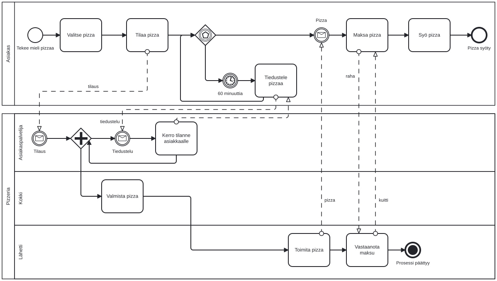
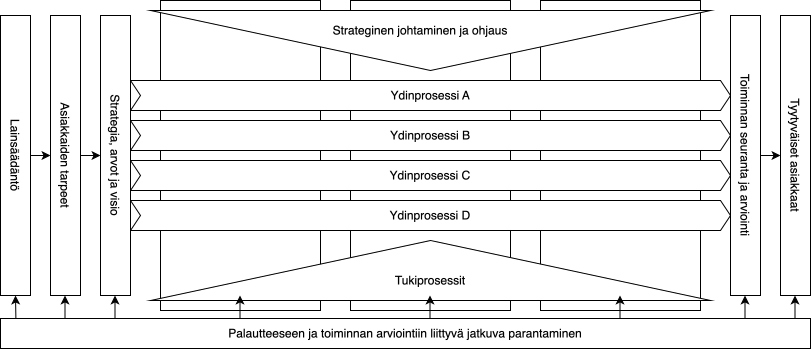

# Prosessit ja liiketoimintaprosessit

Prosessi on järjestelmällinen tapa suorittaa jokin tehtävä ja saavuttaa jokin tavoite. Jos niin halutaan ajatella, on kaikessa, missä jotain tehdään tai jotain tapahtuu, kyse prosesseista. Yritysten ja organisaatioiden toimintaa tarkasteltaessa puhutaan tavallisesti liiketoimintaprosesseista riippumatta siitä, onko toiminta varsinaista liiketoimintaa tai vaikka välitöntä taloudellista arvoa tuottamatonta yleishyödyllistä tai julkista toimintaa.

Medina-Mora ym. [@medina1992action] jakoivat 1990-luvun alussa julkaistussa artikkelissaan organisaatioiden prosessit kolmeen luokkaan. Materiaaliprosessit (*Material Process*) liittyvät fyysisten tuotteiden valmistamiseen, raaka-aineiden hallintaan ja valmiiden tuotteiden toimittamiseen. Ne vaativat fyysistä työtä, joka tapahtuu fyysisessä maailmassa ja vaikuttaa siihen. Tässä mielessä monet perinteisten palveluammattien prosesseistakin voidaan mieltää materiaaliprosesseiksi, vaikka Medina-Mora ym. eivät artikkelissaan näihin suoraan viittaakaan.

Informaatioprosessi (*Information Process*) muodostui käsitteeksi nykyaikaisen tietotyön yleistymisen myötä. Ihmiset puhuvat toisilleen ja naputtelevat näppäimistöä: ”*With computer workstations, all of the physical work becomes indistinguishable – talking to people and tapping keys in front of display screens*.” Informaatioprosesseihin liittyvät siis tietokoneet – tai informaatioteknologia – ja niiden avulla suoritettava tietojenkäsittely, tietokannat, transaktioiden hallinta, data-analytiikka ja niin edelleen. Tietokoneet voivat toteuttaa prosesseja ilman, että niillä on välitöntä vaikutusta ympäröivään fyysiseen todellisuuteen. Informaatioprosessit ovat tehneet mahdolliseksi myös nykyisen ymmärryksemme prosessiautomaatiosta. Informaatioprosessien suhteen Medina-Moran ym. ajatukset ovat hieman dikotomisia. Kaikki tietotyön, tiedon tuottamisen, käsittelyn, tulkinnan ja jalostamisen prosessit eivät tietenkään vaadi tietoteknisiä laitteita tai automaattista tietojenkäsittelyä.

Organisaatioiden prosessien kolmas luokka Medina-Moran ym. mukaan on liiketoimintaprosessit (*Business Process*). Niissä voivat yhdistyä sekä materiaali- että informaatioprosessit, ja ne lähtökohtaisesti ovat markkinakeskeisiä tai markkinaorientoituneita. Ne on suunniteltu täyttämään jokin sopimus tai tietty asiakastarve. Liiketoimintaprosessit ovat käsiteellisellä tasolla tarkasteluna materiaali- ja informaatioprosessien yläpuolella, ja ne määrittyvät markkinoiden[^markkina] asettaman lopputuleman ja tarkoituksen kautta.

[^markkina]: Markkina tulee tässä ymmärtää laajassa merkityksessä: esimerkiksi prosessia toteuttavan organisaation toimintaympäristönä ja sen oletettuina tarpeina.

Tyypillisesti liiketoimintaprosessit sisältävät useita eri vaiheita eli sarjan tehtäviä, jotka voivat olla edellisen luokittelun mukaan materiaali- tai informaatioprosesseja, ja jotka suoritetaan tietyssä järjestyksessä jonkin lopputuloksen saavuttamiseksi. Seuraavassa (@fig-pizzatilaus.svg) on BPMN-kielen klassinen esimerkki: pizzatilausprosessi.

{#fig-pizzatilaus.svg fig-alt="Klassinen esimerkki pizzatilauksen prosessista."}

Joskus kuulee sanottavan, että jokin asia ei ole projekti, vaan se on jatkuva prosessi. Vaikka tämä ajatus esimerkiksi laadun kehittämisestä tai toiminnan jatkuvuudesta puhuttaessa on sinällään ylevä, on se oksymoron: prosessilla on aina oltava alku ja loppu.

Sen sijaan prosessi voi olla toistuva, ja prosessiajattelu ohjaakin ensisijaisesti kiinnittämään huomion usein toistuviin tapahtumasarjoihin. Jatkuvuus ja toistuvuus ovat kuitenkin eri asioita. Toiminnan jatkuva parantaminen liittyy silti oleellisesti prosessiajatteluun. Prosessiajattelua ja jatkuvaa kehittämistä käsitellään myöhemmin.

Projektilla ja prosessilla on kuitenkin paljon yhteistä. Yksi projektinhallinnan kulmakivistä on niin kutsuttu projektin rautakolmio, jonka muodostavat projektin laajuus, hinta tai resurssit sekä aika. Kolmion keskellä on laatu. Rautakolmio[^rautakolmio] pyrkii havainnollistamaan, että esimerkiksi projektin laajuuden kasvaessa, mutta aikataulun ja resurssien pysyessä entisellään, joudutaan tinkimään laadusta. Samat lainalaisuudet pätevät tyypillisesti myös prosesseja tarkasteltaessa.

[^rautakolmio]: Rautakolmion käsite (Project Management Iron Triangle, Project Triangle tai Triple Constraint) yleistyi 1950-1970 -luvuilla projektinhallinnan ammattikunnan kehittyessä ja erityisesti suurissa insinööriprojekteissa.

Projekteja ja prosesseja erottaa pääasiassa se, että projekti on ainutkertainen tapahtuma, kun taas prosessi on toistuvaa ja mahdollisimman vakioitua tekemistä (@tbl-prosessi-projekti). Silti projektinhallinnan menetelmät ja mallit (kuten Vesiputousmalli, Kriittisen polun menetelmä tai Scrum) ovat kaikki prosesseja. Tämä kertoo, että sinällään ainutkertaisiin yhdistelmiin tapahtumia ja kontingenssitekijöitä on mahdollista ja hyödyllistäkin kehittää vakioituja toimintatapoja eli prosesseja[^sfs].

[^sfs]: Suomalainen standardoinnin keskusjärjestö SFS kirjoittaa verkkosivuillaan projektinhallinnasta (SFS/SR 206): ”Sanotaan, että jokainen projekti on ainutlaatuinen. Tästä huolimatta niissä kaikissa on myös yhteisiä tekijöitä. Projektinhallinnan standardeilla pyritään tunnistamaan ja määrittelemään projektien yhteiset tekijät ja viitekehykset. Lisäksi standardit tarjoavat arvokasta ohjeistusta projektinhallinnasta vastuussa oleville henkilöille ja tahoille vaikuttavaan ja tehokkaaseen projektinhallintaan.”

Organisaation ryhtyessä systemaattisesti tarkastelemaan ja kehittämään toimintaansa prosessienhallinnan keinoin, ensimmäiseksi katse kohdistetaan usein toistuviin toimintoihin. Harvinaislaatuisten tai harvoin toteutuvien tapahtumien hahmottaminen prosesseina ei useinkaan ole erityisen hyödyllistä, vaikka toki prosessitarkastelua voidaan harjoittaa minkä tahansa toiminnan osalta. Toisaalta myös toiminnon kriittisyys on hyvä peruste prosessitarkastelulle, vaikka tapahtumatiheys ei olisikaan suuri. Aiheeseen palataan myöhemmin.

|               | Prosessi | Projekti |
|---------------|----------|----------|
| **Luonne**    | Toistuvaa tekemistä. | Kertaluonteinen ja ajallisesti rajattu. |
| **Tavoite**   | Tuottaa arvoa systemaattisesti ja säännöllisesti. | Tuottaa ainutlaatuisen ja spesifisen lopputuloksen. |
| **Kesto**     | Tyypillisesti melko lyhyt ja säännöllisesti toistuva. | Määräaikainen, päättyy tavoitteen saavuttamisen jälkeen. |
| **Resurssit** | Vakiintuneet resurssit, osa organisaation arkea. | Resurssit määritellään projektikohtaisesti. |
| **Hallinta**  | Prosessit noudattavat pysyviä toimintamalleja. | Projektit käyttävät projektinhallintamenetelmiä. |

: Prosessin ja projektin erot {#tbl-prosessi-projekti}

Yhteenvetäen voidaan todeta, että prosessi on organisaation suorittama toistuva toiminto, joka koostuu sarjasta toisiaan seuraavia tehtäviä, joiden toteuttamiseen käytetään resursseja (kuten tarvittavat työkalut, materiaalit, informaatio ja työvoima), ja jonka tavoitteena on muuttaa syötteet arvoa tuottaviksi lopputuotteiksi.

Paitsi että prosessi tuottaa jonkin lopputuloksen, kuten tuotteen tai palvelun, se myös aina kuluttaa joitain resursseja. Joskus prosessin lopputulos saattaa olla arvoltaan vähäisempi kuin sen tuottamiseen käytetyt resurssit. Jos tuotteen tai palvelun toteuttaminen kuluttaa enemmän resursseja kuin mikä tuotettu arvo on, ei toiminta ole kannattavaa ainakaan pitkällä aikavälillä. Siksi tulisi pyrkiä siihen, että prosessin toteuttaminen tuottaa enemmän arvoa kuin mitä se sitä kuluttaa.

Prosessin tuottaman objektiivisen arvon määrittäminen on usein kuitenkin hankalaa, eivätkä monet prosessit tuota minkäänlaista suoraa tai välitöntä arvoa, vaikka ne saattavat kuluttaa paljonkin resursseja. Esimerkiksi tilinpäätöksen laadinta tai muut vastaavat lakisääteiset tehtävät eivät itsessään tuota yrityksille tai organisaatioille välitöntä mitattavaa arvoa. Itse asiassa hyvin harvat tukiprosessit tuottavat suoraan tulosluvuissa näkyvää arvoa, mutta ne ovat välttämättömiä arvon tuottamiseksi ylipäätään. Sen sijaan organisaation ydinprosessien tulisi tähdätä välittömään ja toistuvaan arvontuottoon, joskaan niissäkään näin ei aina tapahdu. Tarkastellaan seuraavaksi näitä prosessityyppejä.

## Ydinprosessit ja muut prosessit

Organisaatioiden prosessit voidaan jakaa erilaisiin luokkiin niiden roolin ja merkityksen perusteella. Tavallisia prosessityyppejä ovat ydinprosessit (*Core Process*), tukiprosessit (*Support Process*) ja johtamisprosessit (*Management Process*).

Ydinprosessit liittyvät suoraan yrityksen arvolupaukseen ja asiakkaan saamaan arvoon. Ne voidaan mieltää organisaation toiminnan perustaksi, ja ne liittyvät tavallisesti tuotteiden tai palveluiden tuottamiseen. Esimerkkejä ydinprosesseista ovat:

- tuotannon ja palvelun toteutus (esimerkiksi valmistavan teollisuuden tuotantoprosessi, asiantuntijapalvelun toteutus asiakkaan toimeksiannosta tai vaikkapa kylmämyynti),
- tuotekehitys (esimerkiksi ohjelmistoyrityksen ohjelmistokehitysprosessi tai palvelualan toimijan palvelumuotoiluprosessi),
- toimitusketjun hallinta (esimerkiksi logistiikka ja varastointi),
- asiakashallinta ja asiakaspalvelu (esimerkiksi asiakassuhteiden hoitaminen) ja
- tilauksen käsittely (esimerkiksi verkkokaupan tilauskäsittelyprosessi).

Tilausten käsittely ei välttämättä kuulosta monenkaan yrityksen ydintoiminnalta. Jos kuitenkin ajatellaan verkkokaupan asiakkaalle tuotettavaa arvoa, on sujuva tilaustoimitus sen kannalta yksi keskeinen tekijä. Kuten edellä todettiin, ydinprosessien tulisi olla liitettävissä asiakkaille annettuun arvolupaukseen, joka on johdettavissa yrityksen liiketoimintamallista ja strategisista tavoitteista. Ydinprosessit oikeuttavat organisaation olemassaolon; toiminnan edellytykset ja kilpailukyky rakentuvat niiden kautta. Näin ollen tilaustoimitus useissa tapauksissa onkin syytä mieltää ydinprosessiksi. Huomattakoon kuitenkin, että esimerkiksi tilaustoimituksiin liittyvä logistiikka on usein ulkoistettu jollekin tähän erikoistuneelle toimijalle. Prosessien ulkoistamiseen palataan myöhemmin.

Tukiprosessit tukevat ydinprosessien toimintaa, mutta ne eivät tuota lisäarvoa ulkoisille asiakkaille. Ne ovat kuitenkin välttämämättömiä organisaation toiminnan kannalta. Esimerkkejä tukiprosessien kokonaisuuksista ovat:

- HR-prosessit eli henkilöstöhallinnon prosessit (esimerkiksi rekrytointi, palkkahallinto ja henkilöstön kehittäminen),
- taloushallinto (kuten kirjanpito, budjetinhallinta ja maksuliikenne),
- sisäinen viestintä ja
- IT-järjestelmien hallinta.

Tukiprosessit tuottavat kuitenkin arvoa organisaation sisäisille asiakkaille. Esimerkiksi palkanmaksuprosessista arvoa saavat asiakkaat ovat organisaation omia työntekijöitä tai sen kumppaneita.

Edelliset esimerkit ydin- ja tukiprosesseista saattavat kuulostaa toiminnanohjausjärjestelmien (Enterprise Resource Planning, ERP) toimintokokonaisuuksia tunteville tutuilta, eikä tämä tietenkään ole sattuma. Kun ensimmäisiä ERP-järjestelmiä lanseerattiin 1980- ja 1990-lukujen vaihteessa, niiden tavoitteeksi esitettiin  organisaation kaikkien keskeisten prosessien palveleminen yhden järjestelmäratkaisun avulla.

Kolmantena prosessikokonaisuutena mainitaan tavallisesti johtamisen prosessit. Huolimatta siitä, että johtajat usein puheita pitäessään nöyrällä äänenpainolla toteavat johtamisen olevan ainoastaan tukitoiminto, on johtamisen prosessien rooli erilainen. Niiden toteutuksessa täytyy huomioida ja painottaa muita asioita kuin varsinaisissa tukiprosesseissa. Johtamisprosesseja saatataan kutsua myös ohjausprosesseiksi. Joitain esimerkkejä johtamis- tai ohjausprosesseista ovat:

- strateginen suunnittelu,
- laadunhallinta,
- riskienhallinta,
- budjetointi ja taloussuunnittelu sekä
- sidosryhmähallinta.

Siinä mistä strategisesta suunnittelusta saattaa vastata suoraan ylimmän johdon alla toimiva strategiaryhmä, ovat esimerkiksi laadunhallinta ja budjetointi tyypillisesti lähempänä operatiivista toimintaa, vaikka toiminnot itsessään ovatkin suoraan strategian ohjaamia. Ydin- ja tukiprosessit ovat yksityiskohtaisesti suunniteltuja sekä määrämuotoisella ja systemaattisella tavalla toteutuvia. Johtamisen prosesseja luonnehtii laaja-alaisuus. Ne kattavat koko organisaation ja huomioivat yhtä lailla ylimmät strategiset tavoitteet ja määräämät, kuin myös operatiivisen toiminnan. Johtamisen prosessien tulee reagoida toimintaympäristön muutoksiin, olipa kyse sitten strategiatyöstä tai budjetoinnista. Kyvykkäät johtamisen prosessit ovat mieluummin proaktiivisia kuin reaktiivisia. Niiden välityksellä kommunikoidaan muutosmahdollisuudet, -paineet ja -tarpeet organisaation ydinprosesseille ja edelleen ydintoimintaa tukeville prosesseille.

Julkisen hallinnon tietohallinnon neuvottelukunnan JHS-sarjan suosituksessa *JHS 152 Prosessien kuvaaminen* esitetään seuraavanlainen prosessikarttamalli[^jhs] (@fig-prosessikartta). Prosessikartta esittää kokonaiskuvan organisaation toiminnasta ja on käyttökelpoinen väline korkean tason päätöksenteon tueksi ja vaikka ulkoiseen viesintään.

{#fig-prosessikartta fig-alt="Esimerkki prosessikartasta."}

[^jhs]: https://dvv.fi/jhs-suositukset

Prosessien luokittelu auttaa hahmottamaan organisaation toimintaa kokonaisuutena ja tunnistamaan siitä kriittisiä alueita sekä mahdollisia aukkoja tai kehityskohteita. Lisäksi se tukee prosessien optimointia ja resurssien kohdentamista. Ennen kaikkea se kuitenkin mahdollistaa tehokkaan prosessijohtamisen ja laadunhallinnan. Perusedellytys prosessimuotoiselle toiminnalle -- tai prosessiorganisaatiolle -- on, että toimintaa hahmotetaan prosesseina ja että prosessit tunnetaan. Näennäisen yksinkertainenkin harjoite, jossa mietitään ja jäsennetään organisaation toimintaa sen ydin-, tuki- ja ohjausprosessien kannalta, voi olla silmiä aukaiseva kokemus ja antaa edellytyksiä prosessijohtamisen tai esimerkiksi kyvykkyysajattelun aloittamiselle.

## Miksi prosessit on tarpeen tuntea?

### Toiminnan ennakointi ja ennustaminen

Mitä tahansa tekojen tai tapahtumien sarjaa voidaan tarkastella prosessina. Esimerkiksi ukonilman muodostuminen on hahmotettavissa prosessina. Ensimmäisessä vaiheessa aurinko lämmittää maanpintaa. Koska lämmennyt ilma on kylmää ilmaa kevyempää, alkaa se nousta ylöspäin. Jossain vaiheessa lämmin ilma törmää ylempänä ilmakehässä sijaitseviin kylmempiin ilmamassoihin. Lämpimän ilman kosteus tiivistyy nopeasti ja muodostuu pilviä. Ja niin edelleen.

Edellinen oli maallikon ymmärryksellä esitetty yritelmä hahmottaa ukkosen syntyä prosessina eli sarjana toisiaan seuraavia tapahtumia. Kaikkia tapahtumasarjoja ei kuitenkaan välttämättä ole mielekästä ajatella prosesseina. Ukkosen prosessista saattavat olla kiinnostuneita ilmakehän ja sääilmiöiden tutkijat. Useimmille meistä kuitenkin riittää, että meteorologi vinkkaa hyvissä ajoin huomisen mahdollisesta ukkosmyrskystä.

Säätiedotteita seuranneet ovat huomanneet, että niissä usein esitetään myös todennäköisyyksiä erilaisten sääilmiöiden toteutumiselle: kuinka todennäköistä on, että huomenna on poutaa ja joko rantakori kannattaa pakata valmiiksi. Siksi puhutaankin myös sääennusteista. Se, että meteorologi pystyy näitä ennusteita esittämään, edellyttää tietenkin maallikkotasoa huomattavasti syvällisempää ymmärrystä sääilmiöiden prosesseista. Meteorologien voidaankin sanoa olevan sääilmiöiden prosessiasiantuntijoita.

{#fig-saaennusteanimaatio.png}

Kun prosessi tunnetaan riittävän hyvin, sen kulkua voidaan simuloida. Simulointi tarkoittaa, että jonkin systeemin, kuten vaikkapa ilmakehän, toimintaa mallinnetaan ja jäljitellään ainakin jossain määrin todellisuutta vastaavalla tarkkuudella. Tämä mallinnus auttaa ennustamaan systeemin käyttäytymistä erilaisissa olosuhteissa tai erilaisilla parametreilla. Simulaatio siis esittää, kuinka jokin prosessi etenee tiettyjen reunaehtojen ja parametrien ollessa voimassa tai kuinka niiden muuttuminen vaikuttaa prosessin lopputulemaan. Television sääennusteiden animaatiot pilvimassojen liikkeistä ovat prosessituntemuksen mahdollistamia simulaatioita (@fig-saaennusteanimaatio.png). Sääsimulaatioissa käytettävän tiedon ja laskentakapasiteetin rajoitteiden vuoksi niiden lopputulos on kuitenkin aina enemmän tai vähemmän arvaus -- siis ennuste.

### Toimintaan vaikuttaminen