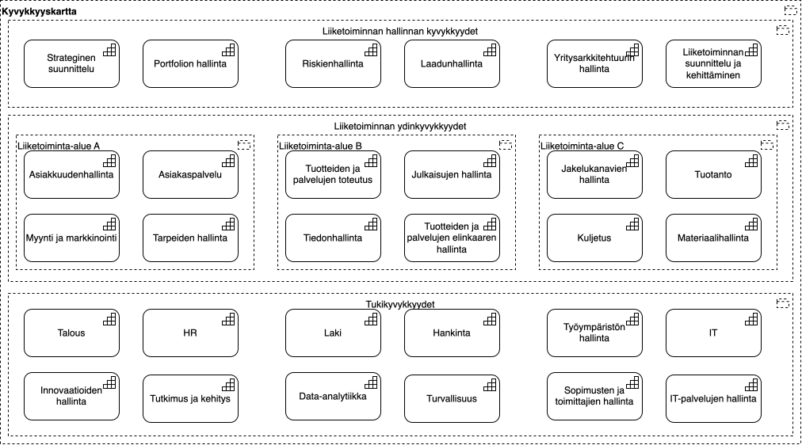
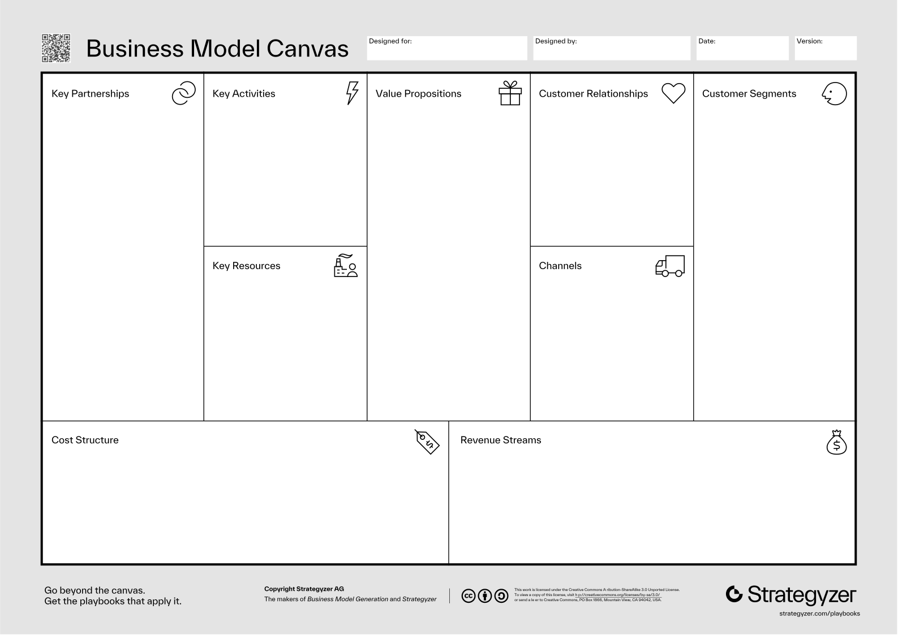
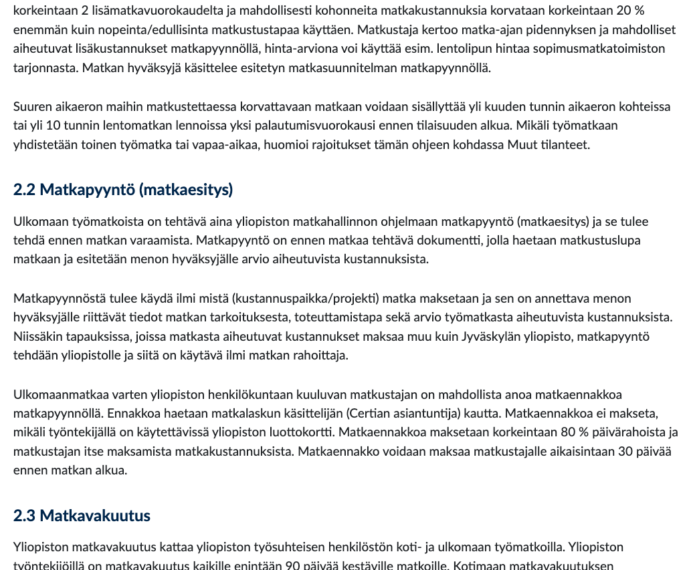

# Prosessitiedon kerääminen

Prosesseja koskevan tiedon jatkuva kerääminen on oleellista prosessien hallinnan ja kehittämisen kannalta. Omanlaisensa ponnistus on prosessitiedon kerääminen silloin, kun toistaiseksi dokumentoimattomat tai kenties jopa tunnistamattomat prosessit on tarpeen saada haltuun ja mallinnetuiksi. Prosessitiedon keräämisessä voidaan hyödyntää useita erilaisia keinoja ja lähteitä: eksplisiittinen tieto dokumentoiduista lähteistä, työntekijöiden hiljainen tieto eli *tacit knowledge* [ks. @nonaka1996theory], tietojärjestelmistä saatava data, kuten loki- ja tapahtumatiedot sekä erilaisilla asiakaskyselyillä ja organisaation sisäisistä ja ulkoisista sidosryhmäpalautteista saatava tieto. Yleisimpiä keinoja prosessitiedon keräämiseen ovat haastattelut, työpajat, havainnointi, dokumenttianalyysi ja prosessianalytiikka.

## Prosessien kypsyystaso ja sen mittaaminen

Ennen kuin prosesseja ryhdytään kehittämään, on tarpeen tietää, mikä niiden taso tällä hetkellä on. Kypsyysmalli (*maturity model*) on tähän tarkoitettu arviointikehikko, joka kuvaa portaittaisen kehityspolun epämuodollisesta ja ehkä sattumanvaraisestakin toiminnasta kohti hallittua, mitattua ja jatkuvasti parannettavaa toimintaa. Kypsyysarviointi on siten yksi prosessitiedon keräämisen tapa: se tuottaa jäsennellyn kuvan prosessien nykytilasta ja auttaa asettamaan kehittämiselle realistisen tavoitetason.

Prosessien yhteydessä kypsyysmalleja käytetään tyypillisesti kolmeen tarkoitukseen [@roglinger2012]:

- Kuvaileva käyttö, jossa selvitetään nykytila ja tunnistetaan vahvuudet ja puutteet.
- Ohjaava käyttö, jossa määritellään tavoitetaso ja toimenpiteet sen saavuttamiseksi.
- Vertaileva käyttö, jossa organisaation tai yksikön tilannetta verrataan -- *benchmarkataan* -- muihin.

Kypsyydestä puhuttaessa on syytä erottaa kaksi tasoa. Prosessin kypsyys kuvaa yksittäisen prosessin, kuten ostolaskujen käsittelyn, kykyä tuottaa tavoiteltu lopputulos johdonmukaisesti ja ennustettavasti. Prosessinhallinnan kypsyys taas kuvaa koko organisaation kyvykkyyttä johtaa ja kehittää prosessejaan: esimerkiksi onko prosesseille nimetty omistajat, onko käytössä yhteiset mallinnuskäytännöt ja mittaristot ja tukeeko organisaation kulttuuri prosessiajattelua [@roglinger2012].

Organisaatioissa voi olla yksittäisiä hyvin hallittuja prosesseja, vaikka prosessijohtaminen kokonaisuutena olisikin kehittymätöntä. Päinvastainen tilanne on harvinaisempi, sillä kypsä prosessien hallinta käytännössä pakottaa prosessit kehittymään.

Useimmat kypsyysmallit pohjautuvat Carnegie Mellonin yliopiston Software Engineering Instituten alun perin ohjelmistokehitykseen laatimaan *Capability Maturity Model* -malliin [@paulk1993] ja sen seuraajaan *CMMI*:hin (*Capability Maturity Model Integration*). Malli jakaa kypsyyden viiteen tasoon, jotka seuraavassa taulukossa (@tbl-kypsyystasot) on sovitettu prosessien kypsyystason tarkasteluun.

| Taso | Nimi | Tyypillinen tilanne |
|---|---|---|
| 1 | Lähtötaso (*Initial*) | Toiminta on epämuodollista, ja onnistuminen riippuu yksittäisistä henkilöistä. |
| 2 | Hallittu (*Managed*) | Prosessit on suunniteltu ja niitä seurataan yksikkö- tai projektikohtaisesti. |
| 3 | Määritelty (*Defined*) | Prosessit on kuvattu ja vakioitu koko organisaatiossa. |
| 4 | Mitattu (*Quantitatively Managed*) | Prosessien suorituskykyä ohjataan mittaritiedon perusteella. |
| 5 | Optimoiva (*Optimizing*) | Prosesseja parannetaan jatkuvasti mittaustiedon ja kokeilujen pohjalta. |

: CMMI-mallin kypsyystasot {#tbl-kypsyystasot tbl-colwidths="[8,27,65]"}

Michael Hammerin *Process and Enterprise Maturity Model* (*PEMM*) [@hammer2007] arvioi kypsyyttä kahdesta suunnasta. Yksittäisen prosessin kypsyyttä mitataan viidellä prosessin mahdollistajalla (*process enablers*): prosessin suunnittelu, suorittajat, omistaja, infrastruktuuri ja mittarit. Organisaation valmiutta taas mitataan neljällä yrityskyvykkyydellä (*enterprise capabilities*): johtajuus, kulttuuri, osaaminen ja hallintamalli. Kumpikin arvioidaan nelitasoisella asteikolla. Hammerin keskeinen havainto on, että mahdollistajat ovat toisistaan riippuvaisia: prosessi on vain niin kypsä kuin sen heikoin mahdollistaja.

Rosemann ja de Bruin [-@rosemann2005] tarkastelevat kypsyysmallissaan prosessien hallinnan kypsyyttä kuuden tekijän kautta: strateginen yhdenmukaisuus, hallintamalli, menetelmät, tietotekniikka, ihmiset ja kulttuuri. Malli muistuttaa, että prosessien hallinta ei ole ainoastaan prosessimallinnuksiin tai työvälineisiin liittyvä asia. Kypsyys edellyttää myös johdon sitoutuneisuutta ja prosessimyönteistä kulttuuria.

Kypsyyden arvioinnissa voidaan hyödyntää tässä luvussa esiteltäviä prosessitiedon keräämisen keinoja, erityisesti prosessihaastattelua ja mittareita. Käytännössä arviointi etenee usein seuraavasti:

1. Rajaus. Päätetään, arvioidaanko yksittäistä prosessia vai koko organisaation prosessinhallintaa, ja valitaan malli sen mukaan.
2. Itsearviointi. Prosessin omistaja ja keskeiset toimijat arvioivat nykytilan mallin kriteereillä, esimerkiksi kyselylomakkeella.
3. Näytön kerääminen. Itsearviota täydennetään haastatteluilla, työpajoilla ja dokumenttianalyysilla. Prosessilouhinta voi tarjota objektiivista näyttöä esimerkiksi siitä, noudatetaanko vakioituja prosesseja myös käytännössä.
4. Tason määrittäminen. Tulokset kootaan ulottuvuuksittain. Kokonaistason sijaan kannattaa tarkastella profiilia, joka korostaa heikkoja ulottuvuuksia.
5. Tavoitetason ja toimenpiteiden määrittäminen. Määritellään, mikä taso on kyseiselle prosessille tarkoituksenmukainen, ja mitä sen saavuttaminen edellyttää.
6. Uusinta. Arviointi toistetaan esimerkiksi vuosittain, jotta kehitystä voidaan seurata.

## Kyvykkyyskartta

Kyvykkyys (*business capability*) on organisaation kyky, joka sillä on tai jonka se voi hankkia saavuttaakseen tietyn lopputuloksen [@togaf-kyvykkyydet]. Kyvykkyys kuvaa, mitä organisaatio pystyy tekemään, riippumatta siitä, kuka työn tekee, millä prosesseilla tai millä tietojärjestelmillä. Prosessi puolestaan kuvaa, miten työ tehdään. Kyvykkyys rakentuu siis ihmisten, prosessien, tiedon ja teknologian yhdistelmästä, ja yhtä kyvykkyyttä voi toteuttaa useampi prosessi.

Seuraavassa kuviossa (@fig-kyvykkyyskartta)[^hosiaisluoma] on esimerkki kyvykkyyskartasta, joka voi myös auttaa tunnistamaan kyvykkyyksiin liittyvät ja kyvykkyyksiä toteuttavat prosessit. Kyvykkyyksien kypsyyttä voidaan arvioida samalla tavalla kuin prosessien. Kun kartta väritetään "lämpökartaksi" kypsyystason tai tunnistetun parannustarpeen mukaan, siitä näkee nopeasti, mihin kyvykkyyksiin ja niitä toteuttaviin prosesseihin kehittämistoimet kannattaa ensimmäiseksi kohdistaa.

{#fig-kyvykkyyskartta fig-alt="Esimerkki kyvykkyyskartasta."}

[^hosiaisluoma]: https://www.hosiaisluoma.fi/

## Business Model Canvas

Osterwalderin [-@osterwalder2004] esittelemä *Business Model Canvas*[^bmc] (*BMC*)  (@fig-bmc) on laajasti käytetty strategisen organisaatiosuunnittelun työväline. BMC voi toimia tehokkaana välineenä myös liiketoimintaprosessien tarkastelussa, sillä se kyvykkyyskartan tavoin tarjoaa kokonaisvaltaisen kuvan yrityksen -- tai miksei myös julkisen tai voittoa tuottamattoman organisaation -- toiminnasta ja auttaa yhdistämään strategisen suunnittelun operatiivisiin toimintoihin.

[^bmc]: https://www.strategyzer.com/library/the-business-model-canvas

{#fig-bmc fig-alt="Business Model Canvas"}

BMC-viitekehys on varsin yksinkertainen. Siinä on yhdeksän lohkoa, jotka esittävät liiketoiminnan keskeisiä rakenneosia:

- Arvolupaus (*Value Proposition*): Mitä arvoa yritys tuottaa asiakkaalle? Minkä ongelman se ratkaisee tai minkä tarpeen täyttää?
- Asiakassegmentit (*Customer Segments*): Kenelle arvoa tuotetaan ja mitkä ovat yrityksen tärkeimmät asiakasryhmät?
- Kanavat (*Channels*): Missä asiakkaat tavoitetaan? Kuinka arvo toimitetaan?
- Asiakassuhteet (*Customer Relationships*): Kuinka asiakkaita hankitaan, kuinka asiakkaat saadaan pidettyä ja kuinka asiakaskuntaa kasvatetaan?
- Tulovirrat (*Revenue Streams*): Mistä tulot saadaan? Mistä asiakkaat haluavat maksaa ja miten?
- Ydinresurssit (*Key Resources*): Mitä resursseja tarvitaan arvolupauksen toteuttamiseen? 
- Ydinaktiviteetit (*Key Activities*): Mitä täytyy tehdä, jotta yrityksen antama arvolupaus voidaan toteuttaa?
- Kumppanit (*Key Partnerships*): Ketkä ovat yrityksen tärkeimmät yhteiskumppanit ja toimittajat?
- Kustannusrakenne (*Cost Structure*): Missä ja miten kustannukset syntyvät? Mitkä ovat suurimmat kulut?

Vaikka BMC sinällään onkin yksinkertainen ryhmittely liiketoiminnan kannalta oleellisista asioista, voi kehyksen täyttäminen vaatia työpajan, jos toisenkin. BMC:n esittämä teemoittelu saattaa kuitenkin tuntua luontevammalta kuin liiketoiminnan jäsentely suoraan kyvykkyys- tai prosessikartan muotoon.

Jo teemojen otsikoista nähdään, että BMC voi monella tapaa tukea prosessien tunnistamista, niiden hallinnan suunnittelua ja kehittämistä. Jokaisen teeman kohdalla voidaan esittää kysymykset: Mitä prosesseja tähän liittyy ja kuinka ne toimivat? Esimerkiksi: Mitkä prosesseista ovat välttämättömiä asiakkaille annettavan arvolupauksen toteuttamiseksi? Jos arvolupaus on nopea toimitus, on prosesseissa tietenkin painotettava logistiikan tehokkuutta. Ovatko prosessit optimoitu erilaisten asiakasryhmien tarpeisiin? Millä prosesseilla toteutetaan asiakashankintaa ja kuinka ne toimivat? Ovatko arvolupauksen toteuttamisen kannalta olennaisiksi todetut ydinaktiviteetit (eli ydinprosessit) riittävästi resursoituja? Voidaanko kustannusrakenteita keventää prosesseja tehostamalla tai olisiko syytä harkita prosessien ulkoistamista? Ja niin edelleen.

Kun kanvaasi on täytetty, voidaan jokaisen alueen sisältö vielä järjestää prioriteettijärjestykseen. Mikä asiakasryhmistä tai asiakkuuksista on tärkein? Mitä uutta asiakasryhmää voitaisiin tavoitella? Mistä suurin tulovirta saadaan nyt? Entä mistä se tulee kolmen vuoden kuluttua? Mitkä ydinaktiviteeteista ovat kaikista tärkeimmät? Missä syntyvät toiminnan suurimmat kustannukset? Priorisoinnin avulla kehitystyötä voidaan suunnata ja muutoksen laajuutta rajata.

Priorisoinnin jälkeen kanvaasin avulla voidaan myös tarkastella eri osa-alueiden prioriteettien johdonmukaisuutta. Jos välittömästi arvolupauksen toteuttamiseen liittyvät toiminnot löytyvät ydinaktiviteettien joukosta vasta alemmilta sijoilta, tai eivät ehkä löydy sieltä ollenkaan, jossain on vikaa. Jos tulovirrat ja ydinresurssit eivät kohtaa, jälleen on prosessien johtamisessa menty metsään.

Kun liiketoimintamalli on kuvattu, voidaan arvioida, mitkä prosessit ovat tärkeimpiä strategian toteutumiselle. Näihin prosesseihin tulee kohdentaa resursseja ja tarvittaessa parantamistoimia. Arvolupauksen toteutusta voidaan optimoida ja resurssien käyttöä saatetaan voida tehostaa esimerkiksi prosessiautomaation avulla. BMC voi myös osoittaa, mihin prosesseihin liittyvää dataa olisi tarpeen kerätä ja analysoida, jotta liiketoimintamallia voidaan jalostaa tiedolla johtamisen avulla.

Tunnettuudestaan huolimatta BMC ei välttämättä ole ensimmäisenä mieleen nouseva väline liiketoimintaprosessien tarkastelun tueksi, mutta se on siihen erinomainen väline. Sen käyttö mahdollistaa prosessien systemaattisen tarkastelun nimenomaan strategian näkökulmasta. Sitä soveltamalla voidaan optimoida prosesseja tukemaan arvolupausta, vähentää kustannuksia ja parantaa asiakastyytyväisyyttä. Tämä johtaa kokonaisvaltaiseen liiketoimintaprosessien, ja siten liiketoiminnan, kehittämiseen. BMC tarjoaa prosesseihin kuitenkin karkean, oikeastaan vain otsikkotasoisen näkymän. Tarkastellaankin seuraavaksi joitain keinoja ja tekniikoita, joiden avulla voidaan päästä kiinni prosessien kulkuun ja sitä kautta kehittämisen yksityiskohtaisempiin suuntiin.

## Olemassa oleva dokumentaatio

Prosesseja koskevaa dokumentoitua tietoa voidaan löytää monista lähteistä. Useissa yrityksissä ja organisaatioissa on työ- tai toimintaohjeita, jotka saattavat parhaassa tapauksessa kuvata jopa askel askeleelta, kuinka jokin tehtävä suoritetaan. Sikäli ne ovat myös väline toiminnan jatkuvuuden varmistamiseksi esimerkiksi henkilöstömuutosten yhteydessä. Lisäksi ne voivat liittyä toiminnan laadun varmistamiseen ja monet laatujärjestelmät edellyttävätkin melko seikkaperäisiä toimintakuvauksia. Kemppaisen [-@kemppainen2018] tutkimuksessa todetaan hyvän työohjeen olevan sellainen, jonka ”avulla pystyy suorittamaan tarkasti määritetyn työtehtävän ilman muita ohjeita tai muuta opastusta.” Seuraavassa (@fig-matkaohje) on katkelma erään yliopiston työmatkaohjeesta.

{#fig-matkaohje fig-alt="Katkelma yliopiston työmatkaohjeesta."}

Laatujärjestelmät, kuten ISO 9001 Laadunhallinta[^iso_9001], edellyttävät prosessimaista toimintatapaa ja prosessien määrittämistä. ISO 9001 Laadunhallinta -järjestelmää ohjaavia periaatteita ovat asiakaslähtöisyys ja laadun jatkuva parantaminen, joten laatusertifikaatin ansainneen organisaation voidaan olettaa päässeen jo varsin pitkälle prosessiajattelussa ja prosessimuotoisessa toiminnassa. Useissa sertifioimattomissakin organisaatioissa on laadittu laatujärjestelmiä, vastuutauluja tai vaikkapa vähemmän muodollisia laatukäsikirjoja, jotka voivat toimia erinomaisena materiaalina liiketoimintaprosesseja tarkasteltaessa.

[^iso_9001]: https://sfs.fi/standardeista/tutustu-standardeihin/suositut-standardit/iso-9001-laadunhallinta/

Vaikka laatukäsikirjaa ei löytyisikään, on useimmilla organisaatioilla ainakin jonkinlainen organisaatiokaavio tehtävänimikkeineen ja vastuualuekuvauksineen. Samoin esimerkiksi verkkosivuilla olevat kuvaukset asiakkaille tarjottavista palveluista voivat myös johtaa prosessien äärelle. Tietojärjestelmien käyttöohjeet ja muut niihin liittyvät dokumentaatiot saattavat tarjota yksityiskohtaistakin tietoa prosesseista, joita toteutetaan tai tuetaan IT-ratkaisuilla.

Sopimukset kuten palvelutasosopimus (*Service Level Agreement*, *SLA*), samoin kuin toimintaa koskeva lainsäädäntö tai muu sääntely, on myös hyvä kartoittaa ja käydä ainakin keskeisiltä osiltaan läpi. Nämä voivat paitsi tarjota tietoa nykytilan prosessien toteutuksesta, ne asettavat myös ensimmäiset raamit uusien prosessien suunnittelulle.

## Prosessihaastattelu

Haastattelun avulla voidaan saada syvällistä tietoa prosessien kulusta sekä esimerkiksi resurssitarpeista, pullonkauloista ja mahdollisista poikkeustilanteista. Haastattelua voidaan käyttää pyrittäessä nykyisten prosessien dokumentointiin ja ymmärtämiseen. Sitä voidaan myös käyttää tiedonkeruumenetelmänä suunniteltaessa ja määriteltäessä prosesseille tavoitetiloja, ja siihen haastattelu onkin yksi parhaista tiedonkeruuvälineistä. Koska haastattelu soveltuu useisiin käyttötarkoituksiin ja se voidaan toteuttaa monessa eri muodossa, onkin ensimmäiseksi tärkeää määritellä tavoitteet ja vasta sen jälkeen suunnitella haastattelun toteutus.

Haastattelun päätyypit ovat strukturoitu, puolistrukturoitu ja avoin haastattelu. Strukturoitu eli rakenteinen muoto on käytettävissä silloin, kun jo etukäteen tarkasti tiedetään, mitä tietoa tarvitaan ja missä muodossa se halutaan saada. Strukturoidun haastattelun ominaisuuksia on esitetty taulukossa alla (@tbl-strukturoitu-haastattelu). Suljetuilla kysymyksillä tarkoitetaan esimerkiksi valinta- ja luokituskysymyksiä.

| Ominaisuus | Kuvaus |
|---|---|
| Kysymykset | Kysymykset ovat täsmällisesti etukäteen määriteltyjä (suljettuja tai puoliavoimia), eikä niiden sisältöä tai muotoa varioida haastattelun aikana tai niiden välillä. |
| Järjestys | Kysymykset esitetään samassa järjestyksessä kaikille haastateltaville. |
| Haastattelijan rooli | Haastattelija pysyy neutraalina, ei improvisoi eikä johdattele haastateltavaa. |
| Tavoite | Tavoitteena on kerätä määrämuotoista ja kvantifioitavaa tietoa. |
| Dokumentointi | Vastaukset kirjataan täsmällisesti, esimerkiksi lomakkeelle tai tietokantaan. |

: Strukturoidun haastattelun ominaisuudet {#tbl-strukturoitu-haastattelu}

Strukturoitu haastattelu soveltuu käytettäväksi silloin, kun ei ole tarpeen päästä kiinni prosessikulun nyansseihin, vaan tavoitteena on muodostaa yleiskuva prosessista tai käytännöistä, ja kun halutaan saada määrällisessä muodossa analysoitavaa tietoa esimerkiksi prosessin kestosta, toistuvuudesta ja tehtävien suoritusjärjestyksestä. Määrämuotoinen strukturoitu haastattelu tuottaa yhtenäistä ja vertailtavaa aineistoa, joka on helppo kvantifioida ja analysoida. Muoto helpottaa myös useiden haastateltujen henkilöiden vastausten vertailua.

Strukturoidulla haastattelulla ei kuitenkaan pystytä syventymään yksittäisen haastateltavan kokemuksiin tai kontekstiin, eikä se mahdollista joustavaa keskustelua tai lisäkysymysten esittämistä. Sen vuoksi strukturoitu haastattelu vaatii huolellisen ennakkosuunnittelun ja haastattelurungon testaamisen ennen haastattelujen aloittamista.

Avoin haastattelu puolestaan toteutetaan ilman valmista kysymysrunkoa ja kysymykset muotoutuvat haastattelun edetessä. Haastattelun kulku vastaa vapaata keskustelua ja sen tavoitteena on ymmärtää ilmiötä, eli prosessihaastattelun tapauksessa jotain prosessia, haastateltavan näkökulmasta ja hänen kontekstissaan. Tekniikka soveltuu käytettäväksi parhaiten silloin, kun käsiteltävät prosessit ovat monimutkaisia tai huonosti jäsentyneitä, tai kun ollaan nimenomaan kiinnostuneita haastateltavien kokemuksista ja näkemyksistä. Avoin haastattelu voi olla toimiva tekniikka esimerkiksi lähdettäessä kartoittamaan huonosti hallussa olevia prosessialueita. Avointen haastattelujen muodossa toteutetun ensimmäisen tiedonkeruukierroksen jälkeen on mahdollista siirtyä systemaattisempiin tiedonkeruumenetelmiin. Vastaavasti avointa haastattelua voidaan käyttää vaikkapa strukturoitujen tai puolistrukturoitujen haastattelujen jälkeen eli siinä vaiheessa, kun prosessista alkaa olla jo yleiskäsitys, mutta lisäksi halutaan vielä selvittää toimijakohtaisia näkemyksiä tai harvinaisempia yksityiskohtia ja poikkeustilanteita.

Puolistrukturoitu haastattelu on todennäköisesti yleisin muoto prosessihaastatteluja toteutettaessa; ainakin se on yleisin haastattelumenetelmä laadullisissa tutkimuksissa [@adeoye2021research]. Se yhdistää sekä strukturoidun että avoimen haastattelun ominaisuuksia. Kysymysrunko on valmiiksi mietitty ja se voi sisältää sekä määrämuotoisia että avoimia kysymyksiä. Haastattelija voi muuttaa kysymysten esittämisjärjestystä ja tarvittaessa esittää tarkentavia tai lisäkysymyksiä. Keskustelun kulku on joustava, mutta ei samalla tavalla vapaasti rönsyilevä kuin avoimessa haastattelussa. Puolistrukturoitu haastattelu pyrkii tuottamaan määrämuotoista tietoa, mutta mahdollistaa kuitenkin syventävien ja haastateltavan kontekstiin liittyvien huomioiden esille nousun. Tätä haastattelutyyppiä käytetään, kun halutaan teemoittain vertailtavaa aineistoa, mutta samalla myös syvempää laadullista ymmärrystä. Puolistrukturoidun haastattelun ominaisuuksia on koottu seuraavaan taulukkoon (@tbl-puolistrukturoitu-haastattelu).

| Ominaisuus | Kuvaus |
|---|---|
| Kysymykset | Kysymykset ovat etukäteen laadittuja, mutta niitä voidaan muokata tilanteen ja haastateltavan aiempien vastausten mukaan. |
| Järjestys | Haastattelun teemat pyritään käymään läpi suunnitellussa järjestyksessä, mutta järjestys ei ole tiukasti sidottu. |
| Haastattelijan rooli | Haastattelija ohjaa keskustelua ja voi esittää lisäkysymyksiä ja tarkennuspyyntöjä joustavasti. |
| Tavoite | Tavoitteena on yhdistää laadullinen syvyys ja aineiston vertailtavuus. |
| Dokumentointi | Haastattelut tavallisesti tallennetaan ja litteroidaan. Vaihtoehtoisesti haastattelija voi tehdä haastattelun aikana tarkkoja muistiinpanoja teemoittain. |

: Puolistrukturoidun haastattelun ominaisuudet {#tbl-puolistrukturoitu-haastattelu}

> **Seuraava osuus perustuu Sara Seppäsen kanssa käytyyn keskusteluun prosessihaastatteluista ja prosessitiedon keräämisestä. Seppänen toimii pääarkkitehtina ja hänellä on runsaasti kokemusta myös prosessien kehittämisestä.**
>
> Haastattelun tavoitteiden mukaisesti haastateltaviksi voidaan valita esimerkiksi prosessien omistajia, asiantuntijoita, työntekijöitä tai sidosryhmiä, joista kukin tarjoaa prosessiin erilaisen näkökulman. Kannattaa pitää mielessä, että haastattelujen avulla saatava tieto on aina vähintään jossain määrin subjektiivista – myös strukturoitujen haastattelujen tapauksessa.
>
> Prosessin omistaja tuntee prosessinsa tavoitteen ja resurssit sekä sen, kuinka se liittyy muihin prosesseihin ja toimintaympäristöönsä. Koska prosessin omistajalla on kokonaiskuva prosessista, osaa hän todennäköisesti kertoa ainakin yleisellä tasolla, mitä kaikkea prosessiin liittyy, sekä neuvoa, ketä muita olisi tavoitteiden saavuttamiseksi hyödyllistä haastatella.
>
> Prosessin yksityiskohtaisemman kulun selvittämiseksi voi olla tarpeen kääntyä prosessin operatiivisessa toteuttamisessa toimivan henkilöstön, esimerkiksi prosessitiimin, puoleen. Jotta kaikki relevantit näkökulmat saadaan katettua, usein tarvitaan eri toimijaryhmien haastatteluja ja haastatteluaineistojen yhdistelemistä.
> 
> Lähellä prosessia toimiva ja prosessiin liittyviä tehtäviä toteuttava työntekijä ei välttämättä kuitenkaan ajattele toimintaansa tai työtehtäviään prosesseina[^ajattelu]. Siksi haastattelijan on mietittävä, millaisia kysymyksiä hänen tulisi esittää, jotta haastattelujen tavoitteita vastaavaa tietoa voidaan saada. Prosessin toteuttamiseen osallistuvalla haastateltavalla saattaa olla yksityiskohtaista tietoa joistain prosessissa usein toistuvista tehtävistä tai ongelmakohdista. Vastaavasti jotkin muut prosessin vaiheet tai poikkeustilanteet, jotka saattavat olla hyvinkin merkityksellisiä, voivat tulla kuitatuiksi lyhyesti ja ainoastaan yleisellä tasolla.
>
> Erityisesti avoimia ja puolistrukturoituja haastatteluja tehtäessä on tavallista, että jokainen prosessin toteuttamiseen osallistuva kertoo prosessille hieman erilaisen kulun. Ihmiset korostavat omasta kontekstistaan eri asioita; sellaisia, joita itse pitävät prosessin kannalta oleellisimpina. Vaikka tällaisen aineiston yhteen vetäminen voi olla työlästä, se mahdollistaa perusteellisen kokonaisnäkemyksen muodostamisen, ja onkin kenties arvokkainta tietoa, mitä prosessista voidaan saada.
> 
> On myös mahdollista, että prosessi todellakin toteutuu tapauksen ja toteuttajan mukaan eri tavoilla, eli prosessikulku ei ole vakioitunut. Mallinnetut kuvaukset saman prosessin erilaisista kuluista ja toteumista ovat tärkeää materiaalia vakioituja prosessikäytänteitä suunniteltaessa ja prosesseja kehitettäessä. Prosessin omistaja tai objektiivinen prosessiasiantuntija voi analysoida erilaisia variantteja ja tarkastella, kuinka ne toteuttavat prosessille asetettuja tavoitteita ja vaatimuksia. Variaatioiden joukosta voidaan valita ideaalisin toteutus tai erilaisista prosessikuluista voidaan poimia parhaat osat, jotka yhdistetään vakioitavaksi prosessimuodoksi.

Seuraavaksi esitetään Seppäsen toteutusmalli prosessihaastattelujen suunnittelusta tulosten loppukatselmointiin ja prosessien jatkuvaan kehittämiseen.

> 1. **Ymmärrä työn tavoitteet**. Ensin tulee määritellä, mitä haastatteluilla pyritään saavuttamaan. Tavoitteena voi esimerkiksi olla jonkin nykyisen prosessin dokumentoiva kuvaaminen, automaatiomahdollisuuksien tunnistaminen tai tavoitetilan suunnittelua ja kehittämistä tukevan informaation kerääminen. Tavoitteen kautta pystytään asettamaan haastattelurunkoon sopivat teemat ja kysymykset. Mikäli tavoitteena on muodostaa yleinen käsitys prosesseista ja niiden liittymäkohdista, tulee haastattelut ja muu tiedonkeruu toteuttaa eri tavalla, kuin jos tavoitteena on tuottaa mahdollisimman yksityiskohtainen kuvaus nykyisestä prosessikulusta tai suunnitella parannettu tai jopa kokonaan uudistettu prosessikulku.
>
> 2. **Tutustu prosessiin mahdollisimman hyvin ennen haastattelujen aloittamista**. Seuraavaksi haastattelijan tulee tutustua kaikkeen relevanttiin taustamateriaaliin, kirjallisiin lähteisiin, kuten työohjeisiin sekä toiminnallisiin ja kenties strategisiinkin tavoitteisiin, mitä käsiteltävästä prosessista on saatavilla. Jos prosessi tuottaa palvelua asiakkaalle, tutustutaan palvelun kuvaukseen, joka voi löytyä yrityksen tai organisaation verkkosivuilta. Saatavilla voi olla myös prosessin asiakkaille tarkoitettuja ohjeita. Mikäli prosessi toteutetaan tietojärjestelmällä, voi järjestelmästä ja sen dokumentaatioista löytyä ainakin välillisesti prosessikulkuun liittyvää informaatiota. Samoin, jos prosessiin liittyy esimerkiksi lomakkeita, tulee niihin tutustua, ja sähköisten lomakkeiden tapauksessa niiden toimintaa kannattaa myös kokeilla. Näin saadaan selville, mitä informaatiota prosessissa käsitellään. Erilaisten taustamateriaalien avulla prosessista saadaan todennäköisesti luotua ensimmäinen kuvaus jo ennen ensimmäisenkään haastattelun toteuttamista. Mitä paremmin haastattelija ymmärtää prosessia jo valmiiksi, sitä tuloksellisempia haastattelut tulevat olemaan. Tämä paitsi säästää haastateltavien aikaa ja auttaa haastattelijaa esittämään oikeita kysymyksiä, se myös helpottaa haastatteluaineiston tulkintaa. Haastattelijalla on paremmat edellytykset ymmärtää, milloin vastaukset käsittelevät keskeisiä teemoja ja milloin ne ehkä liikkuvat lillukan varsissa.
>
> 3. **Tee luonnos prosessikulusta**. Usein on hyödyllistä laatia taustatietojen perusteella prosessikulusta ensimmäinen luonnos. Mikäli prosessia on tarkoitus mallintaa myös haastattelun aikana (ks. kohta 6), voi alustava hahmotelma toimia haastattelijan muistin tukena.
>
> 4. **Haastattele ensimmäiseksi prosessin omistaja**. Jotta prosessista, sen tavoitteista ja vaatimuksista -- esimerkiksi prosessia koskevasta sääntelystä -- saadaan aluksi korkean tason käsitys, kannattaa haastattelut aloittaa prosessin omistajasta. Vaikka omistaja ei välttämättä tunne prosessikulun kaikkia yksityiskohtia, erityistapauksia tai poikkeamia, osaa hän varmasti neuvoa, ketä näiden osalta kannattaa haastatella seuraavaksi. Mikäli prosessilla ei ole nimettyä omistajaa, voidaan haastatteluun kutsua esimerkiksi toiminta-alueen esihenkilö.
>
> 5. **Valitse muut haastateltavat**. Seuraavaksi valitaan muut haastateltavat ja sovitaan haastattelujen aikataulu. On mahdollista, että joku ehdottaa itsensä sijaan haastateltavaksi jotain toista, tehtävän tai prosessin paremmin tuntevaa henkilöä.
>
> 6. **Toteuta haastattelut**. Haastattelun aluksi kannattaa käydä tavoitteet läpi haastateltavan kanssa: Miksi haastattelu toteutetaan. Mitä tarkoitusta se palvelee. Miksi juuri kyseistä henkilöä haluttiin haastatella. Mistä asioista haastattelija on kiinnostunut kuulemaan ja mikä on haastattelun tavoiteltu lopputulos. Mikäli tarpeen, haastateltava voidaan lyhyesti perehdyttää liiketoimintaprosesseihin ja niiden käsitteistöön yleisellä tasolla. Samalla voi olla hyödyllistä käydä läpi jokin yksinkertainen prosessikulku uimaratoineen esimerkiksi vuokaavion tai BPMN-mallin muodossa. Orientaatioksi voidaan jo ennen haastattelua toimittaa esimerkiksi prosessikorttipohja tai muuta materiaalia, jonka tuella haastateltava voi miettiä prosessia etukäteen. Sara Seppänen kuitenkin huomauttaa, että tällaiset ennakkomateriaalit saattavat myös hämmentää tai tarpeettomasti kuormittaa haastateltavaa, eikä hän itse niitä käytä.    Prosessin dokumentointiin tähtäävän haastattelun toteuttamiseen on erilaisia käytänteitä. Jotkut haastattelijat ainoastaan kirjaavat asioita muistiin ja avaavat muistiinpanot prosessimalliksi haastattelun jälkeen. Seppänen kertoo usein piirtävänsä prosessimallia jo haastattelun aikana siten, että myös haastateltava voi nähdä sen. Tällöin haastateltava pystyy seuraamaan, kuinka hänen vastauksensa tulevat tulkituiksi prosessin muotoon ja tarvittaessa välittömästi korjata mahdolliset väärinymmärrykset. Samoin mallin kautta haastateltavan mieleen voi nousta asioita, joita hän ei ole vielä huomannut mainita. Lisäksi prosessimalli auttaa pitämään keskustelun tarkkuustason johdonmukaisena ja tavoitetta vastaavana. Vaiheittain rakentuvasta graafisesta mallista on helpompi huomata, mikäli keskustelu uhkaa ajautua tarpeettomiin yksityiskohtiin tai toisaalta liikkuu tavoitteisiin nähden liian yleisellä tasolla. Haastattelun aikana piirrettävä prosessimalli kannattaa kuitenkin pitää notaatioltaan yksinkertaisena. Useimpiin tilanteisiin riittävät BPMN:n peruselementit tai esimerkiksi vuokaaviomalli. Lopputulos haastattelun päättyessä on tavallisesti yleisellä tasolla esitetty prosessikulku, jota on höystetty joukolla yksityiskohtiin, poikkeuksiin ja tarkennus- tai selvitystarpeisiin liittyviä annotaatioita tai muistilappuja.
>
> 7. **Dokumentoi ja arvioi haastattelun tuottamat tiedot**. Haastattelun jälkeen muistiinpanot kirjoitetaan auki. Mikäli haastattelun aikana on piirretty prosessimallia, sitä tarvittaessa korjataan ja täydennetään muistiinpanojen avulla, viimeistellään ja tarkastetaan. Mikäli muistiin on kirjattu lisäselvitystä vaativia asioita, nämä selvitetään ensimmäiseksi. Sen jälkeen muistiinpanot ja / tai prosessimalli toimitetaan haastatellulle kommentoitavaksi. Yksinkertaisimmillaan tämän voi toteuttaa kysymällä haastatellulta, vastaavatko ne todellisuutta.
>
> 8. **Toteuta tarvittavat lisähaastattelut ja iteraatiot**. Haastateltava ei välttämättä osaa kertoa prosessista kuin siltä osin, mitä hänen omalla ”uimaradallaan” tapahtuu. Voikin olla tarpeen sopia lisähaastatteluja, jotta prosessista saadaan muodostettua riittävän kokonaisvaltainen käsitys. Etenkin kysymykset prosessin käynnistymisestä, päättymisestä sekä prosessiin tulevista ja siitä lähtevistä tietovirroista voivat paljastaa lisää prosessiin liittyviä rooleja, toimijoita ja rajapintoja muihin prosesseihin. Saattaa esimerkiksi olla, että prosessi on itse asiassa käynnistynyt jo ennen kuin haastateltu henkilö osallistuu siihen tai jatkuu sen jälkeen, kun hänen tehtävänsä prosessiin liittyen ovat tulleet valmiiksi. Mahdollista on sekin, että haastattelun perusteella tunnistetaan erilaisia tapauksia ja prosessikulkuja, jotka todellisuudessa ovat eri prosesseja: esimerkiksi henkilöasiakkaan ja yritysasiakkaan prosessit. Joskus voi olla tarpeen kuulla haastateltuja henkilöitä vielä uudelleen.  Usein esimerkiksi täydentävät kysymykset voidaan kuitenkin esittää lyhyessä lisäpalaverissa tai kommenttipyynnön yhteydessä kirjallisesti ilman tarvetta uudelle haastattelukierrokselle.
>
> 9. **Toteuta loppukatselmointi**. Lopuksi prosessimalli ja muut prosessista kerätyt tiedot toimitetaan prosessin omistajalle, joka katselmoi ja hyväksyy lopputuloksen.
>
> 10. **Prosessien jatkuva parantaminen**. Katselmoitu ja hyväksytty prosessi voidaan tarvittaessa avata uudelleen tarkasteltavaksi. Prosessikatselmointi on suositeltavaa toteuttaa säännöllisesti ja sitoa se esimerkiksi vuosikelloon. Laadunhallinnan ja prosessien kehittämisen kannalta tulee tietysti myös seurata prosessin toteumaa. Vastaako toteuma suunniteltua prosessikulkua ja vastaavatko prosessin tulokset asetettuja tavoitteita. Herätteenä uudelle tarkastelulle voivat myös toimia esimerkiksi muutokset toimintaympäristössä, tietojärjestelmissä tai vaikkapa lainsäädännössä, kuin myös merkittävät muutokset virheiden, läpimenoaikojen tai muiden seurattavien mittareiden tuloksissa.

[^ajattelu]: Prosessihaastattelut voivatkin toimia myös hyvänä prosessiajattelun esittelyn ja jalkauttamisen välineenä.

Puolistrukturoitu prosessihaastattelu voisi edetä esimerkiksi seuraavanlaisten kysymysten varassa. Puolistrukturoitua haastattelua saatetaan kutsua myös teemahaastatteluksi. Seuraavista esimerkkikysymyksistä on tunnistettavissa ainakin seuraavat teemat: prosessin kulku, prosessissa käsiteltävät ja tuotettavat tiedot, prosessissa käytettävät tietojärjestelmät, prosessin ongelmakohdat ja prosessin kehittämismahdollisuudet. Kaikki etukäteen päätetyt teemat pyritään käsittelemään haastattelun aikana, mutta se, missä vaiheessa haastattelua ne käsitellään, voi tarvittaessa vaihdella. Samoin teemaan liittyviä kysymyksiä voidaan säätää haastattelun aikana. 

***Voitko kuvailla, miten prosessi etenee?***

- *Ketä toimijoita prosessin toteuttamiseen itsesi lisäksi osallistuu ja mitkä heidän roolinsa prosessissa ovat?*
- *Milloin prosessi käynnistyy? Mikä rooli ja tapahtuma sen käynnistää?*
- *Kuinka monta kertaa prosessi suoritetaan päivän / viikon / kuukauden / vuoden aikana?*
- *Mikä on prosessin ensimmäinen, toinen, ..., viimeinen vaihe*[^vaihe_eli_tehtava]*?*
- *Mikä on sinun vastuusi prosessin ensimmäisessä, toisessa, ..., viimeisessä vaiheessa?*
- *Mitä tietoja tarvitset näissä vaiheissa ja mistä saat nämä tiedot?*
- *Mitä tietoja vaiheessa syntyy ja minne nämä tiedot menevät?*
- *Mitä tietojärjestelmiä käytät vaiheissa ja kuinka järjestelmät tukevat työtäsi?*
- *Mitä prosessin lopputulemalta vaaditaan? Voiko prosessi esimerkiksi jäädä kesken tai olla tulematta valmiiksi?*
- *Onko prosessissa vaiheita, joissa se usein hidastuu tai törmää joihinkin ongelmiin?*
- *Mistä edelliset johtuvat?*

***Mitä virhe- tai poikkeustilanteita prosessin aikana voi tapahtua?***

- *Mistä virheet tai poikkeukset johtuvat?*
- *Kuinka usein virheitä tai poikkeuksia tapahtuu?*

***Miten prosessia voisi mielestäsi parantaa?***

- *Liittyykö prosessikulkuun ongelmia tai kehittämiskohteita?*
- *Tukevatko tietojärjestelmät prosessin toteuttamista?*
- *Onko prosessi resursoitu riittävästi?*

[^vaihe_eli_tehtava]: Vaiheella tarkoitetaan tässä BPMN-mallin mukaista tehtävää (*Task*).

<!--
| Teema | Kysymykset |
|---|---|
| Prosessin roolit ja kulku | Voitko kuvailla, miten prosessi etenee? |
| | Ketä toimijoita prosessin toteuttamiseen itsesi lisäksi osallistuu ja mitkä heidän roolinsa prosessissa ovat? |
| | Milloin prosessi käynnistyy? Mikä rooli ja tapahtuma sen käynnistää? |
| | Kuinka monta kertaa prosessi suoritetaan päivän, viikon, kuukauden tai vuoden aikana? |
| | Mikä on prosessin ensimmäinen, toinen, …, viimeinen vaihe? |
| | Mikä on sinun vastuusi prosessin ensimmäisessä, toisessa, …, viimeisessä vaiheessa? |
| | Mitä tietoja tarvitset näissä vaiheissa ja mistä saat nämä tiedot? |
| | Mitä tietoja vaiheissa syntyy ja minne tiedot menevät? |
| | Mitä tietojärjestelmiä käytät vaiheissa ja kuinka ne tukevat työtäsi? |
| | Mitä prosessin lopputulemalta vaaditaan? Voiko prosessi esimerkiksi jäädä kesken tai olla tulematta valmiiksi? |
| | Onko prosessissa vaiheita, joissa se usein hidastuu tai kohtaa jotain ongelmia? |
| | Mistä nämä johtuvat? |

: Esimerkkikysymyksiä puolistrukturoidulle prosessihaastattelulle {#tbl-haastattelukysymykset}
-->

## Prosessilouhinta

Prosessilouhinta (*Process Mining*) on tekniikka, jossa tietojärjestelmien lokeja tarkastelemalla pyritään tekemään näkyväksi ja analysoimaan, miten prosessit todellisuudessa tapahtuvat [@van2016data]. Prosessilouhinnan käyttötapauksia ovat:

- Prosessien löytäminen (*Process Discovery*), jossa lokitietoja analysoimalla pyritään tunnistamaan, kuinka prosessit tapahtuvat. Lokimerkintä syntyy esimerkiksi silloin, kun käyttäjä kirjaa järjestelmään jonkin tiedon. Tästä pystytään usein päättelemään, mitä ja milloin prosessissa on tapahtunut. Prosessin toteumasta rakennetaan malli lokitietoihin perustuen.
- Prosessien yhtenäisyyden tai sääntöjenmukaisen toteutumisen arviointi (*Process Conformance Checking*), jossa verrataan olemassa olevaa prosessimallia ja esimerkiksi prosessia koskevia ohjeita ja vaatimuksia lokitiedoista ilmenevään prosessin toteumaan.
- Prosessien kehittäminen (*Process Enhancement*), jossa lokitietojen avulla pyritään selvittämään, kuinka prosessimallia voidaan rikastaa esimerkiksi lisäarvoa tuottavilla vaiheilla tai prosessin kulkua optimoida esimerkiksi tunnistettaessa pullonkauloja.

Prosessilouhinnan puolestapuhujat huomauttavat, että perinteiset lähestymistavat prosessien tunnistamiseen, prosessikulkujen selvittämiseen ja mallintamiseen, prosessien arviointiin ja parantamiseen ovat aikaa vieviä ja kalliita. Lisäksi niihin väistämättä liittyvän subjektiivisuuden vuoksi ne ovat myös virhealttiita. Prosessilouhinta paitsi automatisoi näitä tehtäviä, lupaa se dataohjautuvana toimintona tuottaa objektiivista tietoa siitä, kuinka prosessit kaikkine variaatioineen todellisuudessa tapahtuvat -- ilman tarvetta tukeutua arvailuun. Toisaalta tietysti on myös niin, että pelkästään järjestelmien lokitietoja lukemalla ei kaikissa tapauksissa välttämättä pystytä hahmottamaan prosessin kokonaiskuvaa ja sen kaikkia ulottuvuuksia.

Ajatellaan, että sairaala haluaa tietää päivystyksestä alkavien sydänpotilaiden tapausten kulun. Tavoitteena voisi olla parantaa hoidon laatua, läpimenoaikaa, potilastyytyväisyyttä ja resurssien käyttöä. Sairaalan eri järjestelmistä, kuten potilastietojärjestelmä, laboratorio-, kuvantamis- ja kirjausjärjestelmät, saadaan seuraavia lokitietoja: ID (potilastunniste), tapahtumat (esim. saapuminen päivystykseen, EKG), aikaleimat jokaiselle tapahtumalle sekä tehtävien suorittajat. Näistä tiedoista rakennettu loki yhden potilaskäynnin osalta voisi näyttää esimerkiksi seuraavalta (@tbl-tapahtumaloki). Loki siis esittää potilaan käyntiin liittyvät tehtävät siten kuin ne ovat kirjautuneet sairaalan tietojärjestelmiin.

| ID | Aikaleima (alku) | Aikaleima (loppu) | Tehtävän nimi | Tehtävän resurssi | Toimijan rooli |
|---|---|---|---|---|---|
| P001 | 2025-03-30 08:12 | 2025-03-30 08:20 | Saapuminen päivystykseen | Mari Virta | Hoitaja |
| P001 | 2025-03-30 08:25 | 2025-03-30 08:35 | Triage-haastattelu | Jari Niemi | Sairaanhoitaja |
| P001 | 2025-03-30 08:38 | 2025-03-30 08:50 | EKG | Katri Saari | Bioanalyytikko |
| P001 | 2025-03-30 08:55 | 2025-03-30 09:05 | Verinäyte | Katri Saari | Bioanalyytikko |
| P001 | 2025-03-30 09:15 | 2025-03-30 09:30 | Lääkärin konsultaatio | Antti Kivi | Päivystävä lääkäri |
| P001 | 2025-03-30 09:40 | 2025-03-30 10:10 | Osastohoitoon siirto | Salla Mäki | Vuodeosaston hoitaja |
| P001 | 2025-03-31 14:00 | 2025-03-31 14:20 | Uloskirjaus osastolta | Antti Kivi | Lääkäri |

: Esimerkki tapahtumalokista {#tbl-tapahtumaloki}

Suureen määrään lokitietoja perustuva prosessilouhinta voisi näyttää prosessin variaatiot: osa potilaista ehkä ohjautuu suoraan osastolle, kun taas osa kotiutuu suoraan päivystyksestä. Saatettaisiin havaita, että 20 % potilaista käy läpi tarpeettoman laboratorioanalyysin, joka ei vaikuta hoitopäätökseen, tai että prosessin kulku lähes poikkeuksetta hidastuu tietyn roolin tehtävien kohdalla. Nämä ovat prosessien löytämiseen liittyviä huomioita. Prosessin toteumaa voitaisiin myös verrata olemassa olevaan ohjeistettuun hoitopolkuun. Tällöin saatettaisiin esimerkiksi huomata, että tietyissä työvuoroissa tehtävistä puuttuu kardiologin konsultaatio, vaikka sitä sydänpotilaiden tapauksessa vaadittaisiin. Tällaiset puolestaan ovat prosessien poikkeavuuteen liittyviä havaintoja. Kehittämistoimenpiteiksi voitaisiin tunnistaa hoitokäytänteiden ohjeistuksen tarkentaminen, tarpeettomien laboratoriopyyntöjen välttäminen ja prosessin tiettyjen vaiheiden välisten siirtymien sujuvoittaminen.

Prosessilouhinnan analytiikan mahdollistaman kehittämistyön tulokset voisivat esimerkiksi johtaa keskimääräisen läpimenoajan lyhenemiseen, tarpeettomien laboratoriokäyntien vähenemiseen, kustannussäästöihin sekä potilastyytyväisyyden kasvuun.
