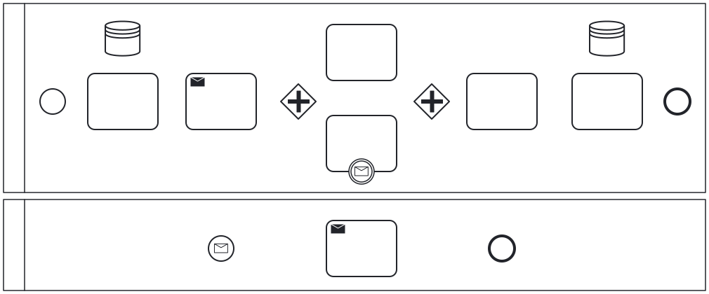

# Harjoitustehtävät

## Luku 2: Tehtävä 1

Jos tunnemme riittävän tarkasti prosessikulun, jolla yritys lähettää vuosittain 3 500 asiakkaalleen toimitusjohtajan käsin kirjaileman joulutervehdyksen postikortilla, tiedämme, että yhdeltä työntekijältä kuluu postimerkkien liimaamiseen noin 35 000 sekuntia eli noin 9 tuntia 45. Sopivan lyhyine taukoineen tämä vas-taa noin puoltatoista työpäivää. Jos postimerkkien liimaamiseen osallistuisikin neljä työntekijää, olisi urakka hoidettu noin 2,5 tunnissa. Säästäisimme aikaa, mutta nyt yksi prosessin vaihe sitoisi neljä työntekijää eli kuluttaisi hetkellisesti neljä kertaa enemmän henkilöstöresurssia. Vaiheen tarvitsemat henkilötyötun-nit säilyisivät kokonaisuudessaan kuitenkin tietysti suurin piirtein ennallaan. 

Joulukorttiprosessiasiantuntija saattaisi tässä vaiheessa myös harkita sellaisia joulukortteja, joiden postimaksu on valmiiksi maksettu. Yrityksen logolla varus-tettu joulukortti maksaa 50 senttiä ja siihen postimerkki 1,50 euroa. Näin ollen yksi postitusvalmis kortti postimerkkeineen maksaa kaksi euroa ja koko 3 500 kortin nippu 7 000 euroa. Punaisen Ristin joulukortti, jossa postimaksu on valmiiksi maksettu, maksaa 3,40 euroa kappaleelta, joten kortit maksaisivat yhteensä 11 900 euroa. Postimerkit itse liimaamalla yritys siis säästäisi joulukor-teissa ja postimerkeissä vuosittain 4 900 euroa. Ei tule kuitenkaan unohtaa postimerkkien liimaamiseen kuluvaa työaikaa, joka oli siis vajaat kymmenen tuntia.

Jos olisimme mittaroineet aiempien vuosien joulukorttiprosessja erityisen tarkasti, saattaisimme myös tietää, kuinka moni postimerkki repeää vihkosta irro-tettaessa liimauskelvottomaan kuntoon, kuinka moni joulukortti on ollut vekillä jo saapuessaan tai ruttaantuu merkkien liimaamisen aikana ja niin edelleen. Nämä ja monet muut tiedot, tai jonkinlaiset arviot niistä, voisimme myös syöttää prosessisimulaattoriin optimaalista tehokkuutta etsittäessä.

Sen ainakin tiedämme, että merkkien liimaamiseen osallistuvan henkilön tunti-palkka on 25 euroa, joten välittömät palkkakustannukset yhdeksän tunnin lii-mausurakasta ovat noin 225 euroa. Palkkakustannuksiin täytyy tietenkin lisätä muut kustannukset, kuten työnantajan sosiaaliturvamaksut, työterveyskulut, vakuutukset ja muut vastaavat. Nämä lisäkulut ovat tavallisesti vähintään 30 prosenttia palkasta, joten postimerkkien liimaamisen kustannukset nousisivat nyt lähelle 300 euroa. Postimerkit itse liimaamalla prosessin kustannukset olisivat kuitenkin edelleen noin 4 600 euroa matalammat kuin Punaisen Ristin joulukortteja käytettäessä. Tässä ei kuitenkaan tule unohtaa, että työntekijä tai työntekijät, jotka käyttävät tunteja postimerkkien liimaamiseen, ovat sen ajan poissa varsinaiseen toimenkuvaansa liittyvien tehtävien hoitamisesta. Mikä tuottotappio tästä seuraa, ja mitkä ovat sen kokonais- ja mahdolliset heijastus-kustannukset, riippuu lukuisista tekijöistä. Myös nämä tekijät tulisi tuntea, jotta prosessille voidaan valita ideaali toteutustapa.

Ja mikäli prosessiasiantuntijamme ei olisi vielä saanut tarpeekseen, voisi hän seuraavaksi yrityksen PR-vastaavan kannustamana ryhtyä selvittämään, ar-vottavatko asiakkaamme joulukorteissaan korkeammalle yrityksemme logon vai Punaisen Ristin logon. Jälkimmäinen voisi kenties viestiä asiakkaille yrityksen vastuullisesta arvopohjasta. Mutta johtavatko joulukortit palaaviin asiakkaisin ja lisämyyntiin? Tuottaako joulukorttiprosessi lopulta lainkaan arvoa vai ainoastaan kustannuksia?

Pohdi edellisen perusteella seuraavia kysymyksiä:

- Mitkä ovat prosessin kriittiset vaiheet ja mahdolliset pullonkaulat?
- Miten vaiheiden ajoitus ja resursointi vaikuttavat koko prosessin läpimenoaikaan?
- Analysoi, milloin on perusteltua käyttää useampia työntekijöitä verrattuna yhden työntekijän pidempään suoritukseen?
- Miten mittaisit, tuottaako prosessi yritykselle arvoa?

## Luku 2: Tehtävä 2

Selvitä, mitä tarkoittaa digitaalinen kaksonen eli digital twin. Kuinka se liittyy prosessisimulointiin vai liittyykö mitenkään?

## Luku 3: Tehtävä 1

Seuraavassa on esimerkki asiakastilauksia käsittelevässä roolissa työskentelevän henkilön haastattelusta. Haastattelu liittyy elektroniikkatuotteita myyvän verkkokaupan tilauskäsittelyprosessiin. Tutustu haastattelun transkriptioon ja laadi vuokaavio tai BPMN-malli prosessin nykytilasta. Nosta esille tunnistettavat kehittämiskohteet ja mieti, miten niihin voitaisiin reagoida.

**Milloin prosessi käynnistyy tai mikä sen käynnistää?**

Prosessi käynnistyy, kun asiakas tekee tilauksen verkkokaupassamme. Tämä voi tapahtua milloin tahansa, koska verkkokauppa toimii 24/7 ympäri vuoden.

**Kuinka usein prosessi suoritetaan?**

Päivittäin käsitellään noin 300 tilausta ja viikossa määrä on keskimäärin 2000 tilausta. Sesonkeina tilauksia on tietysti sitten paljon enemmän. Black Friday ja joulumyynti erityisesti tekevät piikkejä. Päivässä saatetaan myydä enemmän, kuin hiljaisempana aikana parissa viikossa.

**Voitko kuvailla, miten prosessi etenee?**

Ensimmäiseksi saapuu se tilaus verkkokaupan järjestelmään. Sitten tulee maksun vahvistus. Tämän jälkeen varaston tarkistus ja tilauksen keräily. Seuraavana pakkaaminen ja tilauksen lähettäminen asiakkaalle. Sitten seuranta ja toimituksen vahvistus. Ja lopuksi tähän kuuluu myös mahdolliset asiakaspalautteet, reklamaatiot ja palautukset.

**Mikä sinun vastuusi on prosessin eri vaiheissa?**

Olen vastuussa vaiheista 3-6 eli varaston tarkistuksesta toimituksen lähetykseen. Tarkistan, että tuote on varastossa, organisoin keräyksen ja pakkaamisen sekä huolehdin siitä, että lähetys lähtee ajoissa oikealla kuljetuspalvelulla.

**Mitä tietoja tarvitset näissä vaiheissa ja mistä saat nämä tiedot?**

Tarvitsen tiedon tilatusta tuotteesta ja sen varastotilanteesta. Se on saatavilla meidän ERP-järjestelmästämme. Pakkaamisvaiheessa tarvitaan tilauksen ominaisuudet ja sisältö. Nämä ovat saatavilla tilausjärjestelmästä. Lähettämistä varten tarvitaan asiakkaan osoite asiakastietokannasta ja valittu toimitustapa on ilmoitettu tilauksen yhteydessä tilausjärjestelmään. Tilausseurannassa tarvitaan kuljetusyritykseltä seurantanumero, joka saadaan integraatiolla logistiikkakumppanin järjestelmään.

**Mitä tietoja vaiheista lähtee eteenpäin ja minne tiedot menevät?**

Varastolle toimitetaan keräyslista (tuotteen nimi, määrä, varastopaikka) ja tilauksen yksilöllinen tunniste. Nämä tiedot menevät sisäisesti varastohenkilöstölle keräyslaitteisiin tai tulosteena. Pakkausvaiheessa tarvitaan pakkaussisältö, asiakkaan toimitustiedot, osoitekortti. Näitä tietoja tarvitaan pakkausjärjestelmää varten, toimitustietokortin tulostamiseen ja logistiikkaintegraatioon. Tilausta lähetettäessä tarvitaan taas vastaanottajan tiedot, lähetyksen seurantakoodi ja paketin mitat. Nämä tiedot toimitetaan kuljetusyhtiölle ja asiakkaalle itselleen tilauksen seurantaa varten. Seurantavaiheessa asiakkaalle menee toimitusvahvistus ja seurantalinkki. Asiakkaan lisäksi tiedot toimitetaan myös asiakaspalvelulle mahdollisia kyselyjä varten.

**Mitä tietojärjestelmiä käytät eri vaiheissa ja kuinka ne tukevat työtäsi?**

ERP-järjestelmästä näen varastosaldot ja tuoteinformaation. Tilaustenhallintajärjestelmästä näkyy asiakastilaukset ja niiden tila. Logistiikkaintegraation avulla muodostuvat osoitekortit ja seurantatunnukset automaattisesti. Pakkausjärjestelmä osaa automaattisesti määritellä pakkaustarpeet ja -materiaalit. Ihan aina ne eivät mene oikein. Siinä pakkaaja joutuu tekemään vähän muutoksia, jos tuotteet eivät mahdukaan ehdotettuun pakkaukseen tai tehdään sellaista tilanneharkintaa, että tilattu tuote on herkästi särkyvä ja se tarvitsee ylimääräisiä kuplamuoveja tai styrokseja. Meillä käytiin keskustelua, että pakattaisiin kaikki tilaukset varmuuden varalta yli, mutta päätettiin olla näin tekemättä, koska se olisi tuottanut aika paljon kustannuksia pakkaustyön vaatimassa ajassa, pakkausmateriaalien kulutuksessa ja ihan jo lähetettävien pakettien koon puolesta.

**Mitä prosessin lopputulemalta vaaditaan? Voiko prosessi jäädä tulematta valmiiksi?**

Lopputuloksen on oltava onnistunut toimitus oikealle asiakkaalle sovitussa ajassa. Prosessi voi jäädä kesken, jos tuotetta ei ole varastossa, maksua ei vahvisteta tai kuljetuksessa on häiriö.

**Onko prosessissa vaiheita, joissa se usein hidastuu tai kohtaa ongelmia?**

Kyllä, erityisesti varastotarkistuksessa ja kuljetuksessa.

**Mistä nämä johtuvat?**

Varastotilanne ei aina ole reaaliaikainen. Tästä syntyy ristiriitoja eli se melko tyypillinen verkkokauppojen ongelma, että myydään jokin tuote asiakkaalle ”Löytyy varastosta” -tiedolla, mutta sitä ei sitten välttämättä löydykään. Kuljetusyhtiöiden viiveet esimerkiksi ruuhkasesonkeina eivät tietenkään ole meidän vastuullamme, tai se ainakin on asia, jolle emme oikeastaan pysty mitään tekemään, mutta tietysti nämä ongelmat sitten kaatuvat meille. Jos henkilökohtaisen mielipiteeni voin tästä sanoa, niin minusta meidän ei missään tilanteessa pitäisi mennä siihen, että sälytetään ongelma jonkin toisen toimijan päälle, vaikka ongelma oikeasti olisikin siellä. ”Tämä ei ole enää meidän ongelmamme, joten kyselepä sieltä Postin tai Matkahuollon suunnasta.” Tilauksen tehnyt asiakas on meidän asiakkaamme ja tilausprosessi on meidän prosessimme. Tämä tietysti on hankala asia ja tällaisia aina tulee, kun vaikka logistiikkaa on pakko ulkoistaa.

Lisäksi joskus on satunnaisia teknisiä häiriöitä integraatioissa. Nämä useimmiten saadaan kyllä ratkottua niin, että ne eivät edes ehdi näkyä asiakkaalle.

**Mitä virhe- tai poikkeustilanteita prosessin aikana voi tapahtua?**

Tyypillisimmistä ainakin tuo, jonka jo kerroin, että tuote puuttuu varastosta, vaikka järjestelmä näyttää saatavuutta. Jonkin verran on myös tapauksia, joissa maksu ei jostain syystä vahvistu, eikä tilausta voida käsitellä. Joskus harvoin nämä ongelmat johtuvat integraatioista tai verkkopankkien häiriöistä. Tavallisesti kyseessä on kuitenkin asiakkaan tekemä virhe, mutta asiakas ei välttämättä ymmärrä, että maksu ei onnistunut. Sitten asiakas on parin viikon päästä vihainen ja soittaa asiakaspalveluun, että miksi tilausta ei ole toimitettu. Asiakaspalvelu tietysti silloin tilaustenhallintajärjestelmästä näkee, ettei tilauksesta ole tullut maksu perille eikä sitä ole vahvistettu. Tämä ei tietenkään korjaa sitä tilannetta, että kummilapsen joululahja on jäänyt saamatta, ja vika lopulta on taas meidän. 

Kiireisenä kausina tapahtuu jonkin verran sellaisia, että tilaus menee väärään osoitteeseen. Näihinkin virheisiin meillä on nykyisellään valitettavan vähän vaikuttamismahdollisuuksia.

Jonkin verran meidän päässämme tapahtuu sellaista, että tuote pakataan väärin, jolloin se on voinut sitten vaurioitua kuljetuksen aikana. Tällaisia käy kesälomakausilla huomattavasti enemmän, koska meillä on aika paljon lomatuuraajia, jotka eivät kokemuksen puutteen vuoksi osaa tehdä omaa harkintaa ja arviointia siinä pakkaamisessa, vaan menevät aina niillä pakkausjärjestelmän ehdottamilla minimeillä.

**Kuinka usein näitä virheitä tapahtuu?**

Noin muutama prosentti tilauksista kohtaa jonkinasteisen virheen. Suurin osa kuitenkin saadaan ratkaistua nopeasti asiakaspalvelun ja palautusprosessin avulla.

**Miten prosessia voisi mielestäsi parantaa? Liittyykö prosessikulkuun kehittämiskohteita?**

Kyllä. Erityisesti keräys- ja pakkausvaiheissa tehdään edelleen manuaalista työtä, joka on altis virheille. Kuljetusprosessissa ei aina saada välitöntä palautetta toimituksen tilasta, mikä vaikeuttaa poikkeamien hallintaa. Vaikka palautuksia käsitellään tehokkaasti, asiakasnäkökulmasta prosessi voisi olla sujuvampi; esimerkiksi nyt vaikka automaattinen palautuslomake ja seuranta.

**Tukevatko tietojärjestelmät prosessin toteuttamista?**

Osittain kyllä, mutta parannettavaakin löytyy. Tilaustenhallinta- ja ERP-järjestelmät tukevat hyvin tilauskäsittelyä ja varastotietoa. Logistiikkaintegraatiot toimivat pääosin hyvin, mutta joskus yhteydet ovat hitaita tai virhealttiita. Käyttöliittymät varastohenkilöstölle voisivat olla selkeämpiä. Nykyiset järjestelmät eivät ole optimoitu mobiilikäyttöön, mikä hidastaa keräilyä.

**Onko prosessi resursoitu riittävästi?**

Pääosin kyllä, mutta sesonkiaikoina resurssit ovat tiukoilla. Normaalikuormalla prosessi toimii sujuvasti, mutta kampanja- ja kausisesongeissa tarvitaan lisähenkilöstöä, josta sitten taas seuraa kaikenlaisia ongelmia, kuten äsken jo vähän kerroin. Logistiikkakumppaneiden kapasiteetti on joskus pullonkaula, erityisesti kuljetusten noutojen ja toimitusten osalta. IT-tuki ja järjestelmäkehitysresurssit ovat rajallisia, mikä hidastaa teknologisten parannusten toteutusta, vaikka pistemäiset vikatilanteet kyllä saadaankin tyypillisesti korjattua todella nopeasti.

## Luku 3: Tehtävä 2

Piirrä edellisen tapapahtumalokiesimerkin @tbl-tapahtumaloki perusteella hahmotelma sydänpäivystyksen prosessikulusta. Huomaa, että yllä olevassa lokissa on esitetty ainoastaan yksi potilastapaus. Mieti, mitä vaihtoehtoisia kulkuja prosessiin voi liittyä.

## Luku 4: Tehtävä 1

Seuraavassa BPMN-mallissa esitetään perunankuorinnan prosessi. Mitä, millä mittareilla tätä prosessia voisi arvioida. Entä liittyykö prosessiin hukkaa ja voisiko prosessia jollain tavalla kehittää?

## Luku 4: Tehtävä 2

Kuvitellaan tilanne, jossa erään kunnan viranomaisen rakennuslupia käsittelevän prosessin tuottamista päätöksistä valitetaan lähes 20 prosentissa tapauksista. Kuinka lähtisit purkamaan tilannetta ja selvittämään, mistä asikkaiden huono tyytyväisyys johtuu?

## Luku 4: Tehtävä 3

Tuttavasi on asettanut tavoitteekseen katsoa mahdollisimman lyhyessä ajassa 50 sellaista elokuvaa, jotka hän kokee katselun jälkeen erinomaisiksi. Suunnittele tätä tavoitetta tukevat prosessimittarit, joiden avulla tuttavasi voi seurata edistymistään ja tarvittaessa optimoida suoritustaan projektin edetessä.

## Luku 4: Tehtävä 4

Mieti millaisia mittareita voitaisiin käyttää erilaisia tietotyön asiantuntijatehtävien prosesseja mitattaessa?

## Luku 5: Tehtävä 1

Mitä muutoksia pizzerian prosessi ([@fig-pizzatilaus-teht]) tarvitsisi, jotta raaka-aineiden loppuminen ei pääsisi aiheuttamaan suurempia ongelmia?

Entä olisiko tilanne korjattavissa jollain IT-ratkaisulla ja miten sellainen vaikuttaisi prosessikulkuun?

{#fig-pizzatilaus-teht}

## Luku 6: Tehtävä 1

Jo useamman kerran esiintynyt prosessimalli pizzan tilaamisesta on vakiinnuttanut asemansa osana BPMN:n ohje- ja koulutusmateriaaleja. Kuinka ymmärrettävä malli tässä sinusta tässä vaiheessa on? Onko siinä joitain vähemmän ilmeisiä osia?

## Luku 6: Tehtävä 2

Mieti jotain omaan arkeesi liittyvää prosessia, johon kuuluu vähintään kaksi uima-allasta ja joissa molemmissa on vähintään kaksi uimarataa.

## Luku 6: Tehtävä 3

Päivitä edellistä pizzan tilaamisen prosessikulkua niin, että tilauksen toimittaa Wolt tai vastaava lähettipalvelu.

## Luku 6: Tehtävä 4

Lisää seuraavaan prosessimalliin ([@fig-flow-t]) siitä puuttuvat Sequence Flow-, Message Flow- ja Data Association -yhteydet.

{#fig-flow-t}

## Luku 6: Tehtävä 5

Laadi looginen prosessimalli ostoksilla käynnistä. Käytä mallissa viittä perusmuotoista tehtäväelementtiä ja nimeä tehtävät verbi-objekti-muotoon.

## Luku 6: Tehtävä 6

Laadi valitsemastasi aiheesta looginen prosessimalli, jossa käytät seuraavia tehtävätyyppejä tässä järjestyksessä: Manual Task, User Task, Manual Task, User Task, Manual Task.

## Luku 6: Tehtävä 7

Toteuta @fig-dmn-hakemus :n valintataulu valintaporttien avulla.

{#fig-dmn-hakemus}

## Luku 6: Tehtävä 8

Piirrä seuraava tapahtumasarja prosessiksi ja käytä mallissa myös Service Task-, Script Task- ja Business Rule Task -tehtäviä.

1. Vastaanota tilaus.
2. Arvioi kampanja-alennus.
3. Tarkista maksu ulkoisesta maksupalvelusta.
4. Päivitä varastosaldot ERP-järjestelmään.
5. Muodosta pakkauslistat tilauksen riveistä.
6. Tilaa nuoto kuljetusliikkeeltä.
7. Lähetä tilausvahvistus asiakkaalle.
8. Päätä prosessi.

## Luku 6: Tehtävä 9

Mallinna prosessi, johon osallistuvat verkkokauppa ja logistiikkayritys. Prosessiin kuuluvat tehtävät on lueteltu alla satunnaisessa järjestyksessä. Järjestä tehtävät oikeaan etenemisjärjestykseen ja sijoittele ne verkkokaupan ja logistiikkayrityksen altaisiin. Käytä mallissa Send Task- ja Receive Task -tehtäviä aina, kun se on aiheellista.

1. Vastaanota muutospäätös.
2. Tarkista kuljetuskapasiteetti.
3. Lähetä muutospäätös.
4. Valmistele tilaus noutoa varten.
5. Vastaanota noutopyyntö.
6. Lähetä noutoajan muutospyyntö.
7. Päätä muutos (hyväksy/hylkää).
8. Lähetä noutopyyntö.
9. Vastaanota noutovahvistus.
10. Päivitä tilaus.
11. Lähetä noutovahvistus.
12. Vastaanota muutospyyntö.

## Luku 6: Tehtävä 10

Muuta seuraavaa tilauskäsittelyprosessia niin, että kanta-asiakkaat saavat tilauksistaan 10 % alennuksen.

{#fig-tilauskäsittely}

## Luku 6: Tehtävä 11

Toteuta seuraava päätöstaulu valintaporteilla.

{#fig-dmn-paatostaulu}

## Luku 6: Tehtävä 12

Jaa seuraavat tehtävät aliprosesseiksi. Nimeä aliprosessit loogisella tavalla ja yhdistä ne toisiinsa järjestysvirroilla. Huomaa, että tehtävät on esitetty alla aakkosjärjestyksessä, ei välttämättä niiden suoritusjärjestyksessä.

- Hyvitä maksu
- Kerää ja pakkaa
- Kuittaa maksu
- Käsittele maksun epäonnistuminen
- Käsittele palautus
- Käsittele tilauksen peruutus
- Laske hinta ja verot
- Lähetä lasku
- Lähetä vahvistus asiakkaalle
- Luo lasku
- Luo rahtitarra
- Luo tilausvahvistus
- Luovuta kuljetusyhtiölle
- Päivitä CRM-tilausstatus
- Seuraa lähetystä
- Sovella alennukset
- Sulje tapaus
- Tarkasta petosindikaattorit
- Tarkasta varastotilanne
- Varaa varasto
- Vastaanota tilaus
- Validioi asiakastiedot
- Validioi tilausrivit

## Luku 6: Tehtävä 13

Mallinna vastaava prosessikulku ilman Loop-tehtävää.

{#fig-loop}

## Luku 6: Tehtävä 14

Laadi Parallel ja Sequential Multi-instance -tehtäviä käyttävä prosessimalli, joka pystyy käsittelemään samaan tilaukseen sisältyviä fyysisiä tuotteita sekä digitaalisten palvelujen käyttöoikeuksia.

## Luku 6: Tehtävä 15

## Luku 6: Tehtävä 16

Lisää seuraavaan prosessiin ei-keskeyttävä Message Boundary Event, joka ottaa vastaan asiakkaan tilaukseensa tekemän muutoksen, sekä sen käynnistämä polku.

{#fig-eventteja3}

## Luku 6: Tehtävä 17

Piirrä seuraavasta tapahtumakulusta prosessimalli, jossa hyödynnät Message Boundary Eventejä.

Prosessi alkaa, kun asiakas lähettää tukipyynnön sähköistä lomaketta käyttäen. Järjestelmä luo yhteydenoton perusteella tukipyynnön ja lähettää asiakkaalle vahvistusviestin. Tukihenkilö valmistelee vastauksen. Jos asiakas vastaa vahvistusviestiin lisätiedoilla kesken valmistelun, viesti keskeyttää tehtävän ja ohjaa polun “Lisätietojen tarkistus” -aliprosessiin. Jos vastausta ei tule, valmistelu jatkuu normaalisti ja tukihenkilö lähettää vastauksen. Vastauksen lähetyksen jälkeen prosessi päättyy.

## Luku 6: Tehtävä 18

Piirrä seuraavasta tapahtumakulusta prosessimalli, jossa hyödynnät ehdollisia tapahtumia.

Kun lasku saapuu, prosessi käynnistyy Message Start Eventillä. Seuraavaksi lasku tarkistetaan. Jos laskun summa on yli 5 000 € ja toimittaja ei ole hyväksyttyjen toimittajien listalla, siirrytään tehtävään ”Hanki lisähyväksyntä”. Muutoin edetään suoraan tehtävään ”Kirjaa lasku”. Jos laskusta puuttuu joitain pakollisten kenttien tietoja, lasku palautetaan.

## Luku 6: Tehtävä 19

Miten seuraavat prosessimallit tulkitaan?

## Luku 6: Tehtävä 20

1. Ilmaise vuoden viikon 42 maanantai ISO 8601 -standardin mukaisena päivämääränä käyttäen viikkonumerointia.
2. Muunna tapahtuma, joka alkaa 2025-12-06 klo 09:00 Europe/Helsinki, ISO 8601 -muotoon sisältäen aikavyöhykkeen offseting ja UTC-vastineen.
3. Esitä 2 tuntia 30 minuuttia ISO 8601 -keston merkintänä ja lisää siihen 15 minuutin tauko erillisenä kesto-osana.
4. Kirjoita jakso maanantaista torstaihin klo 09:00-16:00 yhtenä ISO 8601 -aikavälinä, joka sisältää päivämäärät ja kellonajat.
5. Esitä viikoittainen luento, joka pidetään joka keskiviikko klo 12:15-13:45 tammi-maaliskuussa 2026, ISO 8601 -aikavälinä ja liitä mukaan toistuvuutta kuvaava sääntö käyttäen standardin mukaisia rakenteita.

## Luku 6: Tehtävä 21

Ajatellaan jotain systeemiä, jolla on useita samanaikaisia käyttäjiä. Yksi käyttäjistä käynnistää prosessin, jossa prosessimuuttujan `luku1` numeroarvosta siirretään puolet muuttujan `luku2` arvoon. Jokin tehtävä lukee ensin `luku1`:n lähtöarvon ja vähentää siitä puolet. Mikäli `luku2`:n arvon kasvattaminen `luku1`:n puolikkaalla jostain teknisestä tai vaikka liiketoimintasääntöön perustuvasta syystä kuitenkin epäonnistuu, transaktiomuotoisessa suorituksessa prosessi keskeytetään (*Abort*) ja systeemi palautetaan sen alkuperäiseen tilaan (*Rollback*). On kuitenkin mahdollista, että systeemin toinen käyttäjä on tällä välin päivittänyt `luku1`:n arvoa, jolloin alkuperäisen tilan palauttaminen rollback-operaatiolla hävittää myös toisen käyttäjän tekemän muutoksen.

Suunnittele kompensoiva rakenne, joka pitää systeemin tietojen arvot oikeina kaikissa tapauksissa.

Toimiiko suunnittelemasi kompensaatio, mikäli `luku1`:n arvo ei saa koskaan mennä alle nollan?

## Luku 6: PALJON PIENIÄ BPMN-TEHTÄVIÄ

Pikkutehtäviin mallivastaukset. Käytä Claudea.

Jaa tehtävät bpmn-tehtäviin ja muihin?