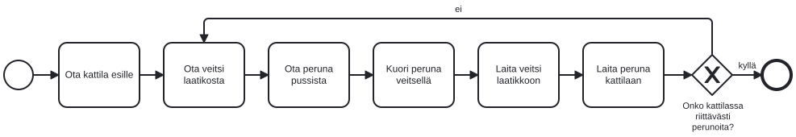
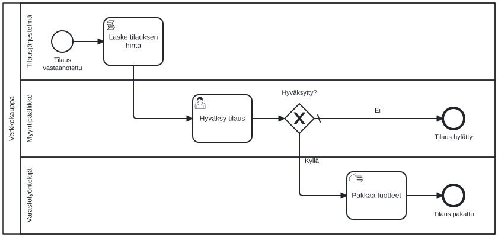
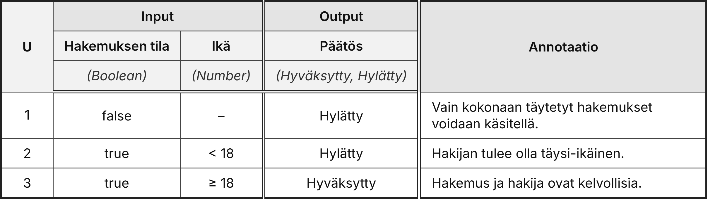
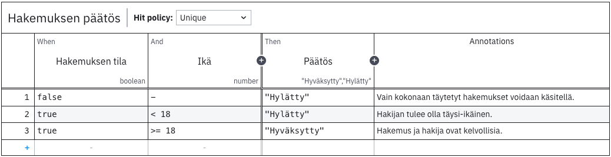
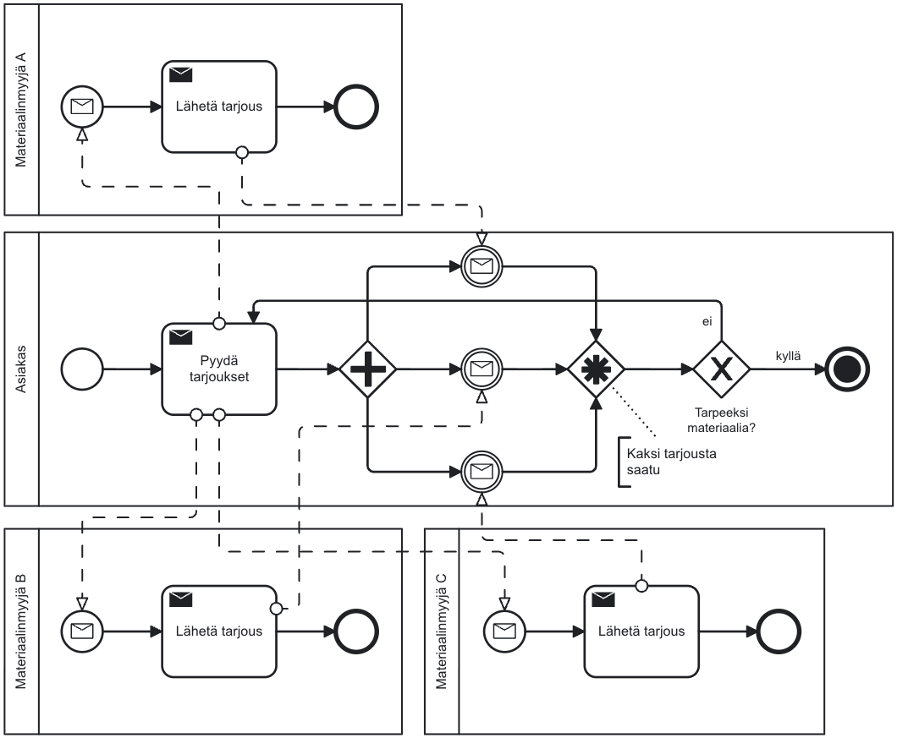
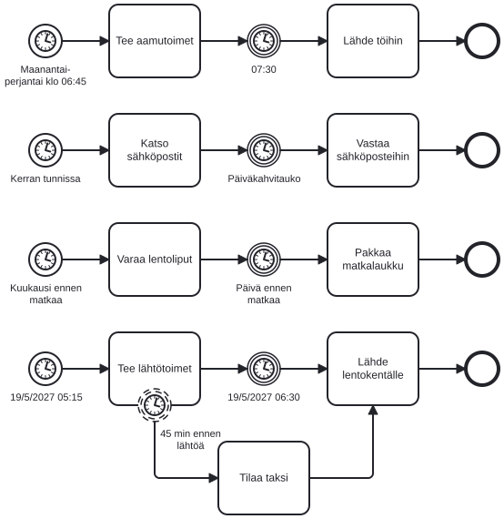
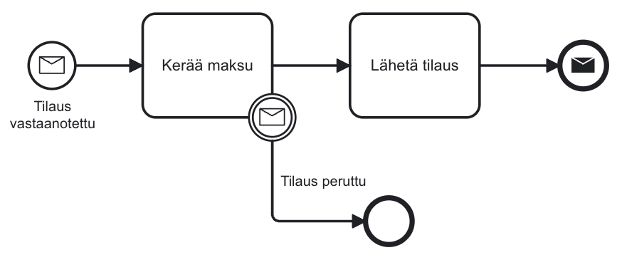
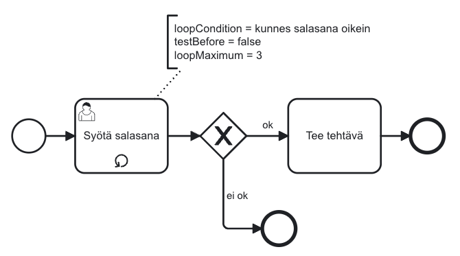

# Harjoitustehtäviä

## Tehtävä 1

Jos tunnemme riittävän tarkasti prosessikulun, jolla yritys lähettää vuosittain 3 500 asiakkaalleen toimitusjohtajan käsin kirjaileman joulutervehdyksen postikortilla, tiedämme, että yhdeltä työntekijältä kuluu postimerkkien liimaamiseen noin 35 000 sekuntia eli noin 9 tuntia 45 minuuttia. Sopivan lyhyine taukoineen tämä vastaa noin puoltatoista työpäivää. Jos postimerkkien liimaamiseen osallistuisikin neljä työntekijää, olisi urakka hoidettu noin 2,5 tunnissa. Säästäisimme aikaa, mutta nyt yksi prosessin vaihe sitoisi neljä työntekijää eli kuluttaisi hetkellisesti neljä kertaa enemmän henkilöstöresurssia. Vaiheen tarvitsemat henkilötyötunnit säilyisivät kokonaisuudessaan kuitenkin tietysti suurin piirtein ennallaan. 

Joulukorttiprosessiasiantuntija saattaisi tässä vaiheessa myös harkita sellaisia joulukortteja, joiden postimaksu on valmiiksi maksettu. Yrityksen logolla varustettu joulukortti maksaa 50 senttiä ja siihen postimerkki 1,50 euroa. Näin ollen yksi postitusvalmis kortti postimerkkeineen maksaa kaksi euroa ja koko 3 500 kortin nippu 7 000 euroa. Punaisen Ristin joulukortti, jossa postimaksu on valmiiksi maksettu, maksaa 3,40 euroa kappaleelta, joten kortit maksaisivat yhteensä 11 900 euroa. Postimerkit itse liimaamalla yritys siis säästäisi joulukorteissa ja postimerkeissä vuosittain 4 900 euroa. Ei tule kuitenkaan unohtaa postimerkkien liimaamiseen kuluvaa työaikaa, joka oli siis vajaat kymmenen tuntia.

Jos olisimme mittaroineet aiempien vuosien joulukorttiprosessia erityisen tarkasti, saattaisimme myös tietää, kuinka moni postimerkki repeää vihkosta irrotettaessa liimauskelvottomaan kuntoon, kuinka moni joulukortti on ollut vekillä jo saapuessaan tai ruttaantuu merkkien liimaamisen aikana ja niin edelleen. Nämä ja monet muut tiedot, tai jonkinlaiset arviot niistä, voisimme myös syöttää prosessisimulaattoriin optimaalista tehokkuutta etsittäessä.

Sen ainakin tiedämme, että merkkien liimaamiseen osallistuvan henkilön tuntipalkka on 25 euroa, joten välittömät palkkakustannukset yhdeksän tunnin liimausurakasta ovat noin 225 euroa. Palkkakustannuksiin täytyy tietenkin lisätä muut kustannukset, kuten työnantajan sosiaaliturvamaksut, työterveyskulut, vakuutukset ja muut vastaavat. Nämä lisäkulut ovat tavallisesti vähintään 30 prosenttia palkasta, joten postimerkkien liimaamisen kustannukset nousisivat nyt lähelle 300 euroa. Postimerkit itse liimaamalla prosessin kustannukset olisivat kuitenkin edelleen noin 4 600 euroa matalammat kuin Punaisen Ristin joulukortteja käytettäessä. Tässä ei kuitenkaan tule unohtaa, että työntekijä tai työntekijät, jotka käyttävät tunteja postimerkkien liimaamiseen, ovat sen ajan poissa varsinaiseen toimenkuvaansa liittyvien tehtävien hoitamisesta. Mikä tuottotappio tästä seuraa, ja mitkä ovat sen kokonais- ja mahdolliset heijastuskustannukset, riippuu lukuisista tekijöistä. Myös nämä tekijät tulisi tuntea, jotta prosessille voidaan valita ideaali toteutustapa.

Ja mikäli prosessiasiantuntijamme ei olisi vielä saanut tarpeekseen, voisi hän seuraavaksi yrityksen PR-vastaavan kannustamana ryhtyä selvittämään, arvottavatko asiakkaamme joulukorteissaan korkeammalle yrityksemme logon vai Punaisen Ristin logon. Jälkimmäinen voisi kenties viestiä asiakkaille yrityksen vastuullisesta arvopohjasta. Mutta johtavatko joulukortit palaaviin asiakkaisiin ja lisämyyntiin? Tuottaako joulukorttiprosessi lopulta lainkaan arvoa vai ainoastaan kustannuksia?

Pohdi edellisen perusteella seuraavia kysymyksiä:

- Mitkä ovat prosessin kriittiset vaiheet ja mahdolliset pullonkaulat?
- Miten vaiheiden ajoitus ja resursointi vaikuttavat koko prosessin läpimenoaikaan?
- Milloin on perusteltua käyttää useampia työntekijöitä yhden työntekijän pidemmän suorituksen sijaan?
- Miten mittaisit, tuottaako prosessi yritykselle arvoa?

## Tehtävä 2

Selvitä, mitä tarkoittaa digitaalinen kaksonen eli digital twin. Liittyykö se prosessisimulointiin, ja jos liittyy, niin miten?

## Tehtävä 3

Seuraavassa on esimerkki asiakastilauksia käsittelevässä roolissa työskentelevän henkilön haastattelusta. Haastattelu liittyy elektroniikkatuotteita myyvän verkkokaupan tilauskäsittelyprosessiin. Tutustu haastattelun transkriptioon ja laadi vuokaavio tai BPMN-malli prosessin nykytilasta. Nosta esille tunnistettavat kehittämiskohteet ja mieti, miten niihin voitaisiin reagoida.

**Milloin prosessi käynnistyy tai mikä sen käynnistää?**

Prosessi käynnistyy, kun asiakas tekee tilauksen verkkokaupassamme. Tämä voi tapahtua milloin tahansa, koska verkkokauppa toimii 24/7 ympäri vuoden.

**Kuinka usein prosessi suoritetaan?**

Päivittäin käsitellään noin 300 tilausta ja viikossa määrä on keskimäärin 2000 tilausta. Sesonkeina tilauksia on tietysti sitten paljon enemmän. Black Friday ja joulumyynti erityisesti tekevät piikkejä. Päivässä saatetaan myydä enemmän kuin hiljaisempana aikana parissa viikossa.

**Voitko kuvailla, miten prosessi etenee?**

Ensimmäiseksi saapuu se tilaus verkkokaupan järjestelmään. Sitten tulee maksun vahvistus. Tämän jälkeen varaston tarkistus ja tilauksen keräily. Seuraavana pakkaaminen ja tilauksen lähettäminen asiakkaalle. Sitten seuranta ja toimituksen vahvistus. Ja lopuksi tähän kuuluu myös mahdolliset asiakaspalautteet, reklamaatiot ja palautukset.

**Mikä sinun vastuusi on prosessin eri vaiheissa?**

Olen vastuussa vaiheista 3-6 eli varaston tarkistuksesta toimituksen lähetykseen. Tarkistan, että tuote on varastossa, organisoin keräyksen ja pakkaamisen sekä huolehdin siitä, että lähetys lähtee ajoissa oikealla kuljetuspalvelulla.

**Mitä tietoja tarvitset näissä vaiheissa ja mistä saat nämä tiedot?**

Tarvitsen tiedon tilatusta tuotteesta ja sen varastotilanteesta. Se on saatavilla meidän ERP-järjestelmästämme. Pakkaamisvaiheessa tarvitaan tilauksen ominaisuudet ja sisältö. Nämä ovat saatavilla tilausjärjestelmästä. Lähettämistä varten tarvitaan asiakkaan osoite asiakastietokannasta ja valittu toimitustapa on ilmoitettu tilauksen yhteydessä tilausjärjestelmään. Tilausseurannassa tarvitaan kuljetusyritykseltä seurantanumero, joka saadaan integraatiolla logistiikkakumppanin järjestelmään.

**Mitä tietoja vaiheista lähtee eteenpäin ja minne tiedot menevät?**

Varastolle toimitetaan keräyslista (tuotteen nimi, määrä, varastopaikka) ja tilauksen yksilöllinen tunniste. Nämä tiedot menevät sisäisesti varastohenkilöstölle keräyslaitteisiin tai tulosteena. Pakkausvaiheessa tarvitaan pakkaussisältö, asiakkaan toimitustiedot, osoitekortti. Näitä tietoja tarvitaan pakkausjärjestelmää varten, toimitustietokortin tulostamiseen ja logistiikkaintegraatioon. Tilausta lähetettäessä tarvitaan taas vastaanottajan tiedot, lähetyksen seurantakoodi ja paketin mitat. Nämä tiedot toimitetaan kuljetusyhtiölle ja asiakkaalle itselleen tilauksen seurantaa varten. Seurantavaiheessa asiakkaalle menee toimitusvahvistus ja seurantalinkki. Asiakkaan lisäksi tiedot toimitetaan myös asiakaspalvelulle mahdollisia kyselyjä varten.

**Mitä tietojärjestelmiä käytät eri vaiheissa ja kuinka ne tukevat työtäsi?**

ERP-järjestelmästä näen varastosaldot ja tuoteinformaation. Tilaustenhallintajärjestelmästä näkyy asiakastilaukset ja niiden tila. Logistiikkaintegraation avulla muodostuvat osoitekortit ja seurantatunnukset automaattisesti. Pakkausjärjestelmä osaa automaattisesti määritellä pakkaustarpeet ja -materiaalit. Ihan aina ne eivät mene oikein. Siinä pakkaaja joutuu tekemään vähän muutoksia, jos tuotteet eivät mahdukaan ehdotettuun pakkaukseen tai tehdään sellaista tilanneharkintaa, että tilattu tuote on herkästi särkyvä ja se tarvitsee ylimääräisiä kuplamuoveja tai styrokseja. Meillä käytiin keskustelua, että pakattaisiin kaikki tilaukset varmuuden varalta yli, mutta päätettiin olla näin tekemättä, koska se olisi tuottanut aika paljon kustannuksia pakkaustyön vaatimassa ajassa, pakkausmateriaalien kulutuksessa ja ihan jo lähetettävien pakettien koon puolesta.

**Mitä prosessin lopputulemalta vaaditaan? Voiko prosessi jäädä tulematta valmiiksi?**

Lopputuloksen on oltava onnistunut toimitus oikealle asiakkaalle sovitussa ajassa. Prosessi voi jäädä kesken, jos tuotetta ei ole varastossa, maksua ei vahvisteta tai kuljetuksessa on häiriö.

**Onko prosessissa vaiheita, joissa se usein hidastuu tai kohtaa ongelmia?**

Kyllä, erityisesti varastotarkistuksessa ja kuljetuksessa.

**Mistä nämä johtuvat?**

Varastotilanne ei aina ole reaaliaikainen. Tästä syntyy ristiriitoja eli se melko tyypillinen verkkokauppojen ongelma, että myydään jokin tuote asiakkaalle ”Löytyy varastosta” -tiedolla, mutta sitä ei sitten välttämättä löydykään. Kuljetusyhtiöiden viiveet esimerkiksi ruuhkasesonkeina eivät tietenkään ole meidän vastuullamme, tai se ainakin on asia, jolle emme oikeastaan pysty mitään tekemään, mutta tietysti nämä ongelmat sitten kaatuvat meille. Jos henkilökohtaisen mielipiteeni voin tästä sanoa, niin minusta meidän ei missään tilanteessa pitäisi mennä siihen, että sälytetään ongelma jonkin toisen toimijan päälle, vaikka ongelma oikeasti olisikin siellä. ”Tämä ei ole enää meidän ongelmamme, joten kyselepä sieltä Postin tai Matkahuollon suunnasta.” Tilauksen tehnyt asiakas on meidän asiakkaamme ja tilausprosessi on meidän prosessimme. Tämä tietysti on hankala asia ja tällaisia aina tulee, kun vaikka logistiikkaa on pakko ulkoistaa.

Lisäksi joskus on satunnaisia teknisiä häiriöitä integraatioissa. Nämä useimmiten saadaan kyllä ratkottua niin, että ne eivät edes ehdi näkyä asiakkaalle.

**Mitä virhe- tai poikkeustilanteita prosessin aikana voi tapahtua?**

Tyypillisimmistä ainakin tuo, jonka jo kerroin, että tuote puuttuu varastosta, vaikka järjestelmä näyttää saatavuutta. Jonkin verran on myös tapauksia, joissa maksu ei jostain syystä vahvistu, eikä tilausta voida käsitellä. Joskus harvoin nämä ongelmat johtuvat integraatioista tai verkkopankkien häiriöistä. Tavallisesti kyseessä on kuitenkin asiakkaan tekemä virhe, mutta asiakas ei välttämättä ymmärrä, että maksu ei onnistunut. Sitten asiakas on parin viikon päästä vihainen ja soittaa asiakaspalveluun, että miksi tilausta ei ole toimitettu. Asiakaspalvelu tietysti silloin tilaustenhallintajärjestelmästä näkee, ettei tilauksen maksu ole tullut perille eikä sitä ole vahvistettu. Tämä ei tietenkään korjaa sitä tilannetta, että kummilapsen joululahja on jäänyt saamatta, ja vika lopulta on taas meidän. 

Kiireisinä kausina tapahtuu jonkin verran sellaisia, että tilaus menee väärään osoitteeseen. Näihinkin virheisiin meillä on nykyisellään valitettavan vähän vaikuttamismahdollisuuksia.

Jonkin verran meidän päässämme tapahtuu sellaista, että tuote pakataan väärin, jolloin se on voinut sitten vaurioitua kuljetuksen aikana. Tällaisia käy kesälomakausilla huomattavasti enemmän, koska meillä on aika paljon lomatuuraajia, jotka eivät kokemuksen puutteen vuoksi osaa tehdä omaa harkintaa ja arviointia siinä pakkaamisessa, vaan menevät aina niillä pakkausjärjestelmän ehdottamilla minimeillä.

**Kuinka usein näitä virheitä tapahtuu?**

Noin muutama prosentti tilauksista kohtaa jonkinasteisen virheen. Suurin osa kuitenkin saadaan ratkaistua nopeasti asiakaspalvelun ja palautusprosessin avulla.

**Miten prosessia voisi mielestäsi parantaa? Liittyykö prosessikulkuun kehittämiskohteita?**

Kyllä. Erityisesti keräys- ja pakkausvaiheissa tehdään edelleen manuaalista työtä, joka on altis virheille. Kuljetusprosessissa ei aina saada välitöntä palautetta toimituksen tilasta, mikä vaikeuttaa poikkeamien hallintaa. Vaikka palautuksia käsitellään tehokkaasti, asiakasnäkökulmasta prosessi voisi olla sujuvampi; esimerkiksi nyt vaikka automaattinen palautuslomake ja seuranta.

**Tukevatko tietojärjestelmät prosessin toteuttamista?**

Osittain kyllä, mutta parannettavaakin löytyy. Tilaustenhallinta- ja ERP-järjestelmät tukevat hyvin tilauskäsittelyä ja varastotietoa. Logistiikkaintegraatiot toimivat pääosin hyvin, mutta joskus yhteydet ovat hitaita tai virhealttiita. Käyttöliittymät varastohenkilöstölle voisivat olla selkeämpiä. Nykyiset järjestelmät eivät ole optimoitu mobiilikäyttöön, mikä hidastaa keräilyä.

**Onko prosessi resursoitu riittävästi?**

Pääosin kyllä, mutta sesonkiaikoina resurssit ovat tiukoilla. Normaalikuormalla prosessi toimii sujuvasti, mutta kampanja- ja kausisesongeissa tarvitaan lisähenkilöstöä, josta sitten taas seuraa kaikenlaisia ongelmia, kuten äsken jo vähän kerroin. Logistiikkakumppaneiden kapasiteetti on joskus pullonkaula, erityisesti kuljetusten noutojen ja toimitusten osalta. IT-tuki ja järjestelmäkehitysresurssit ovat rajallisia, mikä hidastaa teknologisten parannusten toteutusta, vaikka pistemäiset vikatilanteet kyllä saadaankin tyypillisesti korjattua todella nopeasti.

## Tehtävä 4

Piirrä luvun 3 tapahtumalokiesimerkin (@tbl-tapahtumaloki) perusteella hahmotelma sydänpäivystyksen prosessikulusta. Huomaa, että lokissa on esitetty ainoastaan yksi potilastapaus. Mieti, mitä vaihtoehtoisia kulkuja prosessiin voi liittyä.

## Tehtävä 5

Seuraavassa BPMN-mallissa esitetään perunankuorinnan prosessi. Millä mittareilla tätä prosessia voisi arvioida? Entä liittyykö prosessiin hukkaa ja voisiko prosessia jollain tavalla kehittää?

{#fig-perunankuorinta-teht}

## Tehtävä 6

Kuvitellaan tilanne, jossa erään kunnan viranomaisen rakennuslupia käsittelevän prosessin tuottamista päätöksistä valitetaan lähes 20 prosentissa tapauksista. Kuinka lähtisit purkamaan tilannetta ja selvittämään, mistä asiakkaiden tyytymättömyys johtuu?

## Tehtävä 7

Tuttavasi on asettanut tavoitteekseen katsoa mahdollisimman lyhyessä ajassa 50 sellaista elokuvaa, jotka hän kokee katselun jälkeen erinomaisiksi. Suunnittele tätä tavoitetta tukevat prosessimittarit, joiden avulla tuttavasi voi seurata edistymistään ja tarvittaessa optimoida suoritustaan projektin edetessä.

## Tehtävä 8

Mieti, millaisia mittareita voitaisiin käyttää erilaisia tietotyön asiantuntijatehtävien prosesseja mitattaessa?

## Tehtävä 9

Mitä muutoksia tekstissä useampaankin kertaan esiintynyt pizzerian prosessi tarvitsisi, jotta raaka-aineiden loppuminen ei pääsisi aiheuttamaan suurempia ongelmia?

Entä olisiko tilanne korjattavissa jollain IT-ratkaisulla ja miten sellainen vaikuttaisi prosessikulkuun?

## Tehtävä 10

Tee verkkokaupan tilauskäsittelyn prosessikortista versio, joka soveltuisi käytettäväksi henkilöstön työpajassa. Käytä visuaalisia tunnuksia, kuten emojeita sekä värikoodausta, jotka helpottavat kortin hahmottamista. Pyri infografiikkamaiseen ilmeeseen: kortin tulisi mahtua yhdelle dialle.

| Kohta | Kuvaus |
|-------|--------|
| **Prosessin nimi** | Verkkokaupan tilauskäsittely |
| **Tavoite** | Varmistaa tilauksen oikea ja ajantasainen käsittely ja toimitus sekä asiakastyytyväisyys. |
| **Prosessin alku** | Asiakas tekee tilauksen verkkokaupassa. |
| **Prosessin loppu** | Tilaus on toimitettu asiakkaalle ja tilaus suljettu järjestelmässä. |
| **Keskeiset vaiheet** | 1. Tilauksen vastaanotto järjestelmään. 2. Maksun varmistus. 3. Tuotteiden keräys ja pakkaus. 4. Toimituksen organisointi. 5. Lähetyksen seuranta ja viestintä asiakkaalle. |
| **Prosessin omistaja** | Verkkokaupan tilausvastaava. |
| **Osallistujat** | Tilausvastaava, varastotyöntekijät, logistiikkakumppanit, asiakaspalvelu. |
| **KPI-mittarit** | 1. Tilausten käsittelyaika. 2. Toimitusten oikeellisuus. 3. Asiakaspalautteet. 4. Palautusprosentti. |
| **Liittyvät prosessit** | Asiakaspalvelu, palautusten käsittely, varastonhallinta, maksuliikenne. |
| **IT-järjestelmät** | Verkkokauppa-alusta, maksupalvelut, varastonhallintajärjestelmä, kuljetusjärjestelmät. |

## Tehtävä 11

Yritä piirtää pizzan tilaaminen (@fig-pizzatilaus.svg) tai Complex Gateway -esimerkkiprosessi (@fig-complex-esim-teht) vuokaaviotekniikkaa käyttäen. Vuokaavion piirtämiseen voi käyttää esimerkiksi Draw.io -välinettä: https://draw.io.

## Tehtävä 12

Laske uuden työntekijän rekrytoinnin prosessille kunkin tehtävän ES-, EF-, LS- ja LF-arvot sekä pelivara, ja tunnista kriittinen polku. Voit täyttää arvot projektiverkon pohjaan (@fig-cpm-teht). Mikä on prosessin vähimmäiskesto?

| Tunnus | Uuden työntekijän rekrytointi | Kesto (pv) | Edeltävät tehtävät |
|:------:|-------------------------------|:----------:|:------------------:|
| A | Luo työsopimus | 1 | – |
| B | Tilaa työvälineet | 4 | A |
| C | Luo käyttäjätunnukset | 1 | A |
| D | Tilaa kulkulupa ja avaimet | 2 | A |
| E | Valmistele työpiste | 2 | B, C, D |
| F | Laadi perehdytyssuunnitelma | 2 | B, C, D |
| G | Aikatauluta tapaamiset | 2 | E |
| H | Tiimiperehdytys | 2 | F |
| I | Perehdytä teknisiin työvälineisiin | 4 | F |
| J | Mentoritapaaminen | 2 | G |
| K | Sidosryhmätapaamiset | 5 | G |
| L | Rekrytoinnin palautekeskustelu | 1 | H, I, J, K |

: Uuden työntekijän rekrytoinnin tehtävät, kestot ja riippuvuudet {#tbl-rekrytointi-teht}

{#fig-cpm-teht}

## Tehtävä 13

Keksi muutama hyödyllinen prosessien hallintaa tai analysointia tukeva näkymä, jotka voitaisiin rakentaa kokonaisarkkitehtuuri-informaation perusteella. Näkymät voivat olla esimerkiksi lämpökartta- tai liikennevalotyylisiä, kojetaulutyyppisiä mittaristoja, numeerisia yhteenvetoja, eri arkkitehtuurinäkökulmia yhdistäviä graafisia malleja tai muita vastaavia.

## Tehtävä 14

Anna tehtävän 3 haastattelutranskriptio jollekin kielimallille ja pyydä sitä tunnistamaan prosessin vaiheet, roolit, päätöskohdat sekä virhe- ja poikkeustilanteet. Vertaa tulosta omaan ratkaisuusi. Mitä kielimalli tunnisti oikein, mitä se jätti huomiotta ja mitä se keksi, vaikka sitä ei aineistossa ollut? Jos mahdollista, tee sama kahdella eri kielimallilla ja vertaa niiden tuloksia keskenään.

## Tehtävä 15

Anna jokin tekemäsi monimutkaisempi BPMN-malli kielimallille joko kuvana tai .bpmn-tiedostona (BPMN XML) ja pyydä sitä arvioimaan mallin oikeellisuutta ja ymmärrettävyyttä Mendlingin ym. [-@mendling2010seven] seitsemän mallinnusohjeen (7PMG) valossa. Tarkista arvio itse: mitkä kielimallin huomioista pitivät paikkansa ja mitkä olivat virheellisiä? Kuinka paljon työtä arvion tarkistaminen vaati verrattuna siihen, että olisit arvioinut mallin itse? Jos mahdollista, tee sama kahdella eri kielimallilla ja vertaa tuloksia.

## Tehtävä 16 (essee)

Organisaation toimintaa voidaan tarkastella esimerkiksi funktioina (osastot ja yksiköt), projekteina tai prosesseina. Valitse jokin tuntemasi organisaatio, esimerkiksi oma työpaikkasi, oppilaitoksesi tai harrastusseurasi, ja pohdi, mitä etuja ja haittoja sen toiminnan tarkastelusta prosessien kautta olisi. Mitkä organisaation toiminnoista ovat luontevimmin prosesseja, mitkä projekteja ja mitkä funktioita? Mitä muuttuisi, jos organisaatioon nimettäisiin prosessinomistajat?

Laajuus 2–3 sivua. Käytä vähintään kolmea lähdettä, joista ainakin yksi on kirjan lähdeluettelon ulkopuolelta.

## Tehtävä 17 (essee)

”*You get what you measure.*” Kirjoita essee prosessimittareiden haitallisista sivuvaikutuksista. Kuvaa vähintään kaksi esimerkkiä, joissa mittari ohjaa toimintaa ei-toivottuun suuntaan. Esimerkit voivat olla omasta kokemuksestasi, uutisista tai tutkimuskirjallisuudesta. Selvitä, mitä tarkoittaa Goodhartin laki, ja pohdi, miten mittaristo voidaan suunnitella niin, että sen 'väärinkäyttö' on mahdollisimman vaikeaa.

Laajuus 2–3 sivua.

## Tehtävä 18 (essee)

Vertaa prosessien jatkuvaa parantamista (BPI, PDCA, kaizen) ja radikaalia uudistamista (BPR). Millaisissa tilanteissa toinen lähestymistapa on toista parempi? Pohdi erityisesti toiminnanohjausjärjestelmän (ERP) käyttöönottoa: onko se luonteeltaan jatkuvaa parantamista, radikaalia uudistamista vai jotain muuta? Kumpaa tulisi muuttaa, prosesseja vai järjestelmää, kun ne eivät sovi yhteen?

Laajuus 2–3 sivua.

## Tehtävä 19 (essee)

Valitse jokin organisaation tukiprosessi, esimerkiksi palkanlaskenta, IT-tuki, siivous tai rekrytointi. Arvioi luvussa 4 esitellyn McIvorin viitekehyksen avulla, kannattaisiko prosessi ulkoistaa. Käsittele ainakin seuraavia näkökulmia: prosessin kriittisyys ja kytkökset ydinprosesseihin, kustannukset, osaaminen ja sen säilyminen, tietosuoja sekä palvelun takaisinoton (insourcing) mahdollisuus.

Laajuus 2–3 sivua.

## Tehtävä 20 (essee)

BPMN-mallit kuvaavat prosessin työnkulun tarkasti, mutta eivät juurikaan kerro, mihin prosessi liittyy organisaation kokonaisuudessa. Pohdi kokonaisarkkitehtuurin ja ArchiMaten roolia prosessien hallinnassa. Millaisiin kysymyksiin arkkitehtuurimallit vastaavat paremmin kuin prosessimallit, ja päinvastoin? Kenen organisaatiossa pitäisi vastata siitä, että prosessimallit ja arkkitehtuurikuvaukset pysyvät keskenään yhdenmukaisina?

Laajuus 2–3 sivua.

## Tehtävä 21 (essee)

Ohjelmistorobotiikka (RPA) automatisoi tarkasti määriteltyjä työnkulkuja, kun taas tekoälyagentit voivat päättää itse, mitä tehtäviä ne suorittavat ja missä järjestyksessä. Pohdi, millaisiin prosesseihin kumpikin soveltuu. Missä kohdissa prosessia ihmisen tulisi olla mukana päätöksenteossa (*human in the loop*)? Kuka vastaa virheestä, jonka agentti tekee?

Laajuus 2-3 sivua.

## BPMN-mallinnustehtäviä

Tämän osion tehtävät keskittyvät BPMN-mallintamiseen. Ne on ryhmitelty aiheittain, ja kunkin aiheen sisällä lyhyet harjoitukset ovat ensin. Lyhyissä tehtävissä keskitytään yhteen tai muutamaan BPMN-kielen piirteeseen, ja yhden tehtävän tekemiseen kuluu tyypillisesti 5–15 minuuttia. Laajemmiksi merkityt tehtävät vaativat enemmän aikaa ja yhdistelevät useampia piirteitä. Mallit voi piirtää paperille, Camunda Modelerilla tai Draw.io:lla, ja Token Simulationilla voit testata, toimiiko mallisi niin kuin olit ajatellut.

Jokaisen tehtävän perässä on sanallinen malliratkaisu. Yritä ratkaista tehtävä ensin itse. Huomaa, että useimpiin tehtäviin on useampia oikeita ratkaisuja.

### Tehtävät, tapahtumat ja järjestysvirrat

#### BPMN-tehtävä 1

Mallinna aamukahvin keittäminen. Prosessiin kuuluvat tehtävät *Keitä kahvi*, *Kaada kahvi kuppiin* ja *Juo kahvi*. Käytä yhtä aloitus- ja yhtä lopetustapahtumaa.

::: {.callout-tip collapse="true"}
## Malliratkaisu

Start Event → *Keitä kahvi* → *Kaada kahvi kuppiin* → *Juo kahvi* → End Event. Elementit yhdistetään järjestysvirroilla. Tapahtumat kannattaa nimetä tilaa kuvaavasti, esimerkiksi ”Kahvihammasta kolottaa” ja ”Kahvi juotu”.
:::

#### BPMN-tehtävä 2

Nimeä seuraavat tehtävät uudelleen verbi-objekti-muotoon: *Laskun hyväksyntä*, *Tilausten käsittely ja lähettäminen*, *Sähköposti* ja *Asiakas*. Mitä ongelmia nimeämisessä huomaat?

::: {.callout-tip collapse="true"}
## Malliratkaisu

- *Laskun hyväksyntä* → *Hyväksy lasku*
- *Tilausten käsittely ja lähettäminen* → kaksi tehtävää: *Käsittele tilaus* ja *Lähetä tilaus*. Yksi tehtävä kuvaa yhtä toimintoa, ja yksikkömuoto sopii paremmin, koska yksi prosessi-instanssi käsittelee yhden tilauksen.
- *Sähköposti* ja *Asiakas* eivät kerro, mitä tehdään. Ilman asiayhteyttä niitä ei voi nimetä uudelleen. Vaihtoehtoja ovat esimerkiksi *Lähetä vahvistussähköposti* ja *Rekisteröi asiakas*.
:::

#### BPMN-tehtävä 3

Kirjaston lainaustiskillä asiakas valitsee kirjan ja esittää kirjastokorttinsa. Kirjastonhoitaja kirjaa lainan ja antaa asiakkaalle kuitin. Mallinna prosessi yhtenä uima-altaana (*Kirjasto*), jossa on kaksi uimarataa (*Asiakas* ja *Kirjastonhoitaja*).

::: {.callout-tip collapse="true"}
## Malliratkaisu

Asiakkaan radalla: Start Event → *Valitse kirja* → *Esitä kirjastokortti*. Järjestysvirta jatkuu kirjastonhoitajan radalle: *Kirjaa laina* → *Anna kuitti* → End Event. Saman altaan ratojen välillä käytetään järjestysvirtaa, ei viestivirtaa.
:::

#### BPMN-tehtävä 4

Valitse kullekin tehtävälle sopivin BPMN-tehtävätyyppi (User, Manual, Service, Script, Business Rule, Send tai Receive Task):

1. Kanna paketti autoon.
2. Hyväksy matkalasku matkahallintajärjestelmässä.
3. Hae yrityksen tiedot YTJ:n rajapinnasta.
4. Laske tilauksen arvonlisävero.
5. Päätä lainan myöntämisestä luottopolitiikan sääntöjen perusteella.
6. Lähetä asiakkaalle tilausvahvistus.
7. Odota toimittajan tarjousta.

::: {.callout-tip collapse="true"}
## Malliratkaisu

1. Manual Task
2. User Task
3. Service Task
4. Script Task
5. Business Rule Task
6. Send Task (myös Service Task on mahdollinen, jos lähetys tehdään sähköpostipalvelun kautta)
7. Receive Task (tai Message Intermediate Catch Event)
:::

#### BPMN-tehtävä 5

Laadi looginen prosessimalli ostoksilla käynnistä. Käytä mallissa viittä perusmuotoista tehtäväelementtiä ja nimeä tehtävät verbi-objekti-muotoon.

::: {.callout-tip collapse="true"}
## Malliratkaisu

Esimerkiksi: Start Event ”Ruokakaappi tyhjä” → *Laadi ostoslista* → *Mene kauppaan* → *Kerää tuotteet koriin* → *Maksa ostokset* → *Kanna ostokset kotiin* → End Event ”Ostokset tehty”. Kaikki tehtävät ovat yleisiä tehtäväelementtejä ilman tyyppimerkintää, ja ne on nimetty käskymuotoisella verbillä ja objektilla. Tehtävien rajaus voi vaihdella: olennaista on, että jokainen tehtävä kuvaa yhtä selvästi erottuvaa toimintoa ja että mallissa on yksi aloitus- ja yksi lopetustapahtuma.
:::

#### BPMN-tehtävä 6

Laadi valitsemastasi aiheesta looginen prosessimalli, jossa käytät seuraavia tehtävätyyppejä tässä järjestyksessä: Manual Task, User Task, Manual Task, User Task, Manual Task.

::: {.callout-tip collapse="true"}
## Malliratkaisu

Esimerkiksi paketin lähettäminen pakettiautomaatista: Manual Task *Pakkaa tuote laatikkoon* → User Task *Osta lähetystunnus verkkopalvelusta* → Manual Task *Kiinnitä osoitekortti pakettiin* → User Task *Avaa automaatin luukku mobiilisovelluksella* → Manual Task *Aseta paketti luukkuun*. Manual Task tehdään kokonaan ilman tietojärjestelmää. User Task on ihmisen tekemä tehtävä, jossa käytetään tietojärjestelmää. Hyvä tarkistuskysymys on, voisiko tehtävän tehdä myös sähkökatkon aikana.
:::

#### BPMN-tehtävä 7

Piirrä seuraava tapahtumasarja prosessiksi ja käytä mallissa sopivissa kohdissa Service Task-, Script Task- ja Business Rule Task -tehtäviä.

1. Vastaanota tilaus.
2. Arvioi kampanja-alennus.
3. Tarkista maksu ulkoisesta maksupalvelusta.
4. Päivitä varastosaldot ERP-järjestelmään.
5. Muodosta pakkauslistat tilauksen riveistä.
6. Tilaa nouto kuljetusliikkeeltä.
7. Lähetä tilausvahvistus asiakkaalle.
8. Päätä prosessi.

::: {.callout-tip collapse="true"}
## Malliratkaisu

Message Start Event ”Tilaus vastaanotettu” (kohta 1) → Business Rule Task *Arvioi kampanja-alennus* (2) → Service Task *Tarkista maksu* (3) → Service Task *Päivitä varastosaldot* (4) → Script Task *Muodosta pakkauslistat* (5) → Service Task *Tilaa nouto kuljetusliikkeeltä* (6) → Send Task *Lähetä tilausvahvistus* (7) → End Event (8).

Perustelut: alennuksen arviointi on sääntöpohjainen päätös (päätöstaulu). Maksupalvelu, ERP ja kuljetusliikkeen järjestelmä ovat ulkoisia järjestelmiä, joita kutsutaan rajapinnan kautta. Pakkauslistojen muodostaminen tilausriveistä on prosessin sisäistä tiedonkäsittelyä, joka sopii skriptille. Kohdan 7 voi esittää myös Service Taskina, jos vahvistus lähetetään sähköpostipalvelun kautta. Tarkempi malli lisäisi maksun tarkistuksen jälkeen portin, jossa käsitellään epäonnistunut maksu. Kohdat 4 ja 5 voisi myös suorittaa rinnakkain.
:::

### Portit

#### BPMN-tehtävä 8

Ennen ulos lähtemistä tarkistetaan sääennuste. Jos sataa, otetaan mukaan sateenvarjo. Lopuksi lähdetään ulos. Mallinna prosessi Exclusive Gatewayn avulla.

::: {.callout-tip collapse="true"}
## Malliratkaisu

Start Event → *Tarkista sääennuste* → Exclusive Gateway ”Sataako?”. Haara ”Kyllä” → *Ota sateenvarjo* → yhdistävä Exclusive Gateway. Haara ”Ei” johtaa suoraan yhdistävään porttiin. Portin jälkeen *Lähde ulos* → End Event. Yhdistävä portti on tarpeen, jotta molemmat haarat päätyvät samaan jatkoon. Ilman sitä mallissa olisi kaksi rinnakkaista loppua.
:::

#### BPMN-tehtävä 9

Elokuvateatterin kassalla myydään lippuja K18-elokuvaan. Kassa pyytää asiakkaalta henkilöllisyystodistuksen. Jos asiakas on täysi-ikäinen, hänelle myydään lippu, ja muuten myynnistä kieltäydytään. Mallinna prosessi. Käytätkö yhtä vai kahta lopetustapahtumaa? Perustele valintasi.

::: {.callout-tip collapse="true"}
## Malliratkaisu

Start Event → *Pyydä henkilöllisyystodistus* → Exclusive Gateway ”Onko asiakas täysi-ikäinen?”. Haara ”Kyllä” → *Myy lippu*, haara ”Ei” → *Kieltäydy myymästä*. Molemmat ratkaisut ovat oikein. Kaksi nimettyä lopetustapahtumaa (”Lippu myyty” ja ”Myynti evätty”) tekevät lopputuloksista näkyviä. Yksi lopetustapahtuma yhdistävän portin jälkeen noudattaa Mendlingin ym. ohjetta yhdestä aloitus- ja lopetustapahtumasta.
:::

#### BPMN-tehtävä 10

Postin palvelupisteessä lähetyksen hinnoittelu riippuu painosta. Alle 2 kg:n lähetys hinnoitellaan kirjeenä ja 2–30 kg:n lähetys pakettina. Kaikki muut lähetykset hinnoitellaan rahtina. Mallinna päätös niin, että prosessi ei voi jäädä jumiin.

::: {.callout-tip collapse="true"}
## Malliratkaisu

*Punnitse lähetys* → Exclusive Gateway, josta lähtee kolme haaraa. Ehdolliset virrat ovat `paino < 2` → *Hinnoittele kirjeenä* ja `paino >= 2 and paino <= 30` → *Hinnoittele pakettina*. Kolmas haara on oletusvirta (Default Flow) → *Hinnoittele rahtina*. Oletusvirta takaa, että prosessi etenee, vaikka mikään ehto ei täyttyisi. Lopuksi haarat yhdistetään Exclusive Gatewaylla.
:::

#### BPMN-tehtävä 11

Kun juhlapäivä on päätetty, juhlien järjestäjä lähettää kutsut, tilaa kakun ja siivoaa kodin. Näillä tehtävillä ei ole keskinäistä järjestystä. Kun kaikki on tehty, pidetään juhlat. Mallinna prosessi.

::: {.callout-tip collapse="true"}
## Malliratkaisu

*Päätä juhlapäivä* → Parallel Gateway (jakava), josta lähtee kolme haaraa: *Lähetä kutsut*, *Tilaa kakku* ja *Siivoa koti*. Haarat yhdistetään Parallel Gatewaylla, joka odottaa kaikkien kolmen haaran valmistumista. Sen jälkeen *Pidä juhlat* → End Event.
:::

#### BPMN-tehtävä 12

Hampurilaisravintolassa asiakas voi valita annokseensa lisukkeeksi ranskalaiset, salaatin ja juoman: yhden, kaksi tai kaikki kolme. Kun lisukkeet on valmistettu, tarjotin kootaan. Mallinna prosessi.

::: {.callout-tip collapse="true"}
## Malliratkaisu

*Ota tilaus vastaan* → Inclusive Gateway, josta lähtee kolme ehdollista haaraa: *Paista ranskalaiset*, *Valmista salaatti* ja *Kaada juoma*. Haarat yhdistetään Inclusive Gatewaylla, joka odottaa kaikkia aktivoituneita haaroja. Sen jälkeen *Kokoa tarjotin*. Jos on mahdollista, ettei asiakas valitse yhtään lisuketta, jakavaan porttiin tarvitaan oletusvirta, joka johtaa suoraan yhdistävään porttiin.
:::

#### BPMN-tehtävä 13

Etsi virhe. Mallissa Exclusive Gateway jakaa prosessin kahteen haaraan: *Lähetä lasku* ja *Lähetä maksumuistutus*. Haarat yhdistetään Parallel Gatewaylla, jonka jälkeen tulee tehtävä *Kirjaa tapahtuma*. Mitä prosessia suoritettaessa tapahtuu?

::: {.callout-tip collapse="true"}
## Malliratkaisu

Prosessi jumiutuu. Exclusive Gateway aktivoi vain toisen haaran, mutta Parallel Gateway odottaa, että molemmat haarat saapuvat. *Kirjaa tapahtuma* ei siis koskaan käynnisty. Korjaus: haarat yhdistetään Exclusive Gatewaylla.
:::

#### BPMN-tehtävä 14

Etsi virhe. Mallissa Parallel Gateway jakaa prosessin kahteen haaraan: *Varaa hotelli* ja *Varaa lento*. Haarat yhdistetään Exclusive Gatewaylla, jonka jälkeen tulee tehtävä *Lähetä matkasuunnitelma*. Mitä tapahtuu?

::: {.callout-tip collapse="true"}
## Malliratkaisu

*Lähetä matkasuunnitelma* suoritetaan kahdesti, koska Exclusive Gateway päästää jokaisen saapuvan haaran läpi heti odottamatta toista. Korjaus: haarat yhdistetään Parallel Gatewaylla.
:::

#### BPMN-tehtävä 15

Opiskelija kirjoittaa esseen ja pyytää siitä palautetta. Jos opettaja ei hyväksy esseetä, opiskelija korjaa sen ja pyytää palautetta uudelleen. Hyväksytty essee palautetaan. Mallinna toisto porteilla ilman Loop-merkintää.

::: {.callout-tip collapse="true"}
## Malliratkaisu

Start Event → *Kirjoita essee* → yhdistävä Exclusive Gateway → *Pyydä palautetta* → Exclusive Gateway ”Hyväksytty?”. Haara ”Kyllä” → *Palauta essee* → End Event. Haara ”Ei” → *Korjaa essee* → takaisin yhdistävään porttiin ennen tehtävää *Pyydä palautetta*. Taaksepäin palaava järjestysvirta johdetaan porttiin eikä suoraan tehtävään, jotta tehtävään saapuu vain yksi virta.
:::

#### BPMN-tehtävä 16 (laajempi)

Piirrä prosessimalli seuraavasta tapauksesta: Prosessi käynnistyy tuotetilauksen vastaanottamisella. Jos tilattua tuotetta löytyy valmiina, se toimitetaan asiakkaalle lähetysvahvistuksen saattelemana. Mikäli tilattua tuotetta ei ole varastossa, tarkastetaan ensin, ovatko kaikki sen kokoamiseen tarvittavat komponentit yrityksen pajalla. Tarvittaessa komponentteja tilataan toimittajalta. Mikäli tarvittavia osia ei ole saatavilla, tilaus perutaan ja siitä ilmoitetaan asiakkaalle. Kun tuote on saatu valmistettua, se lähetetään asiakkaalle pikatoimituksena. Lisäksi asiakkaalle lähetetään lähetysvahvistus.

::: {.callout-tip collapse="true"}
## Malliratkaisu

Message Start Event ”Tilaus vastaanotettu” → *Tarkista varastosaldo* → Exclusive Gateway ”Tuote varastossa?”.

- Haara ”Kyllä” → *Toimita tuote*.
- Haara ”Ei” → *Tarkista komponentit pajalla* → Exclusive Gateway ”Komponentit pajalla?”. Haara ”Kyllä” vie yhdistävään porttiin. Haara ”Ei” → *Tilaa komponentit toimittajalta* → Exclusive Gateway ”Osat saatavilla?”: ”Kyllä” vie samaan yhdistävään porttiin, ”Ei” → *Peru tilaus* → *Ilmoita asiakkaalle peruutuksesta* → End Event ”Tilaus peruttu”. Yhdistävän portin jälkeen *Kokoa tuote* → *Lähetä tuote pikatoimituksena*.

Molemmat toimitushaarat (*Toimita tuote* ja *Lähetä tuote pikatoimituksena*) yhdistetään Exclusive Gatewaylla, jonka jälkeen *Lähetä lähetysvahvistus* → End Event ”Tilaus toimitettu”. Näin vahvistuksen lähettäminen mallinnetaan vain kerran. Komponenttien tilaaminen voidaan tarkentaa Send Taskiksi ja toimittajan vastauksen vastaanotoksi (Receive Task).
:::

#### BPMN-tehtävä 17

Missä kohdissa seuraavassa prosessimallissa käyttäisit Parallel Gateway-, Inclusive Gateway- ja Exclusive Gateway -portteja?

{#fig-porttitehtava}

::: {.callout-tip collapse="true"}
## Malliratkaisu

- **A**: Parallel Gateway. Varastosaldo tarkistetaan ja maksu vahvistetaan aina, eikä niillä ole keskinäistä järjestystä.
- **B**: Parallel Gateway, joka odottaa molempien tarkistusten valmistumista.
- **C**: Exclusive Gateway. Joko tilaus voidaan toteuttaa tai se perutaan.
- **D**: Inclusive Gateway. Asiakas voi valita lahjapaketoinnin, tervehdyskortin, molemmat tai ei kumpaakaan. Keskimmäinen suora virta on oletusvirta, jota käytetään, kun mitään lisäpalvelua ei ole valittu.
- **E**: Inclusive Gateway, joka odottaa kaikkia aktivoituneita haaroja.
- **F**: Exclusive Gateway. Toimitustapoja on kolme, mutta tilaus toimitetaan vain yhdellä niistä.
- **G**: Exclusive Gateway.

Huomio mallista: peruutushaarassa maksu palautetaan aina, myös silloin, kun peruutuksen syynä oli hylätty maksu. Tarkempi malli erottaisi peruutuksen syyt ja palauttaisi maksun vain, jos se on veloitettu.
:::

#### BPMN-tehtävä 18

Muuta seuraavaa tilauskäsittelyprosessia niin, että kanta-asiakkaat saavat tilauksistaan 10 % alennuksen.

{#fig-tilauskäsittely}

::: {.callout-tip collapse="true"}
## Malliratkaisu

Lisätään tilausjärjestelmän radalle tehtävän *Laske tilauksen hinta* jälkeen Exclusive Gateway ”Kanta-asiakas?”. Haara ”Kyllä” → Script Task *Vähennä 10 %:n kanta-asiakasalennus* → yhdistävä Exclusive Gateway. Haara ”Ei” johtaa suoraan yhdistävään porttiin, josta prosessi jatkuu tehtävään *Hyväksy tilaus*. Tieto asiakkuudesta voidaan hakea asiakasrekisteristä (Data Store ja Data Input Association) tai erillisellä Service Taskilla *Hae asiakkuustiedot CRM:stä*.

Vaihtoehtoja: alennuksen voi laskea myös osana tehtävää *Laske tilauksen hinta*, jolloin malli ei muutu lainkaan, mutta alennussääntö ei näy mallissa. Jos alennussääntöjä on useita, ne kannattaa koota päätöstauluun ja käyttää Business Rule Taskia *Määritä alennus*.
:::

#### BPMN-tehtävä 19

Kuvan @fig-dmn-hakemus-teht prosessissa *Päätä hakemuksesta* -Business Rule Task tekee päätöksen kuvan @fig-dmn-paatostaulu-teht päätöstaulun perusteella. Mallinna sama päätöslogiikka porttien avulla ilman Business Rule Taskia. Kumpi toteutus on helpompi ylläpitää, jos päätökseen lisätään myöhemmin uusia ehtoja, esimerkiksi hakijan asuinkunta ja tulot? Miksi?

{#fig-dmn-hakemus-teht}

{#fig-dmn-paatostaulu-teht}

::: {.callout-tip collapse="true"}
## Malliratkaisu

Start Event ”Hakemus vastaanotettu” → Exclusive Gateway ”Hakemus täytetty kokonaan?”. Haara ”Ei” → End Event ”Hakemus hylätty”. Haara ”Kyllä” → Exclusive Gateway ”Hakija täysi-ikäinen?”: ehto `ikä >= 18` → End Event ”Hakemus hyväksytty”, ehto `ikä < 18` → End Event ”Hakemus hylätty”. Vaihtoehtoisesti yksi Exclusive Gateway, jossa on kolme haaraa päätöstaulun kolmen rivin mukaisesti.

Näin pienen päätöstaulun voi esittää porteilla helposti. Kun ehtoja ja niiden yhdistelmiä lisätään, porttien määrä kasvaa nopeasti ja malli muuttuu vaikealukuiseksi. Lisäksi jokainen sääntömuutos edellyttää prosessimallin muuttamista. Päätöstaulussa liiketoimintasäännöt pysyvät erillään prosessikulusta. Uuden rivin tai sarakkeen voi lisätä koskematta prosessiin, ja Unique-hit policy takaa, että täsmälleen yksi sääntö täyttyy. Porteilla saman joutuu varmistamaan itse muotoilemalla ehdot toisensa poissulkeviksi ja kattaviksi, esimerkiksi oletusvirran avulla.
:::

#### BPMN-tehtävä 20 (laajempi)

Piirrä prosessimalli vuoden 2025 itsenäisyyspäivän linnanjuhlistakin tuttujen lappeenrantalaisten herkkujen, Vetyn ja Atomin, valmistuksesta. Tee ensin Vetylle ja Atomille omat prosessimallinsa. Tämän jälkeen yhdistä ne yhdeksi prosessimalliksi, jolla onnistuu molempien piirakoiden valmistaminen.

Lihapiirakka leikataan auki taskuksi ja väliin lisätään nokare voita. Piirakkaa lämmitetään höyrykattilassa, kunnes voi sulaa. Höyrytyksen aikana kuoritaan ja viipaloidaan kovaksi keitetty (13 min.) kananmuna. Seuraavaksi lisätään piirakan väliin täytteet tilauksen mukaisesti. Vety-piirakkaan tulee viipaloitu kananmuna sekä neljä viipaletta savukinkkua. Atomiin asiakas voi valita joko kananmunan tai kinkun. Lisukkeiksi molempiin on valittavissa kurkkusalaatti, ketsuppi ja sinappi. Mikäli piirakka syödään heti, se kääräistään voipaperiin. Jos piirakka on tarkoitus ottaa mukaan, se pakataan lisäksi pahvirasiaan.

::: {.callout-tip collapse="true"}
## Malliratkaisu

**Vety**: Start Event ”Tilaus vastaanotettu” → *Leikkaa piirakka auki* → *Lisää voinokare* → Parallel Gateway → kaksi haaraa: *Lämmitä piirakkaa höyrykattilassa* ja *Kuori ja viipaloi kananmuna* → Parallel Gateway → *Lisää kananmunaviipaleet* → *Lisää neljä viipaletta savukinkkua* → lisukkeet (ks. alla) → *Kääri piirakka voipaperiin* → Exclusive Gateway ”Mukaan?”: ”Kyllä” → *Pakkaa pahvirasiaan* → yhdistävä Exclusive Gateway; ”Ei” → suoraan yhdistävään porttiin → End Event ”Piirakka valmis”.

Lisukkeet mallinnetaan Inclusive Gatewaylla, josta lähtevät haarat *Lisää kurkkusalaattia*, *Lisää ketsuppia* ja *Lisää sinappia* sekä oletusvirta suoraan yhdistävään Inclusive Gatewayhin siltä varalta, ettei lisukkeita haluta.

**Atomi**: Muuten sama, mutta voin lisäämisen jälkeen Exclusive Gateway ”Täyte?”. Kananmunahaarassa piirakan höyrytys sekä kananmunan kuorinta ja viipalointi tehdään rinnakkain, minkä jälkeen lisätään kananmuna. Kinkkuhaarassa piirakka höyrytetään ja siihen lisätään kinkku. Haarat yhdistetään Exclusive Gatewaylla ennen lisukkeita.

**Yhdistetty malli**: *Leikkaa piirakka auki* → *Lisää voinokare* → Parallel Gateway → (1) *Lämmitä piirakkaa höyrykattilassa* ja (2) Exclusive Gateway ”Tarvitaanko kananmunaa?” → *Kuori ja viipaloi kananmuna* tai oletusvirta ohi → Parallel Gateway. Täytteet lisätään Inclusive Gatewaylla: ehto `piirakka = Vety tai täyte = kananmuna` → *Lisää kananmunaviipaleet*, ehto `piirakka = Vety tai täyte = kinkku` → *Lisää savukinkku*. Vedyssä molemmat haarat aktivoituvat, Atomissa vain toinen. Loppuosa (lisukkeet, kääriminen ja pakkaus) on molemmille yhteinen.

Jos kananmunan keittäminen halutaan mallintaa osaksi prosessia, keittämisen odotus voidaan esittää Timer Intermediate Catch Eventillä `PT13M`.
:::

#### BPMN-tehtävä 21 (laajempi)

Mallinna seuraava tarjouspyyntöprosessi (@fig-complex-esim-teht) käyttämättä Complex Gateway -porttia.

{#fig-complex-esim-teht}

::: {.callout-tip collapse="true"}
## Malliratkaisu

Yksi ratkaisu: Parallel Gatewayn jälkeen jokaisesta kolmesta Message Intermediate Catch Eventistä ”Tarjous saapunut” jatketaan Script Taskiin *Kasvata tarjouslaskuria*. Haarat yhdistetään Exclusive Gatewaylla, jonka jälkeen Exclusive Gateway ”Kaksi tarjousta saatu?”. Ehto `tarjouksia = 2` vie tarkistukseen ”Tarpeeksi materiaalia?”. Oletusvirta päättyy tavalliseen End Eventiin, joka lopettaa vain kyseisen haaran. Ehto on `= 2` eikä `>= 2`, jotta kolmas tarjous ei käynnistä jatkoa uudelleen.

Ratkaisussa on ongelma: jos kolmatta tarjousta ei koskaan tule, sen haara jää odottamaan, eikä prosessi-instanssi pääty. Tämän voi korjata esimerkiksi ajastimella tai päättämällä prosessin Terminate End Eventillä. Selkeämpi vaihtoehto on Parallel Multi-Instance -tyyppinen Receive Task *Vastaanota tarjous*, jolla on kolme instanssia ja päättymisehto `nrOfCompletedInstances >= 2`. Kun kaksi tarjousta on saatu, tehtävä päättyy ja kolmannen tarjouksen odotus perutaan.

Kummassakin mallissa kannattaa miettiä, mitä tapahtuu, kun materiaalia ei ole tarpeeksi ja tarjouksia pyydetään uudelleen. Kuvan mallissa paluu tapahtuu silloin, kun kolmannen tarjouksen odotus voi olla vielä kesken.
:::

### Tapahtumat

#### BPMN-tehtävä 22

Joka arkipäivä kello kahdeksan järjestelmä kokoaa edellisen päivän tilaukset raportiksi ja lähettää sen myyntipäällikölle. Mallinna prosessi. Millä tapahtumalla prosessi käynnistyy?

::: {.callout-tip collapse="true"}
## Malliratkaisu

Timer Start Event → *Kokoa tilausraportti* (Script tai Service Task) → *Lähetä raportti myyntipäällikölle* (Send Task) → End Event. Pelkällä ISO 8601 -toistomääreellä ei voi rajata toistoa arkipäiviin. Esimerkiksi Camunda hyväksyy ajastimelle myös cron-lausekkeen, jolla arkipäivät voi määritellä.
:::

#### BPMN-tehtävä 23

Sämpylätaikinan vaivaamisen jälkeen taikinan annetaan kohota 45 minuuttia. Sitten sämpylät leivotaan ja niiden annetaan kohota vielä 20 minuuttia, minkä jälkeen ne paistetaan. Mallinna prosessi ja kirjoita odotusajat ISO 8601 -muodossa.

::: {.callout-tip collapse="true"}
## Malliratkaisu

*Vaivaa taikina* → Timer Intermediate Catch Event `PT45M` → *Leivo sämpylät* → Timer Intermediate Catch Event `PT20M` → *Paista sämpylät* → End Event. Kohoaminen ei ole kenenkään tekemä tehtävä vaan odotusta, joten se esitetään ajastintapahtumana.
:::

#### BPMN-tehtävä 24

Pizzerian lupaus on, että pizza toimitetaan tunnissa. Jos toimitus kestää yli tunnin, asiakkaalle lähetetään alennuskoodi seuraavaa tilausta varten, mutta toimitus jatkuu normaalisti. Mallinna toimitus. Miten prosessin kulku muuttuisi, jos käyttäisit keskeyttävää ajastinta?

::: {.callout-tip collapse="true"}
## Malliratkaisu

Tehtävään *Toimita pizza* liitetään ei-keskeyttävä (katkoviivainen) Timer Boundary Event `PT1H`. Siitä lähtee haara *Lähetä alennuskoodi* → End Event. Pääpolku jatkuu tehtävästä *Toimita pizza* omaan End Eventiinsä. Keskeyttävä ajastin pysäyttäisi toimituksen tunnin kohdalla, eli pizza jäisi toimittamatta.
:::

#### BPMN-tehtävä 25

Verkkokaupan asiakkaalla on 15 minuuttia aikaa maksaa tilauksensa. Jos maksua ei kuulu, tuotteiden varaus perutaan. Mallinna prosessi Receive Taskin ja ajastimen avulla.

::: {.callout-tip collapse="true"}
## Malliratkaisu

*Varaa tuotteet* → Receive Task *Vastaanota maksu*, johon liitetään keskeyttävä Timer Boundary Event `PT15M`. Pääpolku: *Vastaanota maksu* → *Vahvista tilaus* → End Event. Ajastimen polku: *Peru varaus* → End Event. Tässä keskeyttävä ajastin on oikea valinta, koska maksun odottaminen halutaan lopettaa.
:::

#### BPMN-tehtävä 26

Hammaslääkärin vastaanotolle saapuu ajanvarauspyyntö verkkolomakkeen kautta. Vastaanoton sihteeri varaa ajan kalenterista, minkä jälkeen asiakkaalle lähetetään vahvistus. Mallinna prosessi viestitapahtumien avulla.

::: {.callout-tip collapse="true"}
## Malliratkaisu

Message Start Event ”Ajanvarauspyyntö saapunut” → User Task *Varaa aika kalenterista* → Message End Event ”Vahvistus lähetetty”. Viestitapahtumat kertovat, että prosessi käynnistyy ulkoisesta viestistä ja päättyy viestin lähettämiseen.
:::

#### BPMN-tehtävä 27

Yritys lähettää asiakkaalle tarjouksen. Jos asiakas hyväksyy tarjouksen, tehdään tilaus. Jos asiakas hylkää sen, hylkäys kirjataan. Jos asiakkaalta ei kuulu mitään kahteen viikkoon, myyjä soittaa hänelle. Mallinna tilanne.

::: {.callout-tip collapse="true"}
## Malliratkaisu

*Lähetä tarjous* → Event-Based Gateway, jota seuraa kolme tapahtumaa: Message Intermediate Catch Event ”Hyväksyntä saapunut” → *Tee tilaus*, Message Intermediate Catch Event ”Hylkäys saapunut” → *Kirjaa hylkäys* ja Timer Intermediate Catch Event `P14D` → *Soita asiakkaalle*. Ensimmäisenä toteutuva tapahtuma ratkaisee polun.
:::

#### BPMN-tehtävä 28

Kassalla asiakkaan maksukortti veloitetaan. Jos maksupalvelu hylkää kortin, asiakkaalta pyydetään toinen maksutapa. Mallinna virhetilanne Error Eventin avulla. Voiko virhetapahtuma olla ei-keskeyttävä?

::: {.callout-tip collapse="true"}
## Malliratkaisu

Service Task *Veloita kortti*, johon liitetään Error Boundary Event (virhekoodi esimerkiksi `KORTTI_HYLATTY`) → *Pyydä toinen maksutapa*. Pääpolku jatkuu tehtävästä *Veloita kortti* tehtävään *Anna kuitti*. Error Boundary Event on aina keskeyttävä: virhe lopettaa tehtävän suorittamisen.
:::

#### BPMN-tehtävä 29

Perhe etsii kadonnutta kissaa. Yksi perheenjäsen etsii pihalta ja toinen läheisestä metsästä samaan aikaan. Kun kissa löytyy, kaikki etsiminen lopetetaan. Mallinna prosessi. Mikä ero on End Eventillä ja Terminate End Eventillä tässä tilanteessa?

::: {.callout-tip collapse="true"}
## Malliratkaisu

*Huomaa kissa kadonneeksi* → Parallel Gateway → kaksi haaraa: *Etsi pihalta* ja *Etsi metsästä*. Kumpikin haara päättyy Terminate End Eventiin ”Kissa löytyi”. Tavallinen End Event lopettaisi vain oman haaransa, ja toinen perheenjäsen jatkaisi etsimistä turhaan.
:::

#### BPMN-tehtävä 30

Toimistorakennuksen turvallisuuspäällikkö käynnistää palohälytyksen. Rakennuksen jokaisessa kerroksessa käynnistyy oma evakuointiprosessi: kerroksen henkilökunta poistuu rakennuksesta ja ilmoittautuu kokoontumispaikalla. Mallinna tilanne. Miksi Message Event ei sovi tähän?

::: {.callout-tip collapse="true"}
## Malliratkaisu

Turvallisuuspäällikön prosessi: *Havaitse palo* → Signal Intermediate Throw Event ”Palohälytys”. Kunkin kerroksen prosessi: Signal Start Event ”Palohälytys” → *Poistu rakennuksesta* → *Ilmoittaudu kokoontumispaikalla* → End Event. Signaali välitetään kaikille sitä kuunteleville, eikä lähettäjän tarvitse tietää, montako vastaanottajaa on. Viesti sen sijaan osoitetaan aina yhdelle tietylle vastaanottajalle.
:::

#### BPMN-tehtävä 31

Miten seuraavat prosessimallit tulkitaan?

{#fig-timer_esim-teht}

::: {.callout-tip collapse="true"}
## Malliratkaisu

1. Prosessi käynnistyy arkipäivisin klo 06:45 (toistuva Timer Start Event, esimerkiksi cron-lausekkeella). Aamutoimien jälkeen odotetaan kello 07:30 asti ja lähdetään töihin. Jos aamutoimet venyvät yli 07:30, ajastimen määrittely ratkaisee, lähdetäänkö heti vai odotetaanko seuraavaan kertaan. Siksi ajankohta kannattaa määritellä suhteessa instanssin päivämäärään.
2. Joka tunti käynnistyy uusi prosessi-instanssi, jossa luetaan sähköpostit. Sen jälkeen jokainen instanssi odottaa päiväkahvitaukoa ennen kuin sähköposteihin vastataan. Päivän aikana kertyy siis useita odottavia instansseja, jotka kaikki jatkuvat samaan aikaan kahvitauolla. Tämä tuskin on tarkoitus. ”Päiväkahvitauko” ei myöskään ole ajastimen määrittely, vaan se pitää ilmaista kellonaikana.
3. Aloitusajastin ”Kuukausi ennen matkaa” edellyttää, että matkan päivämäärä tunnetaan ennen kuin prosessi on olemassa. Aloitustapahtuma ei voi lukea prosessimuuttujia, joten parempi aloitus olisi esimerkiksi ”Matka päätetty”, jonka jälkeen odotus lasketaan matkan päivämäärästä välitapahtumalla. Välitapahtuma ”Päivä ennen matkaa” toimii, kun sen ajankohta lasketaan matkan päivämäärän sisältävästä muuttujasta.
4. Kertaluonteinen aloitus 19.5.2027 klo 05:15. Lähtötoimien aikana ei-keskeyttävä reuna-ajastin laukeaa 45 minuuttia ennen lähtöä eli klo 05:45 (`PT30M` tehtävän alkamisesta), ja taksi tilataan lähtötoimien jatkuessa. Pääpolulla odotetaan klo 06:30 asti ja lähdetään. Mallissa on kaksi ongelmaa: (a) *Lähde lentokentälle* -tehtävään saapuu kaksi järjestysvirtaa ilman porttia, joten tehtävä suoritetaan kahdesti, ja (b) jos lähtötoimet valmistuvat ennen klo 05:45, reuna-ajastin ei laukea lainkaan, eikä taksia tilata. Korjaus: taksin tilaus omaksi rinnakkaiseksi haarakseen ja haarojen yhdistäminen Parallel Gatewaylla ennen lähtöä.
:::

#### BPMN-tehtävä 32

1. Ilmaise vuoden 2026 viikon 42 maanantai ISO 8601 -standardin mukaisena päivämääränä käyttäen viikkonumerointia. Mikä kalenteripäivä se on?
2. Muunna tapahtuma, joka alkaa 2025-12-06 klo 09:00 Suomen aikaa (Europe/Helsinki), ISO 8601 -muotoon sisältäen aikavyöhykkeen poikkeaman (offset) sekä UTC-vastineen.
3. Esitä 2 tuntia 30 minuuttia ISO 8601 -keston merkintänä. Esitä sitten kesto, johon on lisätty 15 minuutin tauko.
4. Kurssin intensiiviviikolla opiskellaan maanantaista 4.1.2027 torstaihin 7.1.2027 joka päivä klo 09:00–16:00. Esitä opiskelujaksot ISO 8601 -muodossa. Miksi yksi aikaväli `2027-01-04T09:00/2027-01-07T16:00` ei kuvaa tilannetta oikein?
5. Esitä viikoittainen palaveri, joka pidetään keskiviikkoisin klo 12:00–12:45 tammi–maaliskuussa 2027, ISO 8601 -muotoisena toistuvana aikavälinä. Mitä toistuvuuden ilmaisemisessa pitää ottaa huomioon maaliskuun lopussa?

::: {.callout-tip collapse="true"}
## Malliratkaisu

1. `2026-W42-1` eli maanantai 12.10.2026 (`2026-10-12`).
2. `2025-12-06T09:00:00+02:00`. UTC-aikana `2025-12-06T07:00:00Z`. Joulukuussa Suomessa on normaaliaika, joten ero UTC-aikaan on kaksi tuntia.
3. `PT2H30M`. Tauon kanssa `PT2H45M`. Kestoja ei kirjoiteta peräkkäin, vaan ne lasketaan yhteen yhdeksi kestoksi.
4. Opiskelujaksoja on neljä erillistä: `2027-01-04T09:00/16:00`, `2027-01-05T09:00/16:00`, `2027-01-06T09:00/16:00` ja `2027-01-07T09:00/16:00` (aikavälin loppuosasta voi jättää pois alkuosan kanssa yhteiset osat). Yksi aikaväli maanantaiaamusta torstai-iltapäivään sisältäisi myös illat ja yöt. Toistomerkintä `R4/2027-01-04T09:00:00+02:00/P1D` antaa jaksojen alkamisajat, mutta ei jakson pituutta. Huomaa, että merkintä `R4/2027-01-04T09:00/PT7H` olisi väärin, sillä toistuvat aikavälit seuraavat toisiaan katkeamatta (09–16, 16–23, 23–06 ja niin edelleen).
5. Ensimmäinen palaveri on keskiviikkona 6.1.2027, ja palavereja on 13: `R13/2027-01-06T12:00:00+02:00/P1W`. Palaverin kesto `PT45M` ilmoitetaan erikseen. Kesäaika alkaa sunnuntaina 28.3.2027, joten kiinteä poikkeama `+02:00` siirtäisi viimeisen palaverin (31.3.) Suomen aikaa klo 13:00:aan. Oikea aika olisi `2027-03-31T12:00:00+03:00`. ISO 8601:n perusmerkinnöillä ei voi ilmaista sääntöä ”joka keskiviikko aikavyöhykkeen paikallista aikaa”. Siihen käytetään esimerkiksi kalenterisovellusten iCalendar-standardin toistosääntöä (`RRULE:FREQ=WEEKLY;BYDAY=WE;UNTIL=20270331T235959Z` yhdessä aikavyöhykkeen `Europe/Helsinki` kanssa).
:::

#### BPMN-tehtävä 33 (laajempi)

Piirrä seuraava prosessikulku. Asiakas lähettää palvelupisteelle tukipyynnön. Ensimmäiseksi tarkastetaan, sisältääkö tukipyyntö kaikki tarvittavat tiedot asian käsittelemiseksi. Mikäli lisätietoja ei tarvita, tukipyyntö ohjataan ratkaistavaksi ja prosessi lopetetaan. Jos lisätietoja tarvitaan, näitä pyydetään asiakkaalta. Kun asiakas toimittaa lisätiedot, tukipyyntö ohjataan ratkaistavaksi ja prosessi lopetetaan. Mikäli asiakas ei ole toimittanut lisätietoja 48 tunnin kuluessa, tukipyyntö hylätään ja prosessi lopetetaan.

Tee edellisestä prosessista versio, jossa asiakasta muistutetaan, ellei hän ole toimittanut tarvittavia lisätietoja 48 tunnin kuluessa. Tämän jälkeen lisätietoja odotetaan toiset 48 tuntia ennen tukipyynnön hylkäämistä.

Tee edellisestä prosessista versio, jossa asiakasta muistutetaan lisätiedoista 48 tunnin kuluttua. Sitten asiakasta muistutetaan tarvittaessa uudelleen 96 tunnin kuluttua. Ellei asiakas ole toimittanut lisätietoja 270 tunnin kuluttua, tukipyyntö hylätään ja prosessi lopetetaan.

::: {.callout-tip collapse="true"}
## Malliratkaisu

**Versio 1**: Message Start Event ”Tukipyyntö vastaanotettu” → *Tarkista tukipyynnön tiedot* → Exclusive Gateway ”Lisätietoja tarvitaan?”. Haara ”Ei” → yhdistävä Exclusive Gateway → *Ohjaa tukipyyntö ratkaistavaksi* → End Event. Haara ”Kyllä” → Send Task *Pyydä lisätietoja asiakkaalta* → Receive Task *Vastaanota lisätiedot* → yhdistävä portti. Receive Taskiin liitetään keskeyttävä Timer Boundary Event `PT48H` → *Hylkää tukipyyntö* → End Event ”Tukipyyntö hylätty”. Saman voi mallintaa myös Event-Based Gatewaylla, jota seuraavat Message Intermediate Catch Event ja Timer Intermediate Catch Event.

**Versio 2**: Receive Taskiin liitetään kaksi reuna-ajastinta: ei-keskeyttävä `PT48H` → Send Task *Muistuta asiakasta* → End Event sekä keskeyttävä `PT96H` → *Hylkää tukipyyntö*. Molemmat ajat lasketaan siitä hetkestä, kun tehtävä alkoi, joten hylkäysajastin on 96 tuntia eikä 48. Ei-keskeyttävä ajastin jättää lisätietojen odotuksen voimaan.

**Versio 3**: Kuten versio 2, mutta ei-keskeyttäviä muistutusajastimia on kaksi (`PT48H` ja `PT96H`) tai yksi toistuva ajastin `R2/PT48H`, ja keskeyttävä hylkäysajastin on `PT270H` (eli `P11DT6H`).
:::

#### BPMN-tehtävä 34

Lisää seuraavaan prosessiin ei-keskeyttävä Message Boundary Event, joka ottaa vastaan asiakkaan tilaukseensa tekemän muutoksen, sekä sen käynnistämä polku.

{#fig-eventteja3-teht}

::: {.callout-tip collapse="true"}
## Malliratkaisu

Tehtävään *Kerää maksu* liitetään ei-keskeyttävä (katkoviivainen) Message Boundary Event ”Muutospyyntö saapunut” → *Päivitä tilaus* → *Lähetä muutosvahvistus* → End Event ”Muutos käsitelty”. Maksun kerääminen jatkuu muutoksen käsittelyn ajan. Huomaa, että reunatapahtuma on voimassa vain tehtävän *Kerää maksu* ajan. Jos muutoksia halutaan ottaa vastaan koko tilauksen käsittelyn ajan, tehtävät voidaan koota aliprosessiksi ja liittää tapahtuma siihen, tai käyttää ei-keskeyttävää tapahtuma-aliprosessia (Event Sub-Process). Jos muutos vaikuttaa hintaan, kannattaa pohtia, pitäisikö tapahtuman sittenkin keskeyttää maksun kerääminen.
:::

#### BPMN-tehtävä 35

Piirrä seuraavasta tapahtumakulusta prosessimalli, jossa hyödynnät Message Boundary Eventejä.

Prosessi alkaa, kun asiakas lähettää tukipyynnön sähköistä lomaketta käyttäen. Järjestelmä luo yhteydenoton perusteella tukipyynnön ja lähettää asiakkaalle vahvistusviestin. Tukihenkilö valmistelee vastauksen. Jos asiakas vastaa vahvistusviestiin lisätiedoilla kesken valmistelun, viesti keskeyttää tehtävän ja ohjaa polun “Lisätietojen tarkistus” -aliprosessiin. Jos vastausta ei tule, valmistelu jatkuu normaalisti ja tukihenkilö lähettää vastauksen. Vastauksen lähetyksen jälkeen prosessi päättyy.

::: {.callout-tip collapse="true"}
## Malliratkaisu

Message Start Event ”Tukipyyntö lähetetty” → Service Task *Luo tukipyyntö* → Send Task *Lähetä vahvistusviesti* → yhdistävä Exclusive Gateway → User Task *Valmistele vastaus* → Send Task *Lähetä vastaus* → End Event ”Vastaus lähetetty”.

Tehtävään *Valmistele vastaus* liitetään keskeyttävä Message Boundary Event ”Lisätiedot saapuneet” → aliprosessi *Lisätietojen tarkistus* → takaisin yhdistävään porttiin ennen tehtävää *Valmistele vastaus*. Tehtävänanto ei kerro, mitä aliprosessin jälkeen tapahtuu. Paluu valmisteluun on luonteva oletus. Jos valmistelua ei haluta aloittaa alusta, tapahtuma voi olla myös ei-keskeyttävä.
:::

#### BPMN-tehtävä 36

Piirrä seuraavasta tapahtumakulusta prosessimalli, jossa hyödynnät ehdollisia tapahtumia.

Kun lasku saapuu, prosessi käynnistyy Message Start Eventillä. Seuraavaksi lasku tarkistetaan. Jos laskun summa on yli 5 000 € ja toimittaja ei ole hyväksyttyjen toimittajien listalla, siirrytään tehtävään ”Hanki lisähyväksyntä”. Muutoin edetään suoraan tehtävään ”Kirjaa lasku”. Jos laskusta puuttuu joitain pakollisten kenttien tietoja, lasku palautetaan.

::: {.callout-tip collapse="true"}
## Malliratkaisu

Message Start Event ”Lasku saapunut” → *Tarkista lasku* → Exclusive Gateway. Ehto `summa > 5000 and not hyväksyttyToimittaja` → *Hanki lisähyväksyntä* → yhdistävä portti. Oletusvirta → suoraan yhdistävään porttiin. Portin jälkeen *Kirjaa lasku* → End Event.

Puuttuvat tiedot voidaan mallintaa keskeyttävällä Conditional Boundary Eventillä tehtävässä *Tarkista lasku*. Ehto `puuttuviaKenttiä = true` → *Palauta lasku* → End Event ”Lasku palautettu”. Ehdollinen tapahtuma laukeaa heti, kun ehto täyttyy, vaikka tarkistus olisi vielä kesken.

Pohdittavaa: ehdolliset tapahtumat sopivat tilanteisiin, joissa ehto voi täyttyä milloin tahansa odotuksen tai tehtävän aikana. Tehtävän jälkeen tehtävä tietoon perustuva valinta on yleensä selkeintä mallintaa Exclusive Gatewaylla. Lisähyväksynnän tarpeen voi mallintaa ehdollisilla välitapahtumilla, mutta silloin pitää varmistaa, että täsmälleen yksi ehto täyttyy.
:::

#### BPMN-tehtävä 37 (laajempi)

Ajatellaan jotain systeemiä, jolla on useita samanaikaisia käyttäjiä. Yksi käyttäjistä käynnistää prosessin, jossa prosessimuuttujan `luku1` numeroarvosta siirretään puolet muuttujan `luku2` arvoon. Jokin tehtävä lukee ensin `luku1`:n lähtöarvon ja vähentää siitä puolet. Mikäli `luku2`:n arvon kasvattaminen `luku1`:n puolikkaalla jostain teknisestä tai vaikka liiketoimintasääntöön perustuvasta syystä kuitenkin epäonnistuu, transaktiomuotoisessa suorituksessa prosessi keskeytetään (*Abort*) ja systeemi palautetaan sen alkuperäiseen tilaan (*Rollback*). On kuitenkin mahdollista, että systeemin toinen käyttäjä on tällä välin päivittänyt `luku1`:n arvoa, jolloin alkuperäisen tilan palauttaminen rollback-operaatiolla hävittää myös toisen käyttäjän tekemän muutoksen.

Suunnittele kompensoiva rakenne, joka pitää systeemin tietojen arvot oikeina kaikissa tapauksissa.

Toimiiko suunnittelemasi kompensaatio, mikäli `luku1`:n arvo ei saa koskaan mennä alle nollan?

::: {.callout-tip collapse="true"}
## Malliratkaisu

Rollbackin sijaan käytetään kompensaatiota, joka kumoaa vain prosessin oman muutoksen. Tehtävä *Vähennä luku1:stä puolet* tallentaa vähennetyn määrän prosessimuuttujaan `d` ja vähentää sen yhtenä atomisena operaationa (`luku1 = luku1 − d`). Tehtävään liitetään Compensation Boundary Event, johon kytketään kompensaatiotehtävä *Palauta d luku1:een* (`luku1 = luku1 + d`). Tehtävään *Kasvata luku2:ta d:llä* liitetään Error Boundary Event, josta jatketaan Compensation Throw Eventiin. Se käynnistää kompensaation ja prosessi päättyy. Koska kompensaatio lisää arvoon suhteellisen määrän eikä palauta vanhaa arvoa, toisen käyttäjän tekemä muutos säilyy.

Nollarajoite: kompensaatio vain kasvattaa `luku1`:n arvoa, joten se ei itse voi viedä arvoa alle nollan. Rajoite on kuitenkin tarkistettava vähennyksen yhteydessä samassa atomisessa operaatiossa (vähennetään vain, jos `luku1 >= d`). Jos arvo luetaan ja vähennetään erikseen, toinen käyttäjä voi muuttaa sitä välissä. Jos järjestys olisi päinvastainen ja kompensaatio vähentäisi arvoa, nollarajoite voisi estää kompensaation, ja silloin tarvittaisiin erillinen poikkeuskäsittely.
:::

### Altaat, viestit ja tieto

#### BPMN-tehtävä 38

Opiskelija tilaa opintorekisteriotteen opintotoimistosta. Opintotoimisto tulostaa otteen ja lähettää sen opiskelijalle, joka vastaanottaa sen. Mallinna prosessi kahtena uima-altaana.

::: {.callout-tip collapse="true"}
## Malliratkaisu

Altaassa *Opiskelija*: Start Event → *Lähetä otepyyntö* → *Vastaanota ote* → End Event. Altaassa *Opintotoimisto*: Message Start Event → *Tulosta ote* → *Lähetä ote* → End Event. Viestivirrat kulkevat tehtävästä *Lähetä otepyyntö* opintotoimiston aloitustapahtumaan sekä tehtävästä *Lähetä ote* tehtävään *Vastaanota ote*.
:::

#### BPMN-tehtävä 39

Etsi virhe. Mallissa on kaksi uima-allasta, *Asiakas* ja *Yritys*. Asiakkaan altaan tehtävästä *Maksa lasku* kulkee järjestysvirta yrityksen altaan tehtävään *Kirjaa maksu*. Mikä mallissa on vialla, ja miten se korjataan?

::: {.callout-tip collapse="true"}
## Malliratkaisu

Järjestysvirta ei saa ylittää uima-altaan rajaa. Altaiden välinen vuorovaikutus esitetään viestivirralla. Yrityksen altaaseen tarvitaan myös viestin vastaanottava elementti, esimerkiksi Message Start Event tai Receive Task *Vastaanota maksu*, ennen tehtävää *Kirjaa maksu*.
:::

#### BPMN-tehtävä 40

Mallinna taksin tilaaminen mobiilisovelluksella omasta näkökulmastasi. Taksiyhtiön sisäistä prosessia et tunne, joten esitä taksiyhtiö suljettuna altaana (*black box pool*).

::: {.callout-tip collapse="true"}
## Malliratkaisu

Oma allas: Start Event → *Tilaa taksi sovelluksella* → *Vastaanota tilausvahvistus* → *Odota taksia* → *Maksa matka* → End Event. Taksiyhtiön allas on tyhjä ja suljettu. Viestivirrat kulkevat tilauksesta suljetun altaan reunaan ja altaan reunasta vahvistuksen vastaanottoon. Suljettu allas kertoo, että osapuoli on mukana, mutta sen prosessia ei kuvata.
:::

#### BPMN-tehtävä 41

Prosessissa on tehtävät *Rekisteröi uusi asiakas* ja *Hae asiakkaan tiedot*. Lisää malliin Data Store *Asiakasrekisteri* ja yhdistä se tehtäviin. Kumpi yhteyksistä on Data Input Association ja kumpi Data Output Association?

::: {.callout-tip collapse="true"}
## Malliratkaisu

*Rekisteröi uusi asiakas* tallentaa tietoa rekisteriin, joten yhteys kulkee tehtävästä tietovarastoon. Se on Data Output Association, koska tieto on tehtävän tuotos. *Hae asiakkaan tiedot* lukee rekisteriä, joten yhteys kulkee tietovarastosta tehtävään. Se on Data Input Association, koska tieto on tehtävälle syöte.
:::

#### BPMN-tehtävä 42

Lisää seuraavaan prosessimalliin (@fig-flow-t) siitä puuttuvat Sequence Flow-, Message Flow- ja Data Association -yhteydet.

{#fig-flow-t}

::: {.callout-tip collapse="true"}
## Malliratkaisu

- **Järjestysvirrat** (ylempi allas): Start Event → ensimmäinen tehtävä → Send Task → jakava Parallel Gateway → kaksi rinnakkaista tehtävää → yhdistävä Parallel Gateway → seuraava tehtävä → viimeinen tehtävä → End Event. Alemmassa altaassa: Message Start Event → Send Task → End Event. Alemman rinnakkaisen tehtävän reunatapahtumasta (keskeyttävä Message Boundary Event) johdetaan järjestysvirta esimerkiksi yhdistävään Parallel Gatewayhin, jolloin prosessi jatkuu, vaikka tehtävä keskeytyy.
- **Viestivirrat**: ylemmän altaan Send Taskista alemman altaan Message Start Eventiin sekä alemman altaan Send Taskista ylemmän altaan Message Boundary Eventiin.
- **Data Associationit**: vasemmanpuoleinen tietovarasto ensimmäiseen tehtävään ja oikeanpuoleinen tietovarasto viimeiseen tehtävään. Koska tehtäviä ei ole nimetty, suunta on vapaa. Esimerkiksi ensimmäinen tehtävä lukee tietoa (Data Input Association) ja viimeinen kirjoittaa sitä (Data Output Association).

Viestivirrat kulkevat aina altaiden välillä ja järjestysvirrat altaan sisällä. Token Simulation auttaa tarkistamaan, jumittuuko yhdistävä Parallel Gateway jossain tilanteessa.
:::

#### BPMN-tehtävä 43 (laajempi)

Mallinna prosessi, johon osallistuvat verkkokauppa ja logistiikkayritys. Prosessiin kuuluvat tehtävät on lueteltu alla satunnaisessa järjestyksessä. Järjestä tehtävät oikeaan etenemisjärjestykseen ja sijoittele ne verkkokaupan ja logistiikkayrityksen altaisiin. Käytä mallissa Send Task- ja Receive Task -tehtäviä aina, kun se on aiheellista.

1. Vastaanota muutospäätös.
2. Tarkista kuljetuskapasiteetti.
3. Lähetä muutospäätös.
4. Valmistele tilaus noutoa varten.
5. Vastaanota noutopyyntö.
6. Lähetä noutoajan muutospyyntö.
7. Päätä muutos (hyväksy/hylkää).
8. Lähetä noutopyyntö.
9. Vastaanota noutovahvistus.
10. Päivitä tilaus.
11. Lähetä noutovahvistus.
12. Vastaanota muutospyyntö.

::: {.callout-tip collapse="true"}
## Malliratkaisu

**Verkkokauppa**: Start Event → Send Task *Lähetä noutopyyntö* (8) → Receive Task *Vastaanota noutovahvistus* (9) → Exclusive Gateway ”Sopiiko noutoaika?”. ”Kyllä” → yhdistävä portti. ”Ei” → Send Task *Lähetä noutoajan muutospyyntö* (6) → Receive Task *Vastaanota muutospäätös* (1) → Exclusive Gateway ”Muutos hyväksytty?”: ”Kyllä” → *Päivitä tilaus* (10) → yhdistävä portti, ”Ei” → suoraan yhdistävään porttiin. Portin jälkeen *Valmistele tilaus noutoa varten* (4) → End Event.

**Logistiikkayritys**: Message Start Event tai Receive Task *Vastaanota noutopyyntö* (5) → *Tarkista kuljetuskapasiteetti* (2) → Send Task *Lähetä noutovahvistus* (11) → Receive Task *Vastaanota muutospyyntö* (12) → *Päätä muutos* (7) → Send Task *Lähetä muutospäätös* (3) → End Event.

Viestivirrat: 8 → 5, 11 → 9, 6 → 12 ja 3 → 1. Koska muutospyyntöä ei aina tule, logistiikkayrityksen prosessi jäisi odottamaan tehtävään 12. Tarkempi malli käyttäisi logistiikkayrityksen puolella Event-Based Gatewayta ja ajastinta tai käsittelisi muutospyynnön omana prosessinaan, joka käynnistyy Message Start Eventillä. Tehtävän 4 voi sijoittaa myös prosessin alkuun, jos tilaus valmistellaan ennen noutopyyntöä.
:::

#### BPMN-tehtävä 44 (laajempi)

Mieti jotain omaan arkeesi liittyvää prosessia, johon kuuluu vähintään kaksi uima-allasta, joissa molemmissa on vähintään kaksi uimarataa. Mallinna prosessi BPMN:llä.

::: {.callout-tip collapse="true"}
## Malliratkaisu

Ratkaisu riippuu valitusta prosessista. Esimerkiksi ruokaostosten verkkotilaus: allas *Kotitalous* (radat *Minä* ja *Puoliso*) ja allas *Kauppa* (radat *Verkkokauppajärjestelmä* ja *Keräilijä*). Puoliso laatii ostoslistan ja minä teen tilauksen. Kaupassa järjestelmä vahvistaa tilauksen, keräilijä kerää tuotteet ja järjestelmä ilmoittaa, kun tilaus on noudettavissa.

Tarkista mallistasi:

- Kummallakin altaalla on omat aloitus- ja lopetustapahtumansa.
- Saman altaan ratojen välillä käytetään järjestysvirtaa, altaiden välillä viestivirtaa.
- Radat kuvaavat rooleja tai järjestelmiä, eivät tehtäviä.
- Tehtävät on nimetty verbi-objekti-muotoon.
:::

#### BPMN-tehtävä 45 (laajempi)

Päivitä pizzatilauksen prosessimallia (@fig-pizzatilaus.svg) niin, että tilauksen toimittaa Wolt tai vastaava lähettipalvelu.

::: {.callout-tip collapse="true"}
## Malliratkaisu

Lähettirata poistuu pizzerian altaasta, ja malliin lisätään uusi allas *Wolt* (esimerkiksi radat *Woltin järjestelmä* ja *Kuljettaja*). Keskeiset muutokset:

- Asiakas tilaa ja maksaa pizzan Woltin sovelluksessa etukäteen, joten viestit kulkevat asiakkaan ja Woltin välillä. Maksu siirtyy prosessin alkuun, eikä lähetti enää vastaanota maksua.
- Wolt välittää tilauksen pizzerialle (viestivirta Woltista pizzerian Message Start Eventiin) ja varaa kuljettajan.
- Kokki valmistaa pizzan, ja asiakaspalvelija luovuttaa sen kuljettajalle (viestivirta tai fyysinen luovutus pizzeriasta Woltin altaaseen).
- Kuljettaja toimittaa pizzan asiakkaalle.
- Asiakkaan tiedustelusilmukka ajastimineen voi poistua tai siirtyä Woltin puolelle, koska asiakas seuraa toimitusta sovelluksessa.

Pizzerian oma prosessi yksinkertaistuu, mutta samalla asiakasrajapinta siirtyy pizzerialta Woltille. Woltin ja pizzerian välinen tilitys on oma prosessinsa, eikä sitä tarvitse mallintaa tähän.
:::

### Aliprosessit ja toisto

#### BPMN-tehtävä 46

Muuttoon kuuluvat seuraavat tehtävät: *Pakkaa laatikot*, *Tee osoitteenmuutos*, *Kanna tavarat autoon*, *Irtisano sähkösopimus*, *Aja uuteen osoitteeseen*, *Tee uusi sähkösopimus*, *Kanna tavarat sisään* ja *Pura laatikot*. Ryhmittele tehtävät kahteen tai kolmeen aliprosessiin ja mallinna pääprosessi niin, että aliprosessit on esitetty tiivistettyinä.

::: {.callout-tip collapse="true"}
## Malliratkaisu

Esimerkiksi aliprosessit *Hoida paperityöt* (osoitteenmuutos ja sähkösopimukset) ja *Siirrä tavarat* (pakkaus, kantaminen, ajo ja purku). Paperityöt voidaan tehdä rinnakkain tavaroiden siirron kanssa, joten pääprosessi voi olla muotoa Parallel Gateway → kaksi aliprosessia → Parallel Gateway. Tiivistetty aliprosessi merkitään +-merkillä.
:::

#### BPMN-tehtävä 47

Opettaja arvioi kurssin 25 esseetä. Mallinna tehtävä Multi-Instance-merkinnällä kahdessa versiossa: (a) opettaja arvioi esseet yksin, (b) arviointiin osallistuu kolme assistenttia samanaikaisesti.

::: {.callout-tip collapse="true"}
## Malliratkaisu

(a) Tehtävä *Arvioi essee*, jossa on Sequential Multi-Instance -merkintä (kolme vaakaviivaa). Instanssit suoritetaan yksi kerrallaan. (b) Sama tehtävä Parallel Multi-Instance -merkinnällä (kolme pystyviivaa). Instanssit suoritetaan rinnakkain. Molemmissa syötteenä on esseiden lista, ja prosessi jatkuu vasta, kun kaikki instanssit on suoritettu.
:::

#### BPMN-tehtävä 48 (laajempi)

Jaa seuraavat tehtävät aliprosesseiksi. Nimeä aliprosessit loogisella tavalla ja yhdistä ne toisiinsa järjestysvirroilla. Huomaa, että tehtävät on esitetty alla aakkosjärjestyksessä, ei välttämättä niiden suoritusjärjestyksessä.

- Hyvitä maksu
- Kerää ja pakkaa
- Kuittaa maksu
- Käsittele maksun epäonnistuminen
- Käsittele palautus
- Käsittele tilauksen peruutus
- Laske hinta ja verot
- Lähetä lasku
- Lähetä vahvistus asiakkaalle
- Luo lasku
- Luo rahtitarra
- Luo tilausvahvistus
- Luovuta kuljetusyhtiölle
- Päivitä CRM-tilausstatus
- Seuraa lähetystä
- Sovella alennukset
- Sulje tapaus
- Tarkasta petosindikaattorit
- Tarkasta varastotilanne
- Varaa varasto
- Vastaanota tilaus
- Validioi asiakastiedot
- Validioi tilausrivit

::: {.callout-tip collapse="true"}
## Malliratkaisu

Yksi mahdollinen jako:

1. *Vastaanota ja tarkasta tilaus*: Vastaanota tilaus, Validioi asiakastiedot, Validioi tilausrivit, Tarkasta petosindikaattorit.
2. *Hinnoittele tilaus*: Sovella alennukset, Laske hinta ja verot.
3. *Varmista saatavuus*: Tarkasta varastotilanne, Varaa varasto.
4. *Laskuta ja käsittele maksu*: Luo lasku, Lähetä lasku, Kuittaa maksu.
5. *Vahvista tilaus*: Luo tilausvahvistus, Lähetä vahvistus asiakkaalle, Päivitä CRM-tilausstatus.
6. *Toimita tilaus*: Kerää ja pakkaa, Luo rahtitarra, Luovuta kuljetusyhtiölle, Seuraa lähetystä.
7. *Käsittele poikkeukset*: Käsittele maksun epäonnistuminen, Käsittele tilauksen peruutus, Käsittele palautus, Hyvitä maksu.

Pääprosessi: Start Event → 1 → 2 → 3 → 4 → 5 → 6 → *Sulje tapaus* → End Event. Poikkeukset eivät kuulu normaaliin kulkuun. Ne voidaan liittää pääprosessiin esimerkiksi Error Boundary Eventillä (maksu epäonnistui) ja Message Boundary Eventillä tai tapahtuma-aliprosessilla (peruutus). Palautus käynnistyy yleensä vasta toimituksen jälkeen, joten se voi olla myös oma erillinen prosessinsa. Muutkin jaot ovat perusteltavissa, esimerkiksi varaston varaaminen ennen hinnoittelua.
:::

#### BPMN-tehtävä 49

Mallinna vastaava prosessikulku ilman Loop-tehtävää.

{#fig-loop-teht}

::: {.callout-tip collapse="true"}
## Malliratkaisu

Start Event → Script Task *Nollaa yrityslaskuri* → yhdistävä Exclusive Gateway → User Task *Syötä salasana* → Script Task *Kasvata yrityslaskuria* → Exclusive Gateway, josta lähtee kolme haaraa: `salasanaOikein` → *Tee tehtävä* → End Event, `not salasanaOikein and yritykset >= 3` → End Event ”Kirjautuminen epäonnistui” ja oletusvirta takaisin yhdistävään porttiin. Koska alkuperäisessä mallissa `testBefore = false`, tehtävä suoritetaan vähintään kerran ennen ehdon tarkistamista. Siksi paluuvirta johdetaan tehtävää edeltävään porttiin, eikä ehtoa tarkisteta ennen ensimmäistä yritystä.
:::

#### BPMN-tehtävä 50 (laajempi)

Laadi Parallel ja Sequential Multi-instance -tehtäviä käyttävä prosessimalli, joka pystyy käsittelemään samaan tilaukseen sisältyviä fyysisiä tuotteita sekä digitaalisten palvelujen käyttöoikeuksia.

::: {.callout-tip collapse="true"}
## Malliratkaisu

Message Start Event ”Tilaus vastaanotettu” → Parallel Gateway → kaksi haaraa:

- Fyysiset tuotteet: Sequential Multi-Instance -aliprosessi *Kerää tuote* (kolme vaakaviivaa), jonka syötteenä on tilauksen fyysisten tuotteiden lista. Keräilijä kerää tuotteet yksi kerrallaan. Sen jälkeen *Pakkaa ja lähetä tilaus*.
- Digitaaliset palvelut: Parallel Multi-Instance -tyyppinen Service Task *Aktivoi käyttöoikeus* (kolme pystyviivaa), jonka syötteenä on käyttöoikeuksien lista. Rajapintakutsut voidaan tehdä samanaikaisesti. Sen jälkeen Send Task *Lähetä aktivointitiedot*.

Haarat yhdistetään Parallel Gatewaylla → Send Task *Lähetä tilausvahvistus* → End Event. Jos tilauksessa ei ole lainkaan jompaakumpaa tuotetyyppiä, Multi-Instance-tehtävä tyhjällä listalla päättyy heti. Vaihtoehtoisesti haarat voi jakaa Inclusive Gatewaylla tuotetyyppien mukaan.
:::

#### BPMN-tehtävä 51

Mallinna työpisteen siivous Ad-hoc-aliprosessina. Aliprosessiin kuuluvat tehtävät *Tyhjennä roskakori*, *Pyyhi pöytä*, *Järjestä paperit*, *Imuroi lattia* ja *Kastele kasvit*. Tehtävät voi tehdä missä järjestyksessä tahansa, eikä kaikkia tarvitse tehdä joka kerta. Mitä etuja ja haittoja Ad-hoc-aliprosessilla on verrattuna siihen, että tehtävät mallinnettaisiin kiinteään järjestykseen? Missä tilanteissa Ad-hoc-rakenne voisi soveltua tekoälyagentin ohjaamaan prosessiin?

::: {.callout-tip collapse="true"}
## Malliratkaisu

Ad-hoc-aliprosessi *Siivoa työpiste* merkitään ~-merkillä, ja sen sisällä on viisi tehtävää ilman järjestysvirtoja. Aliprosessi päättyy, kun siivoaja toteaa siivouksen valmiiksi (päättymisehto).

Edut: malli on pieni ja vastaa todellisuutta, jossa järjestys ja tarve vaihtelevat. Tekijä voi käyttää harkintaa. Haitat: malli ei takaa, että tietyt tehtävät tehdään. Järjestystä tai riippuvuuksia ei voi esittää. Suorituksen seuranta ja mittaaminen vaikeutuvat, ja kaikki prosessimoottorit eivät tue ad-hoc-aliprosesseja.

Tekoälyagentti: ad-hoc-aliprosessin tehtävät voivat toimia agentin käytettävissä olevina työkaluina. Agentti päättää tilanteen perusteella, mitä tehtäviä se kutsuu ja missä järjestyksessä. Ympäröivä prosessi pitää huolen siitä, mitä tapahtuu ennen agenttia ja sen jälkeen. Rakenne sopii esimerkiksi asiakaspalvelupyyntöjen käsittelyyn, jossa tarvittavat tiedonhaut ja toimenpiteet vaihtelevat tapauksittain.
:::

### Kokoavia tehtäviä

#### BPMN-tehtävä 52

Kirjaston asiakas tilaa kaukolainan. Kirjasto lähettää pyynnön toiselle kirjastolle ja odottaa kirjaa enintään 14 päivää. Jos kirja saapuu, asiakkaalle ilmoitetaan noudettavasta kirjasta. Jos kirjaa ei kuulu, asiakkaalle ilmoitetaan, ettei kirjaa saatu. Mallinna kirjaston prosessi ja lainaavan kirjaston osuus suljettuna altaana.

::: {.callout-tip collapse="true"}
## Malliratkaisu

Kirjaston allas: Message Start Event ”Kaukolainapyyntö saapunut” → Send Task *Lähetä pyyntö lainaavalle kirjastolle* → Event-Based Gateway, jota seuraa Message Intermediate Catch Event ”Kirja saapunut” → *Ilmoita asiakkaalle noudettavasta kirjasta* sekä Timer Intermediate Catch Event `P14D` → *Ilmoita asiakkaalle, ettei kirjaa saatu*. Lainaava kirjasto on suljettu allas, johon ja josta kulkevat viestivirrat.
:::

#### BPMN-tehtävä 53

Verkkopalveluun kirjaudutaan kaksivaiheisesti. Käyttäjä syöttää salasanan, ja jos se on oikein, hänen puhelimeensa lähetetään vahvistuskoodi. Jos käyttäjä syöttää koodin viiden minuutin kuluessa, kirjautuminen onnistuu. Muuten kirjautuminen keskeytetään. Väärästä salasanasta käyttäjälle näytetään virheilmoitus. Mallinna prosessi.

::: {.callout-tip collapse="true"}
## Malliratkaisu

Start Event → User Task *Syötä salasana* → Exclusive Gateway ”Salasana oikein?”. Haara ”Ei” → *Näytä virheilmoitus* → End Event. Haara ”Kyllä” → Send Task *Lähetä vahvistuskoodi* → Event-Based Gateway, jota seuraa Message Intermediate Catch Event ”Koodi syötetty” → *Kirjaa käyttäjä sisään* → End Event sekä Timer Intermediate Catch Event `PT5M` → *Keskeytä kirjautuminen* → End Event. Vaihtoehtoisesti koodin syöttäminen voi olla User Task, johon liitetään keskeyttävä Timer Boundary Event.
:::
